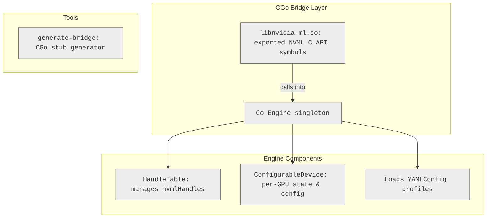
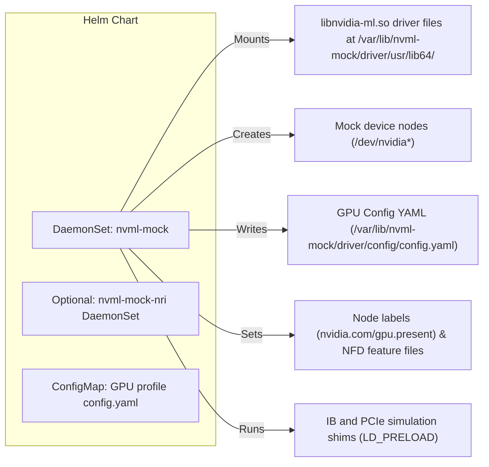
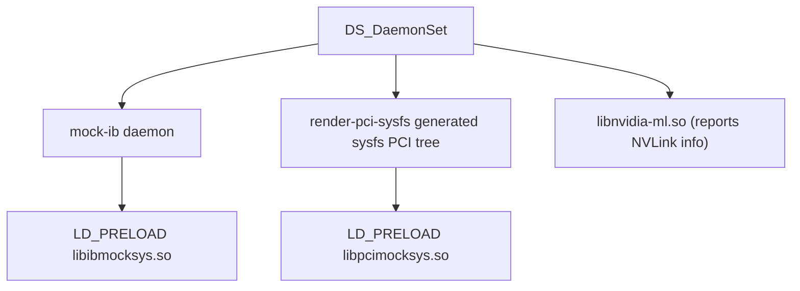
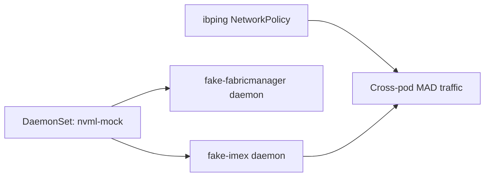
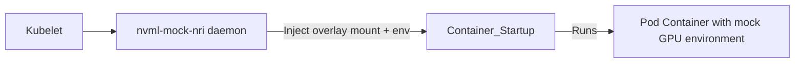

<!-- source: DeepWiki mcp.deepwiki.com · repo NVIDIA/k8s-test-infra · page 9 nvml-mock System · fetched 2026-10-26 -->

# nvml-mock System

<details>
<summary>Relevant source files</summary>

The following files were used as context for generating this wiki page:

- [deployments/nvml-mock/helm/nvml-mock/README.md](deployments/nvml-mock/helm/nvml-mock/README.md)
- [deployments/nvml-mock/helm/nvml-mock/templates/daemonset.yaml](deployments/nvml-mock/helm/nvml-mock/templates/daemonset.yaml)
- [deployments/nvml-mock/helm/nvml-mock/values.schema.json](deployments/nvml-mock/helm/nvml-mock/values.schema.json)
- [deployments/nvml-mock/helm/nvml-mock/values.yaml](deployments/nvml-mock/helm/nvml-mock/values.yaml)
- [deployments/nvml-mock/scripts/cleanup.sh](deployments/nvml-mock/scripts/cleanup.sh)
- [deployments/nvml-mock/scripts/setup.sh](deployments/nvml-mock/scripts/setup.sh)
- [docs/README.md](docs/README.md)
- [docs/architecture.md](docs/architecture.md)
- [docs/demo/kind.yaml](docs/demo/kind.yaml)
- [docs/demo/with-fgo/README.md](docs/demo/with-fgo/README.md)
- [docs/examples.md](docs/examples.md)
- [docs/integrations/fake-gpu-operator.md](docs/integrations/fake-gpu-operator.md)
- [docs/quickstart.md](docs/quickstart.md)
- [pkg/gpu/mocknvml/README.md](pkg/gpu/mocknvml/README.md)
- [pkg/gpu/mocknvml/bridge/padding.go](pkg/gpu/mocknvml/bridge/padding.go)

</details>


The **nvml-mock System** represents the core GPU simulation subsystem in the `k8s-test-infra` repository. It provides a sophisticated mock implementation of NVIDIA's NVML library and associated infrastructure, enabling comprehensive GPU simulation for Kubernetes testing environments without requiring real NVIDIA hardware. This simulation supports realistic device discovery, querying, and monitoring workflows, facilitating development and testing of GPU-aware Kubernetes components including device plugins, the Dynamic Resource Allocation (DRA) driver, GPU Operator, Node Feature Discovery (NFD), and other tooling.

This page offers a high-level overview of the nvml-mock system, summarizing its key components and how they interrelate. It serves as a parent to detailed child documents covering the implementation internals, configuration options, deployment via Helm, simulation of advanced GPU fabric features, node-wide injection, and runtime control utilities.

---

## Overview of nvml-mock

At its core, nvml-mock delivers a **mock NVML shared library** (`libnvidia-ml.so`) built with CGo and implemented in Go. When injected or deployed within Kubernetes pods, this library exposes a full NVML API surface that mimics real GPUs according to user-supplied YAML profiles (e.g., simulating A100, H100, GB200 GPUs). Key APIs like `nvidia-smi` and DCGM telemetry tools work transparently against the mock, enabling rich testing scenarios.

The GPU simulation is orchestrated via a **DaemonSet** deployed by a Helm chart, which runs on every Kubernetes node constituting the cluster. This DaemonSet mounts the mock library, creates device nodes, configures GPU profiles, and exposes node labels and NFD feature files to simulate NVIDIA GPU presence.

The mock system also optionally includes rich **failover and failure injection** modes to test edge cases, and supports **dynamic metrics** (e.g., temperature and utilization fluctuations) to simulate time-varying workloads.

Further, advanced subsystems simulate GPU fabric components like **NVLink, PCIe topology, InfiniBand (IB)**, and multi-node collective GPU communication fabrics (**ComputeDomain and IMEX**). These enable testing of GPU interconnect topologies and network-based resource management in multi-node clusters.

Ambient injection of the mock environment into arbitrary pod containers is supported via a **containerd NRI plugin**, allowing pods without explicit GPU resource requests to use the mock NVML library seamlessly. Runtime control of GPU device states is possible through a CLI (`nvml-mock-ctl`) that interacts over the established daemon.

The sections below briefly introduce each major sub-area, linking to respective child pages for comprehensive technical details.

---

## 1. Mock NVML Library Internals

The mock NVML library is implemented in Go with a **CGo bridge layer** that exposes the NVML C API symbols compatible with the real `libnvidia-ml.so`. This bridge delegates calls into an Engine singleton, which contains the state of all mock devices managed in a **HandleTable**. Each mock GPU is represented by a `ConfigurableDevice` struct holding its configuration and dynamic state updated from YAML profiles and runtime overrides.

A code-generation tool named `generate-bridge` automates the creation of the C-to-Go CGo signature mappings, ensuring scalability and consistency across ~400 NVML API calls.

The internals emphasize thread safety and concurrent access for accurate simulation of parallel NVML client workloads. The Engine also supports event emission, failure injection, and mixing static and dynamic GPU metrics.

For full technical details including class structure, concurrency model, and CGo interop patterns, see [Mock NVML Library Internals](#9.1).



_Sources:_
- `pkg/gpu/mocknvml/README.md:1-150`()

---

## 2. GPU Configuration and Profiles

GPU simulation is driven by YAML configuration profiles that declare device properties including memory size, power limits, PCI bus topology, clock rates, and supported features. Multiple built-in profiles exist, covering common hardware such as:

- `a100` (NVIDIA A100-SXM4-40GB)
- `h100` (NVIDIA H100 80GB HBM3)
- `b200`, `gb200`, `gb300` (Blackwell-series GPUs)
- `l40s` (Ada Lovelace L40S)
- `t4` (Turing Tesla T4)

The configuration structure includes a `system` section for driver versions, default device templates, and a list of `devices` with per-GPU overrides.

Dynamic simulation of **time-varying metrics** such as temperature, power draw, and utilization is available and can be enabled per field to better exercise consumers expecting fluctuating sensor data.

A robust **failure injection** subsystem allows deterministic or probabilistic simulation of GPU failures like device loss, "fallen off bus" events, and ECC uncorrectable errors, enabling fault-tolerant test scenarios.

Configuration resolution applies in the order: Helm chart defaults < GPU profile YAML < user overrides (e.g., via Helm or runtime CLI). This design guarantees the GPU simulation behaves as intended across various deployment contexts.

For in-depth documentation of YAML syntax, profile variants, and metric/failure injection mechanisms, refer to [GPU Configuration and Profiles](#9.2).

```mermaid
%% GPU Config and Profiles Mapping
graph LR
  H[Helm Chart Defaults]
  Y[GPU Profile YAML (a100, h100, gb200, ...)]
  U[User Overrides (runtime CLI)]
  H --> Y --> U --> E[Mock Engine Runtime State]
  E -->|feeds data| CD[ConfigurableDevice instances]
```

_Sources:_
- `deployments/nvml-mock/helm/nvml-mock/values.yaml:4-57`()
- `pkg/gpu/mocknvml/README.md:100-350`()

---

## 3. Helm Chart Deployment

nvml-mock provides a fully featured **Helm chart** to deploy the GPU mock system to Kubernetes clusters. The chart deploys a privileged **DaemonSet** that runs on all selected nodes and performs the following actions:

- Installs the mock NVML shared library at `/var/lib/nvml-mock/driver/usr/lib64/libnvidia-ml.so.*`
- Creates device nodes under `/var/lib/nvml-mock/driver/dev/nvidia*`
- Places the GPU configuration YAML at `/var/lib/nvml-mock/driver/config/config.yaml`
- Writes node labels like `nvidia.com/gpu.present=true` directly to the nodes
- Generates NFD (Node Feature Discovery) feature files for PCI vendor presence
- Creates fake PCI and InfiniBand sysfs trees with respective LD_PRELOAD shim injections
- Optionally launches auxiliary daemons like fake fabricmanager or nvidia-imex

The chart integrates with NVIDIA's Container Device Interface (CDI) to allow easy injection of the mock driver into pods, preserving the expected device environment.

When enabled via values, a **containerd NRI plugin** daemon runs on nodes to ambiently inject the overlay mount and environment variables into all containers, avoiding the need for explicit pod-level device requests or volume mounts.

Standard Helm features such as resource requests/limits, node selectors, tolerations, and update strategies are supported for cluster integration.

Host environment setup and cleanup are orchestrated by container entrypoint scripts `setup.sh` and `cleanup.sh`, which create device nodes, handle symbolic links, and manage node labels and feature files.

For detailed Helm values, chart structure, and deployment procedures, see [Helm Chart Deployment](#9.3).



_Sources:_
- `deployments/nvml-mock/helm/nvml-mock/README.md:1-135`()
- `deployments/nvml-mock/helm/nvml-mock/templates/daemonset.yaml:1-150`()
- `deployments/nvml-mock/scripts/setup.sh:1-250`()
- `deployments/nvml-mock/scripts/cleanup.sh:1-43`()
- `deployments/nvml-mock/helm/nvml-mock/values.yaml:4-60`()

---

## 4. NVLink, InfiniBand, and PCIe Simulation

Beyond simple GPU simulation, nvml-mock simulates complex GPU fabric topology components needed by advanced schedulers and dynamic resource allocation:

- A **mock-ib daemon** emulates InfiniBand Host Channel Adapters (HCAs) with user-space verbs and UMAD shims (`libibmocksys.so`) permitting tools like `ibstat`, `ibstatus`, and `iblinkinfo` to query fake HCAs
- The **render-pci-sysfs** tool fabricates a Linux PCI sysfs topology tree under `/var/lib/nvml-mock/sys` matched to the configured GPU PCI topology — enabling PCI-aware consumers to resolve GPU location and NUMA nodes accurately
- LD_PRELOAD wrappers (`libibmocksys.so`, `libpcimocksys.so`) redirect relevant system calls to the synthetic sysfs trees while forwarding others
- NVLink field values and attributes are included in the simulated GPUs' NVML reports, supporting user-space components requiring NVLink information

This subsystem provides realistic mimicking of fabric-level topology and device attributes critical for comprehensive multi-GPU and multi-node testing.

For technical design, shim implementations, and tool usage, see [NVLink, InfiniBand, and PCIe Simulation](#9.4).



_Sources:_
- `deployments/nvml-mock/helm/nvml-mock/README.md:18-24` (InfiniBand, PCI sysfs, shims)  
- `pkg/gpu/mocknvml/README.md` (overview of NVML APIs and topology)  

---

## 5. ComputeDomain and IMEX Simulation

For multi-node GPU fabric testing, nvml-mock includes a **ComputeDomain simulation**, modeling multi-node, multi-GPU interconnect fabrics such as NVSwitch linking multiple DGX-like nodes.

This involves:

- A **fake-imex daemon** simulating the NVIDIA IMEX (Interconnect Management EXchange) protocol enabling nodes to exchange fabric state and configuration
- The **imex-nogpu-shim** to emulate IMEX behavior when no real GPU hardware exists
- A **fake-fabricmanager** process providing readiness state and fabric management simulation
- An `ibping` network policy and daemon facilitate Multi-Access Device (MAD) traffic relay across pods, enabling multi-pod IMEX communication

This subsystem enables testing of GPU fabric management software, multi-node resource orchestration, and driver integration validating fabric readiness and topology convergence.

For architecture and operational details, see [ComputeDomain and IMEX Simulation](#9.5).



_Sources:_
- `deployments/nvml-mock/helm/nvml-mock/README.md:52-60` (imex ports in daemonset)
- Helm daemonset templates ownership and env vars

---

## 6. NRI Plugin for Node-Wide Injection

To facilitate transparent injection of the mock GPU simulation into all containers on a node, nvml-mock provides a **containerd NRI (Node Resource Interface) plugin** called `nvml-mock-nri`.

Key aspects:

- Runs as a sidecar-like process on each node, exposing health and readiness HTTP probes
- When enabled (`nri.enabled=true` in Helm), it appends the nvml-mock overlay mounts and environment variables (`LD_LIBRARY_PATH` pointing to mock `libnvidia-ml.so`) into newly created containers
- This allows plain pods without GPU resource requests or device mounts to run GPU-aware tools like `nvidia-smi` successfully against the mock driver
- Supports opt-out annotations and excluded namespaces for controlled injection
- Helps demonstrate or test node-wide GPU simulation scenarios without pod spec mutation

The plugin is opt-in due to its cluster-wide injection scope and requires containerd configured with NRI enabled. See [docs/demo/node-wide-injection](../../docs/demo/node-wide-injection) for usage examples.

For a deep dive into plugin architecture, configuration flags, and injection mechanisms, see [NRI Plugin for Node-Wide Injection](#9.6).



_Sources:_
- `deployments/nvml-mock/helm/nvml-mock/values.yaml:110-150` (nri block)
- Helm daemonset.yaml env vars for NRI config

---

## 7. Runtime Control with nvml-mock-ctl

To adjust GPU simulation behavior at runtime without redeploying the DaemonSet or rebooting pods, nvml-mock includes a CLI tool called `nvml-mock-ctl`.

Features:

- Enables modification of device states, error injection, and configuration overrides in a live cluster
- Uses a `config_override` YAML file written atomically to a well-known host path that the mock engine monitors (`/var/lib/nvml-mock/driver/config/overrides.yaml`)
- Overrides can selectively adjust specific GPUs or global behavior to simulate failure or state transitions
- Designed to integrate with E2E test scenarios (`scenario_runtime_control`) to validate error handling paths and crash recovery

This facility enhances testing realism and flexibility by manipulating the simulated GPU environment dynamically without full pod lifecycle operations.

For usage patterns, CLI options, and API details, see [Runtime Control with nvml-mock-ctl](#9.7).

```mermaid
%% Runtime Control Interaction Model
graph LR
  Admin[nvml-mock-ctl CLI]
  Admin -->|Writes overrides| Overrides_File[/var/lib/nvml-mock/driver/config/overrides.yaml]
  DaemonSet --> MockEngine[Mock NVML Engine]
  MockEngine -->|Reloads overrides| Overrides_File
```

_Sources:_
- Child page summary from TOC (implied)

---

# Summary

The **nvml-mock System** is a comprehensive and configurable GPU simulation framework designed to replace NVIDIA hardware with a software mock enabling full-stack testing of GPU-aware Kubernetes components. It centralizes:

- The mock NVML library and CGo bridge
- Flexible YAML-driven GPU profiles and dynamic behavior
- A Kubernetes DaemonSet deployment via Helm that sets up device nodes, libraries, PCI/IB topology, and node labels
- Advanced fabric simulation subsystems for multi-node GPU cluster realism
- Node-wide ambient injection via containerd NRI plugins
- Runtime control utilities for fault injection and scenario testing

Together, these components enable robust, scalable, and realistic GPU testing environments without physical GPUs. To gain in-depth technical understanding, please consult the respective child pages dedicated to each subsystem:

- [Mock NVML Library Internals](#9.1)
- [GPU Configuration and Profiles](#9.2)
- [Helm Chart Deployment](#9.3)
- [NVLink, InfiniBand, and PCIe Simulation](#9.4)
- [ComputeDomain and IMEX Simulation](#9.5)
- [NRI Plugin for Node-Wide Injection](#9.6)
- [Runtime Control with nvml-mock-ctl](#9.7)

---

# References

| Document | Description |
|---------|--------------|
| `deployments/nvml-mock/helm/nvml-mock/README.md` | Helm chart overview and quick start |
| `deployments/nvml-mock/helm/nvml-mock/values.yaml` | Helm default values including GPU profile config |
| `deployments/nvml-mock/helm/nvml-mock/templates/daemonset.yaml` | DaemonSet resource and env var templating |
| `deployments/nvml-mock/scripts/setup.sh` and `cleanup.sh` | Host environment setup and teardown scripts |
| `pkg/gpu/mocknvml/README.md` | Mock NVML library design, profiles, and usage |
| `docs/examples.md` | Usage examples for mock NVML |
| `docs/integrations/fake-gpu-operator.md` | Integration with Run:ai fake-gpu-operator |

---

*This page is part of the [k8s-test-infra](https://github.com/NVIDIA/k8s-test-infra) technical wiki.*

---

