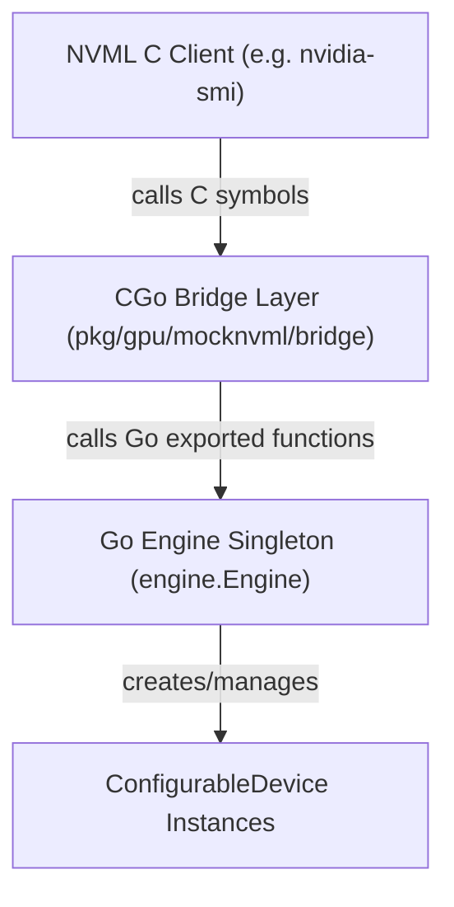
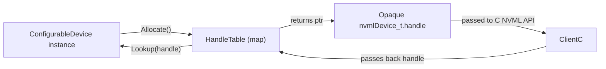
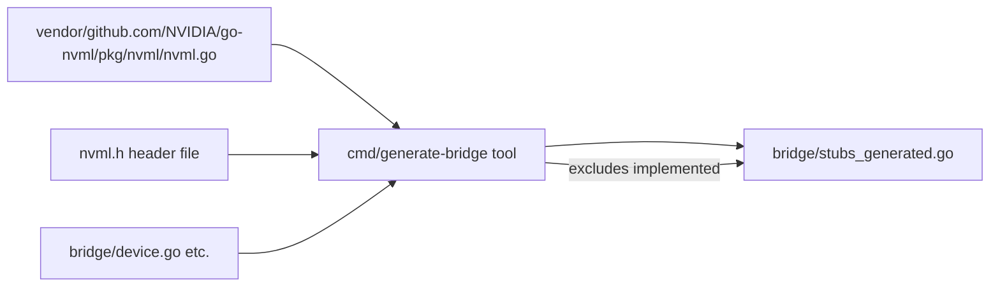
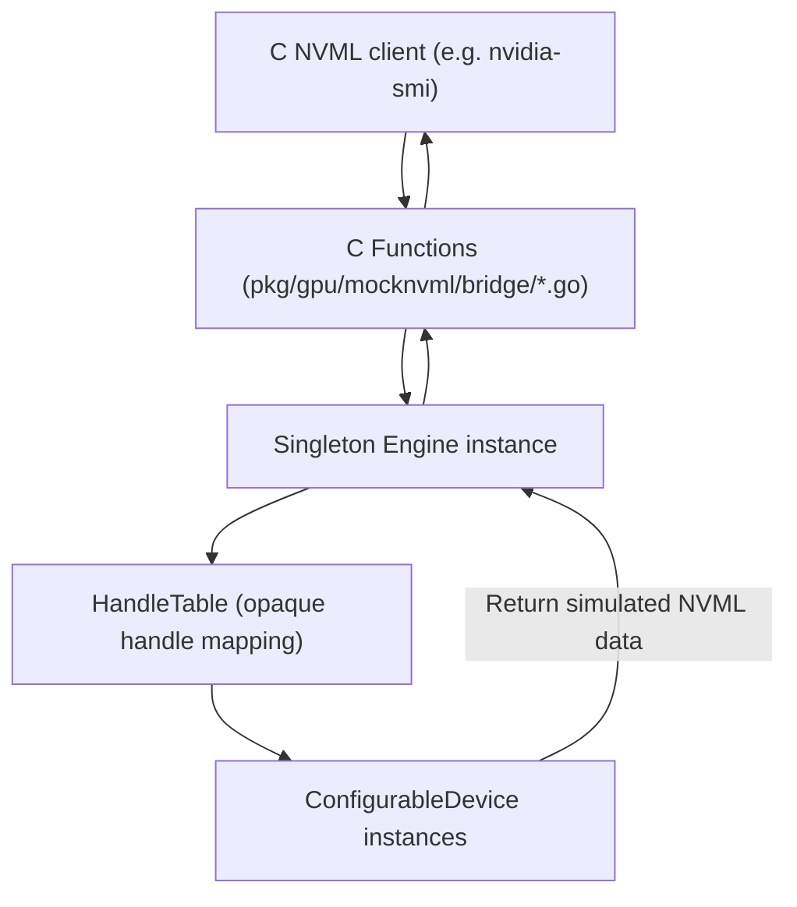
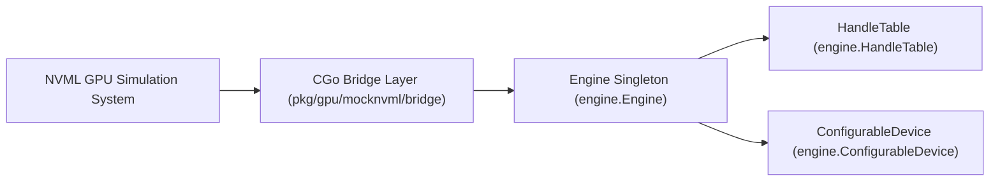
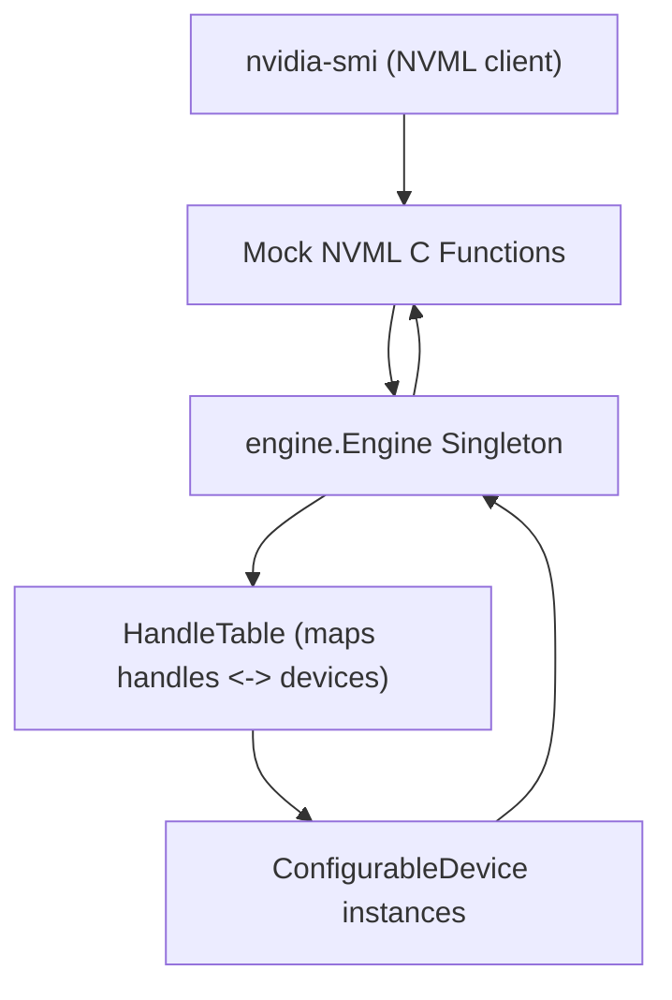

<!-- source: DeepWiki mcp.deepwiki.com · repo NVIDIA/k8s-test-infra · page 9.1 Mock NVML Library Internals · fetched 2026-10-26 -->

# 9.1 Mock NVML Library Internals

<details>
<summary>Relevant source files</summary>

The following files were used as context for generating this wiki page:

- [cmd/generate-bridge/main.go](cmd/generate-bridge/main.go)
- [cmd/generate-bridge/main_test.go](cmd/generate-bridge/main_test.go)
- [cmd/generate-bridge/parser.go](cmd/generate-bridge/parser.go)
- [pkg/gpu/mockcuda/bridge/cuda.go](pkg/gpu/mockcuda/bridge/cuda.go)
- [pkg/gpu/mockcuda/bridge/cuda_types.h](pkg/gpu/mockcuda/bridge/cuda_types.h)
- [pkg/gpu/mockcuda/bridge/helpers.go](pkg/gpu/mockcuda/bridge/helpers.go)
- [pkg/gpu/mockcuda/engine/cuda.go](pkg/gpu/mockcuda/engine/cuda.go)
- [pkg/gpu/mockcuda/engine/cuda_test.go](pkg/gpu/mockcuda/engine/cuda_test.go)
- [pkg/gpu/mockcuda/engine/types.go](pkg/gpu/mockcuda/engine/types.go)
- [pkg/gpu/mocknvml/bridge/cgo_types.go](pkg/gpu/mocknvml/bridge/cgo_types.go)
- [pkg/gpu/mocknvml/bridge/device.go](pkg/gpu/mocknvml/bridge/device.go)
- [pkg/gpu/mocknvml/bridge/fieldvalues.go](pkg/gpu/mocknvml/bridge/fieldvalues.go)
- [pkg/gpu/mocknvml/bridge/helpers.go](pkg/gpu/mocknvml/bridge/helpers.go)
- [pkg/gpu/mocknvml/bridge/init.go](pkg/gpu/mocknvml/bridge/init.go)
- [pkg/gpu/mocknvml/bridge/internal.go](pkg/gpu/mocknvml/bridge/internal.go)
- [pkg/gpu/mocknvml/bridge/nvml_types.h](pkg/gpu/mocknvml/bridge/nvml_types.h)
- [pkg/gpu/mocknvml/bridge/stubs_generated.go](pkg/gpu/mocknvml/bridge/stubs_generated.go)
- [pkg/gpu/mocknvml/bridge/system.go](pkg/gpu/mocknvml/bridge/system.go)
- [pkg/gpu/mocknvml/engine/config_test.go](pkg/gpu/mocknvml/engine/config_test.go)
- [pkg/gpu/mocknvml/engine/device.go](pkg/gpu/mocknvml/engine/device.go)
- [pkg/gpu/mocknvml/engine/device_test.go](pkg/gpu/mocknvml/engine/device_test.go)
- [pkg/gpu/mocknvml/engine/engine.go](pkg/gpu/mocknvml/engine/engine.go)
- [pkg/gpu/mocknvml/engine/engine_test.go](pkg/gpu/mocknvml/engine/engine_test.go)
- [pkg/gpu/mocknvml/engine/field_values.go](pkg/gpu/mocknvml/engine/field_values.go)
- [pkg/gpu/mocknvml/engine/field_values_test.go](pkg/gpu/mocknvml/engine/field_values_test.go)
- [pkg/gpu/mocknvml/engine/handles.go](pkg/gpu/mocknvml/engine/handles.go)
- [pkg/gpu/mocknvml/engine/handles_test.go](pkg/gpu/mocknvml/engine/handles_test.go)
- [pkg/gpu/mocknvml/engine/version.go](pkg/gpu/mocknvml/engine/version.go)
- [pkg/gpu/mocknvml/engine/version_test.go](pkg/gpu/mocknvml/engine/version_test.go)
- [tests/e2e/device-plugin-mock.yaml](tests/e2e/device-plugin-mock.yaml)
- [tests/e2e/kind-dra-config.yaml](tests/e2e/kind-dra-config.yaml)

</details>


This page provides an in-depth technical overview of the internal implementation of the nvml-mock system within the k8s-test-infra project. It explains how the mock NVML C library is bridged into Go with CGo, describing the core singleton `Engine`, the `HandleTable` for opaque device handle management, the `ConfigurableDevice` that simulates GPU devices with YAML-based configuration, and the `generate-bridge` code generator that scaffolds NVML function bindings. This documentation also clarifies the overall C-to-Go interoperability architecture enabling a fully functional NVML mock that integrates seamlessly with NVIDIA tooling and Kubernetes testing.

---

## Purpose and Scope

The nvml-mock system simulates NVIDIA's NVML GPU management library. It replaces the real NVML shared library with a mock implementation capable of simulating multiple devices, device topology, and dynamic state. This allows testing GPU-aware Kubernetes infrastructure components such as Node Feature Discovery (NFD), Dynamic Resource Allocation (DRA), and container runtimes without requiring real GPUs.

Core internals covered in this section:

- The CGo bridge layer exposing the NVML C API to Go
- `Engine` as the singleton managing the lifecycle and device simulation
- `HandleTable` managing opaque NVML device handles
- `ConfigurableDevice` representing a YAML-configurable GPU device instance
- The `generate-bridge` tool automating NVML stub function generation

Detailed explanations span implementation design, data flow, and key functions, alongside structural diagrams mapping concepts to code artifacts.

---

## 1. CGo Bridge Layer

### Overview

The bridge is implemented in the `pkg/gpu/mocknvml/bridge` directory. It exposes NVML C API functions as C symbols that internally delegate to Go functions. 

- The main bridge files (e.g., `device.go`) contain hand-written CGo-exported functions for a subset of NVML APIs, such as `nvmlDeviceGetCount_v2`, `nvmlDeviceGetHandleByIndex_v2`, `nvmlDeviceGetFieldValues`, etc.
- Unimplemented NVML functions are stubbed out automatically in `stubs_generated.go` by the `generate-bridge` tool.
- Type compatibility with real NVML is ensured through internal `nvml_types.h` copied from the real NVML headers, preventing ABI incompatibility.
- Helper routines in `helpers.go` handle error string caching, return code conversion, and common patterns such as version checking and stubbing behavior.

### Key Bridge Functions

- `nvmlDeviceGetCount_v2`: Returns the number of simulated devices by delegating to the singleton Engine (bridge/device.go:117-127).
- `nvmlDeviceGetHandleByIndex_v2`: Resolves a device handle pointer by index (bridge/device.go:143-158).
- `nvmlDeviceGetFieldValues`: Marshals field queries from C into Go, asks the configured device for field values, and writes data back into C structs for `nvidia-smi` compatibility (bridge/fieldvalues.go:73-116).
- `nvmlErrorString`: Caches and returns static C strings for NVML errors matching real NVML semantics (bridge/helpers.go:164-167).
- Stub functions: Return `NVML_ERROR_NOT_SUPPORTED` for NVML calls not implemented yet, supporting graceful degradation (bridge/stubs_generated.go).

The bridge therefore acts as a C ABI compatible layer forwarding NVML calls into the Go-based simulation engine.



**Sources:**  
`pkg/gpu/mocknvml/bridge/device.go:96-194`,  
`pkg/gpu/mocknvml/bridge/fieldvalues.go:73-116`,  
`pkg/gpu/mocknvml/bridge/helpers.go:164-167`,  
`pkg/gpu/mocknvml/bridge/stubs_generated.go:1-150`  

---

## 2. Engine Singleton

### Purpose

The `Engine` struct in `pkg/gpu/mocknvml/engine/engine.go` is the central singleton orchestrating the lifecycle of the mock NVML library:

- Manages initialization (`Init()`) and shutdown (`Shutdown()`) state
- Creates and configures the mock server (`MockServer`), which wraps the dgxa100 base device simulation
- Holds a `HandleTable` which maps opaque C device handles to Go device instances
- Provides device lookup, enumeration, and configuration management APIs requested by the C bridge layer

### Creation and Lifecycle

- The singleton instance is lazy-initialized on first call to `GetEngine()` (engine.go:43-49).
- `Init()` initializes the engine once. It creates a mock server based on configuration loaded either from environment, YAML file, or defaults.
- Device simulation instances (`ConfigurableDevice`) are created for each simulated GPU and stored in the server wrapper.
- During shutdown, resources and cached state are released.
- The engine also tracks GPU visibility filtering to simulate container device visibility.

### Device Creation Paths

- **YAML-based Configuration**: When a YAML config is loaded, devices are created with full per-device and node topology setup (engine.go:128-168).
- **Legacy Configuration**: When no YAML is present, default or environment variable based device count and addresses are used (engine.go:174-203).

### Key Engine Functions

- `DeviceGetCount()`: Returns device count (engine.go:211-219).
- `DeviceGetHandleByIndex(i int)`: Returns opaque handle pointer by device index.
- `LookupDevice(handle unsafe.Pointer)`: Converts opaque handle to a Go device instance or returns an invalid sentinel.
- `GetConfig()`: Returns current configuration including driver version and device count.

```mermaid
%% Title: Engine Singleton Relationships
classDiagram
  class Engine {
    +config *Config
    +server *MockServer
    +handles *HandleTable
    +initCount int
    +Init() nvml.Return
    +Shutdown() nvml.Return
    +DeviceGetCount() (int, nvml.Return)
    +DeviceGetHandleByIndex(int) (unsafe.Pointer, nvml.Return)
    +LookupDevice(unsafe.Pointer) nvml.Interface
  }
  class MockServer {
    +Server dgxa100.Server
    +configurableDevices [ConfigurableDevice]
    +DeviceGetCountFunc func() (int, nvml.Return)
    ...
  }
  class HandleTable {
    +Allocate(v interface{}) unsafe.Pointer
    +Lookup(handle unsafe.Pointer) interface{}
    +Free(handle unsafe.Pointer)
  }
  class ConfigurableDevice {
    ...
  }

  Engine "1" --> "1" MockServer
  Engine "1" --> "1" HandleTable
  MockServer "1" --> "*" ConfigurableDevice
```

**Sources:**  
`pkg/gpu/mocknvml/engine/engine.go:27-224`  
`pkg/gpu/mocknvml/engine/engine_test.go`  

---

## 3. HandleTable: Opaque Device Handle Management

### Purpose

NVML uses opaque pointers (`nvmlDevice_t`) as device handles. The mock system must simulate these while tracking Go device instances.

### Implementation

- The `HandleTable` (in `engine/handles.go`) provides allocation, lookup, and freeing of opaque handles.
- Internally, it uses a thread-safe mapping from opaque pointer values to Go interface{} objects representing devices.
- The table assigns a unique pointer value to each allocated device object, ensuring handles are stable across calls.
- On shutdown, handles are cleared.

This mechanism isolates the simulated device instances from clients only seeing opaque C handles.

**HandleTable API:**

- `Allocate(value interface{}) unsafe.Pointer`: Returns a unique opaque handle for the wrapped device.
- `Lookup(handle unsafe.Pointer) interface{}`: Returns the Go object associated with the handle.
- `Free(handle unsafe.Pointer)`: Removes the mapping (usually on engine shutdown).



**Sources:**  
`pkg/gpu/mocknvml/engine/handles.go`  
`pkg/gpu/mocknvml/engine/engine.go:33`  
`pkg/gpu/mocknvml/engine/engine_test.go`  

---

## 4. ConfigurableDevice: YAML-Configurable GPU Simulation

### Overview

`ConfigurableDevice` wraps the base mock device (`dgxa100.Device`) and adds advanced features for per-device YAML-driven configuration and dynamic simulation. This type implements `nvml.Interface` for simulated device API calls.

### Fields

- The embedded `*dgxa100.Device` provides core DGX A100 mock behavior and base NVML data.
- `baseConfig *DeviceConfig` stores the immutable YAML configuration base for this device.
- `effective atomic.Pointer[DeviceConfig]` stores the current merged config including overrides, refreshed on demand.
- Cached fields include PCI info (`pciInfo`), BAR1 aperture memory (`bar1Memory`).
- Pointers to `dynamicMetricsSimulator` and `failureInjector` enable runtime simulation of dynamic metrics and failure injection.
- `refreshMu` mutex guards reconfiguration when new overrides are applied.

### Construction

- The constructor `NewConfigurableDevice` (engine/device.go:80-161) takes:
  - Device index and base device pointer
  - YAML device config merge base
  - UUID, PCI bus ID, minor number strings
  - The shared node-level `NodeFabric` topology structure
- It applies config overrides to the base device fields (name, architecture, brand, memory).
- Caches PCI info and BAR1 memory.
- Enables optional dynamic metrics simulation and failure injection.
- Initializes atomic effective config pointer.

### Config Override Refresh

- Config overrides are maintained as documented by a global `configOverrides` snapshot.
- `refresh()` recomputes and merges the effective config atomically only if the generation changes.
- It also updates failure injectors and dynamic metrics simulators as per config (engine/device.go:179-210).

### API Example Functions

- `cfg()`: Returns the current effective config for this device.
- `failureInjector()`: Returns the current failure injector after optional refresh.
- `GetPciInfo()`, `GetBAR1MemoryInfo()`: Return cached PCI and BAR1 information.
- `GetComputeRunningProcesses()`, `GetGraphicsRunningProcesses()`: Return simulated empty lists or configured process states.

```mermaid
%% Title: ConfigurableDevice Configuration Refresh Flow
flowchart TD
  Device[ConfigurableDevice]
  BaseCfg[baseConfig (YAML)]
  OverrideDoc[configOverrides snapshot]
  Merge[MergeDeviceConfig(baseConfig, override)]
  Effective[effective atomic.Pointer[DeviceConfig]]
  DynamicSim[dynamicMetricsSimulator]
  FailureInjector[failureInjector]

  Device --> BaseCfg
  OverrideDoc --> Merge
  BaseCfg --> Merge
  Merge --> Effective
  Effective --> Device
  Effective --> DynamicSim
  Effective --> FailureInjector
```

**Sources:**  
`pkg/gpu/mocknvml/engine/device.go:42-180`  
`pkg/gpu/mocknvml/engine/device_test.go`  

---

## 5. generate-bridge Code Generation Tool

### Purpose

Most NVML functions are generated automatically from the official Go NVML bindings and headers, saving handwritten boilerplate. The `cmd/generate-bridge` tool:

- Parses vendor-provided NVML Go source and C header files.
- Generates stub CGo-exported functions returning NOT_SUPPORTED errors.
- Allows selective handwritten overrides for critical functions in `bridge/device.go` and others.
- Removes stubs for implemented functions on regeneration.

### Effects in Codebase

- The generated file `bridge/stubs_generated.go` contains 282 stub functions returning `NVML_ERROR_NOT_SUPPORTED`.
- The build regenerates stubs automatically on source changes.
- Helps keep coverage consistent with the evolving NVML API while allowing incremental implementations.



**Sources:**  
`cmd/generate-bridge/main.go`  
`pkg/gpu/mocknvml/bridge/stubs_generated.go`  

---

## 6. C-to-Go Interoperability Architecture

### Data Flow

The mock NVML library pretends to be a NVIDIA shared object:

- It exports C symbols, built with `buildmode=c-shared`.
- Each exported C function forwards calls to Go functions in the Engine singleton.
- The Engine uses the HandleTable to map opaque C `nvmlDevice_t` handles to Go device instances.
- Calls to device methods (`ConfigurableDevice`) respond with simulated data from YAML or default values.
- Results are marshaled back into C ABI-compatible structs for callers like `nvidia-smi`.

### Memory and Safety

- The opaque `nvmlDevice_t` pointer is actually a pointer into Go-managed memory held by HandleTable.
- The bridge uses careful pointer conversions, avoiding unsafe integer round-trips.
- Field values returned via `nvmlDeviceGetFieldValues` require writing union fields via C helper functions to work around CGo union restrictions.
- Error strings returned by `nvmlErrorString` are cached C strings mimicking the behavior of the real NVML library.



---

## Summary

The nvml-mock internals implement a robust CGo bridge layer that fulfills the NVML C API while forwarding logic to a sophisticated singleton Engine written in Go. The Engine uses a HandleTable to isolate C-visible opaque handles from Go device instances modeled by `ConfigurableDevice`. These devices provide strong per-GPU configurability via YAML, supporting advanced simulation needs. The `generate-bridge` tool automates stub generation for unimplemented functions, enabling gradual coverage of the NVML API surface.

Together, these pieces enable a full NVML simulation environment that Kubernetes test drivers and GPU-aware tooling can interface with naturally and reliably.

---

# Additional Diagrams Bridging Natural Language to Code Entities





---

# References

- `pkg/gpu/mocknvml/bridge/device.go:96-194`  
- `pkg/gpu/mocknvml/bridge/fieldvalues.go:73-116`  
- `pkg/gpu/mocknvml/bridge/helpers.go:164-167`  
- `pkg/gpu/mocknvml/bridge/stubs_generated.go:1-150`  
- `pkg/gpu/mocknvml/engine/engine.go:27-224`  
- `pkg/gpu/mocknvml/engine/engine_test.go`  
- `pkg/gpu/mocknvml/engine/device.go:42-180`  
- `pkg/gpu/mocknvml/engine/device_test.go`  
- `cmd/generate-bridge/main.go`  
- `pkg/gpu/mocknvml/engine/handles.go`

---

