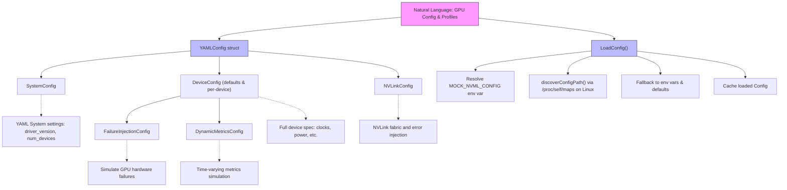
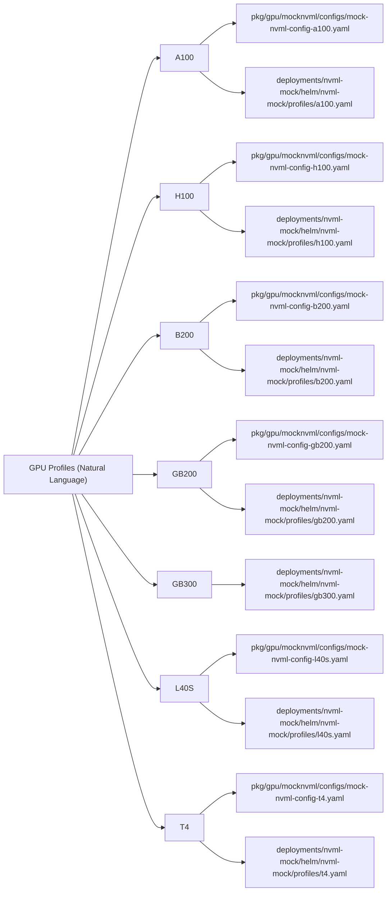

<!-- source: DeepWiki mcp.deepwiki.com · repo NVIDIA/k8s-test-infra · page 9.2 GPU Configuration and Profiles · fetched 2026-10-26 -->

# GPU Configuration and Profiles

<details>
<summary>Relevant source files</summary>

The following files were used as context for generating this wiki page:

- [deployments/nvml-mock/helm/nvml-mock/profiles/a100.yaml](deployments/nvml-mock/helm/nvml-mock/profiles/a100.yaml)
- [deployments/nvml-mock/helm/nvml-mock/profiles/b200.yaml](deployments/nvml-mock/helm/nvml-mock/profiles/b200.yaml)
- [deployments/nvml-mock/helm/nvml-mock/profiles/gb200.yaml](deployments/nvml-mock/helm/nvml-mock/profiles/gb200.yaml)
- [deployments/nvml-mock/helm/nvml-mock/profiles/h100.yaml](deployments/nvml-mock/helm/nvml-mock/profiles/h100.yaml)
- [deployments/nvml-mock/helm/nvml-mock/profiles/l40s.yaml](deployments/nvml-mock/helm/nvml-mock/profiles/l40s.yaml)
- [deployments/nvml-mock/helm/nvml-mock/profiles/t4.yaml](deployments/nvml-mock/helm/nvml-mock/profiles/t4.yaml)
- [docs/configuration.md](docs/configuration.md)
- [docs/development.md](docs/development.md)
- [pkg/gpu/mocknvml/configs/mock-nvml-config-a100.yaml](pkg/gpu/mocknvml/configs/mock-nvml-config-a100.yaml)
- [pkg/gpu/mocknvml/configs/mock-nvml-config-b200.yaml](pkg/gpu/mocknvml/configs/mock-nvml-config-b200.yaml)
- [pkg/gpu/mocknvml/configs/mock-nvml-config-gb200.yaml](pkg/gpu/mocknvml/configs/mock-nvml-config-gb200.yaml)
- [pkg/gpu/mocknvml/configs/mock-nvml-config-h100.yaml](pkg/gpu/mocknvml/configs/mock-nvml-config-h100.yaml)
- [pkg/gpu/mocknvml/configs/mock-nvml-config-l40s.yaml](pkg/gpu/mocknvml/configs/mock-nvml-config-l40s.yaml)
- [pkg/gpu/mocknvml/configs/mock-nvml-config-t4.yaml](pkg/gpu/mocknvml/configs/mock-nvml-config-t4.yaml)
- [pkg/gpu/mocknvml/engine/config.go](pkg/gpu/mocknvml/engine/config.go)
- [pkg/gpu/mocknvml/engine/config_types.go](pkg/gpu/mocknvml/engine/config_types.go)
- [pkg/gpu/mocknvml/engine/dynamic_metrics.go](pkg/gpu/mocknvml/engine/dynamic_metrics.go)
- [pkg/gpu/mocknvml/engine/failure_injector.go](pkg/gpu/mocknvml/engine/failure_injector.go)
- [pkg/gpu/mocknvml/engine/failure_injector_test.go](pkg/gpu/mocknvml/engine/failure_injector_test.go)
- [pkg/gpu/mocknvml/engine/nvlink_error_injection_test.go](pkg/gpu/mocknvml/engine/nvlink_error_injection_test.go)
- [pkg/gpu/mocknvml/engine/nvlink_fields.go](pkg/gpu/mocknvml/engine/nvlink_fields.go)

</details>


This section documents the GPU configuration and profile management within the `k8s-test-infra` repository, focusing on the mock NVML (NVIDIA Management Library) engine used to simulate GPUs for Kubernetes testing. It covers the structure of the YAML configuration (`YAMLConfig`), the loading and resolution order of configurations via `LoadConfig()`, available GPU profiles, the handling of dynamic metrics, and GPU failure injection features.

---

## 1. YAMLConfig Structure

At the core of the GPU simulation configuration is the `YAMLConfig` struct defined in the package `engine`. It represents the complete schema of a GPU simulation configuration described in YAML format.

```go
type YAMLConfig struct {
	Version        string           `json:"version"`
	System         SystemConfig     `json:"system"`
	DeviceDefaults DeviceConfig     `json:"device_defaults"`
	Devices        []DeviceOverride `json:"devices"`
	NVLink         *NVLinkConfig    `json:"nvlink,omitempty"`

	// PCIeTopology promotes the root-complex / NUMA layout (previously
	// consumed only by cmd/render-pci-sysfs) into the engine so NVLink
	// topology, pairwise PCIe levels, and CPU/NUMA affinity all derive
	// from the same facts. Optional; absent on PCIe-only profiles.
	PCIeTopology *PCIeTopologyConfig `json:"pcie_topology,omitempty"`
}
```

- `Version`: Config format version, typically "1.0".
- `System`: System-wide NVML settings such as driver version and CUDA version.
- `DeviceDefaults`: Global device properties applied to all devices unless overridden.
- `Devices`: Per-device configurations to override defaults on a device-by-device basis.
- `NVLink`: NVLink fabric-related configuration.
- `PCIeTopology`: Optional topology information defining PCIe root complex and NUMA layout for realistic simulation.

The nested structs `SystemConfig` and `DeviceConfig` cover detailed aspects of GPU simulation.

`SystemConfig` includes:

- `DriverVersion`: Driver version string.
- `NVMLVersion`: NVML interface version.
- `CUDAVersion`, `CUDAVersionMajor`, and `CUDAVersionMinor`: CUDA runtime versions.
- `NumDevices`: The number of devices simulated (optional override).

`DeviceConfig` is a large struct modeling comprehensive GPU characteristics:

- Identification fields like `Name`, `Brand`, `Serial`, etc.
- Architecture details including `Architecture`, `ComputeCapability`, `NumGPUCores`.
- Memory and BAR1 memory configuration (`MemoryConfig`, `BAR1MemoryConfig`).
- PCI and PCIe configurations.
- Power, thermal, and fan settings.
- Clock configurations and supported clocks.
- Performance, utilization, and encoder/decoder statistics.
- ECC status and error counts.
- Display modes and MIG (Multi-Instance GPU) settings.
- Advanced features like GPU Operation Mode, Driver Model, Accounting, Virtualization.
- Blackwell-specific features and Grace Superchip configurations for newer GPUs.
- GPU topology and simulated running processes.
- Dynamic metrics for time-varying temperature, power, and utilization.
- GPU Performance Monitoring (GPM) configuration.
- Failure injection settings for simulating hardware faults.
- NVLink fabric and error injection information.

This rich configurability enables precise simulation of various GPU models and their operational characteristics.

Sources: `pkg/gpu/mocknvml/engine/config_types.go:16-162`(), `docs/configuration.md:33-304`()

---

## 2. LoadConfig Function and Configuration Resolution

The function `LoadConfig()` orchestrates the retrieval and loading of the GPU simulation configuration. Its design supports flexible resolution across explicit YAML files, implicit discovery, and environment variable fallbacks.

### Resolution Order

1. **Explicit YAML file via `MOCK_NVML_CONFIG`**:  
   The environment variable `MOCK_NVML_CONFIG` sets the path to a YAML config file. If set, that file is loaded and parsed.

2. **Auto-discovery on Linux**:  
   If no explicit config path is set, on Linux systems, the config file is **auto-discovered** by reading `/proc/self/maps` to identify the loaded path of the Mock NVML shared library `.so` file (`libnvidia-ml.so`). Assuming a typical driver installation layout, the code navigates relative parent paths to locate `config/config.yaml` near the driver root.

3. **Environment variables and defaults**:  
   If no YAML config can be loaded, the system falls back to environment variables and default values. Specifically:
   - `MOCK_NVML_NUM_DEVICES` overrides the number of simulated GPUs.
   - `MOCK_NVML_DRIVER_VERSION` overrides the driver version string.
   - Defaults to 8 devices and driver version `"550.163.01"` if nothing else is specified.

### Caching

`LoadConfig()` caches the loaded configuration keyed by the config path to avoid repeated loads in long-running processes. The cache is protected by a mutex.

### Core LoadConfig Logic (simplified):

```go
func LoadConfig() *Config {
	configPath := os.Getenv("MOCK_NVML_CONFIG")
	if configPath == "" {
		configPath = discoverConfigPath()
	}

	configCacheMu.Lock()
	defer configCacheMu.Unlock()

	if configCache != nil && configCachePath == configPath {
		return configCache
	}

	config := DefaultConfig()

	if configPath != "" {
		yamlConfig, err := LoadYAMLConfig(configPath)
		// On error, fallback to defaults; else apply YAML config
		if err == nil {
			config.YAMLConfig = yamlConfig
			config.DriverVersion = yamlConfig.System.DriverVersion
			config.NumDevices = len(yamlConfig.Devices)
			if config.NumDevices == 0 {
				config.NumDevices = 8
			}
			if yamlConfig.System.NumDevices > 0 {
				config.NumDevices = yamlConfig.System.NumDevices
			}

			// Apply topology overlay from cluster config for multi-node fabric...

			configCache = config
			configCachePath = configPath
			return config
		}
	}

	// Fallback to environment variables
	if num := os.Getenv("MOCK_NVML_NUM_DEVICES"); num != "" {
		if val, err := strconv.Atoi(num); err == nil && val >= 0 {
			config.NumDevices = val
		}
	}

	if ver := os.Getenv("MOCK_NVML_DRIVER_VERSION"); ver != "" {
		config.DriverVersion = ver
	}

	configCache = config
	configCachePath = configPath
	return config
}
```

### discoverConfigPath

On Linux, the `discoverConfigPath()` function reads `/proc/self/maps` to find the path of the loaded `.so` file and navigates to `config/config.yaml`. This relies on standard NVIDIA driver directory layout. If no file exists, it returns empty.

### Overrides

There is also support for runtime override files via `MOCK_NVML_OVERRIDES` or `overrides.yaml` adjacent to the main YAML config.

Sources: `pkg/gpu/mocknvml/engine/config.go:61-141`(), `pkg/gpu/mocknvml/engine/config.go:156-210`(), `docs/configuration.md:5-39`()

---

## 3. GPU Profiles

The repository provides several pre-made YAML configuration profiles representing distinct NVIDIA GPU models, supplied as examples for testing.

Each profile is a complete YAML file that fully specifies system and device parameters to enable realistic simulation matching real hardware behavior. They can be referenced using `MOCK_NVML_CONFIG` or Helm chart values for deployment.

The primary profiles are:

| Profile Name | Description                          | Location                          |
|--------------|----------------------------------|---------------------------------|
| **a100**    | NVIDIA A100 SXM4 40GB               | `pkg/gpu/mocknvml/configs/mock-nvml-config-a100.yaml` <br> `deployments/nvml-mock/helm/nvml-mock/profiles/a100.yaml` |
| **h100**    | NVIDIA H100 80GB HBM3 (Hopper)      | `pkg/gpu/mocknvml/configs/mock-nvml-config-h100.yaml` <br> `deployments/nvml-mock/helm/nvml-mock/profiles/h100.yaml` |
| **b200**    | NVIDIA B200 (single GPU Blackwell)  | `pkg/gpu/mocknvml/configs/mock-nvml-config-b200.yaml` <br> `deployments/nvml-mock/helm/nvml-mock/profiles/b200.yaml` |
| **gb200**   | NVIDIA GB200 Grace-Blackwell Superchip | `pkg/gpu/mocknvml/configs/mock-nvml-config-gb200.yaml` <br> `deployments/nvml-mock/helm/nvml-mock/profiles/gb200.yaml` |
| **gb300**   | NVIDIA GB300 Grace-Blackwell variant (not shown in sample) | `deployments/nvml-mock/helm/nvml-mock/profiles/gb300.yaml` |
| **l40s**    | NVIDIA L40S (not shown in sample)    | `pkg/gpu/mocknvml/configs/mock-nvml-config-l40s.yaml` <br> `deployments/nvml-mock/helm/nvml-mock/profiles/l40s.yaml` |
| **t4**      | NVIDIA T4                            | `pkg/gpu/mocknvml/configs/mock-nvml-config-t4.yaml` <br> `deployments/nvml-mock/helm/nvml-mock/profiles/t4.yaml` |

### Profile Contents

Profiles mirror real GPU configurations including:

- CUDA cores, architecture (`ampere`, `hopper`, `blackwell`).
- ECC modes and errors configuration.
- Power and thermal operational parameters.
- Memory sizes (HBM2/3, BAR1 memory).
- PCI and PCIe link configurations.
- Dynamic clock speeds and performance states.
- NVLink fabric and topology for multi-GPU systems.
- Firmware and virtualization settings.

For example, the GB200 profile provides a high-power Grace Superchip simulation with 192 GiB of HBM3e memory, PCIe Gen6 support, and detailed fabric health status.

Profiles are extensively documented in YAML with comments describing each section and typical realistic values.

Sources:  
Profile YAML files `pkg/gpu/mocknvml/configs/*.yaml` and related Helm profile files `deployments/nvml-mock/helm/nvml-mock/profiles/*.yaml`. See:  
- `pkg/gpu/mocknvml/configs/mock-nvml-config-gb200.yaml` (lines 1-11383)  
- `deployments/nvml-mock/helm/nvml-mock/profiles/gb200.yaml` (lines 1-11383)  
- `pkg/gpu/mocknvml/configs/mock-nvml-config-h100.yaml` (lines 1-8523)  
- `deployments/nvml-mock/helm/nvml-mock/profiles/h100.yaml` (lines 1-9287)  
- `pkg/gpu/mocknvml/configs/mock-nvml-config-b200.yaml` (lines 1-7469)  
- `deployments/nvml-mock/helm/nvml-mock/profiles/b200.yaml` (lines 1-8410)  
- `docs/configuration.md`  

---

## 4. Dynamic Metrics

`DynamicMetrics` enables time-varying simulation for GPU telemetry parameters such as temperature, power draw, and utilization percentages, allowing the mock to simulate fluctuating values rather than static snapshots.

Defined inside the `DeviceConfig`:

```go
DynamicMetrics *DynamicMetricsConfig `json:"dynamic_metrics,omitempty"`
```

When `nil` (default), static values directly from the other config fields are returned on queries.

The dynamic configuration supports base values and variance ranges which the engine uses (likely with timers or sampling) to generate simulated time-varying metrics for:

- GPU temperature
- Power consumption
- Utilization statistics

This enriches testing by enabling more realistic monitoring and telemetry behaviors.

Note that in profiles like the GB200 Helm profile there is also a `dynamic_metrics_defaults` key at the top-level YAML, which is used by the Helm chart for default dynamic metrics but ignored internally by the engine.

Sources:  
- `pkg/gpu/mocknvml/engine/config_types.go:138-141`()  
- `deployments/nvml-mock/helm/nvml-mock/profiles/gb200.yaml:17-23`  
- `docs/configuration.md:17-24` (dynamic metrics mention)  

---

## 5. GPU Failure Injection Configuration

Mock NVML supports injective simulation of GPU failures such as device lost, fallen-off-bus errors, uncorrectable ECC errors, and Xid errors. This enhances test coverage for error handling in consumers like GPU Operators or node-level tooling.

The failures are controlled by the `FailureInjectionConfig` struct embedded in `DeviceConfig` under the `Failure` field.

```go
Failure *FailureInjectionConfig `json:"failure,omitempty"`
```

### Key Behavior

- When `Failure` is `nil` or absent, the device behaves as healthy hardware.
- When populated, various failure conditions can be triggered in the simulated GPU state.
- Failure injection interacts with NVLink error injection to simulate link errors at the device fabric-level.

### NVLink Error Injection

- `NVLinkErrorInjectionConfig` allows per-link NVLink data-link error accrual simulation.
- Simulates rising error counters seen by monitoring tools, triggering health events in DCGM and NVSentinel.
- Supports filters to inject errors into specific NVLink links.
- Can simulate healthy links, zero error rates to "heal" devices, or injecting error rates in errors/second.
- Ensures inactive links (meaning not present physically) do not receive errors.

### Validation Tests

- Unit tests verify monotonic error counter accrual over time for injected error rates.
- Tests verify no errors are reported if no injection configured.
- Tests confirm that filtered injections affect only targeted links.
- Tests confirm error counter fields exposed as NVML field values.

Sources:  
- `pkg/gpu/mocknvml/engine/config_types.go:148-161` (Failure and NVLinkErrorInjectionConfig fields)  
- `pkg/gpu/mocknvml/engine/nvlink_error_injection_test.go:13-154` (failure injection tests)  
- `docs/configuration.md` (failure injection usage referenced in the DeviceConfig section)  

---

## 6. System Overview Diagram

Below is a mermaid diagram bridging natural language concepts of GPU simulation configuration to the main code entities:



Sources:  
- `pkg/gpu/mocknvml/engine/config.go:61-141`  
- `pkg/gpu/mocknvml/engine/config_types.go:16-162`  

---

## 7. GPU Profiles and Their Code Location Diagram

This diagram links the profile names from natural language with their YAML file code locations in the codebase, emphasizing the uniform structure and usage.



Sources:  
- `pkg/gpu/mocknvml/configs/mock-nvml-config-*.yaml` files  
- `deployments/nvml-mock/helm/nvml-mock/profiles/*.yaml`  

---

## Summary

- **YAMLConfig** is the extensible top-level structure defining simulation details for the mock NVML engine.
- **LoadConfig()** resolves config using explicit env var, auto-discovery, or default environment variables, caching results for efficiency.
- **GPU Profiles** are pre-built comprehensive YAML files simulating specific NVIDIA GPU models for testing.
- **DynamicMetrics** enables simulation of time-varying telemetry parameters.
- **Failure Injection** provides simulation for GPU hardware errors and NVLink link faults, useful for robust testing of error handling.

This configuration system enables accurate and flexible GPU simulations supporting the Kubernetes test infrastructure, especially within the nvml-mock project.

---

### References

| Topic                  | Location                                    |
|------------------------|---------------------------------------------|
| YAMLConfig struct      | `pkg/gpu/mocknvml/engine/config_types.go:16-162` |
| LoadConfig logic       | `pkg/gpu/mocknvml/engine/config.go:61-141`  |
| Config auto-discovery  | `pkg/gpu/mocknvml/engine/config.go:156-210` |
| GPU Profiles (example) | multiple YAML files under `pkg/gpu/mocknvml/configs/` and Helm profiles `deployments/nvml-mock/helm/nvml-mock/profiles/` |
| Dynamic Metrics        | `pkg/gpu/mocknvml/engine/config_types.go:138-141`   |
| Failure Injection      | `pkg/gpu/mocknvml/engine/config_types.go:148-161` and `pkg/gpu/mocknvml/engine/nvlink_error_injection_test.go` |
| Configuration Reference | `docs/configuration.md`                      |
| Development Guide       | `docs/development.md`                        |

---

End of Section 9.2: GPU Configuration and Profiles

---

