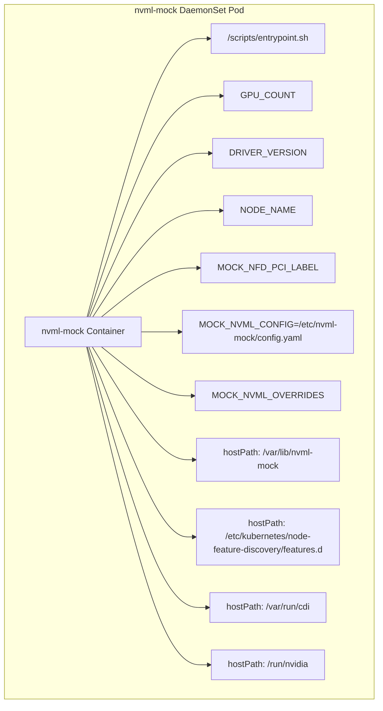
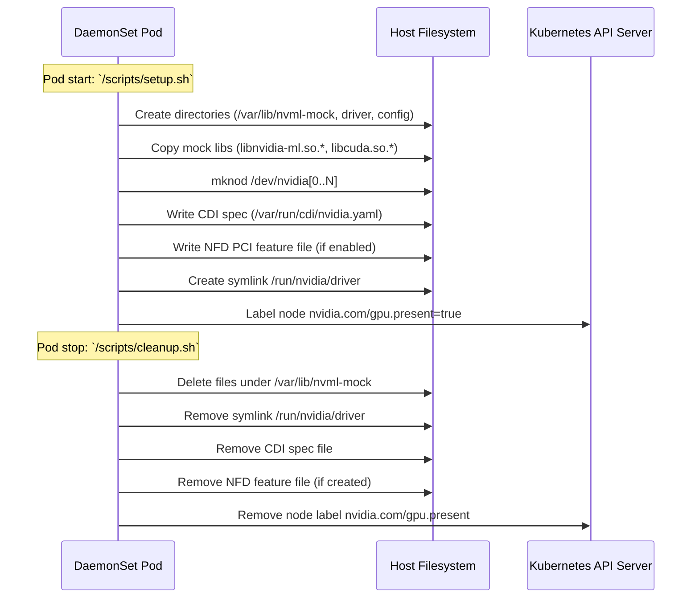

<!-- source: DeepWiki mcp.deepwiki.com · repo NVIDIA/k8s-test-infra · page 9.3 Helm Chart Deployment · fetched 2026-10-26 -->

# Helm Chart Deployment

<details>
<summary>Relevant source files</summary>

The following files were used as context for generating this wiki page:

- [CHANGELOG.md](CHANGELOG.md)
- [deployments/nvml-mock/helm/nvml-mock/Chart.yaml](deployments/nvml-mock/helm/nvml-mock/Chart.yaml)
- [deployments/nvml-mock/helm/nvml-mock/README.md](deployments/nvml-mock/helm/nvml-mock/README.md)
- [deployments/nvml-mock/helm/nvml-mock/templates/NOTES.txt](deployments/nvml-mock/helm/nvml-mock/templates/NOTES.txt)
- [deployments/nvml-mock/helm/nvml-mock/templates/_helpers.tpl](deployments/nvml-mock/helm/nvml-mock/templates/_helpers.tpl)
- [deployments/nvml-mock/helm/nvml-mock/templates/daemonset.yaml](deployments/nvml-mock/helm/nvml-mock/templates/daemonset.yaml)
- [deployments/nvml-mock/helm/nvml-mock/templates/integrations-fgo.yaml](deployments/nvml-mock/helm/nvml-mock/templates/integrations-fgo.yaml)
- [deployments/nvml-mock/helm/nvml-mock/tests/__snapshot__/configmap_test.yaml.snap](deployments/nvml-mock/helm/nvml-mock/tests/__snapshot__/configmap_test.yaml.snap)
- [deployments/nvml-mock/helm/nvml-mock/tests/__snapshot__/daemonset_test.yaml.snap](deployments/nvml-mock/helm/nvml-mock/tests/__snapshot__/daemonset_test.yaml.snap)
- [deployments/nvml-mock/helm/nvml-mock/tests/__snapshot__/notes_test.yaml.snap](deployments/nvml-mock/helm/nvml-mock/tests/__snapshot__/notes_test.yaml.snap)
- [deployments/nvml-mock/helm/nvml-mock/tests/__snapshot__/rbac_test.yaml.snap](deployments/nvml-mock/helm/nvml-mock/tests/__snapshot__/rbac_test.yaml.snap)
- [deployments/nvml-mock/helm/nvml-mock/tests/configmap_test.yaml](deployments/nvml-mock/helm/nvml-mock/tests/configmap_test.yaml)
- [deployments/nvml-mock/helm/nvml-mock/tests/daemonset_test.yaml](deployments/nvml-mock/helm/nvml-mock/tests/daemonset_test.yaml)
- [deployments/nvml-mock/helm/nvml-mock/tests/notes_test.yaml](deployments/nvml-mock/helm/nvml-mock/tests/notes_test.yaml)
- [deployments/nvml-mock/helm/nvml-mock/tests/rbac_test.yaml](deployments/nvml-mock/helm/nvml-mock/tests/rbac_test.yaml)
- [deployments/nvml-mock/helm/nvml-mock/values.schema.json](deployments/nvml-mock/helm/nvml-mock/values.schema.json)
- [deployments/nvml-mock/helm/nvml-mock/values.yaml](deployments/nvml-mock/helm/nvml-mock/values.yaml)
- [deployments/nvml-mock/scripts/cleanup.sh](deployments/nvml-mock/scripts/cleanup.sh)
- [deployments/nvml-mock/scripts/setup.sh](deployments/nvml-mock/scripts/setup.sh)

</details>


This page documents the Helm chart deployment architecture for the `nvml-mock` GPU simulation system within the `k8s-test-infra` repository. It covers the Helm chart structure, schema of the configurable values, ConfigMap generation for GPU profiles, RBAC setup, the DaemonSet pod configuration, and the supporting host environment setup/cleanup shell scripts executed in the DaemonSet container lifecycle.  

## 1. Overview

The `nvml-mock` Helm chart automates deploying the mock NVML-based GPU simulation stack on Kubernetes clusters. It enables turning any cluster into a multi-GPU environment without physical NVIDIA hardware by deploying a privileged DaemonSet on all nodes. Each pod in the DaemonSet provisions a mock GPU device environment, including device nodes, shared libraries simulating the NVIDIA driver (NVML/CUDA), GPU configuration YAMLs, mock PCI/InfiniBand sysfs trees, node labels for GPU presence, and support for the NVIDIA Container Device Interface (CDI).

By default, the Helm chart deploys one DaemonSet and associated ConfigMap, driving the behavior and device count via GPU profile YAMLs and user overrides. The chart also supports optional ambient NRI (NVIDIA Runtime Interface) plugin deployment for node-wide LD_PRELOAD injection and other experimental features like fabric manager and InfiniBand simulation.

## 2. Helm Chart Structure

The chart files live under:

```
deployments/nvml-mock/helm/nvml-mock/
```

Key files include:

- `Chart.yaml`: Chart metadata.
- `values.yaml`: Default configurable values with extensive GPU profile settings.
- `values.schema.json`: JSON schema validating values during helm operations.
- `templates/`: Kubernetes manifest templates rendered with the given values.
  - `daemonset.yaml`: Defines the privileged DaemonSet pod running the mock environment.
  - `configmap.yaml`: Generates the ConfigMap embedding the GPU profile YAML configuration.
  - `rbac.yaml`: ServiceAccount and RBAC resources for DaemonSet permissions.
  - Supporting templates and helper functions in `_helpers.tpl`.
- `scripts/setup.sh` and `scripts/cleanup.sh`: Shell scripts executed inside the DaemonSet container to install/uninstall the mock GPU environment on the host filesystem.

The chart is published as an OCI helm chart and designed for high configurability while maintaining safe defaults for GPU count, driver version, and node labeling.

Sources: `deployments/nvml-mock/helm/nvml-mock/README.md:1-76`, `Chart.yaml`, `values.yaml`, `values.schema.json`

---

## 3. Values Schema and GPU Profiles

### 3.1 GPU Configuration Values

The main `values.yaml` defines the `gpu` block as the core of the chart configuration, controlling:

- `profile`: GPU profile name (e.g., `a100`, `h100`, `b200`, `gb200`, `gb300`, `l40s`, `t4`). Each corresponds to a YAML file in `profiles/` embedded in the chart.
- `count`: The number of mock GPUs to expose per node. Can be empty (`""`) to auto-derive from the selected profile's device list or set to an integer to override.
- `customConfig`: Multi-line string override to provide a full custom GPU config YAML instead of loading a built-in profile.
- `dynamicMetrics`: Enables optional simulated dynamic metrics such as time-varying temperatures, power draw, and utilization patterns.
- `failureInjection`: Enables injection of GPU failure scenarios like lost devices or ECC errors for testing behavior.

The JSON schema (`values.schema.json`) strictly validates these fields at install/upgrade time to catch typos and enforce value ranges (e.g., probability between 0 and 1, pattern enums in dynamicMetrics, etc.).

### 3.2 ConfigMap Generation

The ConfigMap is generated in the template `configmap.yaml` by rendering the GPU profile YAML, optionally patched with overlays for dynamic metrics or failure injection. This is done via Helm template functions in `_helpers.tpl`:

- The `nvml-mock.gpuConfig` template loads the base GPU config either from:
  - the `customConfig` inline YAML override, or
  - an embedded profile YAML file identified by the `profile` field.
  
- If dynamic metrics or failure injection are enabled, it merges corresponding configuration blocks into the base device defaults of the YAML at render time.

This merged YAML is embedded as the `config.yaml` data key in the `ConfigMap` mounted inside the DaemonSet pod at `/etc/nvml-mock/config.yaml`.

This ConfigMap is annotated with a SHA256 hash checksum and referenced in the DaemonSet pod template annotation, which triggers rolling updates on config changes.

| Key             | Description                                            | Default                  |
|-----------------|--------------------------------------------------------|--------------------------|
| `profile`       | GPU profile basename to load YAML from `profiles/`    | `a100`                   |
| `count`         | GPU count override; empty derives from profile devices | `""` (auto)              |
| `customConfig`  | Inline YAML to fully override GPU config               | empty                    |
| `dynamicMetrics.enabled` | Enables time-varying simulated temperature/power | false                    |
| `failureInjection.enabled` | Enables GPU failure simulation                   | false                    |

**Note:** If an unknown profile name is specified, template rendering fails with a detailed error listing available profiles.

Sources:  
- `templates/configmap.yaml`  
- `templates/_helpers.tpl:87-140`  
- `values.yaml:4-58`  
- `values.schema.json:8-134`  
- `tests/configmap_test.yaml` and snapshots

---

## 4. RBAC and ServiceAccount

The chart defines a service account and related RBAC roles for the DaemonSet pods to label nodes and manipulate the NFD feature files.

The service account is created with the name identical to the Helm release full name (from the `_helpers.tpl` `fullname` template).

RBAC rules grant:

- Permissions to label nodes with `nvidia.com/gpu.present=true` to indicate GPU presence.
- Permission to manage files under the host's NFD feature files directory.

The DaemonSet spec references this service account to run its pods with sufficient privileges to perform these operations.

Sources:  
- `templates/rbac.yaml`  
- `templates/daemonset.yaml` (serviceAccountName reference)  
- `tests/rbac_test.yaml`

---

## 5. DaemonSet Pod Configuration

### 5.1 Basic Structure

The DaemonSet, defined in `templates/daemonset.yaml`, deploys one pod per node, running the `nvml-mock` container with the mock GPU environment.

Main points:

- Uses `privileged: true` security context needed for device creation (`mknod`) in the pod.
- Sets a `terminationGracePeriodSeconds` to allow cleanup hook execution.
- Selects nodes via `nodeSelector` and `tolerations` configurable via values.
- Carries standard Helm and custom labels for easy identification.

### 5.2 Container Environment

The container command is fixed to `["/scripts/entrypoint.sh"]` (bundled inside the container image).

Pod environment variables include:

- `GPU_COUNT`: Number of GPUs to simulate, either user-set or auto-derived.
- `DRIVER_VERSION`: NVML mock driver version, auto-derived from GPU profile or value override.
- `NODE_NAME`: Pod's node name from downward API.
- `MOCK_NFD_PCI_LABEL`: Enables or disables the NFD PCI feature file creation (string "on"/"off").
- `MOCK_NVML_CONFIG`: Path to the in-pod ConfigMap-mounted config YAML (`/etc/nvml-mock/config.yaml`).
- `MOCK_NVML_OVERRIDES`: Hosts a writable config override file path (e.g., `/host/var/lib/nvml-mock/driver/config/overrides.yaml`).
- Various environment variables related to fabric manager, InfiniBand tier, mock PCI root, and IB ping configuration.
- `LD_PRELOAD`: Set to preload shared libs for InfiniBand and PCI mocking.

Multiple volumes mount host paths such as:

- `/var/lib/nvml-mock` (host persistent directory for mock driver and config files).
- NFD features directory for dropping feature files.
- CDI socket directory.
- NVIDIA runtime directories for device nodes.

Annotated checksums track changes to the ConfigMap to trigger pod restart on config update.

### 5.3 Lifecycle Hooks

The container defines a `preStop` hook which executes the `/scripts/cleanup.sh` script inside the container to clean the host's mock GPU environment before pod termination.

### 5.4 Update Strategy

The DaemonSet uses a `RollingUpdate` with configured max unavailability (e.g., 25%) during upgrades.

---

### Diagram: DaemonSet Pod Environment and Mounts



Sources:  
- `templates/daemonset.yaml`  
- `values.yaml` (environment variables)  
- `tests/daemonset_test.yaml`

---

## 6. Host Environment Setup and Cleanup Scripts

Two key shell scripts installed inside the DaemonSet container at `/scripts/` manage the lifecycle of the mock GPU environment on the node filesystem:

### 6.1 `setup.sh`

- Entry point script run during pod start.
- Operates under environment variables: `GPU_COUNT`, `DRIVER_VERSION`, `NODE_NAME`, `MOCK_FABRICMANAGER`, `MOCK_FABRICMANAGER_STATE_DIR`, `MOCK_NFD_PCI_LABEL`.
- Steps performed:
  - Caps `GPU_COUNT` to the number of devices defined in the GPU profile YAML.
  - Creates directories under `/host/var/lib/nvml-mock` for driver libraries, device nodes, config files.
  - Copies the built mock NVML (`libnvidia-ml.so.*`) and CUDA (`libcuda.so.*`) shared libraries from container filesystem (`/usr/local/lib/`) to the mock driver root on the host.
  - Creates character device nodes `/dev/nvidia0`, `/dev/nvidiactl`, `/dev/nvidia-uvm`, etc. under the driver device directory with standard major device numbers.
  - Generates a CDI spec YAML (`/host/var/run/cdi/nvidia.yaml`) which declares device nodes and mounts. The CDI spec enables injecting the mock GPU libraries and device nodes into workloads via containerd CDI.
  - Writes the NFD PCI vendor feature file under the mounted NFD feature directory if `MOCK_NFD_PCI_LABEL` equals `"on"`.
  - Creates GPU Operator compatibility symlink `/run/nvidia/driver` on the host.

### 6.2 `cleanup.sh`

- Run as a preStop lifecycle hook before pod termination.
- Actions:
  - Removes all files under `/host/var/lib/nvml-mock`, cleaning the driver root and device nodes.
  - Deletes the GPU Operator symlink `/host/run/nvidia/driver`.
  - Removes the CDI spec YAML file.
  - Deletes the NFD feature file under the features directory if it was created.
  - Revokes the GPU presence node label (`nvidia.com/gpu.present-`) using `kubectl label node` if `kubectl` is available in the container.
  - Leaves certain validation toolkit markers untouched to avoid interfering with other components.

These scripts ensure the mock GPU environment is fully installed on pod start and cleanly removed on pod stop, avoiding stale states across daemonset rollouts.

---

### Diagram: Host Setup/Cleanup Flow



Sources:  
- `scripts/setup.sh:1-200+`  
- `scripts/cleanup.sh:1-43`

---

## 7. Data Flow and Key Template Functions

### 7.1 Data Flow Overview

- User configures GPU profile, count, and options via `values.yaml` or Helm CLI flags.
- During `helm install`/`upgrade`:
  - Helm templates the ConfigMap embedding the corresponding GPU profile YAML, applying overlays for dynamic metrics and failure injection if enabled.
  - Helm templates the DaemonSet with environment variables and volumes referencing the ConfigMap and host paths.
  - Helm templates RBAC and ServiceAccount resources.
- DaemonSet pods start on each node:
  - Run `setup.sh` to install mock GPU environment.
  - Run mock NVML/CUDA libraries and expose mock devices.
  - Label nodes and write NFD features for GPU presence.
- On pod deletion, `cleanup.sh` removes mock GPU artifacts and cleans node labels.

### 7.2 Helper Template Highlights

- `nvml-mock.gpuConfig`: Computes the final ConfigMap `config.yaml` content by resolving profile or custom YAML and overlaying dynamic/failure blocks.
- `nvml-mock.driverVersion`: Derives NVML driver version string, defaulting to profile metadata or user override.
- `nvml-mock.infinibandEnabled`: Detects if InfiniBand simulation is enabled based on profile config.
- Label-related templates generate standard Helm labels and selector labels for DaemonSet and NRI pods.
- `gpuCount`: Returns the number of GPUs, using count override or profile device counts.

---

### Diagram: Natural Language to Code Mapping

```mermaid
graph LR
  subgraph User Input
    ValuesYAML["values.yaml"]
    CLIFlags["Helm CLI --set ..."]
  end

  subgraph Helm_Templates
    ConfigMapYAML["templates/configmap.yaml"]
    DaemonSetYAML["templates/daemonset.yaml"]
    RBACYAML["templates/rbac.yaml"]
    Helpers["templates/_helpers.tpl"]
  end

  subgraph Container_Scripts
    SetupSH["scripts/setup.sh"]
    CleanupSH["scripts/cleanup.sh"]
  end

  ValuesYAML --> Helm_Templates
  CLIFlags --> Helm_Templates
  Helpers --> ConfigMapYAML
  Helpers --> DaemonSetYAML

  ConfigMapYAML -->|Mounted as volume /etc/nvml-mock/config.yaml| DaemonSetYAML
  DaemonSetYAML -->|ENV vars (GPU_COUNT, DRIVER_VERSION, MOCK_NFD_PCI_LABEL)| Container_Scripts

  SetupSH -->|Creates mock GPU env on host| HostFS["Host Filesystem"]
  CleanupSH -->|Removes mock GPU env and labels| HostFS

  DaemonSetYAML -->|Executes setup.sh & cleanup.sh on lifecycle hooks| Container_Scripts
```

Sources:  
- `templates/_helpers.tpl`  
- `templates/configmap.yaml`  
- `templates/daemonset.yaml`  
- `scripts/setup.sh`  
- `scripts/cleanup.sh`

---

## Summary

The `nvml-mock` Helm chart is a comprehensive deployment package for the mock GPU simulation layer in Kubernetes. It integrates templated GPU profiles, dynamic and failure injection overlays, and full management of the host environment via setup and cleanup scripts within a privileged DaemonSet pod. RBAC and node labeling enable Kubernetes ecosystem components to recognize mock GPUs, while CDI facilitates injection of the mock libraries into workloads. The design supports advanced features like InfiniBand simulation and fabric manager readiness gating, making it suitable for integration and testing in multi-GPU Kubernetes environments without physical hardware dependency.

---

# References and Sources

- `deployments/nvml-mock/helm/nvml-mock/README.md:1-76`  
- `deployments/nvml-mock/helm/nvml-mock/values.yaml:1-141`  
- `deployments/nvml-mock/helm/nvml-mock/values.schema.json:1-150`  
- `deployments/nvml-mock/helm/nvml-mock/templates/daemonset.yaml:1-148`  
- `deployments/nvml-mock/helm/nvml-mock/templates/_helpers.tpl:1-180`  
- `deployments/nvml-mock/helm/nvml-mock/templates/configmap.yaml` (implied from tests)  
- `deployments/nvml-mock/helm/nvml-mock/templates/rbac.yaml` (implied from tests)  
- `deployments/nvml-mock/scripts/setup.sh:1-200+`  
- `deployments/nvml-mock/scripts/cleanup.sh:1-43`  
- `deployments/nvml-mock/helm/nvml-mock/tests/configmap_test.yaml`  
- `deployments/nvml-mock/helm/nvml-mock/tests/daemonset_test.yaml`

---

