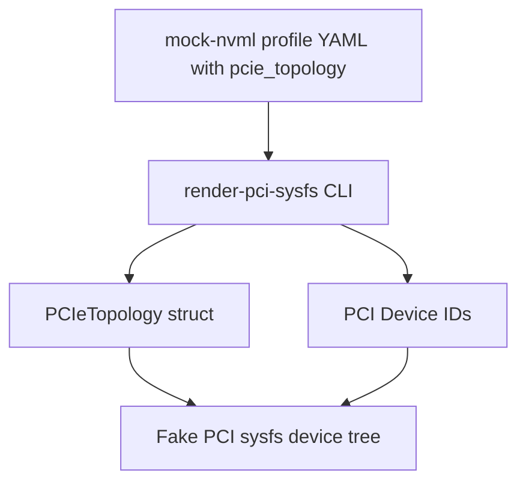
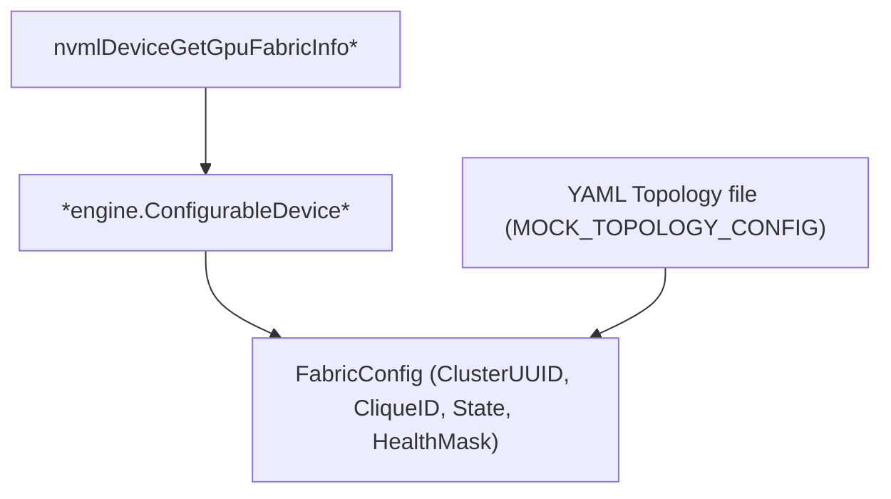

<!-- source: DeepWiki mcp.deepwiki.com · repo NVIDIA/k8s-test-infra · page 9.4 NVLink, InfiniBand, and PCIe Simulation · fetched 2026-10-26 -->

# NVLink, InfiniBand, and PCIe Simulation

<details>
<summary>Relevant source files</summary>

The following files were used as context for generating this wiki page:

- [.gitignore](.gitignore)
- [cmd/fake-imex/ctl/peers.go](cmd/fake-imex/ctl/peers.go)
- [cmd/fake-imex/ctl/peers_test.go](cmd/fake-imex/ctl/peers_test.go)
- [cmd/render-pci-sysfs/main.go](cmd/render-pci-sysfs/main.go)
- [pkg/gpu/mocknvml/bridge/fabric.go](pkg/gpu/mocknvml/bridge/fabric.go)
- [pkg/gpu/mocknvml/bridge/fabric_dispatch.go](pkg/gpu/mocknvml/bridge/fabric_dispatch.go)
- [pkg/gpu/mocknvml/bridge/fabric_dispatch_test.go](pkg/gpu/mocknvml/bridge/fabric_dispatch_test.go)
- [pkg/gpu/mocknvml/bridge/fabric_layout_test.go](pkg/gpu/mocknvml/bridge/fabric_layout_test.go)
- [pkg/gpu/mocknvml/bridge/nvlink.go](pkg/gpu/mocknvml/bridge/nvlink.go)
- [pkg/gpu/mocknvml/engine/fabric_test.go](pkg/gpu/mocknvml/engine/fabric_test.go)
- [pkg/imexcoord/coord_test.go](pkg/imexcoord/coord_test.go)
- [pkg/network/mockib/README.md](pkg/network/mockib/README.md)
- [pkg/network/mockib/daemon/discover.go](pkg/network/mockib/daemon/discover.go)
- [pkg/network/mockib/daemon/discover_test.go](pkg/network/mockib/daemon/discover_test.go)
- [pkg/network/mockib/daemon/fabric.go](pkg/network/mockib/daemon/fabric.go)
- [pkg/network/mockib/daemon/fabric_register_test.go](pkg/network/mockib/daemon/fabric_register_test.go)
- [pkg/network/mockib/daemon/server.go](pkg/network/mockib/daemon/server.go)
- [pkg/network/mockib/daemon/server_smp_test.go](pkg/network/mockib/daemon/server_smp_test.go)
- [pkg/network/mockib/daemon/server_test.go](pkg/network/mockib/daemon/server_test.go)
- [pkg/network/mockib/fabric/graph.go](pkg/network/mockib/fabric/graph.go)
- [pkg/network/mockib/fabric/graph_test.go](pkg/network/mockib/fabric/graph_test.go)
- [pkg/network/mockib/registry/registry.go](pkg/network/mockib/registry/registry.go)
- [pkg/network/mockib/registry/registry_test.go](pkg/network/mockib/registry/registry_test.go)
- [pkg/network/mockib/subnet/synthesize.go](pkg/network/mockib/subnet/synthesize.go)
- [pkg/network/mockib/subnet/synthesize_test.go](pkg/network/mockib/subnet/synthesize_test.go)
- [pkg/network/mockib/sysfs/scan.go](pkg/network/mockib/sysfs/scan.go)
- [pkg/network/mockib/sysfs/scan_test.go](pkg/network/mockib/sysfs/scan_test.go)
- [pkg/system/mockpcisysfs/c/shim.c](pkg/system/mockpcisysfs/c/shim.c)
- [pkg/system/mockpcisysfs/config/types.go](pkg/system/mockpcisysfs/config/types.go)
- [pkg/system/mockpcisysfs/render/render.go](pkg/system/mockpcisysfs/render/render.go)
- [pkg/system/mockpcisysfs/render/render_test.go](pkg/system/mockpcisysfs/render/render_test.go)
- [pkg/system/mockpcisysfs/shim/shim_test.go](pkg/system/mockpcisysfs/shim/shim_test.go)
- [tests/e2e/validate-sminfo.sh](tests/e2e/validate-sminfo.sh)

</details>


This section documents the mechanisms and components involved in simulating NVIDIA's GPU interconnectivity and PCIe device topology within the `k8s-test-infra` project. The mock implementations enable comprehensive testing of Kubernetes GPU scheduling, device discovery, and fabric interactions without requiring physical hardware. The technologies covered include NVLink (GPU interconnect), InfiniBand (IB networking), and PCIe device topology. This page details the architecture, key tools—including the `mock-ib` daemon and the `render-pci-sysfs` utility—the LD_PRELOAD shims (`libibmocksys.so` and `libpcimocksys.so`), NVLink link field semantics, and the fabric/ComputeDomain simulation subsystem within the mock NVML engine.

---

## 1. Overview of Simulation Components

The simulation is split across multiple cooperating components focusing on different layers of the GPU and fabric stack:

- **mock-ib daemon**: An InfiniBand protocol mock daemon that listens on a UNIX domain socket, intercepts synthetic InfiniBand management packets, and emulates subnet management responses and MAD (Management Datagram) traffic. It synthesizes SMP requests (like Subnet Manager Port Info queries) per a configured IB topology.

- **render-pci-sysfs tool**: A CLI utility that reads GPU profile YAML configs, extracts a PCIe topology (`pcie_topology:` block), and writes a fake PCI sysfs directory tree, replicating key attributes and symlink structure of real Linux PCI device sysfs entries. This is critical for tools like `lspci` and device attribute resolution libraries used in Kubernetes scheduling.

- **LD_PRELOAD shims (`libibmocksys.so`, `libpcimocksys.so`)**: Shared library shims intercept syscalls related to file operations and directory scans on paths under `/sys/bus/pci` and InfiniBand device trees. They transparently redirect lookups and operations to simulated sysfs under configured root dirs (`MOCK_PCI_ROOT` and `MOCK_IB_ROOT`), enabling user-space tools and drivers to operate against the simulated data.

- **NVLink field values**: The mock NVML engine simulates NVLink link state and error counters using enumerated field values. These represent the hardware link states reported by real GPUs and populate NVML calls like `nvmlDeviceGetGpuFabricInfo*`.

- **Fabric/ComputeDomain simulation**: This subsystem under the GPU mock engine simulates NVLink fabric domains (ComputeDomains), including cluster and clique UUIDs, node assignments, and health/state bitmasks. It supports multi-node cluster testing and emulation of fabric state propagated via NVML API calls.

Together, these simulate complex GPU interconnect and networking conditions essential for scheduler logic, device feature discovery, and runtime behavior validation in orchestrated Kubernetes environments.

---

## 2. The mock-ib Daemon

The mock-ib daemon provides a user-space mock of the InfiniBand protocol stack's management and fabric functionality. It is implemented as a long-running server listening on a UNIX socket specified at start.

### Key Functionality

- Listens on Unix domain sockets to accept client connections representing InfiniBand subsystem clients.
- Implements handlers for SMP (Subnet Management Packets) such as retrieving port info, node info, and SM (Subnet Manager) info.
- Synthesizes granular IB subnet topology and port states, including LID assignments, port physical state flags, and management attributes.
- Supports fabric simulation via integration with the fabric graph subsystem.
- Provides operational support to tests that execute IB-related queries, to validate controller and device interactions.

### Implementation Highlights

- The daemon startup is performed by `NewServer` which configures socket paths and loads IBRoot directory states and optionally fabric simulation (`Fabric` flag).
- For SMP request handling, packet inspection and response generation are guided by InfiniBand management class and attribute IDs (e.g., PortInfo, SMInfo).
- Uses the `fabric` package to build a graph of IB ports and peers representing physical and virtual topology.
- Implements state tracking of ports and responds to GET/SET MAD messages, including fabric events.
- Test coverage includes SMP request/response cycles and validation of generated payloads.

```mermaid
flowchart TD
    ClientApp[IB Client Process]
    mockIB_Socket[Unix Domain Socket]
    mock_ib_Daemon[mock-ib Daemon]
    FabricGraph[Fabric Graph (pkg/network/mockib/fabric)]
    IBTopologyDir[IB Sysfs Mock Dir]

    ClientApp -->|Connects| mockIB_Socket
    mockIB_Socket --> mock_ib_Daemon
    mock_ib_Daemon -->|Synthesize SMP responses| FabricGraph
    mock_ib_Daemon -->|Read config files| IBTopologyDir
```

Sources: `pkg/network/mockib/daemon/server.go` (overview), `pkg/network/mockib/daemon/server_smp_test.go` (tests)  
---

## 3. The render-pci-sysfs Tool

`render-pci-sysfs` is a CLI utility to generate a synthetic PCI sysfs filesystem tree based on a GPU mock profile.

### Purpose

- Reads the `pcie_topology:` block embedded in a mock-nvml profile YAML configuration.
- Writes a full fake PCI sysfs tree under a specified fake root directory.
- Produces directory structures, device symlinks, `numa_node` files, identity files (`vendor`, `device`, `subsystem_vendor`, `subsystem_device`), and a 256-byte binary `config` file per PCI device.
- Enables user-space tools like `lspci` and the Kubernetes deviceattribute library to resolve PCI device topology as if real devices were present.

### Data Flow and Usage

1. Load and parse mock-nvml profile YAML with `sigs.k8s.io/yaml`.
2. Validate topology and device PCI identities.
3. Generate `/sys/devices/pciXXXX:YY/` directories corresponding to PCI root complexes.
4. For each device BDF, create a directory with attribute files populated from device identity or defaults.
5. Create symlinks from `/sys/bus/pci/devices/<bdf>` mapping to the device directories with relative paths.
6. Output written under a provided root directory (`--output`).

### Code Structure

- Main function parses flags `--config` and `--output`, loads config, validates, and calls `render.Render()`.
- The `render` package implements rendering logic, exposes `Options` struct and `Render` function.
- `renderRootComplex()` method creates directories, `numa_node` files, and device attribute files.
- Device attributes obey PCI conventions: `vendor`, `device`, `class`, `revision`, `irq`.
- A binary VMware-like PCI config space (256 bytes) is synthesized, beginning with vendor and device IDs.



---

#### Directory and Symlink Layout

- `/sys/devices/pci0000:00/0000:07:00.0/numa_node` contains NUMA node number as a single integer string with newline.
- `/sys/bus/pci/devices/0000:07:00.0` is a symlink pointing to `../../../devices/pci0000:00/0000:07:00.0`.
- Attribute files like `vendor`, `device`, `subsystem_vendor`, `subsystem_device`, `class`, `revision`, `irq` are text files with PCI hex values.
- `config` is a 256-byte binary file containing PCI config space starting with Vendor ID and Device ID fields in little endian.

---

## 4. LD_PRELOAD Shims: libibmocksys.so and libpcimocksys.so

The simulation leverages LD_PRELOAD-style shared library shims that intercept system calls to redirect and virtualize sysfs accesses:

### libpcimocksys.so

- Redirects open, openat, fopen, and readlink syscalls targeting paths under `/sys/bus/pci`.
- Redirects path lookups to a configured `MOCK_PCI_ROOT` directory holding the synthetic PCI sysfs tree generated by `render-pci-sysfs`.
- Handles fortified libc open variants (`__open_2`) to avoid escapes due to glibc fortify optimizations.
- Enables tools like `lspci` to read synthetic PCI attributes as if they were native files.
- Special care is taken to replicate relative symlink targets to support deviceattribute libraries resolving PCI roots correctly.

### libibmocksys.so

- Similarly redirects file operations over InfiniBand sysfs tree paths to a synthetic IB root, typically managed by the `mock-ib` daemon and rendered data.
- Ensures user-space IB tools transparently interact with the simulated IB topology.

### Implementation Highlights

- Uses `dlsym(RTLD_NEXT)` to fetch real syscall pointers.
- On intercepted calls, rewrites paths with configured mock roots if the prefix matches PCI or IB sysfs paths.
- Respects maximum path lengths and returns `ENAMETOOLONG` on overflow instead of silently falling back.
- Compiled C interceptors reside under `pkg/system/mockpcisysfs/c/shim.c`.

---

## 5. NVLink Field Values and Fabric Simulation

Within the mock NVML engine, NVLink and fabric simulation populates fields that describe link health, state, and fabric domain membership.

### NVLink Field Semantics

- Each NVLink has a state enumerated as a specific numeric value (e.g., `LINKUP`, `DOWN`, etc.) tracked within the device state.
- Error counts, health masks, and link states are exposed through instrumented NVML API functions enabling tests to validate fabric behavior.

### Fabric / ComputeDomain Simulation

- The package `pkg/gpu/mocknvml/bridge/fabric.go` exports NVML API functions like `nvmlDeviceGetGpuFabricInfo` and its versioned variant `nvmlDeviceGetGpuFabricInfoV`.
- These functions return a `nvmlGpuFabricInfo_t` structure populated from the simulated fabric state held by `ConfigurableDevice` instances.
- The fabric config includes:
  - `ClusterUUID` (a 16-byte UUID string),
  - `CliqueID` (an integer identifying the clique),
  - `State` (governed by enums like `FabricStateCompleted`, `FabricStateNotStarted`),
  - `HealthMask` and `HealthSummary` bitmasks.
- A topology overlay facility merges cluster topology (from YAML) with device defaults, dynamically adjusting fabric membership based on node environment variables.
- Fabric health and state propagate through multi-versioned NVML structs, supporting backward-compatibility test scenarios.



---

## 6. Architectural Summary and Interaction

```mermaid
flowchart TD
    subgraph PCI_Simulation
        RenderPCI[render-pci-sysfs]
        PCIConfigDir[/sys/devices/pciXXXX:XX/]
        PCIBusSymlinks[/sys/bus/pci/devices/]
        LibPCShim[libpcimocksys.so]
        UserSpaceTools[lspci, deviceattribute lib]
    end

    subgraph IB_Simulation
        MockIBDaemon[mock-ib daemon]
        IBSysfsDir[/sys/class/infiniband/ etc.]
        LibIBShim[libibmocksys.so]
        IBTools[InfiniBand user tools]
    end

    subgraph NVML_Fabric
        GPUDevices[ConfigurableDevice instances]
        NVMLAPIs[nvmlDeviceGetGpuFabricInfo*]
        FabricConfigYAML[ComputeDomain topology YAML]
    end

    UserSpaceTools -->|open/readlink| LibPCShim
    LibPCShim -->|redirects| PCIConfigDir
    PCIConfigDir --> RenderPCI
    IBTools --> LibIBShim
    LibIBShim --> IBSysfsDir
    IBSysfsDir --> MockIBDaemon
    GPUDevices --> NVMLAPIs
    FabricConfigYAML --> GPUDevices
```

---

## Summary

This NVLink, InfiniBand, and PCIe simulation subsystem in the `k8s-test-infra` is a sophisticated mock infrastructure enabling Kubernetes device and fabric-related tests to run in hardware-free environments. The `mock-ib` daemon and PCI sysfs renderer produce realistic topologies, while the LD_PRELOAD shims ensure user-space tools transparently access synthetic device information. The NVML mock fabric bridge closely mimics NVLink ComputeDomain states facilitating multi-node GPU fabric testing. Together, these components enable end-to-end testing of device feature discovery, scheduling, and fabric-aware runtime features.

---

# References and Sources

- `cmd/render-pci-sysfs/main.go:4-98`  
- `pkg/system/mockpcisysfs/render/render.go:4-160`  
- `pkg/system/mockpcisysfs/render/render_test.go:18-171`  
- `pkg/system/mockpcisysfs/config/types.go:4-169`  
- `pkg/system/mockpcisysfs/c/shim.c:1-195`  
- `pkg/system/mockpcisysfs/shim/shim_test.go:1-200`  
- `pkg/network/mockib/daemon/server_smp_test.go:1-183`  
- `pkg/network/mockib/daemon/server.go` (overview)  
- `pkg/network/mockib/fabric/graph.go:1-47`  
- `pkg/network/mockib/subnet/synthesize.go:1-170`  
- `pkg/gpu/mocknvml/bridge/fabric.go:1-130`  
- `pkg/gpu/mocknvml/engine/fabric_test.go:1-181`

---

