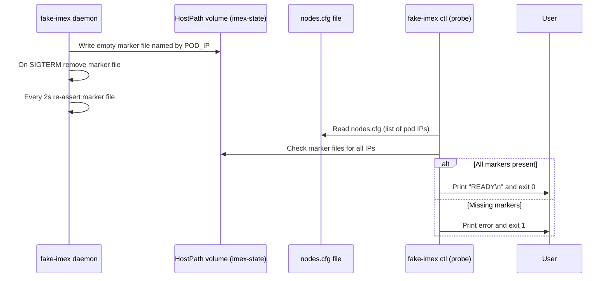
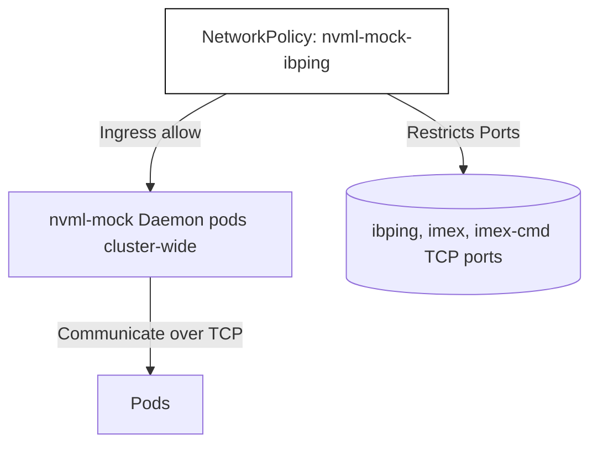

<!-- source: DeepWiki mcp.deepwiki.com · repo NVIDIA/k8s-test-infra · page 9.5 ComputeDomain and IMEX Simulation · fetched 2026-10-26 -->

# ComputeDomain and IMEX Simulation

<details>
<summary>Relevant source files</summary>

The following files were used as context for generating this wiki page:

- [cmd/fake-imex/ctl/main.go](cmd/fake-imex/ctl/main.go)
- [cmd/fake-imex/ctl/peers.go](cmd/fake-imex/ctl/peers.go)
- [cmd/fake-imex/ctl/peers_test.go](cmd/fake-imex/ctl/peers_test.go)
- [cmd/fake-imex/daemon/main.go](cmd/fake-imex/daemon/main.go)
- [cmd/fake-imex/integration_test.go](cmd/fake-imex/integration_test.go)
- [cmd/imex-nogpu-shim/exec_test.go](cmd/imex-nogpu-shim/exec_test.go)
- [cmd/imex-nogpu-shim/main.go](cmd/imex-nogpu-shim/main.go)
- [cmd/imex-nogpu-shim/main_test.go](cmd/imex-nogpu-shim/main_test.go)
- [deployments/nvml-mock/Dockerfile.compute-domain-daemon](deployments/nvml-mock/Dockerfile.compute-domain-daemon)
- [deployments/nvml-mock/helm/nvml-mock/templates/network-policy-ibping.yaml](deployments/nvml-mock/helm/nvml-mock/templates/network-policy-ibping.yaml)
- [deployments/nvml-mock/helm/nvml-mock/tests/network_policy_ibping_test.yaml](deployments/nvml-mock/helm/nvml-mock/tests/network_policy_ibping_test.yaml)
- [docs/demo/compute-domain/README.md](docs/demo/compute-domain/README.md)
- [docs/demo/compute-domain/run.sh](docs/demo/compute-domain/run.sh)
- [pkg/gpu/mocknvml/bridge/fabric.go](pkg/gpu/mocknvml/bridge/fabric.go)
- [pkg/gpu/mocknvml/bridge/fabric_dispatch.go](pkg/gpu/mocknvml/bridge/fabric_dispatch.go)
- [pkg/gpu/mocknvml/bridge/fabric_dispatch_test.go](pkg/gpu/mocknvml/bridge/fabric_dispatch_test.go)
- [pkg/gpu/mocknvml/bridge/fabric_layout_test.go](pkg/gpu/mocknvml/bridge/fabric_layout_test.go)
- [pkg/gpu/mocknvml/engine/fabric_test.go](pkg/gpu/mocknvml/engine/fabric_test.go)
- [pkg/imexcoord/coord.go](pkg/imexcoord/coord.go)
- [pkg/imexcoord/coord_test.go](pkg/imexcoord/coord_test.go)
- [tests/e2e/kind-compute-domain-config.yaml](tests/e2e/kind-compute-domain-config.yaml)

</details>


This page documents the ComputeDomain (multi-node GPU fabric) simulation subsystem within nvml-mock, including the integration of real `nvidia-imex` daemons running in NO GPU mode via the `imex-nogpu-shim`, the legacy fake-imex coordination protocol, the `fake-fabricmanager`, and the Kubernetes NetworkPolicy for limiting cross-pod multimad (MAD) traffic relay. These components enable simulating multi-node fabric topology and inter-node communication over the pod network in Kubernetes test clusters without requiring actual GPU hardware or real NVIDIA fabric adapters.

---

## 1. Overview and Purpose

The ComputeDomain simulation emulates NVIDIA's NVLink fabric topologies and the behaviors of IMEX daemons responsible for GPU fabric domain coordination, but without physical hardware. It is designed to function on Kubernetes test clusters (e.g., Kind) with multiple worker nodes labeled and grouped into fabric cliques.

Key design goals include:

- Simulating multi-node fabric topologies by overlaying YAML/ConfigMap topology data on per-node NVML mock profiles.
- Replacing the legacy fake IMEX coordination protocol—which uses hostPath-shared empty marker files to signal presence—with the real `nvidia-imex` daemon running in NO GPU mode for true networked peer coordination.
- Using `imex-nogpu-shim` to transparently inject `--nogpu` flags to the real `nvidia-imex` daemon binary.
- Providing container images that bundle the mock NVML stack, real IMEX daemons, and coordination shims.
- Controlling pod-level permissions and ingress via Kubernetes NetworkPolicy for sound multi-node inter-pod communication (MAD traffic).
- Enabling test-time overlays, topology rebinding, and readiness probe emulation.

This simulation serves both as a powerful test infrastructure component for Kubernetes GPU device plugins and as a demo showing complex GPU fabric domain coordination at the software level.

---

## 2. ComputeDomain Fabric Simulation in NVML Mock

The mock NVML library implements native NVML GPU fabric APIs to surface cluster-wide topology information to consumers like the NVIDIA Device Plugin and DRA driver.

- The `pkg/gpu/mocknvml/bridge/fabric.go` file exports the NVML functions:
  - `nvmlDeviceGetGpuFabricInfo`
  - `nvmlDeviceGetGpuFabricInfoV`

These hand-written bindings fetch per-GPU fabric info via the mock engine layer (`engine.ConfigurableDevice.GetMockFabricInfo` and `.GetMockFabricInfoV`), allowing the simulated GPUs to expose:

- The NVLink fabric cluster UUID
- Clique ID (fabric domain membership)
- Fabric state (e.g., completed)
- Health masks (starting from v2/v3 API structs)

The cluster-level topology overlay is applied dynamically from a ConfigMap specifying domains, cliques, and member Kubernetes node names. The mock engine uses the environment variable `NODE_NAME` to match the local node in the overlay and adjust fabric data accordingly.

This topology injection causes each node's GPUs to report consistent fabric IDs matching their clique membership, simulating NVLink cluster assignments on real hardware.

```mermaid
flowchart TB
  subgraph "mock NVML library (pkg/gpu/mocknvml)"
    A[nvmlDeviceGetGpuFabricInfo]
    B[nvmlDeviceGetGpuFabricInfoV]
    C[engine.ConfigurableDevice.GetMockFabricInfo / GetMockFabricInfoV]
    D[engine.Engine / Device Table]
    E[Topology Overlay from ConfigMap (MOCK_TOPOLOGY_CONFIG)]
  end

  A --> C
  B --> C
  C --> D
  C --> E
```

Sources:  
`pkg/gpu/mocknvml/bridge/fabric.go:51-128`  
`pkg/gpu/mocknvml/engine/fabric_test.go:27-130`  
`docs/demo/compute-domain/README.md:1-181`

---

## 3. Fake-IMEX Daemon and Coordination Protocol (Deprecated)

Originally, a lightweight file-based coordination protocol was used to simulate multi-node IMEX daemons without GPUs:

- **Fake IMEX Daemon (`cmd/fake-imex/daemon`):**  
  On startup, it writes a marker file named by its pod IP in a shared hostPath directory (usually `/var/lib/nvml-mock/imex-state`) signaling presence in the fabric clique.

- **Fake IMEX Control (`cmd/fake-imex/ctl`):**  
  Used as a readiness probe. It reads a list of expected peer pod IPs from a shared `nodes.cfg` file and checks that marker files exist for all peers. If all peers are ready, it prints `READY` and exits 0; otherwise, it exits 1.

- This protocol relies on the shared hostPath volume for file-based signaling, a design suited for Kind multi-node clusters.

- The daemon reasserts its marker every 2 seconds for resilience against accidental cleanup.

- The protocol lacks liveness detection on SIGKILL and pod evictions but suffices for ephemeral cluster tests.

- Both binaries accept legacy CLI flags for compatibility.

### Data Flow and Lifecycle



### Key Implementation Details:

- `imexcoord` package provides shared helpers to manage state directories, marker files, and node configuration reading.
- Marker write is idempotent and guarded by IP validation.
- Daemon logs re-reads of nodes.cfg on SIGUSR1.
- `ctl` only supports `-q` query mode for readiness.
- The deprecation notice in logs announces real IMEX replacement.

This protocol is deprecated and replaced by the real IMEX daemon with the `--nogpu` shim.

Sources:  
`cmd/fake-imex/daemon/main.go:14-101`  
`cmd/fake-imex/ctl/main.go:14-75`  
`pkg/imexcoord/coord.go:14-283`  
`cmd/fake-imex/integration_test.go:31-196`

---

## 4. Real IMEX Daemon with imex-nogpu-shim

To replace the fake marker mechanism, the simulation runs the real upstream `nvidia-imex` daemon, but in a **NO GPU** mode:

- The `imex-nogpu-shim` is a small Go shim executable that installs as `/usr/bin/nvidia-imex` inside the container.
- When launched, the shim execs the real binary `/usr/bin/nvidia-imex.real` with the `--nogpu` flag appended.
- This cause the real daemon to disable GPU detection and run purely in networked peer mode over gRPC.
- Daemon health ready probes use the real `nvidia-imex-ctl` client interrogating the pod network.
- This approach works in any Kubernetes cluster without shared hostPath volumes.

### Image Configuration (`Dockerfile.compute-domain-daemon`)

- The overlay image combines:
  - The real `nvidia-imex` and `nvidia-imex-ctl` binaries installed from Ubuntu 22.04 multiverse package `nvidia-imex-595`.
  - The Go-built `imex-nogpu-shim` binary replacing the front-line `nvidia-imex` executable.
  - The `nvml-mock:compute-domain` base image containing the mock NVML stack and `check-fabric` utility.
- Two targets:
  - `daemon` (default): real IMEX + shim on upstream compute-domain-daemon base image.
  - `demo`: overlays real IMEX with shim onto the mock NVML image, used by the documented demo script.

```mermaid
graph LR
  A[Base: ubuntu:22.04 + nvidia-imex-595 packages] --> B[real nvidia-imex and nvidia-imex-ctl]
  C[Go-built imex-nogpu-shim] --> D[replaces /usr/bin/nvidia-imex]
  E[nvml-mock:compute-domain base image] --> F[provides NVML mock + check-fabric]

  subgraph Dockerfile.compute-domain-daemon overlay build
    B
    D
  end --> G[final image: real IMEX with shim]

  F --> G

```

Sources:  
`deployments/nvml-mock/Dockerfile.compute-domain-daemon:15-88`  
`cmd/imex-nogpu-shim/main.go`  
`docs/demo/compute-domain/README.md:13-90`

---

## 5. ComputeDomain Demo and Topology Overlay

The [ComputeDomain demo](docs/demo/compute-domain/README.md) exercises the full multi-node fabric simulation end-to-end:

- Creates a dedicated Kind cluster with four workers labeled into two cliques (0 and 1).
- Builds and loads `nvml-mock:compute-domain` and demo overlay images that combine NVML mock plus real IMEX with shim.
- Installs the chart with GB200 GPU profile and topology overlay enabled.
- The topology ConfigMap specifies domain UUIDs, cliques, and node membership.
- Pods pick up node clique via `NODE_NAME` env var to reflect fabric overlay.
- Run `check-fabric` inside pods verifies correct cluster UUID, clique ID, and fabric state.
- Real IMEX daemons form a network fabric domain in NO GPU mode:
  - `nvidia-imex-ctl -q` returns `READY` when all peers are up.
  - Domain reports UP status and version `NO_GPU`.
  - Killing one daemon causes domain to leave UP state.
- Helm upgrade can rebind topology documents without rebuilding images.

This demonstrates the seamless integration of the mock NVML fabric simulation with real IMEX network-based coordination.

Sources:  
`docs/demo/compute-domain/README.md`  
`docs/demo/compute-domain/run.sh`  
`tests/e2e/kind-compute-domain-config.yaml`

---

## 6. `fake-fabricmanager`

`fake-fabricmanager` is a legacy utility in the fake IMEX ecosystem to simulate backend services like fabric topology management but is largely superseded by real IMEX usage. It is not documented in detail here due to limited relevance and the real IMEX subnet cluster mode.

---

## 7. Kubernetes NetworkPolicy for Cross-Pod MAD Traffic Relay

The ComputeDomain simulation requires inter-pod communication on several TCP ports to enable fabric peers to communicate (multi-pod MAD):

- The DaemonSet pods expose:
  - TCP port `ibping` (mock InfiniBand ping listener)
  - TCP port `imex` (real IMEX gRPC peer traffic, default 50000)
  - TCP port `imex-cmd` (command/status grpc, default 50005)
- The NetworkPolicy defined in the Helm chart (`templates/network-policy-ibping.yaml`) applies when:
  - The infiniband ping networkPolicy is enabled in values.
  - The GPU profile supports InfiniBand fabric (`infiniband.enabled=true`).
- It allows ingress TCP traffic on these ports **only** from pods with the same labels (`app.kubernetes.io/name: nvml-mock`, `component: daemon`) in **any namespace**.
- Egress is left unrestricted to permit DNS-based discovery.
- This policy is mandatory on Kind clusters where the default `kindnetd` enforces NetworkPolicies by default.
- It limits the exposure surface of the mock fabric listener to intended peers to prevent external interference.



Sources:  
`deployments/nvml-mock/helm/nvml-mock/templates/network-policy-ibping.yaml`  
`deployments/nvml-mock/helm/nvml-mock/tests/network_policy_ibping_test.yaml`

---

## 8. Summary Diagram: Components and Interactions

```mermaid
graph LR
  subgraph Kubernetes Cluster (Kind Multi-Node)
    PodA[nvml-mock daemon pod (worker 0)]
    PodB[nvml-mock daemon pod (worker 1)]
    PodC[nvml-mock daemon pod (worker 2)]
    PodD[nvml-mock daemon pod (worker 3)]

    PodA -->|nvidia-imex (shim + real daemon NO GPU mode)| IMEXA[nvidia-imex process]
    PodB -->|nvidia-imex (shim + real daemon)| IMEXB[nvidia-imex process]
    PodC -->|nvidia-imex (shim + real daemon)| IMEXC[nvidia-imex process]
    PodD -->|nvidia-imex (shim + real daemon)| IMEXD[nvidia-imex process]

    IMEXA ---|gRPC peer traffic (imex port 50000)| IMEXB
    IMEXC ---|gRPC peer traffic| IMEXD

    PodA -- TCP (ibping, imex, imex-cmd) --> PodB
    PodA -- TCP (ibping, imex, imex-cmd) --> PodC
    PodB -- TCP (ibping, imex, imex-cmd) --> PodD

    subgraph HostPath Volumes (Deprecated)
      StateDir["/var/lib/nvml-mock/imex-state"]
      NodesCfg["/imexd/nodes.cfg"]
      PodAFakeMarker["marker ip marker file (PodA)"]
      PodBFakeMarker["marker ip marker file (PodB)"]
    end

    PodA -.-> PodAFakeMarker
    PodB -.-> PodBFakeMarker
    IMEXCtl[Fake 'nvidia-imex-ctl' readiness probe] -.-> NodesCfg
    IMEXCtl -.-> StateDir
  end

  subgraph NVML Mock Library inside Pod
    NVMLCall["call nvmlDeviceGetGpuFabricInfo(V)"]
    Engine["engine.ConfigurableDevice"]
    Topology["Topology Overlay ConfigMap"]
  end

  PodA --> NVMLCall
  NVMLCall --> Engine
  Engine --> Topology
```

---

# References

| Component                 | Code Locations                                                        |
|---------------------------|---------------------------------------------------------------------|
| Fake IMEX Daemon          | `cmd/fake-imex/daemon/main.go:14-101`                               |
| Fake IMEX Control         | `cmd/fake-imex/ctl/main.go:14-75`                                  |
| IMEX Coordination Helpers | `pkg/imexcoord/coord.go:14-283`                                    |
| IMEX Integration Tests    | `cmd/fake-imex/integration_test.go:31-196`                         |
| Real IMEX Shim + Overlay  | `deployments/nvml-mock/Dockerfile.compute-domain-daemon:15-88`     |
| Mock NVML Fabric APIs     | `pkg/gpu/mocknvml/bridge/fabric.go:51-128`                         |
| Mock NVML Fabric Tests    | `pkg/gpu/mocknvml/engine/fabric_test.go:27-130`                    |
| ComputeDomain Demo Script | `docs/demo/compute-domain/run.sh`                                  |
| Kind Cluster Config       | `tests/e2e/kind-compute-domain-config.yaml`                        |
| Network Policy YAML       | `deployments/nvml-mock/helm/nvml-mock/templates/network-policy-ibping.yaml` |
| Network Policy Tests      | `deployments/nvml-mock/helm/nvml-mock/tests/network_policy_ibping_test.yaml` |

---

This completes the comprehensive technical documentation of the ComputeDomain and IMEX simulation components in the NVIDIA k8s-test-infra codebase.

---

