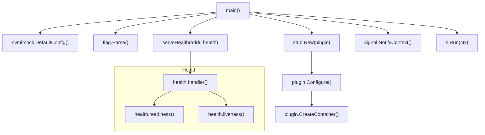
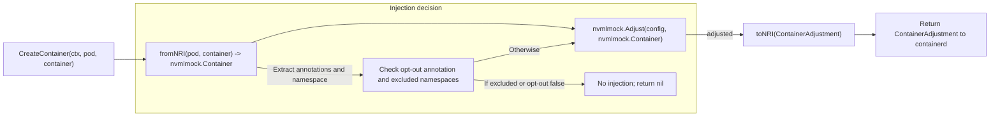

<!-- source: DeepWiki mcp.deepwiki.com · repo NVIDIA/k8s-test-infra · page 9.6 NRI Plugin for Node-Wide Injection · fetched 2026-10-26 -->

# 9.6 NRI Plugin for Node-Wide Injection

<details>
<summary>Relevant source files</summary>

The following files were used as context for generating this wiki page:

- [cmd/nvml-mock-nri/dev_number_oracle_test.go](cmd/nvml-mock-nri/dev_number_oracle_test.go)
- [cmd/nvml-mock-nri/health.go](cmd/nvml-mock-nri/health.go)
- [cmd/nvml-mock-nri/health_test.go](cmd/nvml-mock-nri/health_test.go)
- [cmd/nvml-mock-nri/main.go](cmd/nvml-mock-nri/main.go)
- [cmd/nvml-mock-nri/main_test.go](cmd/nvml-mock-nri/main_test.go)
- [deployments/nvml-mock/helm/nvml-mock/templates/nri-daemonset.yaml](deployments/nvml-mock/helm/nvml-mock/templates/nri-daemonset.yaml)
- [deployments/nvml-mock/helm/nvml-mock/tests/nri_daemonset_test.yaml](deployments/nvml-mock/helm/nvml-mock/tests/nri_daemonset_test.yaml)
- [tests/e2e/go/scenario_nri_test.go](tests/e2e/go/scenario_nri_test.go)

</details>


This section documents the **nvml-mock-nri** plugin, a containerd Node Resource Interface (NRI) plugin designed for node-wide injection of the nvml-mock overlay into containers. The plugin enables ambient injection of simulated NVIDIA GPU devices and LD_PRELOAD shim libraries into Kubernetes pods transparently—without requiring explicit device requests or volume mounts from workloads.

---

## Purpose and Scope

The **nvml-mock-nri** plugin integrates with containerd's NRI framework to dynamically modify container creation specifications at runtime on a Kubernetes node. It injects:

- Device nodes representing mock NVIDIA GPUs
- Bind mounts for the nvml-mock overlay filesystem
- Environment variables controlling overlay topology
- LD_PRELOAD shims into containers for API interception and simulation

Key features include:

- Configuration via command-line flags and environment variables
- Health and readiness probes exposing plugin state
- Annotation-based opt-out and opt-in device injection controls
- Seamless injection into all pods on the node except explicitly excluded namespaces
- Support for integration with ComputeDomain fabrics topology injection for advanced GPU-fabric simulation

This page covers the implementation architecture, configuration options, health checks, container injection logic, opt-out mechanisms, and LD_PRELOAD shim handling.

---

## Implementation Overview

The main plugin binary is implemented in Go (`cmd/nvml-mock-nri/main.go`). At startup, it parses configuration flags, sets up a containerd NRI stub plugin, and serves HTTP health and readiness probes.

### High-Level Components

- **plugin struct**: Maintains configuration and health tracker 
- **stub.Plugin interface**: Implements containerd NRI plugin callbacks
- **Health tracker**: Tracks registration and request states for liveness/readiness
- **Injection logic**: Converts containerd container and pod specs into an internal form, decides injection based on annotations/namespaces, and constructs container adjustment specs with mounts, devices, mounts, and environment updates.

### Lifecycle

1. **Startup**:
   - Read plugin flags and environment variables (for overlay paths, node name, annotations, excluded namespaces, etc.)
   - Create the NRI stub plugin with a connection socket and plugin identity
   - Serve /healthz and /readyz endpoints for Kubernetes probes on a configurable port

2. **Registration**:
   - containerd calls `Configure()` to register the plugin
   - Plugin marks itself registered and ready to receive container events

3. **Handling new containers**:
   - Intercept `CreateContainer` events
   - Extract pod and container details and check opt-out annotation or excluded namespace
   - If injection enabled, prepare:
     - Filesystem bind mounts for nvml-mock overlay and topology if enabled
     - Device nodes (from a specific host device path)
     - Environment variables to pass topology config and LD_PRELOAD shim paths
   - Return `ContainerAdjustment` instructions to containerd to update the container spec

4. **Health Tracking**:
   - Track in-progress CreateContainer requests with timing
   - If a request gets stuck longer than a multiple of containerd's own RPC request timeout, mark as "wedged" causing readiness and liveness failures
   - Mark not ready if the plugin is not registered or connection closed

5. **Graceful exit** on signal interruption

---

## Configuration Flags and Defaults

| Flag                   | Env Variable                     | Default                                 | Description                                                                                     |
|------------------------|---------------------------------|-----------------------------------------|-------------------------------------------------------------------------------------------------|
| --socket-path          | NRI_SOCKET_PATH                 | `/var/run/nri/nri.sock`                  | Path to the containerd NRI UNIX socket                                                        |
| --health-addr          | NVML_MOCK_HEALTH_ADDR           | `:8080`                                 | HTTP address to serve /healthz and /readyz probe endpoints, empty disables probes              |
| --plugin-name          | NRI_PLUGIN_NAME                 | `nvml-mock`                             | Name of the plugin registered with containerd                                                 |
| --plugin-index         | NRI_PLUGIN_INDEX                | `10`                                    | Ordering index of the plugin                                                                   |
| --overlay-host-path    | NVML_MOCK_OVERLAY_HOST_PATH      | `/var/lib/nvml-mock`                    | Host path containing the nvml-mock overlay that is bind mounted into containers                |
| --overlay-mount-path   | NVML_MOCK_OVERLAY_MOUNT_PATH     | `/var/lib/nvml-mock`                    | Container path where the overlay is mounted                                                  |
| --node-name            | NODE_NAME                      | (empty)                                | Kubernetes node name; enables ComputeDomain topology injection when used                       |
| --topology-host-path   | NVML_MOCK_TOPOLOGY_HOST_PATH     | `<overlay-host-path>/topology/topology.yaml` | Host path checked for staged ComputeDomain topology document                                   |
| --topology-mount-path  | NVML_MOCK_TOPOLOGY_MOUNT_PATH    | `<overlay-mount-path>/topology/topology.yaml` | Container path injected as MOCK_TOPOLOGY_CONFIG environment variable                           |
| --device-host-path     | NVML_MOCK_DEVICE_HOST_PATH        | `<overlay-host-path>/driver/dev`       | Host path containing mock `/dev/nvidia*` device nodes                                         |
| --opt-out-annotation   | NVML_MOCK_OPT_OUT_ANNOTATION      | `nvml-mock.nvidia.com/inject`           | Pod annotation key; if set to `"false"`, injection is disabled for that pod                    |
| --device-annotation    | NVML_MOCK_DEVICE_ANNOTATION        | `nvml-mock.nvidia.com/device`           | Pod annotation key; if set to `"true"`, adds `/dev/nvidia*` device nodes into the container    |
| --excluded-namespaces  | NVML_MOCK_EXCLUDED_NAMESPACES      | `NAMESPACE,kube-system`                  | Comma-separated list of namespaces where injection is skipped                                 |
| --ld-preload-shims     | NVML_MOCK_LD_PRELOAD_SHIMS         | (paths relative to overlay mount)       | Comma-separated list of LD_PRELOAD shim paths injected into containers                         |

These options allow flexibility in how the overlay and device injection is applied, enabling node-specific features, namespace filtering, and selective opt-out/in per pod through annotations.

Sources: [cmd/nvml-mock-nri/main.go:30-152](), [deployments/nvml-mock/helm/nvml-mock/templates/nri-daemonset.yaml:1-98]()

---

## Health and Readiness Probes

The plugin serves HTTP probes at configurable ports (default `:8080`) for:

- `/healthz`: Liveness probe
- `/readyz`: Readiness probe

### Health States Tracked

The plugin monitors:

- **Registration state**: Whether it is currently registered with containerd and receiving container creation events.
- **In-flight requests**: Tracks ongoing `CreateContainer` RPC requests to detect stuck/wedged states.

The health logic distinguishes these states:

| State                                          | Readiness  | Liveness  | Description                              |
|------------------------------------------------|------------|-----------|------------------------------------------|
| 1. Process dead                                | N/A        | N/A       | Kubernetes handles this                   |
| 2. Alive, never registered                     | Not Ready  | Live      | Plugin not yet registered; no injection  |
| 3. Alive, registered and serving               | Ready      | Live      | Normal healthy operation                  |
| 4. Alive, registered, handler wedged (stuck)  | Not Ready  | Not Live  | Handler blocked; triggers restart        |
| 5. Alive, unregistered by containerd           | Not Ready  | Live      | Connection lost; injection stopped       |

### Wedged Request Detection

The plugin applies a timeout threshold to detect wedged handler requests:

```
wedged = (request_duration > (containerd_request_timeout * 2))
```

If a request exceeds two times the containerd RPC timeout, the plugin signals a liveness failure prompting the kubelet to restart it.

### Implementation Notes

- The health tracker uses a mutex and a map of in-flight request IDs to their start times.
- Register/Unregister updates the `registered` flag.
- Each `CreateContainer` begins a tracked request and defers marking it finished.
- HTTP handlers report `503 Service Unavailable` if readiness or liveness probes fail.
- The plugin logs health listen and readiness changes.

Sample probe response includes textual reason messages for easier debugging.

Sources: [cmd/nvml-mock-nri/health.go:6-193](), [cmd/nvml-mock-nri/health_test.go]()

---

## Opt-Out Annotation and Namespace Exclusion

Injection can be controlled on a per-pod basis by two pod annotations:

- **Opt-out annotation** (`nvml-mock.nvidia.com/inject` by default):
  - If set to `"false"`, the plugin skips injection for that pod.
  - Otherwise, injection is enabled by default.

- **Device annotation** (`nvml-mock.nvidia.com/device` by default):
  - If set to `"true"`, adds `/dev/nvidia*` device nodes into the container.

Additionally, the plugin excludes injection into any pod running in configured excluded namespaces (default includes `"NAMESPACE"` and `"kube-system"`).

These policies allow fine tuning of injection scope per workload.

### Injection Decision Logic

1. Check if pod namespace is in excluded list → skip injection.
2. Read opt-out annotation → if explicitly `"false"` → skip injection.
3. If injection proceeds:
   - Optionally add devices if device annotation is `"true"`.
   - Always mount nvml-mock overlay paths.
   - Inject LD_PRELOAD shim environment variables.

Sources: [cmd/nvml-mock-nri/main.go:133-152](), [deployments/nvml-mock/helm/nvml-mock/templates/nri-daemonset.yaml:45-51]()

---

## Container Injection Details

When intercepting the `CreateContainer` event, the plugin builds a `ContainerAdjustment` instructing containerd how to modify the container spec:

### Injected Elements

- **Mounts**:
  - Bind mount the nvml-mock overlay host path into the container at a configured mount path.
  - Bind mount the ComputeDomain topology document (if enabled by node name and topology document presence).

- **Devices**:
  - Inject `/dev/nvidia*` device nodes from the configured device host path if opted-in via annotation.

- **Environment Variables**:
  - `MOCK_TOPOLOGY_CONFIG`: Path inside the container to the staged topology document (if applicable).
  - `NODE_NAME`: Kubernetes node name (used for ComputeDomain).
  - `LD_PRELOAD`: Prepended with configured shim libraries injected relative to the overlay mount path or absolute paths.

### Data Flow

1. Convert containerd's `api.PodSandbox` and `api.Container` to internal `nvmlmock.Container` structure.
2. Call `nvmlmock.Adjust()` which applies configured filters and builds the injection spec.
3. Convert the internal injection spec to an NRI `ContainerAdjustment`.
4. Return adjustment to containerd to edit the OCI specification at container creation time.

The LD_PRELOAD shim injection enables API interception by wrapping standard NVIDIA libraries, allowing simulation of GPU behavior transparently inside containers.

Sources: [cmd/nvml-mock-nri/main.go:133-152](), [pkg/nri/nvmlmock/nvmlmock.go (external)]()

---

## LD_PRELOAD Shim Injection

To enable transparent interception of GPU APIs inside containers, the plugin injects LD_PRELOAD environment variables referencing shim shared libraries.

- Shims are configured via the `--ld-preload-shims` flag or `NVML_MOCK_LD_PRELOAD_SHIMS` environment variable as a comma-separated list of relative or absolute paths.
- These paths typically reside inside the mounted nvml-mock overlay, enabling the containerized workload to dynamically link against mock-layer shims.
- The shim library names and paths are prepended to the `LD_PRELOAD` environment variable in the container, preserving any existing value.

This injection enables simulation of GPU metrics, errors, and interactions without modifying container images or runtime commands.

Sources: [cmd/nvml-mock-nri/main.go:39-46,133-152]()

---

## NRI Plugin DaemonSet Deployment

The plugin is deployed on Kubernetes as a DaemonSet included in the `nvml-mock` Helm chart under `nri.enabled`.

### Deployment Features

- Container runs with the `nvml-mock-nri` image
- Mounts:
  - The NRI socket directory (`/var/run/nri`)
  - The nvml-mock overlay host directory (`/var/lib/nvml-mock`)
- Environment:
  - NODE_NAME mounted via fieldRef to inject the Kubernetes node name
- Configurable flags via Helm values:
  - Overlay host and container mount paths
  - Socket path location
  - Excluded namespaces list
  - Opt-out and device annotation keys
  - Health probe addresses and ports
- Probes:
  - Liveness probe hitting `/healthz`
  - Readiness probe hitting `/readyz`
- SecurityContext forbids privilege escalation; runs as root (required for device injection)
- Resource requests configurable (default modest CPU/memory)

### Helm Chart YAML Snippet (key elements)

```yaml
apiVersion: apps/v1
kind: DaemonSet
metadata:
  name: RELEASE-NAME-nvml-mock-nri
  labels:
    app.kubernetes.io/name: nvml-mock-nri
    app.kubernetes.io/component: nri
spec:
  selector:
    matchLabels:
      app.kubernetes.io/name: nvml-mock-nri
      app.kubernetes.io/component: nri
  template:
    metadata:
      labels:
        app.kubernetes.io/name: nvml-mock-nri
        app.kubernetes.io/component: nri
    spec:
      serviceAccountName: RELEASE-NAME
      automountServiceAccountToken: false
      containers:
        - name: nvml-mock-nri
          image: ghcr.io/nvidia/nvml-mock:latest
          command: ["/usr/local/bin/nvml-mock-nri"]
          args:
            - --socket-path=/var/run/nri/nri.sock
            - --overlay-host-path=/var/lib/nvml-mock
            - --overlay-mount-path=/var/lib/nvml-mock
            - --device-host-path=/var/lib/nvml-mock/driver/dev
            - --opt-out-annotation=nvml-mock.nvidia.com/inject
          env:
            - name: NODE_NAME
              valueFrom:
                fieldRef:
                  fieldPath: spec.nodeName
          ports:
            - name: health
              containerPort: 8080
          readinessProbe:
            httpGet:
              path: /readyz
              port: health
          livenessProbe:
            httpGet:
              path: /healthz
              port: health
          volumeMounts:
            - name: nri-socket-dir
              mountPath: /var/run/nri
            - name: nvml-mock-overlay
              mountPath: /var/lib/nvml-mock
              readOnly: true
      volumes:
        - name: nri-socket-dir
          hostPath:
            path: /var/run/nri
            type: DirectoryOrCreate
        - name: nvml-mock-overlay
          hostPath:
            path: /var/lib/nvml-mock
            type: DirectoryOrCreate
```

Sources: [deployments/nvml-mock/helm/nvml-mock/templates/nri-daemonset.yaml](), [deployments/nvml-mock/helm/nvml-mock/tests/nri_daemonset_test.yaml]()

---

## Data Flow and Key Functions/Class Associations

The following diagrams associate natural language concepts with code entities for top-level understanding.

### Diagram 1: Plugin Initialization and Event Loop



This shows how `main` initializes config, parses flags, creates an NRI stub plugin that hooks into containerd, serves HTTP health probes, and runs an event loop to handle container creation requests.

Sources: [cmd/nvml-mock-nri/main.go:20-90](), [cmd/nvml-mock-nri/health.go:20-190]()

---

### Diagram 2: Container Injection Logic Flow



This diagram visualizes the flow from receiving the container event to deciding whether to inject, applying adjustments, converting back to NRI API objects, and returning the result.

Sources: [cmd/nvml-mock-nri/main.go:133-152]()

---

## Summary

The **nvml-mock-nri** plugin provides a critical integration point enabling node-wide ambient injection of simulated NVIDIA GPU environments into Kubernetes containers using containerd's NRI framework. It balances fine-grained opt-out controls with global namespace exclusions and detailed health checking to ensure robust operation in test and simulation clusters.

The plugin's code modularity and configuration flexibility allow emulating complex GPU topologies, device presence, and API behaviors transparently, aiding in testing and development of GPU-aware Kubernetes operators and workloads.

---

# References

- `cmd/nvml-mock-nri/main.go` (lines 1-152)
- `cmd/nvml-mock-nri/health.go` (lines 1-193)
- `deployments/nvml-mock/helm/nvml-mock/templates/nri-daemonset.yaml`
- `deployments/nvml-mock/helm/nvml-mock/tests/nri_daemonset_test.yaml`
- `tests/e2e/go/scenario_nri_test.go`
- `cmd/nvml-mock-nri/health_test.go`
- `cmd/nvml-mock-nri/main_test.go`
- `cmd/nvml-mock-nri/dev_number_oracle_test.go`

---

This concludes the documentation for the "9.6 NRI Plugin for Node-Wide Injection" leaf page.

---

