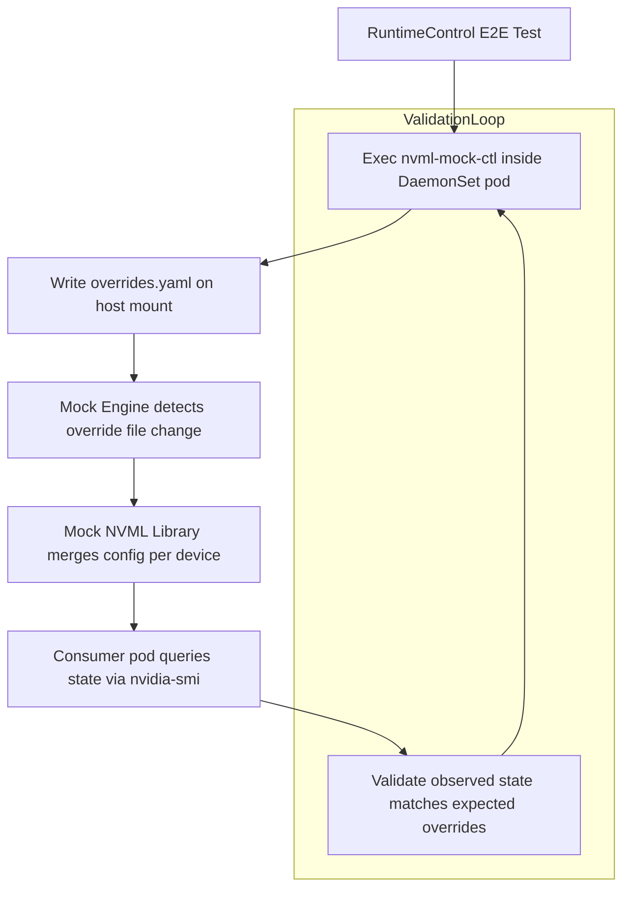
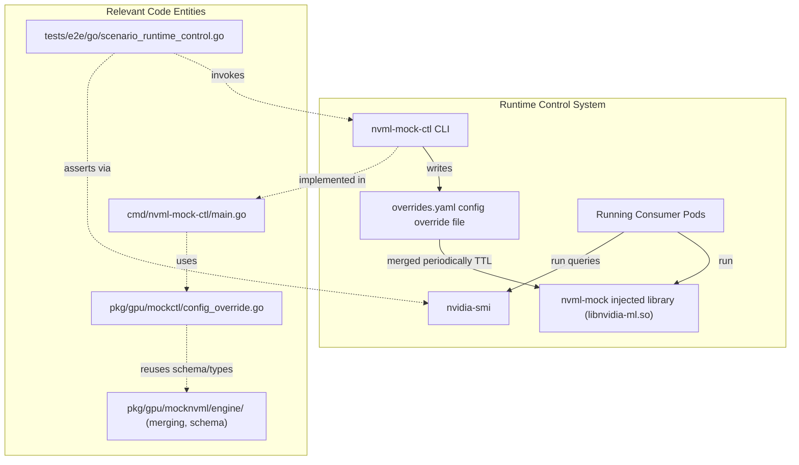

<!-- source: DeepWiki mcp.deepwiki.com · repo NVIDIA/k8s-test-infra · page 9.7 Runtime Control with nvml-mock-ctl · fetched 2026-10-26 -->

# Runtime Control with nvml-mock-ctl

<details>
<summary>Relevant source files</summary>

The following files were used as context for generating this wiki page:

- [cmd/nvml-mock-ctl/main.go](cmd/nvml-mock-ctl/main.go)
- [cmd/nvml-mock-ctl/main_test.go](cmd/nvml-mock-ctl/main_test.go)
- [docs/nvml-mock-ctl.md](docs/nvml-mock-ctl.md)
- [pkg/gpu/mockctl/config_override.go](pkg/gpu/mockctl/config_override.go)
- [pkg/gpu/mockctl/config_override_test.go](pkg/gpu/mockctl/config_override_test.go)
- [tests/e2e/go/scenario_runtime_control.go](tests/e2e/go/scenario_runtime_control.go)
- [tests/e2e/go/scenario_standalone_test.go](tests/e2e/go/scenario_standalone_test.go)

</details>


The `nvml-mock-ctl` tool facilitates **runtime control of simulated GPU states** within the nvml-mock system on a live Kubernetes node without requiring any Helm upgrade, image rebuild, or pod restart. It enables testers and developers to dynamically inject GPU state overrides such as failure scenarios, ECC mode toggling, temperature/power/fan/utilization metrics, and performance state adjustments on-the-fly.

This page covers the implementation details of `nvml-mock-ctl`, the **config_override** mechanism it uses to apply runtime device state patches, and explains how the **scenario_runtime_control** end-to-end (E2E) tests exercise this functionality to validate hot-reload semantics.

---

## Purpose and Scope

- **Purpose:** Allow immediate, device-level mutations of GPU simulation state for tests and demos, avoiding disruptive restarts or redeployments.
- **Scope:** Per-node device overrides applied by writing a *config override* file on the host, merged in-process by the shared `libnvidia-ml.so` mock NVML library in every consumer container.
- **Audience:** Developers and testers working with the nvml-mock Kubernetes test infrastructure, especially those validating state transitions and dynamic conditions.

---

## 1. Background: nvml-mock and the Runtime Override Model

Unlike a traditional GPU daemon, the nvml-mock system is implemented as a **per-process shared library injection (`libnvidia-ml.so`)**, not as a centralized server process. Therefore, the `nvml-mock-ctl` tool cannot send RPCs or socket commands.

Instead, `nvml-mock-ctl` uses a **node-local on-disk config override file** approach to communicate with all running mock consumers on that node:

1. `nvml-mock-ctl` atomically writes a **config override YAML file** (`overrides.yaml`) into a configured directory on the node's filesystem.  
2. Each consumer process running the nvml-mock library periodically (default TTL = 1 second, controlled by the `MOCK_NVML_OVERRIDES_TTL` env var) reloads the override file and **deep-merges the patch on top** of the pristine base profile config (`config.yaml`).  
3. Since the config override file is bind-mounted into consumers (typically via CDI mounts), even already-running containers see the same updated state within the TTL window without restart or reload commands.  

### Merge Hierarchy

Overrides from `overrides.yaml` merge atop the base profile config as follows:

```
base config.yaml  <  config override "all:" block  <  config override "devices[<idx>]:" block
```

- A targeted per-device override entry takes precedence over the `all` block, which itself overrides base default values.
- Unknown fields and invalid types are rejected at write time, ensuring users catch typos or schema mistakes immediately.

### What Is Hot-Reloadable?

- **Hot-reloadable fields:** failure injection, ECC counters and mode, temperature, power, fan speed, utilization, clocks, throttle reasons, performance state, device memory stats, and NVLink error rates.
- **Immutable without restart:** device identity and topology fields such as `name`, `architecture`, `uuid`, `compute_capability`, PCI `bus_id`, and `bar1_memory` settings are baked at device construction and **cannot** be changed at runtime.

> To modify baked fields requires editing the Helm profile and restarting the DaemonSet pod.

---

## 2. Implementation Details of nvml-mock-ctl CLI

The CLI tool is implemented in **Go** with a pure Go backend for config override management and a thin main driver that:

- Parses CLI commands and flags,
- Resolves the GPU target device index or UUID,
- Loads and locks the override config file,
- Applies mutations via the `mockctl` package,
- Writes the new override file atomically, and
- Unlocks and exits.

### Components and Flow

```mermaid
flowchart LR
  A[User runs `nvml-mock-ctl` CLI] --> B{Command parsing}
  B --> C[Resolve GPU target from index/UUID/all]
  B --> D[Parse mutation arguments (fail, temp, power...)]
  C --> E[Load base config.yaml]
  E --> F[Lock overrides.yaml]
  F --> G[Load overrides.yaml into Doc]
  G --> H[Mutate Doc per command]
  H --> I[Validate & deep-merge patches]
  I --> J[Write updated overrides.yaml atomically]
  J --> K[Unlock overrides.yaml file]
  K --> L[Exit with status]
```

- The CLI operates purely on YAML documents representing a runtime override **Doc**.
- Locking is done via file locks to support concurrent CLI ops safely.
- Validation and merge logic resides in the `pkg/gpu/mockctl/config_override.go` package, which acts as a bridge library exposing core mutation and schema logic without CGo or the engine internals.
- The driver enforces strict argument validation (e.g., clamping ranges, checking modes, integer parsing) for reliable usage.

### Source Highlights

- Main entrypoint and CLI dispatch: [`cmd/nvml-mock-ctl/main.go:14-146`]()
- Config override mutation logic and validation: [`pkg/gpu/mockctl/config_override.go:18-185`]()

---

## 3. Config Override Data Model and Mutation Library

The `mockctl` package defines a `Doc` struct (mirror of the engine's `ConfigOverrideDoc`) storing:

- `Version` – schema version (default 1),
- `All` – shared override map applying to all devices,
- `Devices` – map of per-index device override maps.

### Key Types and Functions

| Type / Function     | Description                                                                                 |
|--------------------|---------------------------------------------------------------------------------------------|
| `Doc`              | Represents the config override document in-memory.                                         |
| `Target`           | Specifies which bucket the mutation applies to: the global `All` map or a device-index key.|
| `Load(path)`       | Reads and unmarshals the override YAML file, returning an empty `Doc` if missing or empty.  |
| `(*Doc).Bytes()`   | Marshals the override document back to YAML for writing.                                   |
| `(*Doc).SetFields` | Deep merges a `map[string]any` patch into the appropriate target bucket in `Doc`.           |
| `(*Doc).Fail`      | Sets or removes a `failure` override entry for the target; validates mode string.          |
| Convenience patch builders (`TemperaturePatch`, `PowerPatch`, `FanPatch`, etc.) | Construct common override patches for metric pinning with dynamic/static metrics combined.|

### Merge & Validation

The mutation methods call internal helpers to validate fields against the engine's schema types for consistency and reject unknown or type-mismatched keys. Invalid commands will fail early and not corrupt the override file.

The patch builders construct minimal but authoritative device config fragments that can be merged into the override file with full type-safety.

### Example Patch for Temperature

```go
func TemperaturePatch(celsius int) map[string]any {
	return map[string]any{
		"thermal": map[string]any{"temperature_gpu_c": celsius},
		"dynamic_metrics": map[string]any{
			"temperature": map[string]any{
				"base_c":     celsius,
				"ramp_c":     0,
				"variance_c": 0,
			},
		},
	}
}
```

This approach guarantees that the temperature reading is deterministic and overrides both static and dynamic simulator values.

---

## 4. Command Reference Summary

The CLI supports a variety of commands for runtime control, all scoped via `--gpu` to a device index, UUID, or `all`:

| Command       | Purpose                                                                              | Notes                                  |
|---------------|--------------------------------------------------------------------------------------|----------------------------------------|
| `fail`        | Inject or clear a failure mode (`healthy`, `lost`, `fallen_off_bus`, `ecc_uncorrectable`) | Supports delayed trip (`--after-calls`) and Xid injection (`--xid`). |
| `temp`/`temperature` | Pin GPU temperature in Celsius.                                                 | Overwrites dynamic and static thermal fields. |
| `power`       | Pin GPU power draw in watts.                                                         | Converts watts to milliwatts internally. |
| `fan`         | Pin fan speed in percent; forces fan count ≥ 1 for visibility.                       | Useful for liquid/passively cooled profiles. |
| `util`/`utilization` | Pin GPU and memory utilization percent; disables dynamic utilization simulator. |                                            |
| `clocks`      | Pin SM and graphics clock speeds in MHz.                                            | Memory clock is preserved from base profile. |
| `throttle`    | Set active throttle reasons (e.g., `thermal`, `sw_power_cap`); `none` clears all.      | Writes explicit boolean flags for each reason. |
| `pstate`      | Pin GPU performance state (P-state) from 0 to 15.                                   | Prepares `performance_state` string like "P8". |
| `nvlink-error`| Inject NVLink data link layer error rates (errors per second).                      | Supports selecting specific links, rate zero heals errors. |
| `set`         | Arbitrary field patching by key paths and values (e.g., `memory.used_bytes=...`).     | Deep merges; rejects unknown/invalid fields. |
| `status`      | Display active runtime overrides.                                                   | Optional `--gpu` to narrow scope.       |
| `reset`       | Clear runtime overrides for one or all GPUs.                                       | Defaults to all if no `--gpu` given.    |

For a full usage summary, see the embedded usage string parseable via `nvml-mock-ctl help`.

---

## 5. Locking and Atomicity

To handle potential concurrent invocations, the CLI locks the override file with an exclusive **POSIX lock** before reading and writing. It writes to a temporary file and then atomically renames over the original, ensuring file integrity even on errors or multiple simultaneous calls.

---

## 6. Runtime Override Lifecycle and TTL

- The TTL is a configurable interval (`MOCK_NVML_OVERRIDES_TTL`, default 1 second) at which injected consumers reread the override file and merge.
- This means the effective state changes **propagate asynchronously** but quickly.
- No active reload commands or restarts are needed for changes to take effect, making `nvml-mock-ctl` ideal for automated or live testing workflows.

---

## 7. scenario_runtime_control E2E Test Patterns

The runtime control commands and their semantics are extensively exercised by **E2E integration tests** in the `scenario_runtime_control.go` package. This validates the entire live update path end-to-end:

- Mutations are applied by exec-ing `nvml-mock-ctl` inside a running DaemonSet pod on a node.
- The effect is verified by querying the same pod's simulated GPUs directly via `nvidia-smi` commands with various queries.
- Tests confirm that overrides apply without pod restarts, hot reload as expected, and that commands produce consistent, scoped effects.

### Key Test Flow



- Example tests include injecting ECC uncorrectable errors, pinning temperature or power, asserting throttle reasons, targeting by UUID, resetting overrides, and more.
- Each test resets the override state to isolate side effects between scenarios.

### Test Implementation Details

- The helper `nvmlMockCtl(ctx, h, args...)` runs the CLI inside the pod and asserts success.
- Queries to `nvidia-smi` are parsed and asserted against expected values.
- The tests implement timeouts and polling loops to accommodate the TTL delay in override propagation.

Source file: [`tests/e2e/go/scenario_runtime_control.go:6-3415`]() (truncated, but see full for details and helper functions)  
Sample scenario snippet from tests:

```go
func assertRuntimeECCInjection(ctx SpecContext, h *harness.Harness, consumer kube.PodRef) {
	resetRuntimeOverrides(ctx, h)
	nvmlMockCtl(ctx, h, "fail", "--gpu", "0", "--mode", "ecc_uncorrectable", "--after-calls", "1", "--xid", "79")
	Eventually(func() int {
		return smiGPUInt(ctx, h, consumer, 0, "ecc.errors.uncorrected.aggregate.total")
	}).WithTimeout(runtimeTTLTimeout).Should(BeNumerically(">", 0))
	nvmlMockCtl(ctx, h, "reset", "--gpu", "all")
	Eventually(func() int {
		return smiGPUInt(ctx, h, consumer, 0, "ecc.errors.uncorrected.aggregate.total")
	}).WithTimeout(runtimeTTLTimeout).Should(Equal(0))
}
```

---

## 8. Summary Diagram: Runtime Control System Mapping



---

## 9. Source References

- `nvml-mock-ctl` main CLI driver and command dispatch: [`cmd/nvml-mock-ctl/main.go:14-146`]()
- CLI testing code validating commands and argument handling: [`cmd/nvml-mock-ctl/main_test.go:14-154`]()
- Config override pure mutation library: [`pkg/gpu/mockctl/config_override.go:18-185`]()
- Config override tests covering patch validation: [`pkg/gpu/mockctl/config_override_test.go:14-170`]()
- CLI user-facing usage and prose documentation: [`docs/nvml-mock-ctl.md:1-175`]()
- E2E test scenarios exercising runtime overrides: [`tests/e2e/go/scenario_runtime_control.go:6-3415`]() (truncated for brevity)

---

This page completes the detailed technical reference of runtime GPU simulation control via the `nvml-mock-ctl` tool — the cornerstone for flexible, dynamic test and failure injection scenarios in the `k8s-test-infra` GPU testing infrastructure.

---

