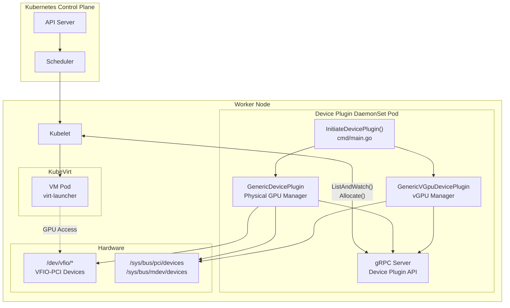
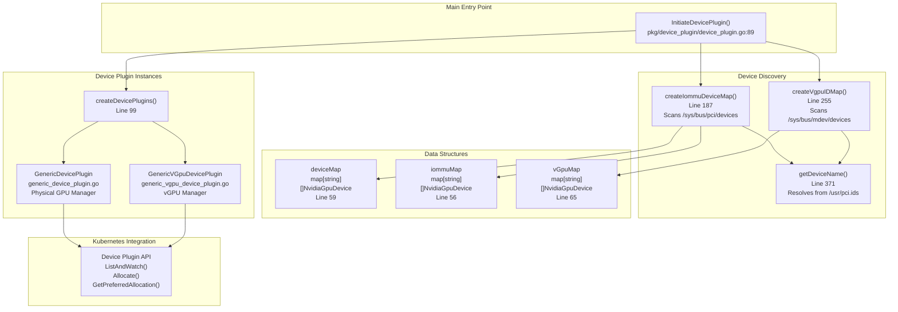
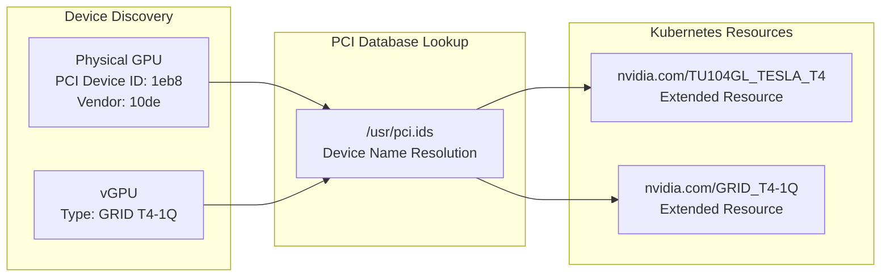
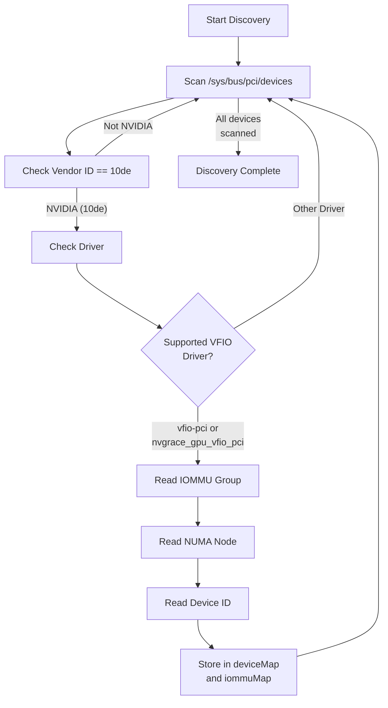
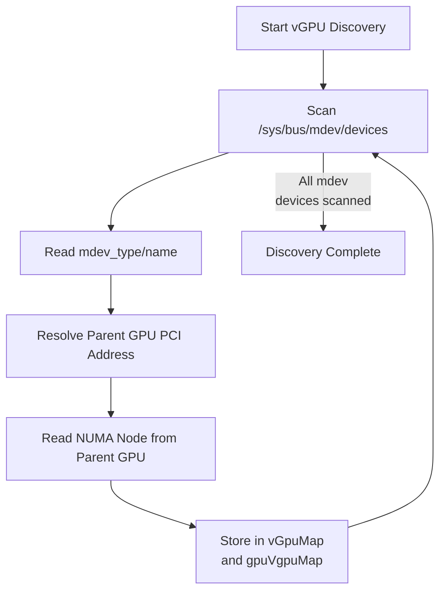

<!-- source: DeepWiki mcp.deepwiki.com · repo NVIDIA/kubevirt-gpu-device-plugin · page 1 Overview · fetched 2026-10-26 -->

# Overview

<details>
<summary>Relevant source files</summary>

The following files were used as context for generating this wiki page:

- [README.md](README.md)
- [examples/kubevirt-featuregate-cm.yaml](examples/kubevirt-featuregate-cm.yaml)
- [go.mod](go.mod)
- [manifests/nvidia-kubevirt-gpu-device-plugin.yaml](manifests/nvidia-kubevirt-gpu-device-plugin.yaml)
- [pkg/device_plugin/device_plugin.go](pkg/device_plugin/device_plugin.go)
- [pkg/device_plugin/device_plugin_test.go](pkg/device_plugin/device_plugin_test.go)

</details>


## Purpose and Scope

This document provides a comprehensive overview of the NVIDIA KubeVirt GPU Device Plugin, a Kubernetes device plugin that enables GPU passthrough and virtual GPU (vGPU) support for KubeVirt virtual machines. This page introduces the system's architecture, key components, and operational model.

For detailed installation instructions, see [Getting Started](#2). For in-depth architectural documentation, see [Architecture](#3). For build and deployment procedures, see [Build and Deployment](#4).

**Sources:** [README.md:1-13](), [pkg/device_plugin/device_plugin.go:89-96]()

---

## What Problem Does This Solve?

KubeVirt extends Kubernetes to run virtual machine workloads alongside container workloads. However, VMs requiring GPU access need a mechanism to discover, allocate, and attach physical GPUs or vGPUs. The NVIDIA KubeVirt GPU Device Plugin bridges this gap by:

1. **Discovering GPU resources** on Kubernetes nodes (both physical GPUs and vGPUs)
2. **Advertising GPU availability** to the Kubernetes scheduler as custom resources
3. **Allocating GPU devices** to KubeVirt VM pods with proper IOMMU isolation
4. **Monitoring device health** to ensure reliable GPU operations

The plugin specifically targets KubeVirt workloads and is optimized for GPU passthrough scenarios where VMs require direct access to physical GPU hardware or mediated virtual GPUs.

**Sources:** [README.md:12-19](), [pkg/device_plugin/device_plugin.go:186-247]()

---

## Key Capabilities

The device plugin provides three core capabilities:

| Capability | Description | Implementation |
|-----------|-------------|----------------|
| **Physical GPU Passthrough** | Discovers NVIDIA GPUs bound to VFIO-PCI drivers and exposes them for VM passthrough | `createIommuDeviceMap()`, `GenericDevicePlugin` |
| **Virtual GPU (vGPU) Support** | Discovers NVIDIA vGPUs configured via mdev subsystem and exposes them to VMs | `createVgpuIDMap()`, `GenericVGpuDevicePlugin` |
| **Health Monitoring** | Performs basic health checks on GPUs and tracks device availability | NVML integration, fsnotify watching |

**Sources:** [README.md:16-19](), [pkg/device_plugin/device_plugin.go:89-96]()

---

## System Architecture Overview

The following diagram shows how the device plugin integrates with Kubernetes, KubeVirt, and GPU hardware:



**Figure 1: System Context and Component Interactions**

The device plugin runs as a DaemonSet pod on each GPU-enabled node. The `InitiateDevicePlugin()` function initializes two parallel device plugin instances: `GenericDevicePlugin` for physical GPUs and `GenericVGpuDevicePlugin` for vGPUs. These communicate with Kubelet via gRPC, implementing the Kubernetes Device Plugin API to advertise and allocate GPU resources.

**Sources:** [manifests/nvidia-kubevirt-gpu-device-plugin.yaml:1-40](), [pkg/device_plugin/device_plugin.go:89-96]()

---

## Core Components and Code Mapping

The following diagram maps system components to their implementation in the codebase:



**Figure 2: Component Architecture with Code References**

The system follows a clear initialization flow:

1. **`InitiateDevicePlugin()`** [pkg/device_plugin/device_plugin.go:89-96]() - Main entry point that orchestrates device discovery and plugin creation
2. **`createIommuDeviceMap()`** [pkg/device_plugin/device_plugin.go:187-247]() - Discovers physical GPUs by scanning `/sys/bus/pci/devices`, filtering for NVIDIA vendor ID (`10de`), and validating VFIO driver binding
3. **`createVgpuIDMap()`** [pkg/device_plugin/device_plugin.go:255-291]() - Discovers vGPUs by scanning `/sys/bus/mdev/devices` for mediated devices
4. **`createDevicePlugins()`** [pkg/device_plugin/device_plugin.go:99-176]() - Instantiates device plugin objects for each GPU type discovered
5. **`getDeviceName()`** [pkg/device_plugin/device_plugin.go:371-422]() - Resolves human-readable GPU names from PCI IDs database

**Sources:** [pkg/device_plugin/device_plugin.go:45-96](), [pkg/device_plugin/device_plugin.go:186-291]()

---

## Resource Advertisement Model

The device plugin advertises GPU resources to Kubernetes using a structured naming convention:



**Figure 3: Resource Naming Convention**

Each discovered GPU is advertised as a Kubernetes extended resource with the format:

- **Format:** `nvidia.com/DEVICE_NAME`
- **Physical GPU example:** `nvidia.com/TU104GL_TESLA_T4`
- **vGPU example:** `nvidia.com/GRID_T4-1Q`

The device name is derived from the PCI IDs database at `/usr/pci.ids`, which maps vendor and device IDs to human-readable names. The plugin normalizes these names by converting to uppercase, replacing special characters with underscores, and removing non-alphanumeric characters [pkg/device_plugin/device_plugin.go:404-415]().

Each advertised device includes NUMA topology information to enable NUMA-aware scheduling [pkg/device_plugin/device_plugin.go:115-119]().

**Sources:** [pkg/device_plugin/device_plugin.go:109-136](), [pkg/device_plugin/device_plugin.go:371-422](), [examples/kubevirt-featuregate-cm.yaml:10-18]()

---

## Device Discovery Details

### Physical GPU Discovery

The plugin discovers physical GPUs through the following process:



**Figure 4: Physical GPU Discovery Flow**

The discovery process validates that:
1. Device vendor ID is `10de` (NVIDIA) [pkg/device_plugin/device_plugin.go:209]()
2. Device is bound to a supported VFIO driver (`vfio-pci` or `nvgrace_gpu_vfio_pci`) [pkg/device_plugin/device_plugin.go:75-78]()
3. Device has a valid IOMMU group for isolation [pkg/device_plugin/device_plugin.go:221-225]()
4. NUMA node information is available (defaults to node 0 if unavailable) [pkg/device_plugin/device_plugin.go:226-230]()

**Sources:** [pkg/device_plugin/device_plugin.go:186-247](), [pkg/device_plugin/device_plugin.go:249-252]()

### Virtual GPU Discovery

For vGPUs, the plugin scans the mdev subsystem:



**Figure 5: vGPU Discovery Flow**

Each vGPU is associated with its parent physical GPU to track NUMA topology [pkg/device_plugin/device_plugin.go:280-284]().

**Sources:** [pkg/device_plugin/device_plugin.go:255-291]()

---

## Deployment Model

The device plugin deploys as a DaemonSet in the `kube-system` namespace:

| Configuration | Value | Purpose |
|--------------|-------|---------|
| **Namespace** | `kube-system` | System-level component |
| **Priority Class** | `system-node-critical` | High priority for scheduling |
| **Security Context** | `allowPrivilegeEscalation: false`<br/>`capabilities: drop ALL` | Minimal privileges |
| **Volume Mounts** | `/var/lib/kubelet/device-plugins`<br/>`/dev/vfio` | Socket communication and device access |

The DaemonSet ensures the device plugin runs on every GPU-enabled node. The pod requires access to:
- `/var/lib/kubelet/device-plugins` - Unix socket directory for kubelet communication
- `/dev/vfio` - VFIO device files for GPU access validation

**Sources:** [manifests/nvidia-kubevirt-gpu-device-plugin.yaml:1-40]()

---

## Supported GPU Modes

The plugin supports two GPU operational modes:

### 1. GPU Passthrough Mode

Physical GPUs bound to VFIO-PCI drivers are passed through directly to VMs:

- **Driver Requirements:** GPU must be bound to `vfio-pci` or `nvgrace_gpu_vfio_pci` driver
- **IOMMU:** Must be enabled with proper IOMMU group isolation
- **VM Access:** VM gets exclusive, direct access to physical GPU hardware
- **Resource Name Format:** `nvidia.com/DEVICE_NAME` (e.g., `nvidia.com/TU104GL_TESLA_T4`)

**Sources:** [README.md:34-109](), [pkg/device_plugin/device_plugin.go:75-78]()

### 2. vGPU Mode

Virtual GPUs created through NVIDIA vGPU Manager and Linux mdev subsystem:

- **Driver Requirements:** NVIDIA Virtual GPU Manager installed on host
- **mdev Configuration:** vGPU instances created at `/sys/bus/pci/devices/*/mdev_supported_types/`
- **VM Access:** Multiple VMs can share a physical GPU via time-sliced vGPUs
- **Resource Name Format:** `nvidia.com/VGPU_TYPE` (e.g., `nvidia.com/GRID_T4-1Q`)

**Sources:** [README.md:111-173](), [pkg/device_plugin/device_plugin.go:255-291]()

---

## Integration with KubeVirt

The device plugin integrates with KubeVirt through the permitted devices mechanism:

```yaml
apiVersion: kubevirt.io/v1alpha3
kind: KubeVirt
spec:
  configuration:
    permittedHostDevices:
      pciHostDevices:
      - pciVendorSelector: "10DE:1EB8"
        resourceName: "nvidia.com/TU104GL_Tesla_T4"
        externalResourceProvider: true
      mediatedDevices:
      - mdevNameSelector: "GRID T4-1Q"
        resourceName: "nvidia.com/GRID_T4-1Q"
    developerConfiguration:
      featureGates:
        - GPU
```

**Key Configuration Requirements:**

1. **GPU Feature Gate:** Must be enabled in KubeVirt CR
2. **Permitted Devices:** Both physical GPUs and vGPUs must be allowlisted
3. **External Resource Provider:** Set to `true` for device plugin managed resources
4. **Resource Name Match:** Must exactly match the resource names advertised by the device plugin

**Sources:** [examples/kubevirt-featuregate-cm.yaml:1-22](), [README.md:25-32]()

---

## Key Data Structures

The plugin maintains several critical data structures:

| Data Structure | Type | Purpose |
|---------------|------|---------|
| `deviceMap` | `map[string][]NvidiaGpuDevice` | Maps device IDs to GPU devices |
| `iommuMap` | `map[string][]NvidiaGpuDevice` | Maps IOMMU group IDs to GPU devices |
| `bdfToIommuMap` | `map[string]string` | Maps PCI BDF addresses to IOMMU groups |
| `vGpuMap` | `map[string][]NvidiaGpuDevice` | Maps vGPU types to vGPU instances |
| `gpuVgpuMap` | `map[string][]string` | Maps parent GPU IDs to child vGPUs |

The `NvidiaGpuDevice` structure stores device details:

```go
type NvidiaGpuDevice struct {
    addr     string  // PCI address (BDF) or mdev UUID
    numaNode int64   // NUMA node ID for topology-aware scheduling
}
```

**Sources:** [pkg/device_plugin/device_plugin.go:49-68]()

---

## Next Steps

- For installation and host preparation instructions, see [Getting Started](#2)
- For detailed architectural documentation, see [Architecture](#3)
- For build and deployment procedures, see [Build and Deployment](#4)
- For development guidelines, see [Development Guide](#5)

---

