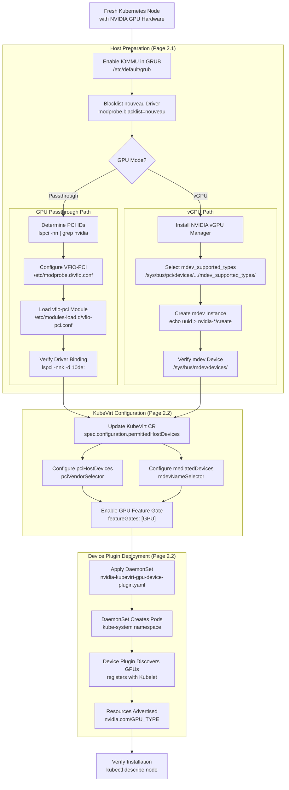
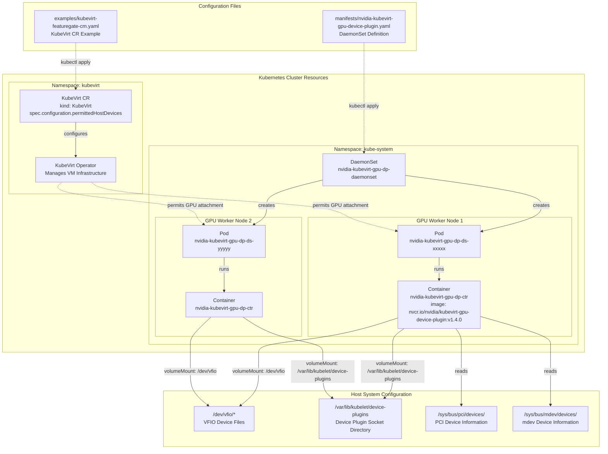
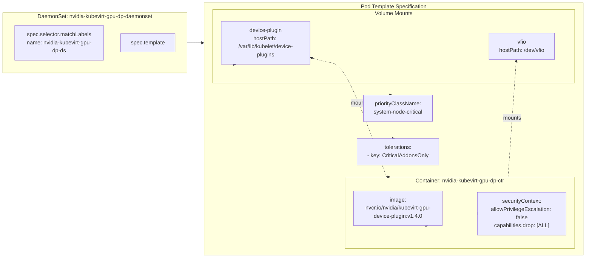
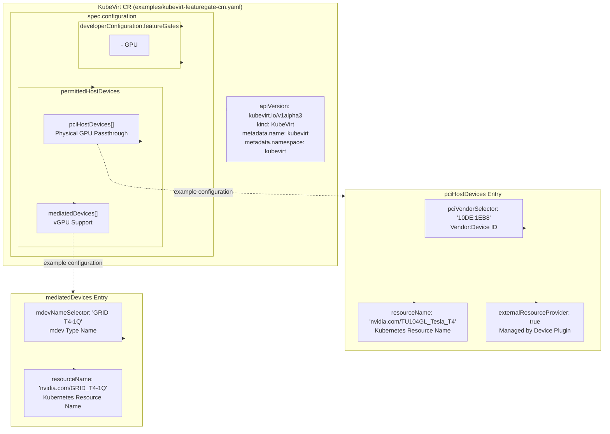

<!-- source: DeepWiki mcp.deepwiki.com · repo NVIDIA/kubevirt-gpu-device-plugin · page 2 Getting Started · fetched 2026-10-26 -->

# Getting Started

Relevant source files

The following files were used as context for generating this wiki page:

- [README.md](README.md)
- [examples/kubevirt-featuregate-cm.yaml](examples/kubevirt-featuregate-cm.yaml)
- [manifests/nvidia-kubevirt-gpu-device-plugin.yaml](manifests/nvidia-kubevirt-gpu-device-plugin.yaml)

This page provides an overview of the prerequisites and installation process for the NVIDIA KubeVirt GPU Device Plugin. It introduces the setup workflow and key deployment components. For detailed step-by-step instructions on host preparation, see [Prerequisites and Host Setup](#2.1). For deployment procedures, see [Installing the Device Plugin](#2.2).

## Purpose and Scope

The NVIDIA KubeVirt GPU Device Plugin enables GPU and vGPU passthrough to KubeVirt virtual machines running in a Kubernetes cluster. This Getting Started guide covers the complete setup process from host preparation through deployment verification. 

This page focuses on installation and initial configuration. For architectural details about how the device plugin works internally, see [Architecture](#3). For build and development workflows, see [Development Guide](#5).

## Installation Overview

Setting up the device plugin requires preparation at three layers:

| Layer | Configuration Required | Purpose |
|-------|----------------------|---------|
| **Host System** | IOMMU enablement, kernel driver binding | Enable hardware virtualization and device isolation |
| **KubeVirt** | Feature gates, permitted device allowlisting | Allow GPU/vGPU attachment to VMs |
| **Device Plugin** | DaemonSet deployment | Discover and advertise GPU resources to Kubernetes |

The installation follows a sequential dependency chain where each layer must be configured before proceeding to the next.

## Setup Workflow

The following diagram illustrates the complete setup workflow from bare-metal host configuration through device plugin deployment:

**Sources**: [README.md:27-173](), [manifests/nvidia-kubevirt-gpu-device-plugin.yaml:1-40](), [examples/kubevirt-featuregate-cm.yaml:1-22]()

## Component Deployment Architecture

The following diagram maps the deployed Kubernetes resources to their source files and shows how they interact at runtime:

**Sources**: [manifests/nvidia-kubevirt-gpu-device-plugin.yaml:1-40](), [examples/kubevirt-featuregate-cm.yaml:1-22]()

## Key Requirements

Before proceeding with installation, ensure the following prerequisites are met:

### Software Versions

| Component | Minimum Version | Notes |
|-----------|----------------|-------|
| Kubernetes | v1.11 | Required for Device Plugin API v1beta1 |
| KubeVirt | v0.36.0 | Earlier versions require device plugin v1.0.1 |
| Linux Kernel | IOMMU-capable | Check with `dmesg \| grep -E "DMAR\|IOMMU"` |

**Sources**: [README.md:22-24]()

### Hardware Prerequisites

- NVIDIA GPU hardware with either:
  - VFIO-PCI driver binding support (for GPU passthrough), or
  - NVIDIA vGPU Manager compatibility (for vGPU mode)
- IOMMU support in BIOS/UEFI and CPU (Intel VT-d or AMD-Vi)

**Sources**: [README.md:21-22]()

### Configuration Files Reference

The installation process uses the following key configuration files:

| File Path | Purpose | Applied With |
|-----------|---------|--------------|
| `manifests/nvidia-kubevirt-gpu-device-plugin.yaml` | DaemonSet deployment specification | `kubectl apply -f` |
| `examples/kubevirt-featuregate-cm.yaml` | KubeVirt CR with GPU feature gate and permitted devices | `kubectl apply -f` |
| `/etc/default/grub` | Host GRUB configuration for IOMMU | Host-level edit + `grub2-mkconfig` |
| `/etc/modprobe.d/vfio.conf` | VFIO-PCI driver binding configuration | Host-level edit |
| `/etc/modules-load.d/vfio-pci.conf` | VFIO-PCI module auto-load | Host-level edit |

**Sources**: [README.md:37-96](), [manifests/nvidia-kubevirt-gpu-device-plugin.yaml:1-40](), [examples/kubevirt-featuregate-cm.yaml:1-22]()

## DaemonSet Deployment Model

The device plugin uses a DaemonSet deployment pattern to ensure GPU resource discovery on every GPU-capable node:

**Sources**: [manifests/nvidia-kubevirt-gpu-device-plugin.yaml:1-40]()

### DaemonSet Configuration Highlights

The DaemonSet manifest [manifests/nvidia-kubevirt-gpu-device-plugin.yaml:1-40]() includes several critical configurations:

- **System Priority**: [manifests/nvidia-kubevirt-gpu-device-plugin.yaml:15]() sets `priorityClassName: system-node-critical`, ensuring the device plugin pods are not evicted during resource pressure.

- **Critical Add-on Toleration**: [manifests/nvidia-kubevirt-gpu-device-plugin.yaml:16-20]() allows pods to run even when nodes are in maintenance mode.

- **Security Hardening**: [manifests/nvidia-kubevirt-gpu-device-plugin.yaml:24-27]() drops all capabilities and disables privilege escalation, following least-privilege principles.

- **Required Host Access**: 
  - [manifests/nvidia-kubevirt-gpu-device-plugin.yaml:28-30]() mounts `/var/lib/kubelet/device-plugins` for gRPC socket communication with kubelet.
  - [manifests/nvidia-kubevirt-gpu-device-plugin.yaml:31-32]() mounts `/dev/vfio` for VFIO device file access.

**Sources**: [manifests/nvidia-kubevirt-gpu-device-plugin.yaml:1-40]()

## KubeVirt Integration Requirements

KubeVirt must be configured to permit GPU devices before VMs can use them. The configuration uses the KubeVirt Custom Resource:

**Sources**: [examples/kubevirt-featuregate-cm.yaml:1-22](), [README.md:31-32]()

### Permitted Device Configuration

The KubeVirt CR [examples/kubevirt-featuregate-cm.yaml:1-22]() demonstrates two types of device permissions:

**Physical GPU (Passthrough)**:
- [examples/kubevirt-featuregate-cm.yaml:11-15]() configures PCI device passthrough
- `pciVendorSelector: "10DE:1EB8"` specifies the NVIDIA vendor ID (10DE) and Tesla T4 device ID (1EB8)
- `resourceName` must match the resource name advertised by the device plugin
- `externalResourceProvider: true` indicates the device plugin manages this resource

**Virtual GPU (mdev)**:
- [examples/kubevirt-featuregate-cm.yaml:16-18]() configures mediated device support
- `mdevNameSelector: "GRID T4-1Q"` specifies the vGPU profile name
- The device plugin discovers and advertises these mdev devices automatically

**Feature Gate**:
- [examples/kubevirt-featuregate-cm.yaml:20-22]() enables the GPU feature gate, required for any GPU passthrough functionality

**Sources**: [examples/kubevirt-featuregate-cm.yaml:1-22]()

## Next Steps

With an understanding of the overall setup workflow and component architecture, proceed to the detailed configuration guides:

1. **[Prerequisites and Host Setup](#2.1)**: Complete IOMMU enablement, driver binding (VFIO-PCI or vGPU), and host verification.

2. **[Installing the Device Plugin](#2.2)**: Deploy the DaemonSet, configure KubeVirt permissions, and verify GPU resources are advertised to Kubernetes.

After successful installation, see [Architecture](#3) to understand the internal implementation details, or proceed directly to creating GPU-enabled VMs using the example manifests in the `examples/` directory.

**Sources**: [README.md:1-211]()

---

