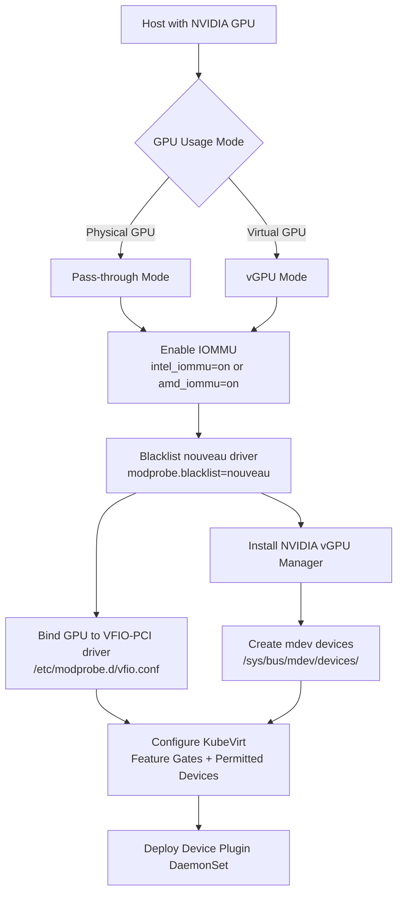
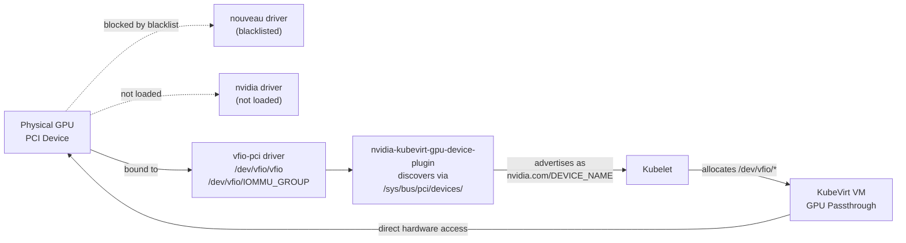
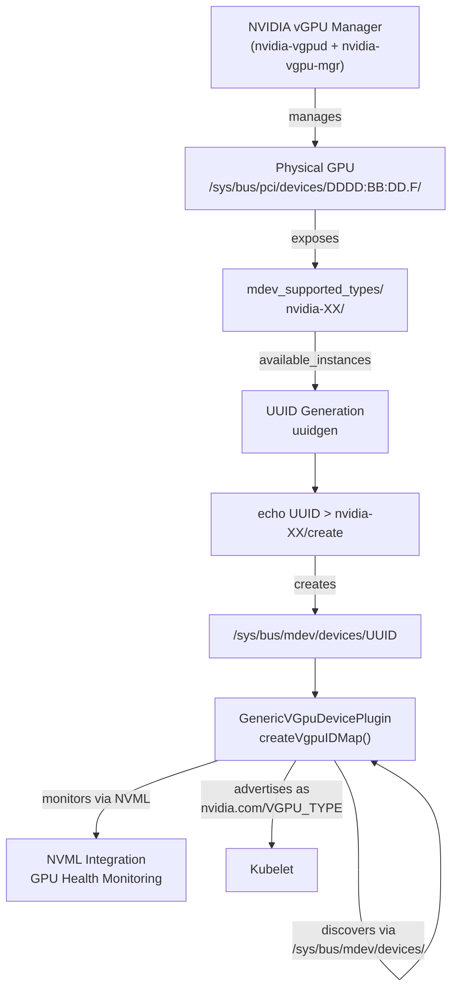
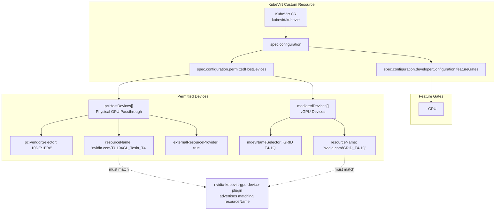

<!-- source: DeepWiki mcp.deepwiki.com · repo NVIDIA/kubevirt-gpu-device-plugin · page 2.1 Prerequisites and Host Setup · fetched 2026-10-26 -->

# Prerequisites and Host Setup

<details>
<summary>Relevant source files</summary>

The following files were used as context for generating this wiki page:

- [README.md](README.md)
- [examples/kubevirt-featuregate-cm.yaml](examples/kubevirt-featuregate-cm.yaml)
- [manifests/nvidia-kubevirt-gpu-device-plugin.yaml](manifests/nvidia-kubevirt-gpu-device-plugin.yaml)

</details>


## Purpose and Scope

This page details the host-level prerequisites and configuration steps required before deploying the NVIDIA KubeVirt GPU Device Plugin. It covers hardware requirements, kernel configuration, driver setup for both GPU pass-through and vGPU modes, and KubeVirt cluster configuration. 

For installation of the device plugin itself, see [Installing the Device Plugin](#2.2). For architectural details about how the device plugin discovers and manages GPUs, see [Device Discovery and Mapping](#3.2).

---

## Overview of Requirements

The device plugin requires specific host configuration to access GPU hardware through the VFIO subsystem. The configuration path differs based on whether physical GPU pass-through or vGPU virtualization is desired.



**Sources:** [README.md:21-32](), [README.md:34-109](), [README.md:111-173]()

---

## Software Requirements

| Component | Minimum Version | Notes |
|-----------|----------------|-------|
| Kubernetes | v1.11+ | Required for Device Plugin API support |
| KubeVirt | v0.36.0+ | Earlier versions not supported from device plugin v1.1.0+ |
| Linux Kernel | 4.x+ | IOMMU and VFIO support required |
| Operating System | RHEL/CentOS 7+, Ubuntu 18.04+ | Other distributions supported if kernel requirements met |

**Sources:** [README.md:23-24]()

---

## Hardware Requirements

### NVIDIA GPU

The system requires NVIDIA GPUs that support either:
- **GPU Pass-through**: GPU hardware with IOMMU virtualization support
- **vGPU Technology**: GPUs that support NVIDIA Virtual GPU (vGPU) with SR-IOV or mediated device (mdev) framework

### IOMMU Support

The host CPU and motherboard must support IOMMU (Input-Output Memory Management Unit):
- **Intel**: VT-d (Virtualization Technology for Directed I/O)
- **AMD**: AMD-Vi (I/O Virtualization Technology)

Verify IOMMU support in BIOS/UEFI settings before proceeding.

**Sources:** [README.md:37-65]()

---

## Host Configuration for GPU Pass-through Mode

GPU pass-through mode requires binding the physical GPU to the `vfio-pci` driver, which provides direct device access to virtual machines without host driver interference.

### Architecture: VFIO-PCI Binding Flow



**Sources:** [README.md:34-109](), [manifests/nvidia-kubevirt-gpu-device-plugin.yaml:31-39]()

### Step 1: Enable IOMMU and Blacklist Nouveau Driver

Edit the GRUB configuration to enable IOMMU and prevent the `nouveau` open-source driver from loading.

**File:** `/etc/default/grub`

Append to `GRUB_CMDLINE_LINUX`:
- **Intel CPUs**: `intel_iommu=on modprobe.blacklist=nouveau`
- **AMD CPUs**: `amd_iommu=on modprobe.blacklist=nouveau`

Example configuration:
```
GRUB_CMDLINE_LINUX="rd.lvm.lv=centos/root rd.lvm.lv=centos/swap rhgb quiet intel_iommu=on modprobe.blacklist=nouveau"
```

**Sources:** [README.md:37-49]()

#### Regenerate GRUB Configuration

**Legacy BIOS:**
```shell
grub2-mkconfig -o /boot/grub2/grub.cfg
reboot
```

**UEFI:**
```shell
grub2-mkconfig -o /boot/efi/EFI/centos/grub.cfg
reboot
```

**Sources:** [README.md:51-60]()

#### Verification

After reboot, verify IOMMU is enabled:
```shell
dmesg | grep -E "DMAR|IOMMU"
```

Verify `nouveau` is disabled:
```shell
dmesg | grep -i nouveau
```

**Sources:** [README.md:62-69]()

### Step 2: Determine GPU PCI Identifiers

Identify the GPU's vendor ID and device ID:
```shell
lspci -nn | grep -i nvidia
```

Example output:
```
04:00.0 3D controller [0302]: NVIDIA Corporation GP102GL [Tesla P40] [10de:1b38] (rev a1)
```

In this example:
- **Vendor ID**: `10de` (NVIDIA)
- **Device ID**: `1b38` (Tesla P40)

**Sources:** [README.md:73-82]()

### Step 3: Configure VFIO-PCI Driver Binding

Create the VFIO configuration file:
```shell
echo "options vfio-pci ids=10de:1b38" > /etc/modprobe.d/vfio.conf
```

Replace `10de:1b38` with your GPU's vendor ID and device ID.

Configure the module to load at boot:
```shell
echo 'vfio-pci' > /etc/modules-load.d/vfio-pci.conf
reboot
```

**Sources:** [README.md:84-96]()

### Step 4: Verify VFIO-PCI Driver Binding

After reboot, confirm the GPU is bound to `vfio-pci`:
```shell
lspci -nnk -d 10de:
```

Expected output showing `Kernel driver in use: vfio-pci`:
```
04:00.0 3D controller [0302]: NVIDIA Corporation GP102GL [Tesla P40] [10de:1b38] (rev a1)
        Subsystem: NVIDIA Corporation Device [10de:11d9]
        Kernel driver in use: vfio-pci
        Kernel modules: nouveau
```

The device plugin will discover GPUs by scanning `/sys/bus/pci/devices/` for devices bound to the `vfio-pci` driver.

**Sources:** [README.md:98-109]()

---

## Host Configuration for vGPU Mode

vGPU mode enables GPU virtualization where a single physical GPU is partitioned into multiple virtual GPUs (vGPUs) that can be assigned to different virtual machines.

### Architecture: mdev Device Creation Flow



**Sources:** [README.md:111-173]()

### Step 1: Install NVIDIA vGPU Manager

Install the NVIDIA Virtual GPU Manager package on the host. This provides the necessary drivers and tools for creating and managing vGPU devices through the Linux mdev framework.

**Note:** The NVIDIA vGPU Manager software requires a valid NVIDIA vGPU software license and is available through NVIDIA Licensing Portal.

### Step 2: Locate GPU mdev Support Directory

Navigate to the GPU's `mdev_supported_types` directory:
```shell
cd /sys/bus/pci/devices/DDDD\:BB\:DD.F/mdev_supported_types/
```

Example for GPU at PCI address `0000:06:00.0`:
```shell
cd /sys/bus/pci/devices/0000\:06\:00.0/mdev_supported_types/
```

**Sources:** [README.md:114-121]()

### Step 3: Identify vGPU Type

List available vGPU types and find the subdirectory for your desired type:
```shell
grep -l "M10-2Q" nvidia-*/name
```

Example output:
```
nvidia-41/name
```

This indicates that the `M10-2Q` vGPU type configuration is in the `nvidia-41` subdirectory.

**Sources:** [README.md:122-132]()

### Step 4: Check Available Instances

Verify that vGPU instances can be created:
```shell
cat nvidia-41/available_instances
```

Example output showing 4 available instances:
```
4
```

If the value is `0`, either the maximum number of vGPUs has been created or an incompatible vGPU type is already instantiated on the GPU.

**Sources:** [README.md:133-145]()

### Step 5: Generate UUID and Create vGPU Instance

Generate a UUID for the vGPU:
```shell
uuidgen
```

Example output:
```
aa618089-8b16-4d01-a136-25a0f3c73123
```

Create the vGPU instance:
```shell
echo "aa618089-8b16-4d01-a136-25a0f3c73123" > nvidia-41/create
```

**Sources:** [README.md:146-162]()

### Step 6: Verify vGPU Creation

Confirm the vGPU device exists:
```shell
ls -l /sys/bus/mdev/devices/
```

Expected output:
```
total 0
lrwxrwxrwx. 1 root root 0 Nov 24 13:33 aa618089-8b16-4d01-a136-25a0f3c73123 -> ../../../devices/pci0000:00/0000:00:03.0/0000:03:00.0/0000:04:09.0/0000:06:00.0/aa618089-8b16-4d01-a136-25a0f3c73123
```

The device plugin's `createVgpuIDMap()` function will discover these mdev devices by scanning `/sys/bus/mdev/devices/`.

**Sources:** [README.md:167-172]()

---

## KubeVirt Configuration

The device plugin requires KubeVirt to be configured with GPU feature gates enabled and permitted devices whitelisted.

### Component Configuration Map



**Sources:** [examples/kubevirt-featuregate-cm.yaml:1-22](), [README.md:25](), [README.md:31-32]()

### Enable GPU Feature Gate

The GPU feature gate must be enabled in the KubeVirt CR:

```yaml
spec:
  configuration:
    developerConfiguration:
      featureGates:
        - GPU
```

**Sources:** [examples/kubevirt-featuregate-cm.yaml:20-22]()

### Configure Permitted Host Devices

#### Physical GPU Pass-through Configuration

For GPUs bound to `vfio-pci`, configure `pciHostDevices`:

```yaml
spec:
  configuration:
    permittedHostDevices:
      pciHostDevices:
      - pciVendorSelector: "10DE:1EB8"
        resourceName: "nvidia.com/TU104GL_Tesla_T4"
        externalResourceProvider: true
```

| Field | Description |
|-------|-------------|
| `pciVendorSelector` | PCI vendor:device ID in format `VVVV:DDDD` (e.g., `10DE:1EB8` for Tesla T4) |
| `resourceName` | Kubernetes extended resource name advertised by device plugin |
| `externalResourceProvider` | Must be `true` to indicate device plugin manages allocation |

**Sources:** [examples/kubevirt-featuregate-cm.yaml:10-15]()

#### vGPU Configuration

For mdev-based vGPUs, configure `mediatedDevices`:

```yaml
spec:
  configuration:
    permittedHostDevices:
      mediatedDevices:
      - mdevNameSelector: "GRID T4-1Q"
        resourceName: "nvidia.com/GRID_T4-1Q"
```

| Field | Description |
|-------|-------------|
| `mdevNameSelector` | mdev type name (e.g., `GRID T4-1Q`, `M10-2Q`) |
| `resourceName` | Kubernetes extended resource name advertised by device plugin |

**Sources:** [examples/kubevirt-featuregate-cm.yaml:16-18]()

### Resource Name Matching

The `resourceName` values in the KubeVirt CR **must match** the resource names advertised by the device plugin. The device plugin constructs resource names as:

- **Physical GPUs**: `nvidia.com/<GPU_MODEL_NAME>` where the model name is resolved from the PCI database
- **vGPUs**: `nvidia.com/<VGPU_TYPE_NAME>` where the type name comes from the mdev device name

For example, a Tesla T4 GPU might be advertised as `nvidia.com/TU104GL_Tesla_T4`, and this exact string must appear in the KubeVirt CR's `pciHostDevices[].resourceName` field.

**Sources:** [README.md:31-32](), [examples/kubevirt-featuregate-cm.yaml:14](), [examples/kubevirt-featuregate-cm.yaml:18]()

---

## Verification Prerequisites

Before deploying the device plugin, verify all prerequisites are met:

| Requirement | Verification Command | Expected Result |
|-------------|---------------------|-----------------|
| IOMMU Enabled | `dmesg \| grep -E "DMAR\|IOMMU"` | Output shows IOMMU initialization messages |
| Nouveau Blacklisted | `dmesg \| grep -i nouveau` | No driver loading messages |
| VFIO-PCI Bound (pass-through) | `lspci -nnk -d 10de:` | Shows `Kernel driver in use: vfio-pci` |
| vGPU Created (vGPU mode) | `ls /sys/bus/mdev/devices/` | Lists created mdev device UUIDs |
| KubeVirt GPU Feature | `kubectl get kubevirt -n kubevirt kubevirt -o yaml` | Shows `GPU` in `featureGates[]` |
| Permitted Devices | `kubectl get kubevirt -n kubevirt kubevirt -o yaml` | Shows device configuration in `permittedHostDevices` |

**Sources:** [README.md:62-69](), [README.md:98-109](), [README.md:167-172](), [README.md:25](), [README.md:31-32]()

---

## Device Plugin Volume Mounts Dependency

The device plugin DaemonSet requires specific host paths to be mounted for operation:

```yaml
volumeMounts:
  - name: device-plugin
    mountPath: /var/lib/kubelet/device-plugins
  - name: vfio
    mountPath: /dev/vfio
volumes:
  - name: device-plugin
    hostPath:
      path: /var/lib/kubelet/device-plugins
  - name: vfio
    hostPath:
      path: /dev/vfio
```

| Volume | Purpose |
|--------|---------|
| `/var/lib/kubelet/device-plugins` | Device plugin registration socket location (required by Kubernetes Device Plugin API) |
| `/dev/vfio` | VFIO device files for GPU access (both pass-through and vGPU modes require VFIO subsystem) |

These mounts are essential for the device plugin to:
1. Register with the Kubelet via the gRPC socket
2. Enumerate VFIO IOMMU groups and device files
3. Provide device file paths in `AllocateResponse` to the Kubelet

**Sources:** [manifests/nvidia-kubevirt-gpu-device-plugin.yaml:28-39]()

---

## Next Steps

After completing the host setup and KubeVirt configuration, proceed to [Installing the Device Plugin](#2.2) to deploy the DaemonSet and verify GPU resource discovery.

---

