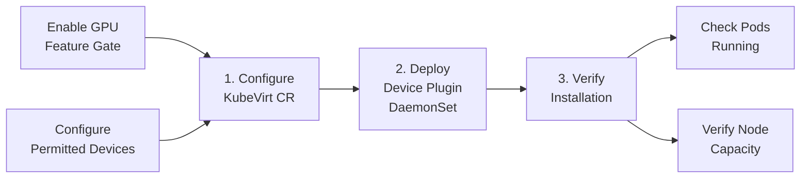
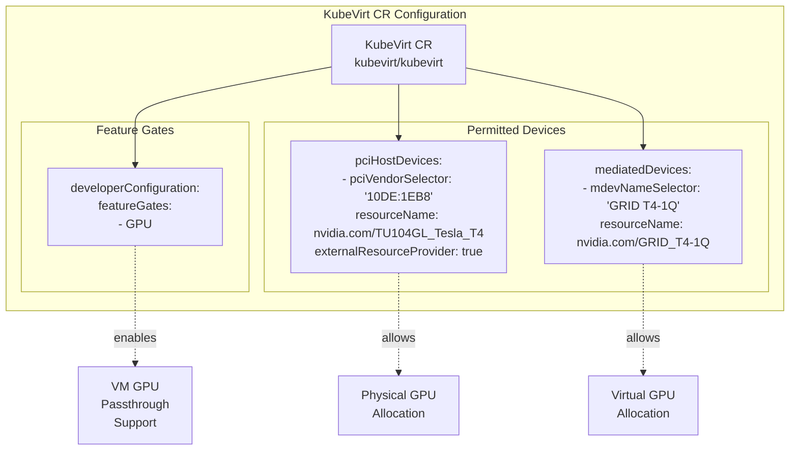
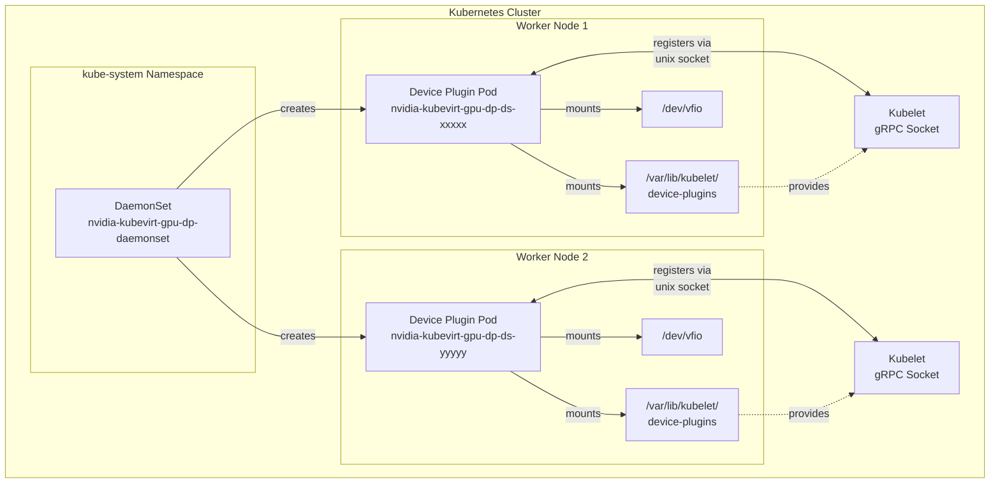
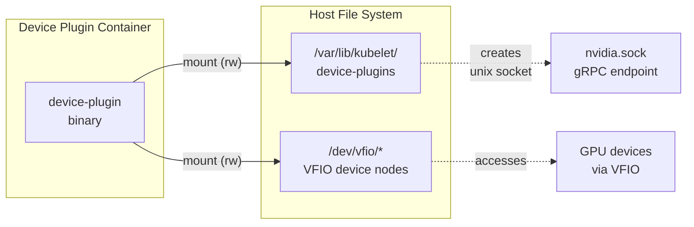
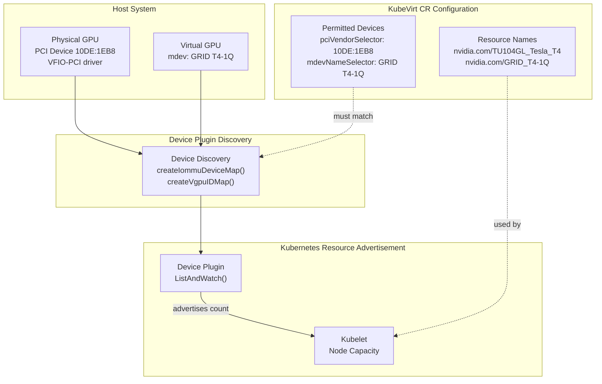

<!-- source: DeepWiki mcp.deepwiki.com · repo NVIDIA/kubevirt-gpu-device-plugin · page 2.2 Installing the Device Plugin · fetched 2026-10-26 -->

# Installing the Device Plugin

<details>
<summary>Relevant source files</summary>

The following files were used as context for generating this wiki page:

- [README.md](README.md)
- [examples/kubevirt-featuregate-cm.yaml](examples/kubevirt-featuregate-cm.yaml)
- [manifests/nvidia-kubevirt-gpu-device-plugin.yaml](manifests/nvidia-kubevirt-gpu-device-plugin.yaml)

</details>


This document guides you through deploying the NVIDIA KubeVirt GPU Device Plugin to your Kubernetes cluster. It covers KubeVirt configuration, DaemonSet deployment, and installation verification.

**Prerequisites**: Before proceeding with installation, ensure your nodes are properly configured with VFIO-PCI drivers for GPU passthrough or NVIDIA vGPU Manager for virtual GPUs. See [Prerequisites and Host Setup](#2.1) for complete host preparation instructions.

**Related Documentation**: For information about building custom container images, see [Container Images](#4.2). For deployment customization and advanced configuration, see [Kubernetes Deployment](#4.3).

## Installation Overview

The device plugin installation involves three main steps that must be performed in order:



**Sources**: [README.md:27-33](), [manifests/nvidia-kubevirt-gpu-device-plugin.yaml:1-40]()

## Step 1: Configure KubeVirt

Before deploying the device plugin, you must configure KubeVirt to enable GPU support and whitelist the GPU devices. This is done by modifying the KubeVirt Custom Resource (CR).

### Enabling the GPU Feature Gate

The GPU feature gate must be enabled in the KubeVirt CR to allow VMs to use host devices. This is configured in the `spec.configuration.developerConfiguration.featureGates` section:

```yaml
apiVersion: kubevirt.io/v1alpha3
kind: KubeVirt
metadata:
  name: kubevirt
  namespace: kubevirt
spec:
  configuration:
    developerConfiguration:
      featureGates:
        - GPU
```

**Sources**: [examples/kubevirt-featuregate-cm.yaml:20-22](), [README.md:25]()

### Configuring Permitted Devices

GPUs and vGPUs must be explicitly whitelisted in the KubeVirt CR's `permittedHostDevices` section. The device plugin advertises devices to Kubernetes using resource names that must match the `resourceName` field configured here.

#### Physical GPU Configuration

For physical GPUs bound to the VFIO-PCI driver, configure `pciHostDevices`:

```yaml
configuration:
  permittedHostDevices:
    pciHostDevices:
    - pciVendorSelector: "10DE:1EB8"
      resourceName: "nvidia.com/TU104GL_Tesla_T4"
      externalResourceProvider: true
```

| Field | Description | Example |
|-------|-------------|---------|
| `pciVendorSelector` | PCI vendor:device ID pair (format: `VENDOR:DEVICE`) | `"10DE:1EB8"` for Tesla T4 |
| `resourceName` | Kubernetes resource name advertised by device plugin | `"nvidia.com/TU104GL_Tesla_T4"` |
| `externalResourceProvider` | Must be `true` to indicate device plugin manages allocation | `true` |

**Sources**: [examples/kubevirt-featuregate-cm.yaml:11-15](), [README.md:32]()

#### Virtual GPU Configuration

For NVIDIA vGPUs (mdev devices), configure `mediatedDevices`:

```yaml
configuration:
  permittedHostDevices:
    mediatedDevices:
    - mdevNameSelector: "GRID T4-1Q"
      resourceName: "nvidia.com/GRID_T4-1Q"
```

| Field | Description | Example |
|-------|-------------|---------|
| `mdevNameSelector` | vGPU type name from mdev subsystem | `"GRID T4-1Q"` |
| `resourceName` | Kubernetes resource name advertised by device plugin | `"nvidia.com/GRID_T4-1Q"` |

**Sources**: [examples/kubevirt-featuregate-cm.yaml:16-18](), [README.md:111-173]()

### Complete KubeVirt CR Example



A complete example can be found at [examples/kubevirt-featuregate-cm.yaml:1-22]().

Apply the KubeVirt CR configuration:

```bash
kubectl apply -f examples/kubevirt-featuregate-cm.yaml
```

**Sources**: [examples/kubevirt-featuregate-cm.yaml:1-22](), [README.md:32]()

## Step 2: Deploy the Device Plugin DaemonSet

The device plugin is deployed as a DaemonSet in the `kube-system` namespace, ensuring it runs on every GPU-enabled node in the cluster.

### DaemonSet Architecture



**Sources**: [manifests/nvidia-kubevirt-gpu-device-plugin.yaml:1-40]()

### DaemonSet Manifest Components

The DaemonSet manifest [manifests/nvidia-kubevirt-gpu-device-plugin.yaml:1-40]() contains several critical configurations:

#### Namespace and Priority

```yaml
metadata:
  name: nvidia-kubevirt-gpu-dp-daemonset
  namespace: kube-system
spec:
  template:
    spec:
      priorityClassName: system-node-critical
```

The device plugin runs in the `kube-system` namespace with `system-node-critical` priority class, ensuring it is scheduled before regular workloads.

**Sources**: [manifests/nvidia-kubevirt-gpu-device-plugin.yaml:3-5,15]()

#### Tolerations

```yaml
tolerations:
- key: CriticalAddonsOnly
  operator: Exists
```

The toleration allows the device plugin to run on nodes in "critical add-ons only" mode, ensuring GPU resources remain available during node maintenance.

**Sources**: [manifests/nvidia-kubevirt-gpu-device-plugin.yaml:16-20]()

#### Container Configuration

| Configuration | Value | Purpose |
|--------------|-------|---------|
| **Container Name** | `nvidia-kubevirt-gpu-dp-ctr` | Container running the device plugin binary |
| **Image** | `nvcr.io/nvidia/kubevirt-gpu-device-plugin:v1.4.0` | Official NVIDIA container image |
| **Security Context** | `allowPrivilegeEscalation: false`<br/>`capabilities.drop: ["ALL"]` | Minimal security permissions |

**Sources**: [manifests/nvidia-kubevirt-gpu-device-plugin.yaml:22-27]()

#### Volume Mounts

The device plugin requires two critical volume mounts:



| Volume Name | Host Path | Container Mount | Purpose |
|------------|-----------|-----------------|---------|
| `device-plugin` | `/var/lib/kubelet/device-plugins` | `/var/lib/kubelet/device-plugins` | Creates gRPC socket for Kubelet communication |
| `vfio` | `/dev/vfio` | `/dev/vfio` | Accesses VFIO device nodes for GPU discovery and health checks |

**Sources**: [manifests/nvidia-kubevirt-gpu-device-plugin.yaml:28-39]()

### Deploying the DaemonSet

Apply the DaemonSet manifest to deploy the device plugin:

```bash
kubectl apply -f manifests/nvidia-kubevirt-gpu-device-plugin.yaml
```

The DaemonSet will automatically create device plugin pods on all nodes in the cluster. Pods will only successfully initialize on nodes that have GPUs configured with VFIO-PCI drivers or vGPU mdev devices.

**Sources**: [README.md:175-179]()

## Step 3: Verify Installation

### Check Pod Status

Verify that device plugin pods are running on GPU-enabled nodes:

```bash
kubectl get pods -n kube-system -l name=nvidia-kubevirt-gpu-dp-ds
```

Expected output:
```
NAME                                     READY   STATUS    RESTARTS   AGE
nvidia-kubevirt-gpu-dp-daemonset-abcd1   1/1     Running   0          2m
nvidia-kubevirt-gpu-dp-daemonset-xyz99   1/1     Running   0          2m
```

Check pod logs for successful device discovery and registration:

```bash
kubectl logs -n kube-system -l name=nvidia-kubevirt-gpu-dp-ds
```

Expected log entries indicating successful operation:
- Device discovery messages showing detected GPUs
- Device plugin registration with Kubelet
- ListAndWatch gRPC stream established

**Sources**: [README.md:175-179](), [manifests/nvidia-kubevirt-gpu-device-plugin.yaml:8-13]()

### Verify Node Capacity

Confirm that GPU resources are advertised on nodes:

```bash
kubectl get node <node-name> -o json | jq '.status.capacity'
```

Expected output showing GPU resources:
```json
{
  "cpu": "8",
  "memory": "32Gi",
  "nvidia.com/TU104GL_Tesla_T4": "1",
  "nvidia.com/GRID_T4-1Q": "4",
  "pods": "110"
}
```

The resource names (e.g., `nvidia.com/TU104GL_Tesla_T4`, `nvidia.com/GRID_T4-1Q`) should match the `resourceName` values configured in the KubeVirt CR's `permittedHostDevices` section.

**Sources**: [examples/kubevirt-featuregate-cm.yaml:14,18]()

### Resource Name Verification



The device plugin constructs resource names from PCI vendor/device IDs and vGPU type names. These resource names must be explicitly whitelisted in the KubeVirt CR for VMs to request them.

**Sources**: [examples/kubevirt-featuregate-cm.yaml:11-18](), [README.md:32]()

## Resource Name Format

The device plugin generates Kubernetes resource names following these patterns:

### Physical GPU Resource Names

Format: `nvidia.com/<DEVICE_NAME>`

The device name is resolved from the PCI IDs database using the vendor and device ID. For example:
- PCI ID `10DE:1EB8` → Device name `TU104GL_Tesla_T4` → Resource name `nvidia.com/TU104GL_Tesla_T4`

### Virtual GPU Resource Names

Format: `nvidia.com/<VGPU_TYPE_NAME>`

The vGPU type name is read from the mdev device's `name` attribute. Spaces in the type name are replaced with underscores. For example:
- vGPU type `GRID T4-1Q` → Resource name `nvidia.com/GRID_T4-1Q`

**Sources**: [examples/kubevirt-featuregate-cm.yaml:14,18](), [README.md:17-18]()

## Troubleshooting Installation

### Common Issues

| Symptom | Possible Cause | Resolution |
|---------|---------------|------------|
| Pods stuck in `CrashLoopBackOff` | GPUs not configured with VFIO-PCI driver | Verify VFIO-PCI driver binding per [Prerequisites and Host Setup](#2.1) |
| No GPU resources in node capacity | KubeVirt CR not configured | Ensure `permittedHostDevices` matches discovered devices |
| VMs fail to start with GPUs | Resource names mismatch | Verify `resourceName` in KubeVirt CR matches what device plugin advertises |
| Pods not scheduled | Node selectors or taints | Check DaemonSet tolerations and node labels |

### Viewing Detailed Logs

Enable verbose logging by modifying the device plugin container arguments:

```yaml
containers:
- name: nvidia-kubevirt-gpu-dp-ctr
  args:
  - "-v=4"  # Increase verbosity level
```

**Sources**: [README.md:27-33](), [manifests/nvidia-kubevirt-gpu-device-plugin.yaml:1-40]()

## Next Steps

With the device plugin installed and verified:

1. Create VMs requesting GPU resources using the resource names advertised by the device plugin
2. Monitor GPU allocation and health through device plugin logs
3. Review [Architecture](#3) documentation to understand the system's internal operation

For example VM configurations with GPU allocation, see the `examples/` directory in the repository.

**Sources**: [README.md:181]()

---

