<!-- source: DeepWiki mcp.deepwiki.com · repo NVIDIA/kubevirt-gpu-device-plugin · page 3 Architecture · fetched 2026-10-26 -->

# Architecture

<details>
<summary>Relevant source files</summary>

The following files were used as context for generating this wiki page:

- [manifests/nvidia-kubevirt-gpu-device-plugin.yaml](manifests/nvidia-kubevirt-gpu-device-plugin.yaml)
- [pkg/device_plugin/device_plugin.go](pkg/device_plugin/device_plugin.go)
- [pkg/device_plugin/device_plugin_test.go](pkg/device_plugin/device_plugin_test.go)
- [pkg/device_plugin/generic_device_plugin.go](pkg/device_plugin/generic_device_plugin.go)
- [pkg/device_plugin/generic_vgpu_device_plugin.go](pkg/device_plugin/generic_vgpu_device_plugin.go)

</details>


## Purpose and Scope

This document provides a comprehensive technical overview of the NVIDIA KubeVirt GPU Device Plugin's internal architecture and design. It covers the core components, their interactions, and the technical implementation that enables GPU passthrough and vGPU support for KubeVirt virtual machines within Kubernetes clusters.

For installation and deployment procedures, see [Getting Started](#2). For detailed subsystem documentation, see the following child pages:
- System architecture overview: [System Architecture Overview](#3.1)
- Device discovery mechanisms: [Device Discovery and Mapping](#3.2)
- Physical GPU management: [Physical GPU Device Plugin](#3.3)
- Virtual GPU management: [Virtual GPU Device Plugin](#3.4)
- Kubernetes API integration: [Kubernetes Integration](#3.5)
- Observability infrastructure: [Logging and Observability](#3.6)

---

## Architectural Overview

The device plugin operates as a Kubernetes DaemonSet pod on GPU-enabled nodes, implementing the Kubernetes Device Plugin API v1beta1 to advertise GPU resources and handle allocation requests. The system supports both physical GPU passthrough via VFIO-PCI and virtual GPU (vGPU) allocation via Linux mdev subsystem.

### Core Components

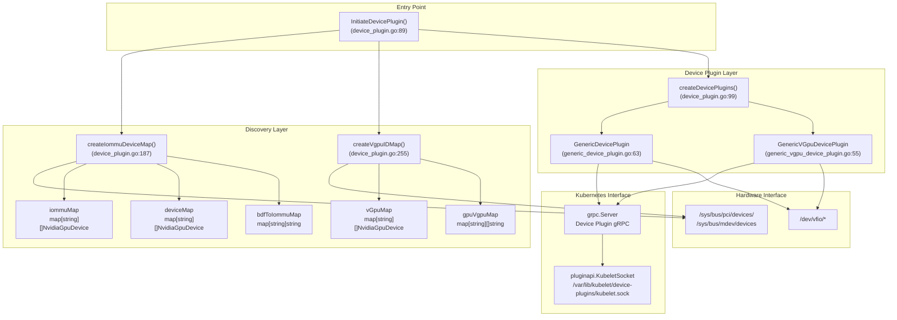

**Sources:** [pkg/device_plugin/device_plugin.go:89-176](), [pkg/device_plugin/generic_device_plugin.go:63-90](), [pkg/device_plugin/generic_vgpu_device_plugin.go:55-81]()

---

## Data Structures and Mapping

The system maintains several critical maps to track GPU devices, their IOMMU groups, and relationships between physical and virtual GPUs:

| Map Variable | Type | Purpose | Source |
|--------------|------|---------|--------|
| `iommuMap` | `map[string][]NvidiaGpuDevice` | IOMMU group ID → GPU devices in that group | [device_plugin.go:56]() |
| `deviceMap` | `map[string][]NvidiaGpuDevice` | GPU device ID → all GPUs of that type | [device_plugin.go:59]() |
| `bdfToIommuMap` | `map[string]string` | PCI BDF address → IOMMU group ID | [device_plugin.go:62]() |
| `vGpuMap` | `map[string][]NvidiaGpuDevice` | vGPU type → vGPU devices of that type | [device_plugin.go:65]() |
| `gpuVgpuMap` | `map[string][]string` | GPU device ID → associated vGPU IDs | [device_plugin.go:68]() |

### NvidiaGpuDevice Structure

```go
type NvidiaGpuDevice struct {
    addr     string // PCI address (e.g., "0000:03:00.0")
    numaNode int64  // NUMA node ID for topology-aware scheduling
}
```

**Sources:** [pkg/device_plugin/device_plugin.go:49-68]()

---

## Device Discovery Process

Device discovery occurs at startup through two parallel scanning operations:

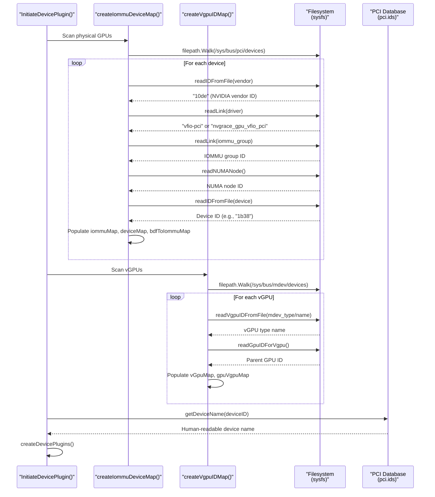

**Sources:** [pkg/device_plugin/device_plugin.go:89-96](), [pkg/device_plugin/device_plugin.go:187-247](), [pkg/device_plugin/device_plugin.go:255-291](), [pkg/device_plugin/device_plugin.go:371-438]()

### Discovery Functions

| Function | Path | Purpose |
|----------|------|---------|
| `createIommuDeviceMap()` | [device_plugin.go:187-247]() | Scans `/sys/bus/pci/devices`, identifies NVIDIA GPUs with VFIO drivers, maps to IOMMU groups |
| `createVgpuIDMap()` | [device_plugin.go:255-291]() | Scans `/sys/bus/mdev/devices`, identifies vGPU instances, links to parent GPUs |
| `readIDFromFileFunc()` | [device_plugin.go:294-302]() | Reads vendor/device IDs from sysfs |
| `readLinkFunc()` | [device_plugin.go:323-331]() | Resolves symlinks for driver and IOMMU group |
| `readNUMANodeFunc()` | [device_plugin.go:304-320]() | Reads NUMA topology information |
| `readVgpuIDFromFileFunc()` | [device_plugin.go:334-344]() | Extracts vGPU type name |
| `getDeviceName()` | [device_plugin.go:371-422]() | Resolves device ID to human-readable name from pci.ids database |

**Sources:** [pkg/device_plugin/device_plugin.go:187-438]()

---

## Dual Device Plugin Architecture

The system instantiates separate device plugin instances for each discovered GPU type and vGPU type. Each plugin operates independently with its own gRPC server and socket.

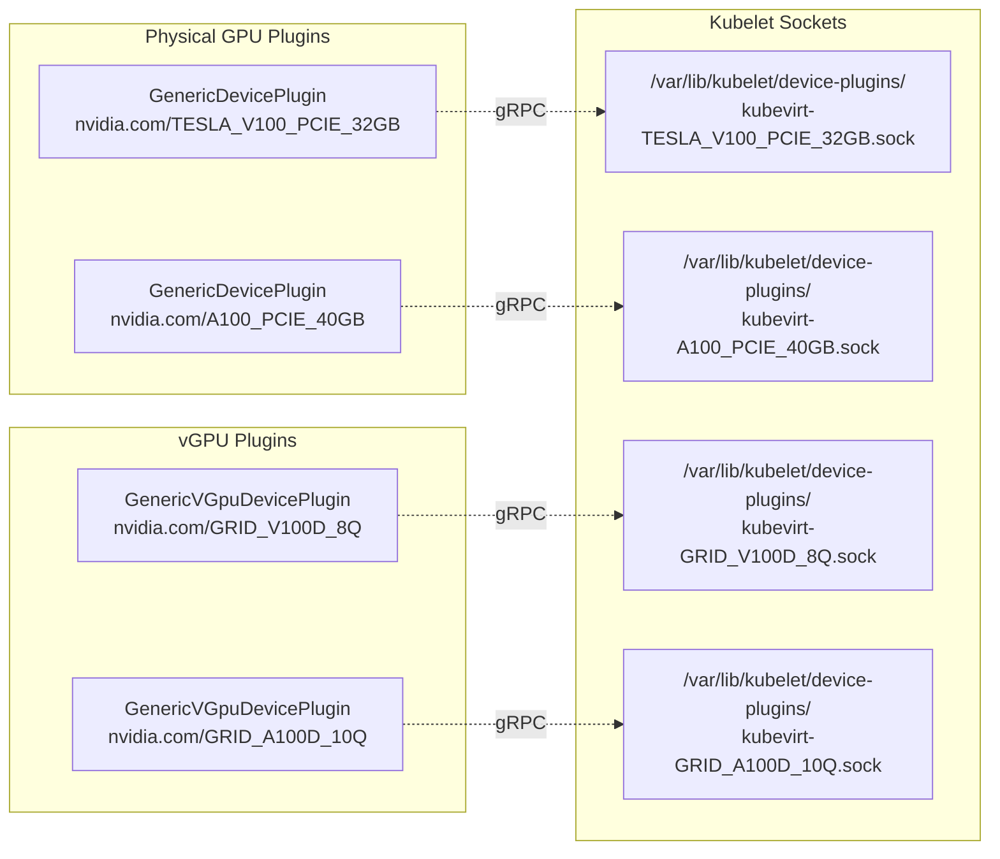

### Plugin Instantiation Flow

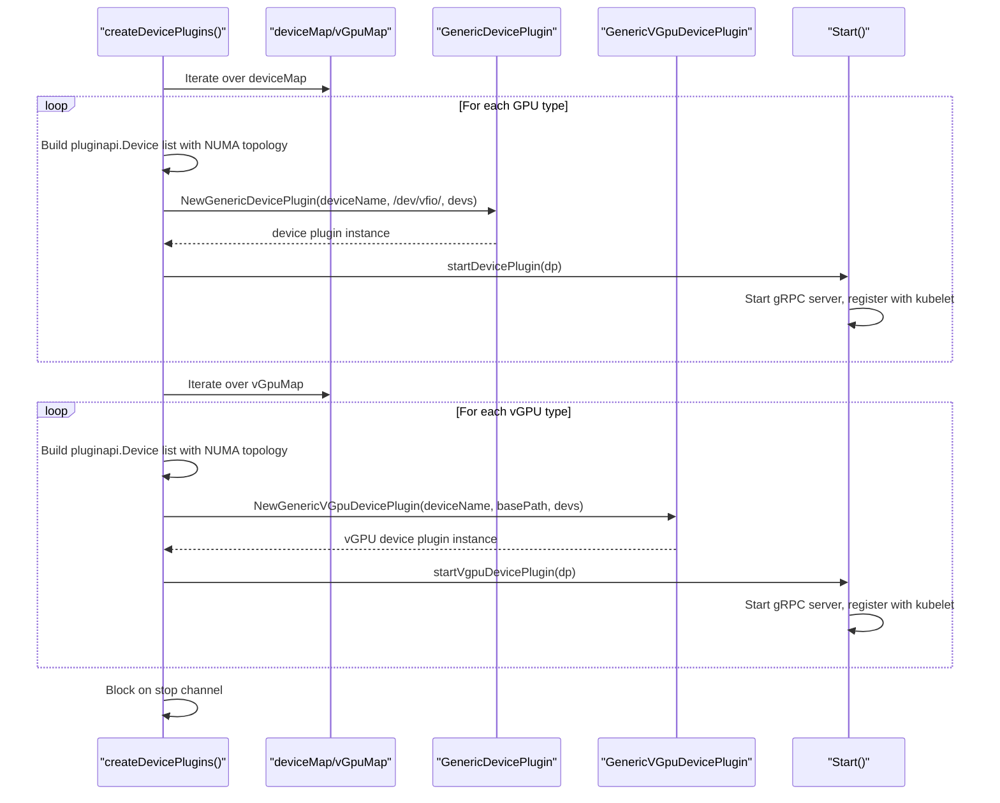

**Sources:** [pkg/device_plugin/device_plugin.go:99-176](), [pkg/device_plugin/generic_device_plugin.go:77-90](), [pkg/device_plugin/generic_vgpu_device_plugin.go:68-81]()

---

## Kubernetes Device Plugin API Implementation

Both `GenericDevicePlugin` and `GenericVGpuDevicePlugin` implement the `pluginapi.DevicePluginServer` interface, providing the following methods:

### Device Plugin Methods

| Method | GenericDevicePlugin | GenericVGpuDevicePlugin | Purpose |
|--------|---------------------|-------------------------|---------|
| `Register()` | [generic_device_plugin.go:202-223]() | [generic_vgpu_device_plugin.go:156-175]() | Registers with kubelet via gRPC |
| `ListAndWatch()` | [generic_device_plugin.go:226-263]() | [generic_vgpu_device_plugin.go:178-206]() | Streams device list and health updates |
| `Allocate()` | [generic_device_plugin.go:266-361]() | [generic_vgpu_device_plugin.go:209-247]() | Handles device allocation requests |
| `GetDevicePluginOptions()` | [generic_device_plugin.go:371-377]() | [generic_vgpu_device_plugin.go:257-262]() | Returns plugin capabilities |
| `GetPreferredAllocation()` | [generic_device_plugin.go:387-525]() | [generic_vgpu_device_plugin.go:270-278]() | Provides NUMA-aware allocation hints |
| `PreStartContainer()` | [generic_device_plugin.go:379-382]() | [generic_vgpu_device_plugin.go:264-267]() | Pre-start hook (no-op) |

**Sources:** [pkg/device_plugin/generic_device_plugin.go:63-634](), [pkg/device_plugin/generic_vgpu_device_plugin.go:55-438]()

---

## Physical GPU Allocation Flow

The `GenericDevicePlugin.Allocate()` method performs validation and constructs device specifications for physical GPU allocation:

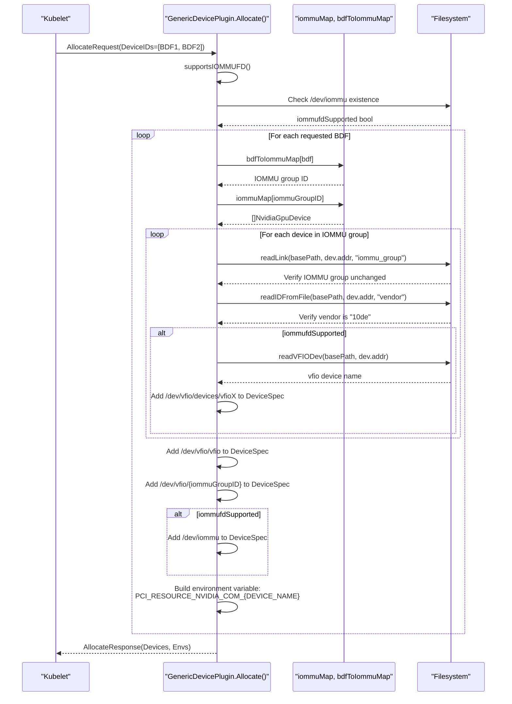

### Allocation Output

For a physical GPU allocation, the response includes:

**Device Specifications:**
- `/dev/vfio/vfio` - VFIO container device
- `/dev/vfio/{iommuGroupID}` - IOMMU group device (e.g., `/dev/vfio/26`)
- `/dev/vfio/devices/vfioX` - Per-device IOMMUFD device (if supported)
- `/dev/iommu` - IOMMUFD device (if supported)

**Environment Variables:**
- `PCI_RESOURCE_NVIDIA_COM_{DEVICE_NAME}` - Comma-separated list of BDF addresses

**Sources:** [pkg/device_plugin/generic_device_plugin.go:266-361](), [pkg/device_plugin/generic_device_plugin.go:609-633]()

---

## Virtual GPU Allocation Flow

The `GenericVGpuDevicePlugin.Allocate()` method handles vGPU allocation:

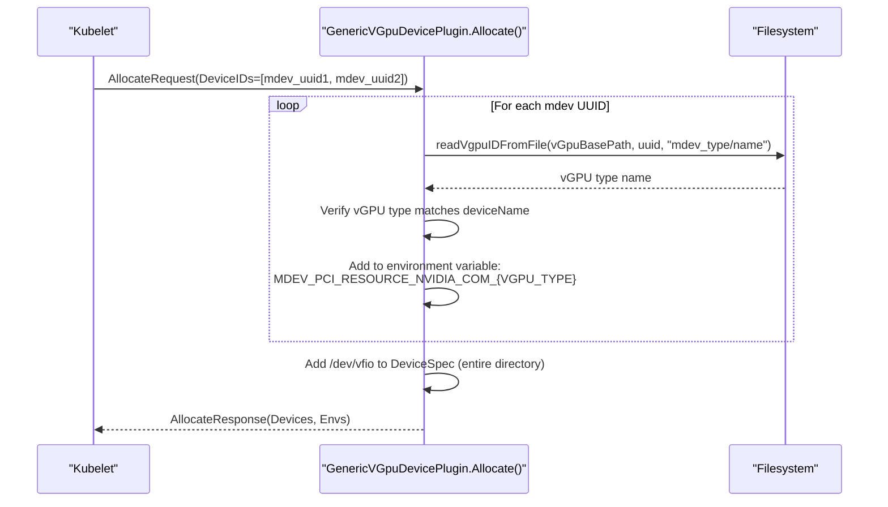

### Allocation Output

For a vGPU allocation, the response includes:

**Device Specifications:**
- `/dev/vfio` - Entire VFIO directory (mdev devices appear here)

**Environment Variables:**
- `MDEV_PCI_RESOURCE_NVIDIA_COM_{VGPU_TYPE}` - Comma-separated list of mdev UUIDs

**Sources:** [pkg/device_plugin/generic_vgpu_device_plugin.go:209-247]()

---

## NUMA-Aware Allocation

The `GetPreferredAllocation()` method in `GenericDevicePlugin` implements topology-aware device selection to optimize NUMA affinity:

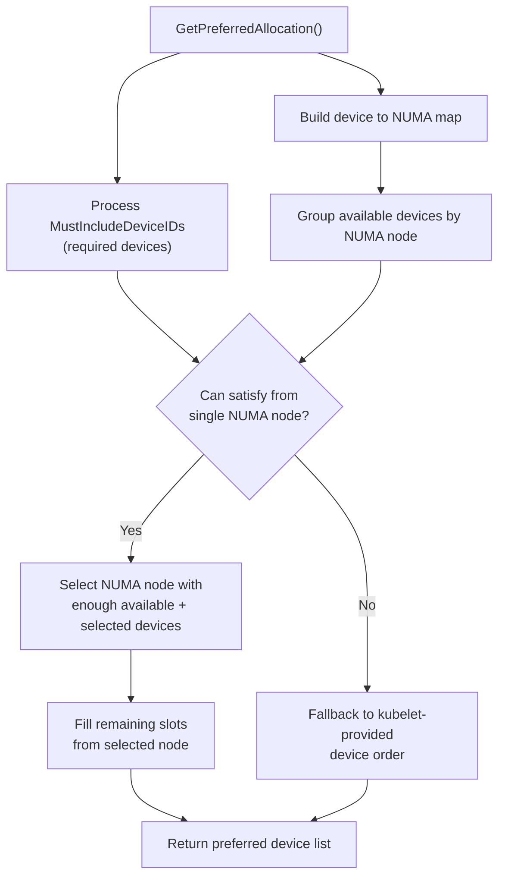

### Algorithm Details

1. **Build NUMA topology map**: Extract NUMA node ID from each device's `Topology.Nodes[0].ID`
2. **Process must-include devices**: Add all required devices first, preserving order
3. **Attempt single-node allocation**: Try to find a NUMA node with sufficient devices (including already selected)
4. **Fill from selected node**: If a suitable node found, add remaining devices from that node
5. **Fallback**: If no single node can satisfy, use kubelet's original device order

**Sources:** [pkg/device_plugin/generic_device_plugin.go:387-525]()

---

## Health Monitoring

Both device plugin types implement continuous health monitoring through goroutines started in `Start()`:

### Physical GPU Health Check

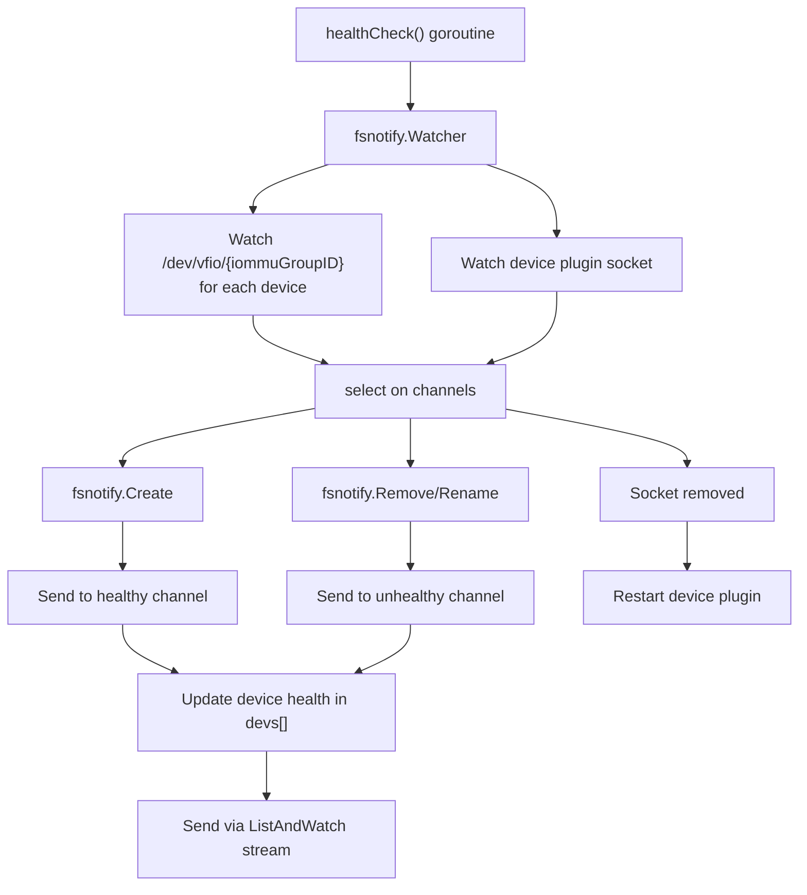

**Sources:** [pkg/device_plugin/generic_device_plugin.go:528-607]()

### Virtual GPU Health Check

The vGPU health check adds NVML-based XID error monitoring:

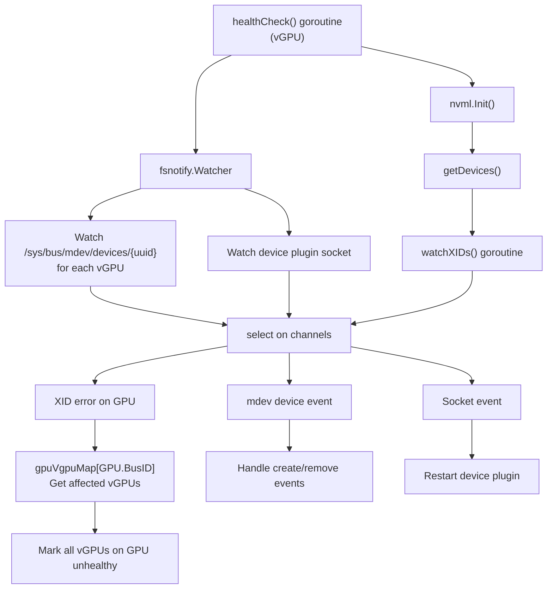

### XID Error Monitoring

The `watchXIDs()` function monitors critical GPU errors via NVML:

```go
nvml.RegisterEventForDevice(eventSet, nvml.XidCriticalError, device.UUID)
```

Critical XID errors (excluding application errors 31, 43, 45) trigger marking all vGPUs on the affected physical GPU as unhealthy via the `gpuVgpuMap` lookup.

**Sources:** [pkg/device_plugin/generic_vgpu_device_plugin.go:281-438](), [pkg/device_plugin/generic_vgpu_device_plugin.go:388-437]()

---

## Lifecycle and Registration

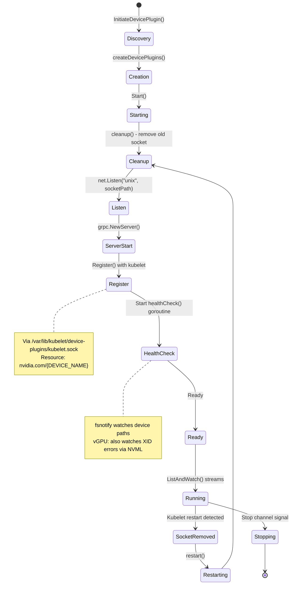

**Sources:** [pkg/device_plugin/generic_device_plugin.go:130-170](), [pkg/device_plugin/generic_device_plugin.go:188-199](), [pkg/device_plugin/generic_device_plugin.go:202-223]()

---

## DaemonSet Deployment Architecture

The device plugin runs as a privileged DaemonSet in the `kube-system` namespace:

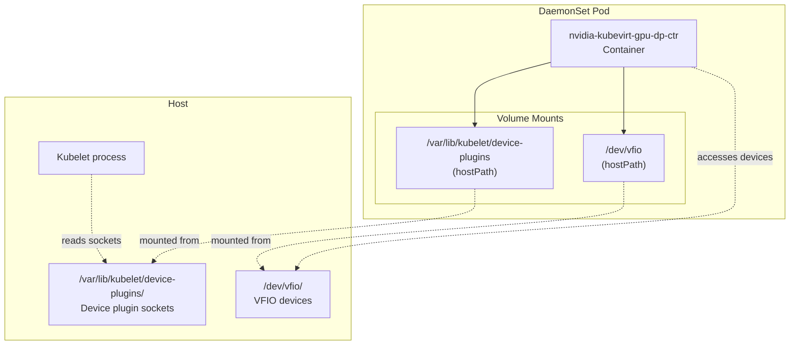

### Security Configuration

| Setting | Value | Purpose |
|---------|-------|---------|
| `allowPrivilegeEscalation` | `false` | Prevents privilege escalation |
| `capabilities.drop` | `["ALL"]` | Drops all Linux capabilities |
| `priorityClassName` | `system-node-critical` | Ensures high scheduling priority |
| Tolerations | `CriticalAddonsOnly` | Allows running during maintenance |

**Sources:** [manifests/nvidia-kubevirt-gpu-device-plugin.yaml:1-40]()

---

## Key Constants and Configuration

### Resource Namespaces and Prefixes

```go
const (
    DeviceNamespace   = "nvidia.com"                // Kubernetes resource namespace
    connectionTimeout = 5 * time.Second             // gRPC connection timeout
    vfioDevicePath    = "/dev/vfio"                 // VFIO device directory
    iommuDevicePath   = "/dev/iommu"                // IOMMUFD device
    gpuPrefix         = "PCI_RESOURCE_NVIDIA_COM"   // Physical GPU env var prefix
    vgpuPrefix        = "MDEV_PCI_RESOURCE_NVIDIA_COM" // vGPU env var prefix
    nvidiaVendorID    = "10de"                      // NVIDIA PCI vendor ID
)
```

### Filesystem Paths

| Path | Variable | Purpose |
|------|----------|---------|
| `/sys/bus/pci/devices` | `basePath` | Physical GPU discovery |
| `/sys/bus/mdev/devices` | `vGpuBasePath` | vGPU discovery |
| `/usr/pci.ids` | `pciIdsFilePath` | PCI device name database |
| `/var/lib/kubelet/device-plugins/kubelet.sock` | `pluginapi.KubeletSocket` | Kubelet registration endpoint |
| `/var/lib/kubelet/device-plugins/kubevirt-{NAME}.sock` | Computed | Device plugin socket |

### Supported VFIO Drivers

```go
var supportedVfioDrivers = map[string]struct{}{
    "vfio-pci":             {},  // Standard VFIO-PCI driver
    "nvgrace_gpu_vfio_pci": {},  // NVIDIA Grace GPU VFIO driver
}
```

**Sources:** [pkg/device_plugin/generic_device_plugin.go:50-57](), [pkg/device_plugin/device_plugin.go:45-79]()

---

## Summary

The NVIDIA KubeVirt GPU Device Plugin implements a sophisticated architecture with clear separation of concerns:

1. **Discovery Layer**: Scans sysfs to build comprehensive maps of physical and virtual GPU devices with topology information
2. **Plugin Layer**: Instantiates separate device plugin instances per GPU/vGPU type, each with independent gRPC servers
3. **Allocation Layer**: Validates IOMMU isolation, provides NUMA-aware allocation hints, and constructs device specifications
4. **Health Layer**: Continuously monitors device paths via fsnotify and GPU errors via NVML
5. **Integration Layer**: Implements standard Kubernetes Device Plugin API for seamless kubelet integration

This design enables robust GPU resource management for KubeVirt virtual machines with support for both passthrough and vGPU scenarios, NUMA-aware scheduling, and comprehensive health monitoring.

---

