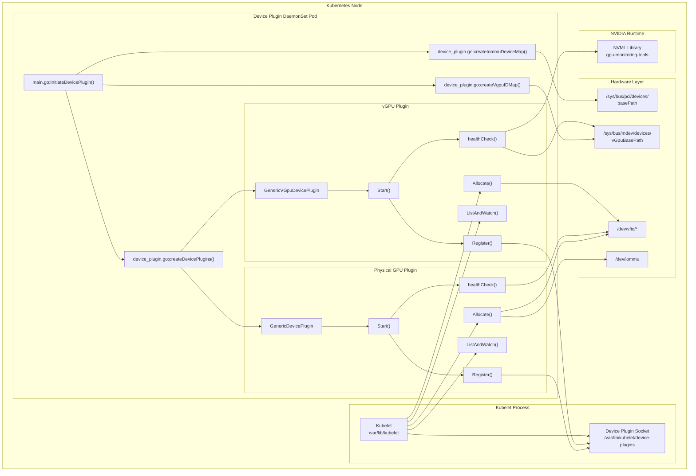
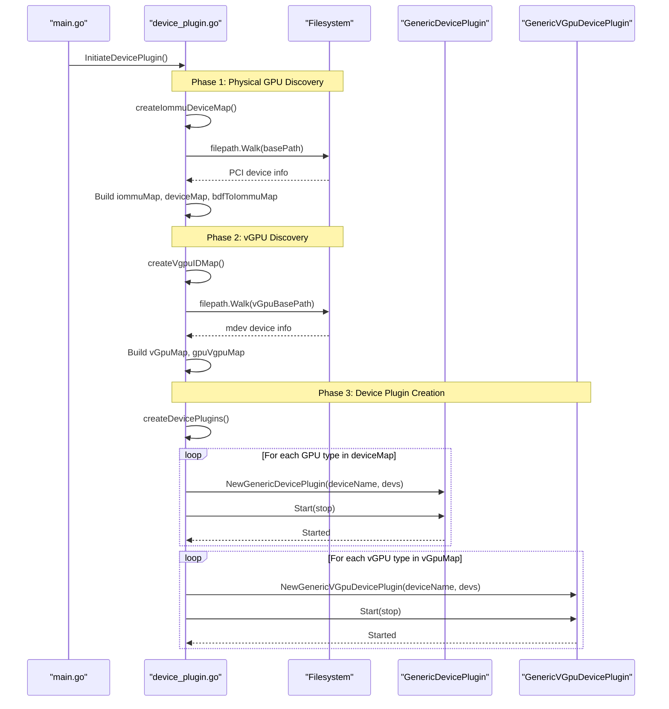
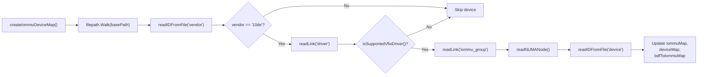
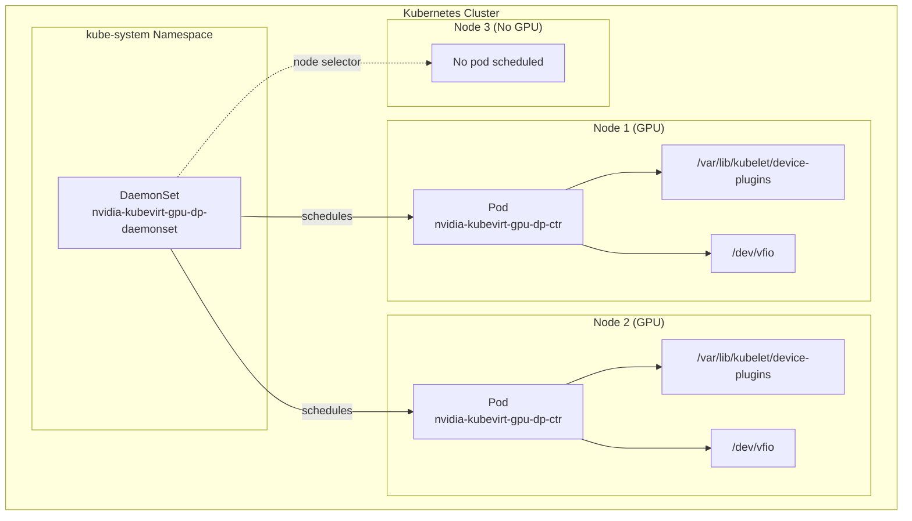
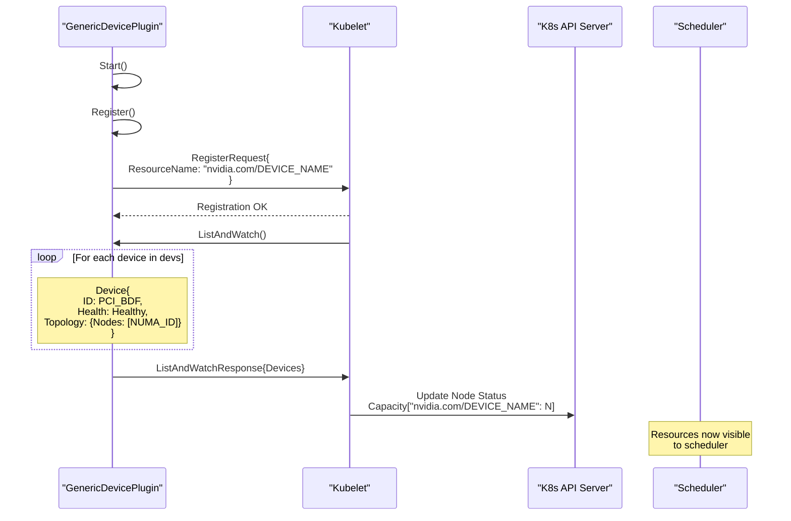
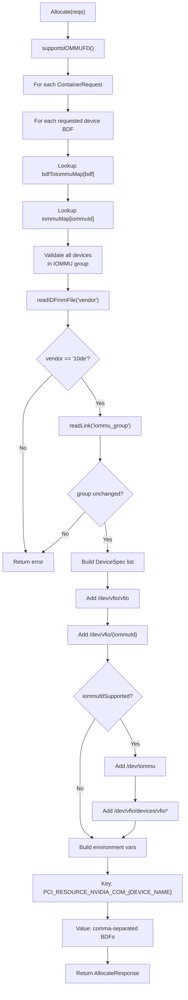
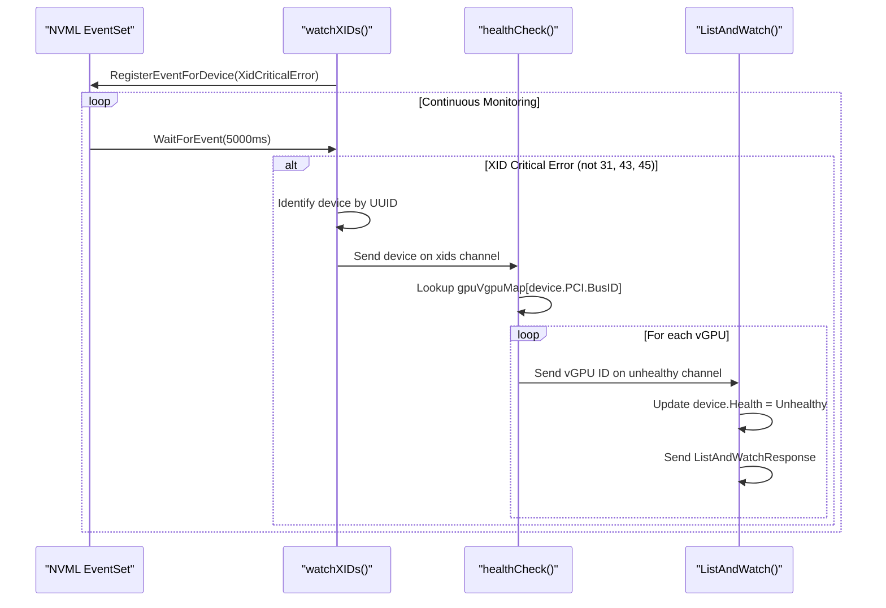

<!-- source: DeepWiki mcp.deepwiki.com · repo NVIDIA/kubevirt-gpu-device-plugin · page 3.1 System Architecture Overview · fetched 2026-10-26 -->

# System Architecture Overview

<details>
<summary>Relevant source files</summary>

The following files were used as context for generating this wiki page:

- [manifests/nvidia-kubevirt-gpu-device-plugin.yaml](manifests/nvidia-kubevirt-gpu-device-plugin.yaml)
- [pkg/device_plugin/device_plugin.go](pkg/device_plugin/device_plugin.go)
- [pkg/device_plugin/device_plugin_test.go](pkg/device_plugin/device_plugin_test.go)
- [pkg/device_plugin/generic_device_plugin.go](pkg/device_plugin/generic_device_plugin.go)
- [pkg/device_plugin/generic_vgpu_device_plugin.go](pkg/device_plugin/generic_vgpu_device_plugin.go)

</details>


## Purpose and Scope

This document provides a comprehensive technical overview of the NVIDIA KubeVirt GPU Device Plugin's internal architecture. It describes the system's main components, their interactions, and how they collectively enable GPU passthrough and virtual GPU support for KubeVirt virtual machines running on Kubernetes.

For build and deployment details, see [Build System](#4.1) and [Kubernetes Deployment](#4.3). For low-level device discovery mechanisms, see [Device Discovery and Mapping](#3.2). For specific implementation details of the device plugins, see [Physical GPU Device Plugin](#3.3) and [Virtual GPU Device Plugin](#3.4).

---

## High-Level System Architecture

The device plugin operates as a bridge between Kubernetes resource management and NVIDIA GPU hardware. It implements the Kubernetes Device Plugin API v1beta1, runs as a DaemonSet on GPU-enabled nodes, and manages both physical GPU passthrough (via VFIO-PCI) and virtual GPU allocation (via mdev).



**Sources:** [pkg/device_plugin/device_plugin.go:89-96](), [pkg/device_plugin/generic_device_plugin.go:63-74](), [pkg/device_plugin/generic_vgpu_device_plugin.go:54-66](), [manifests/nvidia-kubevirt-gpu-device-plugin.yaml:1-40]()

---

## Core Components

### Entry Point and Initialization

The system starts from `InitiateDevicePlugin()` which orchestrates the three-phase startup sequence:

| Phase | Function | Purpose |
|-------|----------|---------|
| 1. Physical GPU Discovery | `createIommuDeviceMap()` | Scans `/sys/bus/pci/devices` for NVIDIA GPUs with VFIO-PCI driver |
| 2. vGPU Discovery | `createVgpuIDMap()` | Scans `/sys/bus/mdev/devices` for mdev devices |
| 3. Plugin Creation | `createDevicePlugins()` | Instantiates and starts device plugin servers |



**Sources:** [pkg/device_plugin/device_plugin.go:89-96](), [pkg/device_plugin/device_plugin.go:99-176](), [pkg/device_plugin/device_plugin.go:187-247](), [pkg/device_plugin/device_plugin.go:254-291]()

### Device Discovery Subsystem

The discovery subsystem maintains five global maps that represent the GPU topology:

| Map Variable | Type | Purpose |
|--------------|------|---------|
| `iommuMap` | `map[string][]NvidiaGpuDevice` | Maps IOMMU group ID → GPU devices in that group |
| `deviceMap` | `map[string][]NvidiaGpuDevice` | Maps GPU device ID (e.g., "1b80") → GPU devices of that type |
| `bdfToIommuMap` | `map[string]string` | Maps PCI BDF (Bus:Device.Function) → IOMMU group ID |
| `vGpuMap` | `map[string][]NvidiaGpuDevice` | Maps vGPU type name → vGPU devices of that type |
| `gpuVgpuMap` | `map[string][]string` | Maps GPU ID → list of associated vGPU device addresses |

The `NvidiaGpuDevice` struct stores device metadata:

```
type NvidiaGpuDevice struct {
    addr     string  // PCI address (e.g., "0000:03:00.0") or mdev UUID
    numaNode int64   // NUMA node ID for topology-aware allocation
}
```

**Discovery Process for Physical GPUs:**



**Sources:** [pkg/device_plugin/device_plugin.go:45-87](), [pkg/device_plugin/device_plugin.go:187-247](), [pkg/device_plugin/device_plugin.go:254-291](), [pkg/device_plugin/device_plugin.go:294-331]()

### Device Plugin Implementations

Both `GenericDevicePlugin` and `GenericVGpuDevicePlugin` implement the Kubernetes Device Plugin API by satisfying these gRPC service methods:

| Method | Physical GPU (`GenericDevicePlugin`) | vGPU (`GenericVGpuDevicePlugin`) |
|--------|--------------------------------------|----------------------------------|
| `GetDevicePluginOptions()` | Returns `GetPreferredAllocationAvailable: true` | Returns default options |
| `ListAndWatch()` | Streams device list with NUMA topology | Streams device list with NUMA topology |
| `GetPreferredAllocation()` | NUMA-aware allocation algorithm | Not implemented (returns nil) |
| `Allocate()` | Returns VFIO device specs and IOMMU group mounts | Returns VFIO device path and env vars |
| `PreStartContainer()` | No-op | No-op |

**Physical GPU Plugin Structure:**

```mermaid
classDiagram
    class GenericDevicePlugin {
        +devs []*pluginapi.Device
        +server *grpc.Server
        +socketPath string
        +stop chan struct{}
        +term chan bool
        +healthy chan string
        +unhealthy chan string
        +devicePath string
        +deviceName string
        
        +Start(stop) error
        +Stop() error
        +Register() error
        +ListAndWatch() error
        +Allocate() (*AllocateResponse, error)
        +GetPreferredAllocation() (*PreferredAllocationResponse, error)
        +healthCheck() error
    }
    
    class GenericVGpuDevicePlugin {
        +devs []*pluginapi.Device
        +server *grpc.Server
        +socketPath string
        +stop chan struct{}
        +term chan bool
        +healthy chan string
        +unhealthy chan string
        +devicePath string
        +deviceName string
        
        +Start(stop) error
        +Stop() error
        +Register() error
        +ListAndWatch() error
        +Allocate() (*AllocateResponse, error)
        +healthCheck() error
    }
    
    class Device_Plugin_API {
        <<interface>>
        +GetDevicePluginOptions()
        +ListAndWatch()
        +Allocate()
        +GetPreferredAllocation()
        +PreStartContainer()
    }
    
    GenericDevicePlugin ..|> Device_Plugin_API
    GenericVGpuDevicePlugin ..|> Device_Plugin_API
```

**Sources:** [pkg/device_plugin/generic_device_plugin.go:63-74](), [pkg/device_plugin/generic_vgpu_device_plugin.go:54-66](), [pkg/device_plugin/generic_device_plugin.go:371-377](), [pkg/device_plugin/generic_vgpu_device_plugin.go:257-262]()

### Kubernetes Integration Layer

The device plugins communicate with Kubelet through Unix domain sockets using gRPC:

```mermaid
graph TB
    subgraph "Device Plugin"
        SOCK_PATH["socketPath<br/>/var/lib/kubelet/device-plugins/kubevirt-{deviceName}.sock"]
        GRPC_SERVER["grpc.Server"]
        REG_FUNC["Register()"]
        LAW_FUNC["ListAndWatch()"]
        ALLOC_FUNC["Allocate()"]
    end
    
    subgraph "Kubelet"
        KUBELET_SOCK["pluginapi.KubeletSocket<br/>/var/lib/kubelet/device-plugins/kubelet.sock"]
        REG_CLIENT["RegistrationClient"]
        DP_CLIENT["DevicePluginClient"]
    end
    
    subgraph "Registration Flow"
        REG_FUNC -->|connect()| KUBELET_SOCK
        KUBELET_SOCK --> REG_CLIENT
        REG_CLIENT -->|RegisterRequest| REG_FUNC
    end
    
    subgraph "Device Advertisement Flow"
        DP_CLIENT -->|gRPC| SOCK_PATH
        SOCK_PATH --> GRPC_SERVER
        GRPC_SERVER --> LAW_FUNC
        LAW_FUNC -->|ListAndWatchResponse| DP_CLIENT
    end
    
    subgraph "Allocation Flow"
        DP_CLIENT -->|AllocateRequest| GRPC_SERVER
        GRPC_SERVER --> ALLOC_FUNC
        ALLOC_FUNC -->|AllocateResponse| DP_CLIENT
    end
```

**Registration Details:**

Each device plugin registers with Kubelet using a resource name in the format `nvidia.com/{deviceName}`. The `deviceName` is derived from the PCI device ID by looking it up in `/usr/pci.ids` via `getDeviceName()`:

1. Opens `pciIdsFilePath` (`/usr/pci.ids`)
2. Calls `locateVendor()` to find NVIDIA vendor section (ID: `10de`)
3. Searches for device ID (e.g., `1b80`)
4. Transforms device name to uppercase, replaces spaces/special chars with underscores
5. Returns formatted name (e.g., `GK104GL_GRID_K520`)

**Sources:** [pkg/device_plugin/generic_device_plugin.go:201-223](), [pkg/device_plugin/generic_device_plugin.go:129-170](), [pkg/device_plugin/device_plugin.go:371-438](), [pkg/device_plugin/generic_device_plugin.go:50-57]()

---

## Deployment Architecture

The device plugin runs as a DaemonSet in the `kube-system` namespace with the following characteristics:

| Configuration | Value | Purpose |
|---------------|-------|---------|
| **Namespace** | `kube-system` | System-level component |
| **Priority Class** | `system-node-critical` | Ensures scheduling during resource pressure |
| **Security Context** | `allowPrivilegeEscalation: false`, `drop: ["ALL"]` | Minimal privileges |
| **Volume Mounts** | `/var/lib/kubelet/device-plugins` (RW) | Device plugin socket communication |
|                 | `/dev/vfio` (RW) | VFIO device access |
| **Tolerations** | `CriticalAddonsOnly` | Runs on tainted nodes |



**Container Image:** `nvcr.io/nvidia/kubevirt-gpu-device-plugin:v1.4.0`

**Sources:** [manifests/nvidia-kubevirt-gpu-device-plugin.yaml:1-40]()

---

## State Management and Data Flow

### Global State Variables

The system maintains shared state through package-level variables in `device_plugin.go`:

| Variable | Type | Scope | Purpose |
|----------|------|-------|---------|
| `basePath` | `string` | Discovery | Root path for PCI device enumeration (default: `/sys/bus/pci/devices`) |
| `vGpuBasePath` | `string` | Discovery | Root path for mdev device enumeration (default: `/sys/bus/mdev/devices`) |
| `rootPath` | `string` | System | Root filesystem path (configurable for testing) |
| `pciIdsFilePath` | `string` | Naming | Path to PCI ID database (default: `/usr/pci.ids`) |
| `supportedVfioDrivers` | `map[string]struct{}` | Validation | Set of valid VFIO drivers: `vfio-pci`, `nvgrace_gpu_vfio_pci` |
| `stop` | `chan struct{}` | Lifecycle | Global stop signal for all device plugins |

**Sources:** [pkg/device_plugin/device_plugin.go:70-87]()

### Resource Advertisement Flow

When a device plugin starts, it advertises GPU resources to Kubelet with NUMA topology information:



**Sources:** [pkg/device_plugin/generic_device_plugin.go:225-263](), [pkg/device_plugin/device_plugin.go:108-123]()

### Allocation and Device Passthrough

The `Allocate()` method performs IOMMU group validation and returns device specifications for container mounting:

**Physical GPU Allocation Logic:**



**Environment Variables Set:**

For physical GPUs: `PCI_RESOURCE_NVIDIA_COM_{DEVICE_NAME}` = comma-separated list of PCI BDFs

For vGPUs: `MDEV_PCI_RESOURCE_NVIDIA_COM_{DEVICE_NAME}` = comma-separated list of mdev UUIDs

**Sources:** [pkg/device_plugin/generic_device_plugin.go:266-361](), [pkg/device_plugin/generic_vgpu_device_plugin.go:209-247](), [pkg/device_plugin/generic_device_plugin.go:609-633]()

---

## Health Monitoring

Both device plugin implementations continuously monitor device health using `fsnotify` watchers and respond to device state changes.

### Physical GPU Health Monitoring

The `healthCheck()` method for `GenericDevicePlugin`:

1. Creates an `fsnotify.Watcher`
2. Watches device plugin socket path (detects Kubelet restarts)
3. For each device, watches `/dev/vfio/{iommuGroupId}`
4. On `fsnotify.Remove` or `fsnotify.Rename` → marks device unhealthy
5. On `fsnotify.Create` → marks device healthy
6. Sends health updates via `healthy`/`unhealthy` channels to `ListAndWatch()`

### vGPU Health Monitoring

The `healthCheck()` method for `GenericVGpuDevicePlugin` adds NVML-based XID error monitoring:

1. Initializes NVML: `nvmlInit()`
2. Gets all GPU devices: `nvmlGetDeviceCount()`, `nvmlNewDeviceLite()`
3. Spawns `watchXIDs()` goroutine to monitor XID critical errors
4. Watches `/sys/bus/mdev/devices/{vgpuUUID}` with fsnotify
5. On XID error → looks up affected vGPUs via `gpuVgpuMap` and marks them unhealthy
6. On filesystem events → marks vGPU healthy/unhealthy as appropriate

**XID Error Handling:**



**Sources:** [pkg/device_plugin/generic_device_plugin.go:528-607](), [pkg/device_plugin/generic_vgpu_device_plugin.go:281-368](), [pkg/device_plugin/generic_vgpu_device_plugin.go:388-437]()

---

## NUMA-Aware Allocation

The `GetPreferredAllocation()` method implements NUMA-aware device selection for physical GPUs to optimize performance:

**Algorithm:**

1. Build `deviceToNUMA` map from device topology information
2. Group available devices by NUMA node
3. Add all `MustIncludeDeviceIDs` first (preserving order)
4. Try to fill remaining allocation from a single NUMA node:
   - First check NUMA nodes that already have selected devices
   - Then check other NUMA nodes in discovery order
   - Select the first node with enough total devices (selected + available)
5. If no single NUMA node can satisfy the request, fall back to kubelet-provided order
6. Return `PreferredAllocationResponse` with device IDs

**Example:** Request for 2 GPUs with `MustIncludeDeviceIDs: ["gpu2"]` on NUMA node 1:
- Selects `gpu2` (required)
- Checks NUMA node 1 for additional devices
- Finds `gpu3` also on NUMA node 1
- Returns `["gpu2", "gpu3"]` for optimal NUMA locality

**Sources:** [pkg/device_plugin/generic_device_plugin.go:387-525](), [pkg/device_plugin/device_plugin_test.go:438-533]()

---

## Summary

The NVIDIA KubeVirt GPU Device Plugin architecture consists of:

- **Entry Point**: `InitiateDevicePlugin()` orchestrates discovery and plugin instantiation
- **Discovery Layer**: Scans sysfs/mdev, builds IOMMU and device maps, resolves names from PCI database
- **Device Plugins**: Separate implementations for physical GPUs and vGPUs implementing Kubernetes Device Plugin API
- **Kubernetes Integration**: gRPC servers registered via Unix sockets with Kubelet
- **Health Monitoring**: fsnotify-based device monitoring plus NVML XID error detection for vGPUs
- **NUMA Awareness**: Topology-aware allocation algorithm for optimal performance
- **Deployment**: DaemonSet with minimal security context, hostPath volume mounts for device access

The system maintains clear separation between discovery (reading filesystem state), management (tracking device health), and integration (exposing resources to Kubernetes), enabling robust GPU resource management for KubeVirt virtual machines.

---

