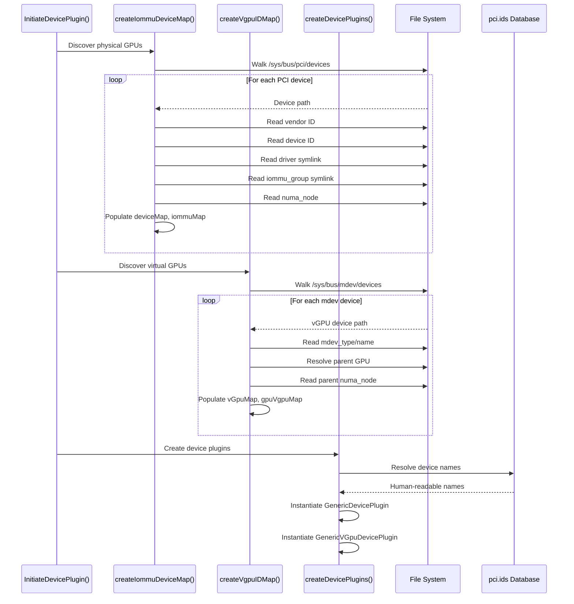
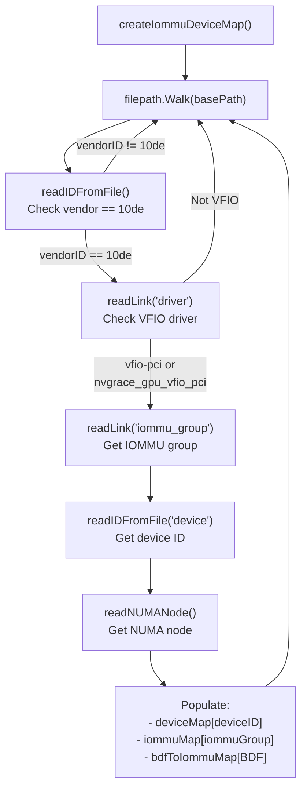
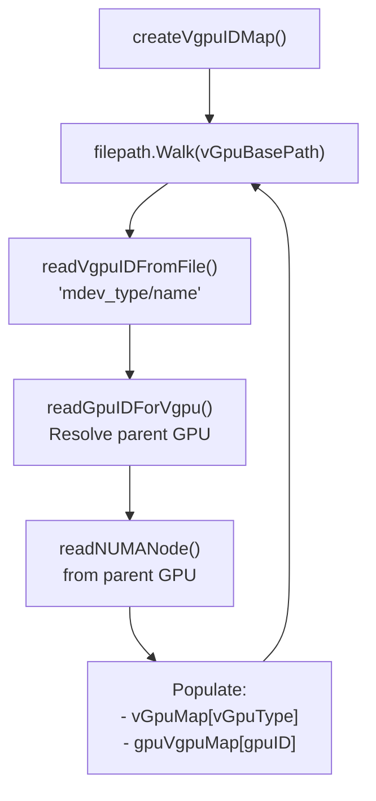
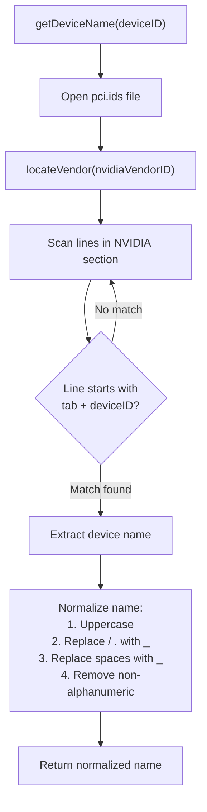
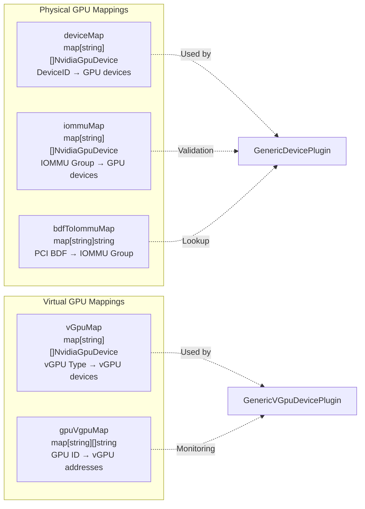
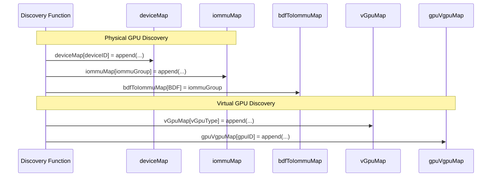

<!-- source: DeepWiki mcp.deepwiki.com · repo NVIDIA/kubevirt-gpu-device-plugin · page 3.2 Device Discovery and Mapping · fetched 2026-10-26 -->

# Device Discovery and Mapping

<details>
<summary>Relevant source files</summary>

The following files were used as context for generating this wiki page:

- [pkg/device_plugin/device_plugin.go](pkg/device_plugin/device_plugin.go)
- [pkg/device_plugin/device_plugin_test.go](pkg/device_plugin/device_plugin_test.go)
- [utils/pci.ids](utils/pci.ids)

</details>


This document describes how the NVIDIA KubeVirt GPU Device Plugin discovers physical GPUs and virtual GPUs (vGPUs) on the host system, maps them to appropriate data structures, and resolves human-readable device names. This discovery process occurs during device plugin initialization and forms the foundation for subsequent resource advertisement to Kubelet.

For information about how discovered devices are registered with Kubernetes, see [Kubernetes Integration](#3.5). For details on physical GPU device plugin implementation, see [Physical GPU Device Plugin](#3.3). For vGPU management, see [Virtual GPU Device Plugin](#3.4).

## Overview

The device discovery and mapping subsystem performs three primary functions:

1. **Physical GPU Discovery** - Scans PCI devices to identify NVIDIA GPUs bound to VFIO drivers
2. **Virtual GPU Discovery** - Scans mdev devices to identify configured vGPU instances
3. **Device Name Resolution** - Translates hardware device IDs to human-readable names using the PCI IDs database

The entry point is `InitiateDevicePlugin()` [pkg/device_plugin/device_plugin.go:89-96](), which orchestrates the discovery sequence and subsequently creates device plugin instances.

Sources: [pkg/device_plugin/device_plugin.go:89-96]()

## Discovery Flow



**Discovery Sequence**: The system first discovers physical GPUs by scanning the PCI bus, then discovers vGPUs by scanning mdev devices, and finally creates device plugin instances with resolved device names.

Sources: [pkg/device_plugin/device_plugin.go:89-96](), [pkg/device_plugin/device_plugin.go:99-176]()

## Physical GPU Discovery

### Discovery Process

The `createIommuDeviceMap()` function [pkg/device_plugin/device_plugin.go:187-247]() discovers physical NVIDIA GPUs that are bound to VFIO-PCI drivers by scanning the Linux sysfs file system.



**Physical GPU Discovery Flow**: Scans PCI devices, filters for NVIDIA GPUs with VFIO drivers, and populates multiple mapping data structures.

Sources: [pkg/device_plugin/device_plugin.go:187-247]()

### VFIO Driver Validation

The system supports multiple VFIO driver types defined in `supportedVfioDrivers` [pkg/device_plugin/device_plugin.go:75-78]():

| Driver Name | Purpose |
|-------------|---------|
| `vfio-pci` | Standard VFIO PCI driver for GPU passthrough |
| `nvgrace_gpu_vfio_pci` | NVIDIA Grace-specific VFIO driver |

The `isSupportedVfioDriver()` function [pkg/device_plugin/device_plugin.go:249-252]() validates whether a discovered device uses a supported driver before including it in the device map.

Sources: [pkg/device_plugin/device_plugin.go:75-78](), [pkg/device_plugin/device_plugin.go:249-252]()

### File System Layout

Physical GPU discovery relies on the following sysfs paths:

```
/sys/bus/pci/devices/
├── 0000:00:01.0/
│   ├── vendor          # PCI vendor ID (e.g., "0x10de")
│   ├── device          # PCI device ID (e.g., "0x1b80")
│   ├── driver/         # Symlink to driver (e.g., vfio-pci)
│   ├── iommu_group/    # Symlink to IOMMU group (e.g., ../../kernel/iommu_groups/1)
│   └── numa_node       # NUMA node ID (e.g., "0")
└── 0000:00:02.0/
    └── ...
```

The base path is configurable via `basePath` [pkg/device_plugin/device_plugin.go:70](), which defaults to `/sys/bus/pci/devices`.

Sources: [pkg/device_plugin/device_plugin.go:70](), [pkg/device_plugin/device_plugin.go:192-246]()

### Data Collection

For each discovered NVIDIA GPU, the system collects:

1. **Vendor ID** - Read via `readIDFromFile(basePath, deviceAddress, "vendor")` [pkg/device_plugin/device_plugin.go:202-206]()
   - Must equal `nvidiaVendorID` constant (`"10de"`) [pkg/device_plugin/device_plugin.go:46]()

2. **Driver** - Read via `readLink(basePath, deviceAddress, "driver")` [pkg/device_plugin/device_plugin.go:212-220]()
   - Must be a supported VFIO driver

3. **IOMMU Group** - Read via `readLink(basePath, deviceAddress, "iommu_group")` [pkg/device_plugin/device_plugin.go:221-225]()
   - Used for device isolation validation

4. **Device ID** - Read via `readIDFromFile(basePath, deviceAddress, "device")` [pkg/device_plugin/device_plugin.go:234-238]()
   - Used to identify GPU model

5. **NUMA Node** - Read via `readNUMANode(basePath, deviceAddress)` [pkg/device_plugin/device_plugin.go:226-230]()
   - Used for NUMA-aware scheduling
   - Defaults to 0 if unavailable or set to -1

Sources: [pkg/device_plugin/device_plugin.go:202-243]()

### Helper Functions

#### readIDFromFileFunc

[pkg/device_plugin/device_plugin.go:294-302]()

Reads PCI vendor or device ID from sysfs files. The IDs are stored with `0x` prefix in sysfs, which this function strips by reading from index 2 onwards.

```go
data, err := os.ReadFile(filepath.Join(basePath, deviceAddress, property))
id := strings.Trim(string(data[2:]), "\n")  // Strip "0x" prefix
```

#### readLinkFunc

[pkg/device_plugin/device_plugin.go:323-331]()

Resolves symbolic links for driver and IOMMU group paths, extracting only the basename of the resolved path.

#### readNUMANodeFunc

[pkg/device_plugin/device_plugin.go:304-320]()

Reads the NUMA node from sysfs. If the value is -1 (common when NUMA is disabled), it returns 0 as the default. This ensures devices always have a valid NUMA node for topology-aware scheduling.

Sources: [pkg/device_plugin/device_plugin.go:294-331]()

## Virtual GPU Discovery

### Discovery Process

The `createVgpuIDMap()` function [pkg/device_plugin/device_plugin.go:254-291]() discovers NVIDIA vGPU instances configured through the mdev (Mediated Device) framework.



**Virtual GPU Discovery Flow**: Scans mdev devices, reads vGPU type information, resolves parent GPU, and builds vGPU mappings.

Sources: [pkg/device_plugin/device_plugin.go:254-291]()

### mdev File System Layout

Virtual GPU discovery relies on the mdev sysfs paths:

```
/sys/bus/mdev/devices/
├── 12345678-1234-1234-1234-123456789abc/
│   ├── mdev_type/
│   │   └── name         # vGPU type name (e.g., "GRID P100-1B")
│   └── ../../../0000:00:01.0/  # Symlink to parent GPU
└── 87654321-4321-4321-4321-cba987654321/
    └── ...
```

The base path is configurable via `vGpuBasePath` [pkg/device_plugin/device_plugin.go:74](), which defaults to `/sys/bus/mdev/devices`.

Sources: [pkg/device_plugin/device_plugin.go:74](), [pkg/device_plugin/device_plugin.go:259-290]()

### vGPU Type Name Processing

The `readVgpuIDFromFileFunc()` [pkg/device_plugin/device_plugin.go:334-344]() reads the vGPU type name and normalizes it:

1. Reads from `mdev_type/name` file
2. Replaces all whitespace with underscores using regex `\\s+`
3. Returns normalized string (e.g., "GRID P100-1B" → "GRID_P100-1B")

This normalization ensures vGPU type names are valid Kubernetes resource names.

Sources: [pkg/device_plugin/device_plugin.go:334-344]()

### Parent GPU Resolution

The `readGpuIDForVgpuFunc()` [pkg/device_plugin/device_plugin.go:347-357]() resolves the parent physical GPU for each vGPU:

1. Reads the symbolic link of the vGPU device itself
2. Splits the path and extracts the parent GPU's PCI address
3. Returns the PCI BDF (Bus:Device.Function) of the parent GPU

Example: For vGPU path `../../../0000:65:00.0/...`, extracts `0000:65:00.0` as the parent GPU ID.

Sources: [pkg/device_plugin/device_plugin.go:347-357]()

### NUMA Node Inheritance

Virtual GPUs inherit the NUMA node from their parent physical GPU [pkg/device_plugin/device_plugin.go:280-284]():

```go
numaNode, err := readNUMANode(basePath, gpuID)
```

This ensures vGPU devices maintain the same NUMA affinity as their parent GPU for optimal performance.

Sources: [pkg/device_plugin/device_plugin.go:280-284]()

## Device Name Resolution

### PCI IDs Database

The system uses a PCI IDs database [utils/pci.ids]() to translate numeric device IDs to human-readable names. This database is maintained by the PCI ID Project and follows a standardized format.

The database file is expected at `/usr/pci.ids` [pkg/device_plugin/device_plugin.go:79]() and contains entries in the format:

```
10de  NVIDIA Corporation
    1b80  GP104GL [Tesla P4]
    1b81  GP104 [GeForce GTX 1070]
    2331  GH100 [H100 PCIe]
```

Sources: [pkg/device_plugin/device_plugin.go:79](), [utils/pci.ids:1-50]()

### Name Resolution Algorithm

The `getDeviceName()` function [pkg/device_plugin/device_plugin.go:371-422]() performs a two-phase lookup:



**Device Name Resolution**: Two-phase process that first locates the NVIDIA vendor section, then searches for the device ID within that section.

Sources: [pkg/device_plugin/device_plugin.go:371-422]()

### Vendor Location

The `locateVendor()` function [pkg/device_plugin/device_plugin.go:424-438]() scans the PCI IDs file to find the NVIDIA vendor section:

1. Scans lines until it finds a line starting with `nvidiaVendorID` (`10de`)
2. Returns a scanner positioned at the start of the NVIDIA device list
3. This ensures device IDs are resolved within the correct vendor context

This prevents conflicts when multiple vendors use the same device ID numbers.

Sources: [pkg/device_plugin/device_plugin.go:424-438]()

### Name Normalization

Device names undergo several transformations to create valid Kubernetes resource names [pkg/device_plugin/device_plugin.go:404-415]():

| Step | Operation | Example |
|------|-----------|---------|
| 1 | Convert to uppercase | "Tesla P4" → "TESLA P4" |
| 2 | Replace `/` with `_` | "V100/PCIe" → "V100_PCIe" |
| 3 | Replace `.` with `_` | "V100.32GB" → "V100_32GB" |
| 4 | Replace whitespace with `_` | "TESLA P4" → "TESLA_P4" |
| 5 | Remove non-alphanumeric (except `_`) | "GP104[P4]" → "GP104P4" |

Final resource names take the form `nvidia.com/TESLA_P4` or `nvidia.com/GH100_H100_PCIE`.

Sources: [pkg/device_plugin/device_plugin.go:404-415]()

### Fallback Behavior

If device name resolution fails (database not found, device ID not present), the system falls back to using the raw device ID [pkg/device_plugin/device_plugin.go:125-128]():

```go
deviceName := getDeviceName(k)
if deviceName == "" {
    log.Printf("Error: Could not find device name for device id: %s", k)
    deviceName = k  // Use device ID as fallback
}
```

This ensures the device plugin can still function even without the PCI IDs database.

Sources: [pkg/device_plugin/device_plugin.go:125-128]()

## Data Structures and Mappings

### Core Data Structures

#### NvidiaGpuDevice

[pkg/device_plugin/device_plugin.go:50-53]()

```go
type NvidiaGpuDevice struct {
    addr     string // PCI address of device (BDF format)
    numaNode int64  // NUMA node ID
}
```

Represents both physical GPUs and vGPU instances with their PCI address and NUMA affinity.

Sources: [pkg/device_plugin/device_plugin.go:50-53]()

### Mapping Tables

The discovery process populates five key mapping tables:



**Data Structure Relationships**: Five mapping tables provide different views of GPU resources for device plugin operation and validation.

Sources: [pkg/device_plugin/device_plugin.go:56-68]()

#### deviceMap

[pkg/device_plugin/device_plugin.go:59]()

Maps device IDs to lists of GPU devices of that type. Key is the PCI device ID (e.g., `"1b80"`), value is a slice of `NvidiaGpuDevice` instances sharing that device ID.

**Purpose**: Groups GPUs by model to create separate device plugins for each GPU type.

#### iommuMap

[pkg/device_plugin/device_plugin.go:56]()

Maps IOMMU group IDs to lists of GPU devices in that group. Key is the IOMMU group (e.g., `"12"`), value is a slice of `NvidiaGpuDevice` instances in that group.

**Purpose**: Used during device allocation to validate IOMMU isolation between devices.

#### bdfToIommuMap

[pkg/device_plugin/device_plugin.go:62]()

Maps PCI Bus:Device.Function addresses to IOMMU group IDs. Key is the PCI BDF (e.g., `"0000:65:00.0"`), value is the IOMMU group ID.

**Purpose**: Quick lookup to determine which IOMMU group a device belongs to during allocation.

#### vGpuMap

[pkg/device_plugin/device_plugin.go:65]()

Maps vGPU type names to lists of vGPU instances. Key is the normalized vGPU type (e.g., `"GRID_P100-1B"`), value is a slice of `NvidiaGpuDevice` instances of that vGPU type.

**Purpose**: Groups vGPUs by type to create separate device plugins for each vGPU profile.

#### gpuVgpuMap

[pkg/device_plugin/device_plugin.go:68]()

Maps physical GPU IDs to lists of their associated vGPU device addresses. Key is the parent GPU's PCI address, value is a slice of vGPU mdev UUIDs.

**Purpose**: Enables monitoring of parent GPU health when managing vGPU devices.

Sources: [pkg/device_plugin/device_plugin.go:56-68]()

### Mapping Population



**Mapping Population Flow**: Physical GPU discovery populates three maps; vGPU discovery populates two additional maps.

Sources: [pkg/device_plugin/device_plugin.go:240-243](), [pkg/device_plugin/device_plugin.go:287-288]()

## NUMA Topology Information

### NUMA Node Discovery

Each discovered device includes NUMA node information obtained from sysfs [pkg/device_plugin/device_plugin.go:226-230]():

```go
numaNode, err := readNUMANode(basePath, info.Name())
if err != nil {
    log.Printf("Could not get NUMA node for device %s: %v. Defaulting to NUMA node 0", info.Name(), err)
    numaNode = 0
}
```

### NUMA Node Defaults

The system applies the following default behavior [pkg/device_plugin/device_plugin.go:316-319]():

- If `numa_node` file is missing: defaults to 0
- If `numa_node` contains -1: returns 0
- If `numa_node` contains a valid value: returns that value

This ensures all devices have a valid NUMA node for Kubernetes topology-aware scheduling.

### Topology in Device Registration

NUMA node information is included when creating device plugin resources [pkg/device_plugin/device_plugin.go:112-122]():

```go
device := &pluginapi.Device{
    ID:     gpuDev.addr,
    Health: pluginapi.Healthy,
    Topology: &pluginapi.TopologyInfo{
        Nodes: []*pluginapi.NUMANode{
            {ID: gpuDev.numaNode},
        },
    },
}
```

This topology information enables Kubelet to make NUMA-aware scheduling decisions when allocating GPUs to pods.

Sources: [pkg/device_plugin/device_plugin.go:112-122](), [pkg/device_plugin/device_plugin.go:304-320]()

## Integration with Device Plugin Creation

After discovery completes, the `createDevicePlugins()` function [pkg/device_plugin/device_plugin.go:99-176]() uses the populated maps to instantiate device plugins:

1. Iterates over `deviceMap` to create `GenericDevicePlugin` instances for each physical GPU type
2. Iterates over `vGpuMap` to create `GenericVGpuDevicePlugin` instances for each vGPU type
3. Resolves human-readable device names via `getDeviceName()`
4. Starts each device plugin instance

The discovered device information and NUMA topology are passed to the device plugin constructors, which then register these resources with Kubelet.

Sources: [pkg/device_plugin/device_plugin.go:99-176]()

## Testing

The discovery and mapping functionality is extensively tested in [pkg/device_plugin/device_plugin_test.go](). Key test scenarios include:

| Test Case | Coverage |
|-----------|----------|
| `readLinkFunc() Tests` | Symbolic link resolution for driver and IOMMU group |
| `readIDFromFileFunc() Tests` | Vendor and device ID parsing from sysfs |
| `readNUMANodeFunc() Tests` | NUMA node reading with default fallback behavior |
| `readVgpuIDFromFile() Tests` | vGPU type name reading and normalization |
| `readGpuIDForVgpu() Tests` | Parent GPU resolution from vGPU paths |
| `createIommuDeviceMap() Tests` | Full physical GPU discovery flow with mocked file system |
| `createVgpuIDMap() Tests` | Full vGPU discovery flow with mocked file system |
| `getDeviceName() Tests` | PCI IDs database parsing and name normalization |
| `isSupportedVfioDriver() Tests` | VFIO driver validation |

The tests use temporary directories and mock functions to simulate the sysfs file system structure, enabling thorough testing without requiring actual GPU hardware.

Sources: [pkg/device_plugin/device_plugin_test.go:1-543]()

---

