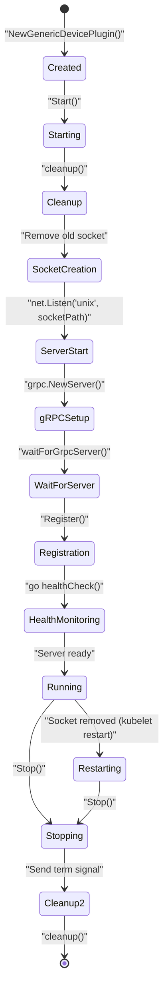
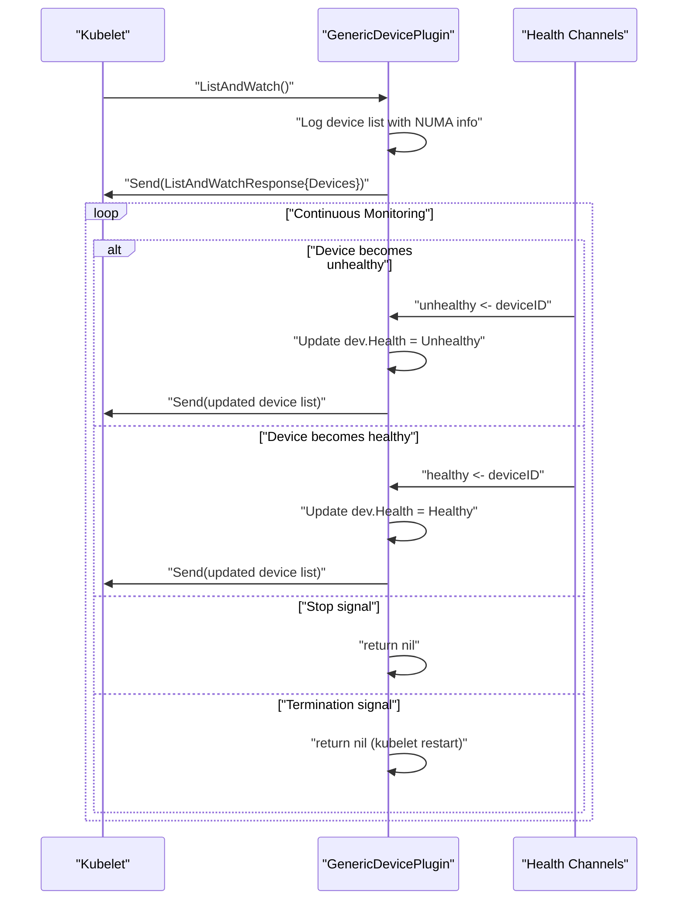
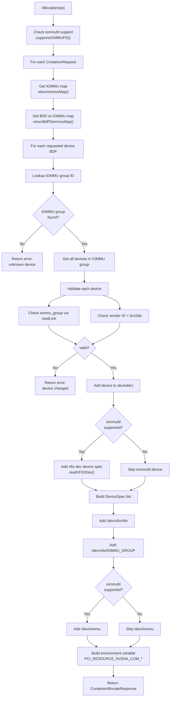
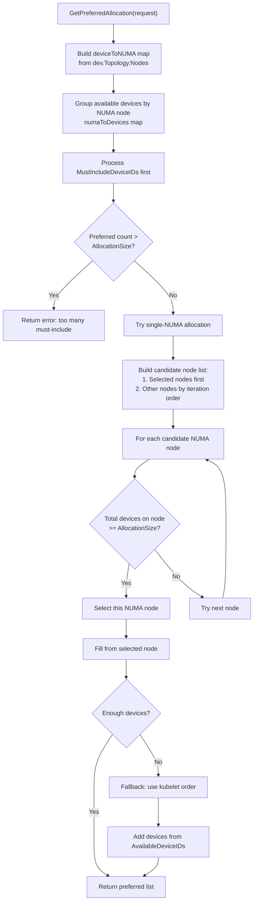
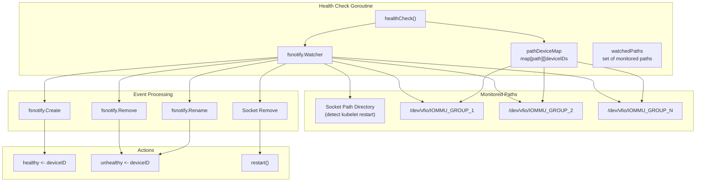
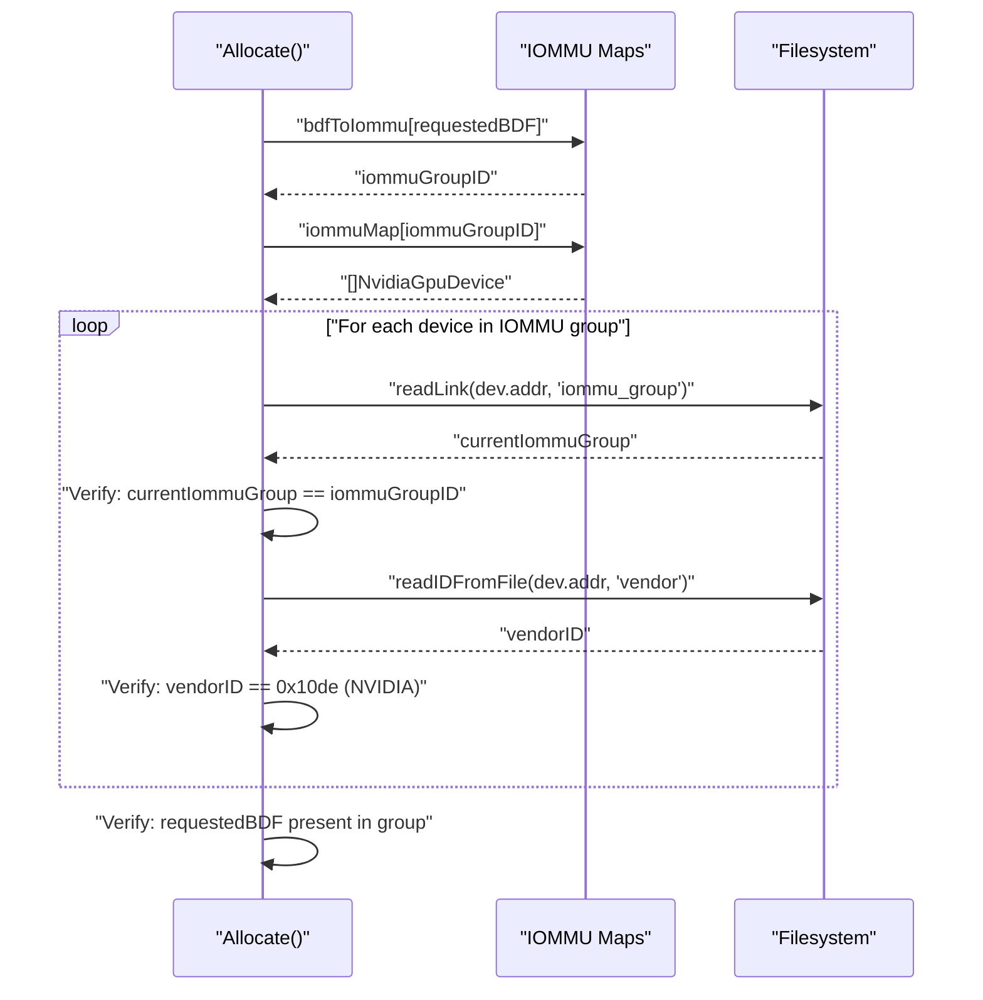

<!-- source: DeepWiki mcp.deepwiki.com · repo NVIDIA/kubevirt-gpu-device-plugin · page 3.3 Physical GPU Device Plugin · fetched 2026-10-26 -->

# Physical GPU Device Plugin

<details>
<summary>Relevant source files</summary>

The following files were used as context for generating this wiki page:

- [pkg/device_plugin/generic_device_plugin.go](pkg/device_plugin/generic_device_plugin.go)
- [pkg/device_plugin/generic_device_plugin_test.go](pkg/device_plugin/generic_device_plugin_test.go)
- [pkg/device_plugin/generic_vgpu_device_plugin_test.go](pkg/device_plugin/generic_vgpu_device_plugin_test.go)

</details>


This document describes the `GenericDevicePlugin` implementation, which manages physical NVIDIA GPU devices and enables GPU passthrough to KubeVirt virtual machines via the VFIO-PCI driver. This plugin implements the Kubernetes Device Plugin API to advertise physical GPUs as schedulable resources and provides NUMA-aware allocation capabilities.

For information about virtual GPU (vGPU/mdev) management, see [Virtual GPU Device Plugin](#3.4). For details on the device discovery process that feeds into this plugin, see [Device Discovery and Mapping](#3.2).

**Sources**: [pkg/device_plugin/generic_device_plugin.go:1-634]()

## Core Data Structure

The `GenericDevicePlugin` struct encapsulates all state and communication channels required for managing physical GPU devices:

```go
type GenericDevicePlugin struct {
    devs       []*pluginapi.Device  // List of GPU devices to advertise
    server     *grpc.Server         // gRPC server for device plugin API
    socketPath string               // Unix socket path for kubelet communication
    stop       chan struct{}        // Channel to signal plugin shutdown
    term       chan bool            // Channel to detect kubelet restarts
    healthy    chan string          // Channel to receive healthy device notifications
    unhealthy  chan string          // Channel to receive unhealthy device notifications
    devicePath string               // Base path for device monitoring
    deviceName string               // Resource name (e.g., "GPU_TYPE")
    devsHealth []*pluginapi.Device  // Device health tracking
}
```

Key constants that define the plugin's behavior:

| Constant | Value | Purpose |
|----------|-------|---------|
| `DeviceNamespace` | `"nvidia.com"` | Kubernetes resource namespace |
| `connectionTimeout` | `5 * time.Second` | gRPC connection timeout |
| `vfioDevicePath` | `"/dev/vfio"` | VFIO device directory |
| `iommuDevicePath` | `"/dev/iommu"` | IOMMU device path for iommufd support |
| `gpuPrefix` | `"PCI_RESOURCE_NVIDIA_COM"` | Environment variable prefix for allocated devices |

**Sources**: [pkg/device_plugin/generic_device_plugin.go:50-74]()

## Initialization and Registration

### Plugin Instantiation

The `NewGenericDevicePlugin` function creates a new device plugin instance for a specific GPU type:

```
NewGenericDevicePlugin(deviceName, devicePath, devices) -> *GenericDevicePlugin
```

This function:
1. Constructs the socket path as `<pluginapi.DevicePluginPath>/kubevirt-<deviceName>.sock`
2. Initializes communication channels (`term`, `healthy`, `unhealthy`)
3. Stores the device list and metadata

**Sources**: [pkg/device_plugin/generic_device_plugin.go:77-90]()

### Device Plugin Lifecycle

The following diagram illustrates the complete lifecycle of the physical GPU device plugin:

**Lifecycle State Machine**



**Sources**: [pkg/device_plugin/generic_device_plugin.go:129-199]()

### Registration with Kubelet

The `Register` method connects to the kubelet's device plugin manager and registers the GPU resource:

```
Register() -> error
```

Registration flow:
1. Connect to `pluginapi.KubeletSocket` via Unix domain socket
2. Create a `RegisterRequest` with:
   - Version: `pluginapi.Version`
   - Endpoint: Socket filename (e.g., `kubevirt-GPU_TYPE.sock`)
   - ResourceName: `nvidia.com/<deviceName>`
3. Submit registration via gRPC
4. Log successful registration

**Sources**: [pkg/device_plugin/generic_device_plugin.go:201-223]()

## Device Plugin API Implementation

### ListAndWatch: Device Advertisement

The `ListAndWatch` method implements the core device advertising mechanism required by the Kubernetes Device Plugin API:

**ListAndWatch Flow Diagram**



The method logs detailed information about each device, including:
- Device ID (PCI BDF address)
- Health status (`Healthy` or `Unhealthy`)
- NUMA node affinity (extracted from `dev.Topology.Nodes[0].ID`)

**Sources**: [pkg/device_plugin/generic_device_plugin.go:225-263]()

### Allocate: Device Assignment

The `Allocate` method handles device allocation requests from the kubelet, performing validation and constructing the allocation response:

**Allocation Process Flow**



**Device Specifications Created**:

| Path | Purpose | Permissions |
|------|---------|-------------|
| `/dev/vfio/devices/vfioN` | IOMMU file descriptor device (iommufd mode) | `mrw` |
| `/dev/vfio/vfio` | VFIO container device | `mrw` |
| `/dev/vfio/<IOMMU_GROUP>` | IOMMU group device file | `mrw` |
| `/dev/iommu` | IOMMU device (iommufd mode only) | `mrw` |

**Environment Variables**:
- Key format: `PCI_RESOURCE_NVIDIA_COM_<DEVICE_NAME_UPPER>`
- Value: Comma-separated list of PCI BDF addresses in the IOMMU group

**Sources**: [pkg/device_plugin/generic_device_plugin.go:265-361](), [pkg/device_plugin/generic_device_plugin.go:609-633]()

### GetPreferredAllocation: NUMA-Aware Scheduling

The `GetPreferredAllocation` method implements topology-aware device selection to optimize NUMA locality:

**NUMA-Aware Allocation Algorithm**



**Algorithm Details**:

1. **NUMA Topology Extraction**: Extract NUMA node ID from `dev.Topology.Nodes[0].ID` for each device
2. **Priority Ordering**:
   - MustIncludeDeviceIDs are always placed first
   - Attempt to satisfy allocation from a single NUMA node
   - If single-NUMA fails, fall back to kubelet-provided ordering
3. **Node Selection**: Prefer NUMA nodes that already have must-include devices selected
4. **Logging**: Extensive logging of NUMA allocation decisions for observability

This implementation enables the Kubernetes Topology Manager to make optimal scheduling decisions based on NUMA affinity, reducing cross-NUMA memory access overhead for GPU workloads.

**Sources**: [pkg/device_plugin/generic_device_plugin.go:384-525]()

## Health Monitoring

The `healthCheck` method implements continuous device health monitoring using filesystem events:

**Health Monitoring Architecture**



**Health Check Mechanism**:

1. **Initialization**:
   - Create `fsnotify.Watcher` instance
   - Add socket path directory to watch for kubelet restarts
   - Build `pathDeviceMap`: maps IOMMU group device paths to device IDs

2. **Device Path Monitoring**:
   - For each device, determine IOMMU group via `bdfToIommuMap`
   - Construct device path: `<devicePath>/<iommuGroupID>`
   - Add path to watcher (skip if already watched)
   - Map device path to all device IDs in that IOMMU group

3. **Event Handling**:

| Event Type | Condition | Action |
|------------|-----------|--------|
| `fsnotify.Create` | Device path created | Send device IDs to `healthy` channel |
| `fsnotify.Remove` | Device path removed | Send device IDs to `unhealthy` channel |
| `fsnotify.Rename` | Device path renamed | Send device IDs to `unhealthy` channel |
| Socket remove | Socket file removed | Call `restart()` to re-register with kubelet |

4. **Kubelet Restart Detection**:
   - When socket file is removed, kubelet has likely restarted
   - Trigger plugin restart: `Stop()` then `Start()`
   - Allows plugin to re-register without pod restart

**Sources**: [pkg/device_plugin/generic_device_plugin.go:527-607]()

## VFIO and IOMMU Integration

### IOMMU Group Validation

During allocation, the plugin performs rigorous validation of IOMMU group integrity:

**Validation Steps**:



This validation ensures:
- IOMMU group membership has not changed since discovery
- All devices remain NVIDIA devices (vendor ID `0x10de`)
- The requested device is actually present in the IOMMU group

**Sources**: [pkg/device_plugin/generic_device_plugin.go:296-325]()

### IOMMU File Descriptor Support

The plugin detects and supports the modern iommufd interface when available:

**IOMMUFD Detection and Usage**:

1. **Detection** (`supportsIOMMUFD`):
   - Check for existence of `/dev/iommu` device
   - Return `(bool, error)` indicating support status

2. **Usage in Allocation**:
   - If supported, read vfio device name via `readVFIODev(basePath, dev.addr)`
   - Add `/dev/vfio/devices/vfioN` device spec for each device
   - Add `/dev/iommu` device spec for IOMMU file descriptor access

3. **Benefits**:
   - Modern VFIO interface with improved security
   - Better support for device hot-plug scenarios
   - Compatibility with latest kernel versions

**Sources**: [pkg/device_plugin/generic_device_plugin.go:609-633](), [pkg/device_plugin/generic_device_plugin.go:311-342]()

## Additional Device Plugin Methods

### GetDevicePluginOptions

Returns configuration options for the device plugin:

```go
GetDevicePluginOptions() -> *pluginapi.DevicePluginOptions {
    PreStartRequired: false,                    // No pre-start hook needed
    GetPreferredAllocationAvailable: true       // NUMA-aware allocation enabled
}
```

**Sources**: [pkg/device_plugin/generic_device_plugin.go:371-377]()

### PreStartContainer

Provides a hook for pre-container-start operations (currently no-op):

```go
PreStartContainer(*pluginapi.PreStartContainerRequest) -> (*pluginapi.PreStartContainerResponse, error)
```

**Sources**: [pkg/device_plugin/generic_device_plugin.go:379-382]()

## Testing Strategy

The test suite validates all critical functionality using Ginkgo and Gomega:

**Test Coverage**:

| Test Case | File Reference | Purpose |
|-----------|----------------|---------|
| Device registration | [pkg/device_plugin/generic_device_plugin_test.go:147-151]() | Verify `Stop()` cleanup |
| Device allocation | [pkg/device_plugin/generic_device_plugin_test.go:153-169]() | Verify allocation with environment variables and device specs |
| IOMMUFD allocation | [pkg/device_plugin/generic_device_plugin_test.go:171-198]() | Verify allocation with iommufd support |
| Invalid allocation | [pkg/device_plugin/generic_device_plugin_test.go:200-229]() | Verify rejection of invalid requests |
| Health monitoring | [pkg/device_plugin/generic_device_plugin_test.go:231-243]() | Verify fsnotify-based health checks |
| ListAndWatch | [pkg/device_plugin/generic_device_plugin_test.go:245-269]() | Verify device listing and health updates |

**Test Infrastructure**:

The tests use mock implementations to simulate system behavior:

```go
// Mock functions (configurable via package variables)
returnIommuMap = getFakeIommuMap          // Mock IOMMU group mapping
returnBdfToIommuMap = getFakeBdfToIommuMap // Mock BDF-to-IOMMU mapping
readLink = getFakeLink                     // Mock symlink reading
readIDFromFile = getFakeIDFromFile         // Mock vendor ID reading
```

This approach allows comprehensive testing without requiring actual GPU hardware or kernel VFIO subsystem.

**Sources**: [pkg/device_plugin/generic_device_plugin_test.go:45-270]()

## Summary

The `GenericDevicePlugin` provides a robust implementation of physical GPU device management for KubeVirt environments:

- **Standards Compliance**: Full implementation of Kubernetes Device Plugin API v1beta1
- **NUMA Awareness**: Sophisticated topology-aware allocation via `GetPreferredAllocation`
- **Health Monitoring**: Continuous device health tracking using filesystem events
- **VFIO Integration**: Complete support for VFIO-PCI passthrough with IOMMU group validation
- **Modern Kernel Support**: Detection and support for iommufd interface
- **Resilience**: Automatic recovery from kubelet restarts
- **Comprehensive Testing**: Full test coverage using mock implementations

This implementation enables KubeVirt virtual machines to access physical GPUs with minimal overhead through direct device assignment, while maintaining Kubernetes-native scheduling and resource management semantics.

---

