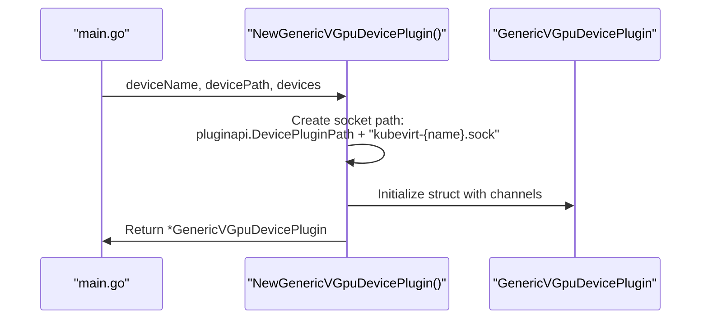
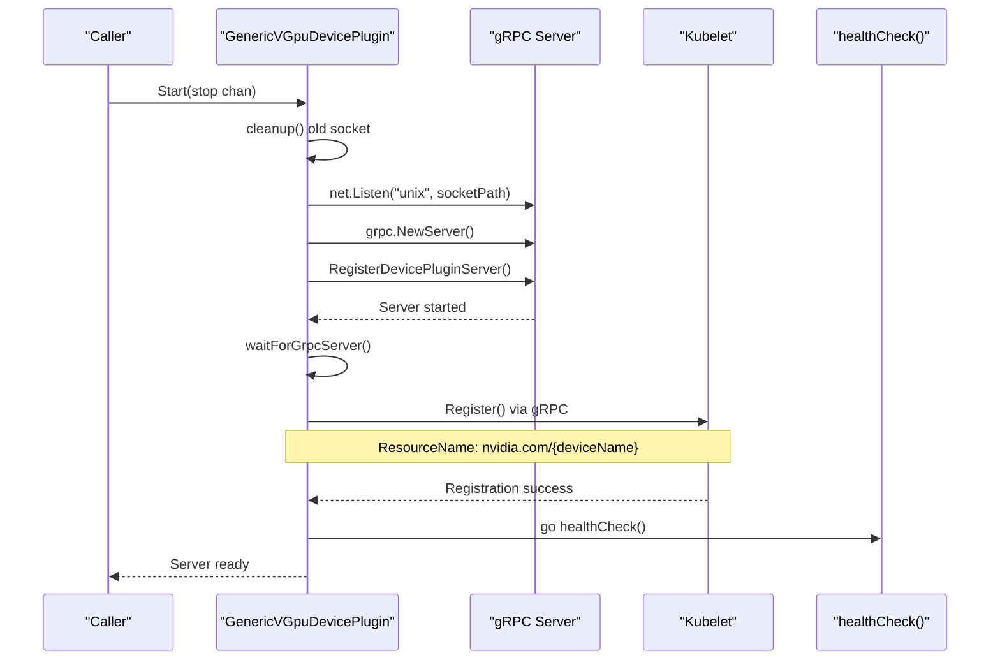
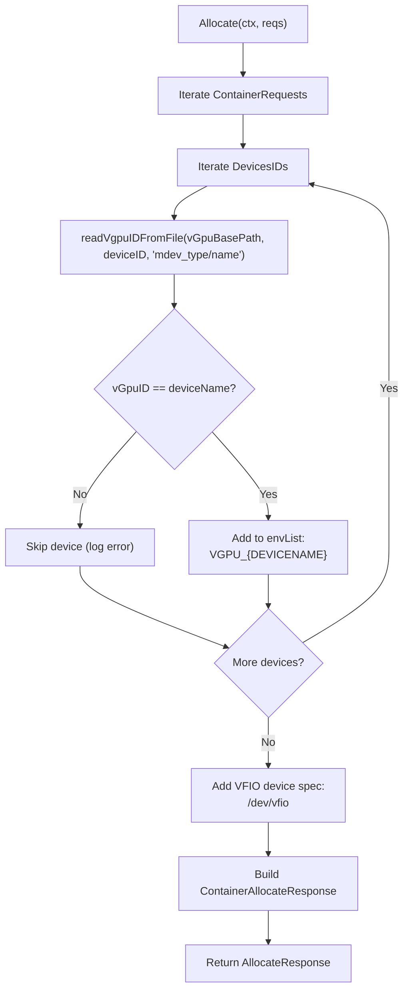
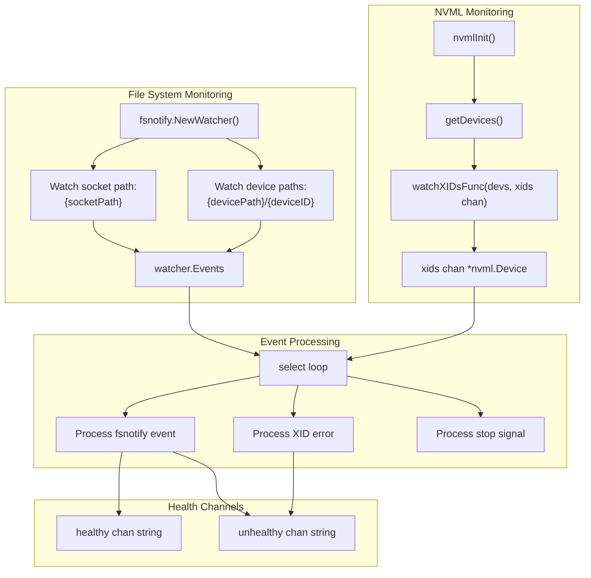
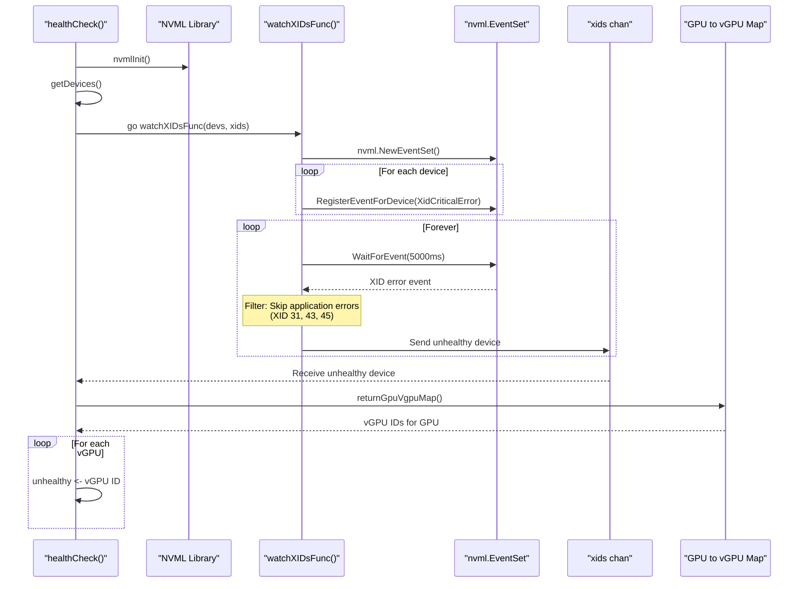
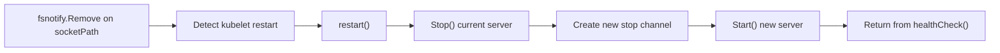
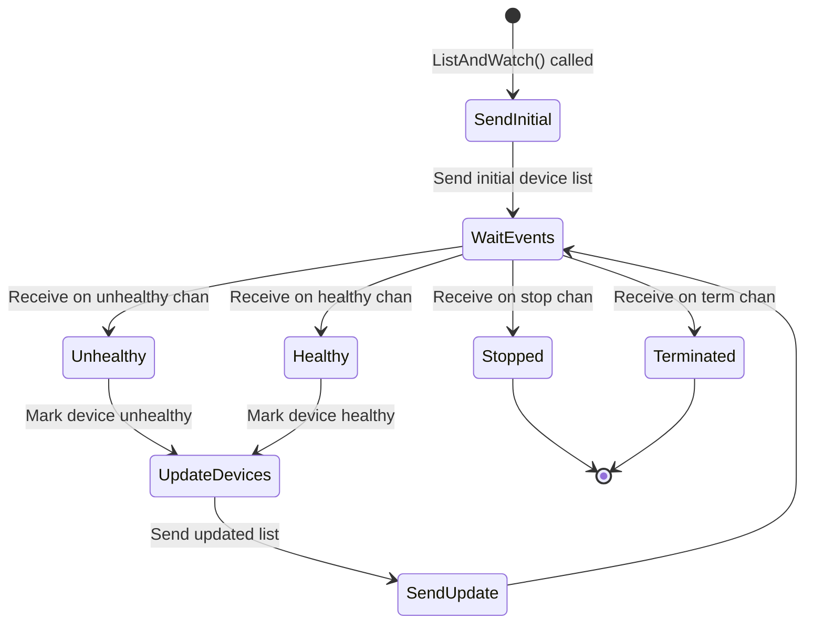
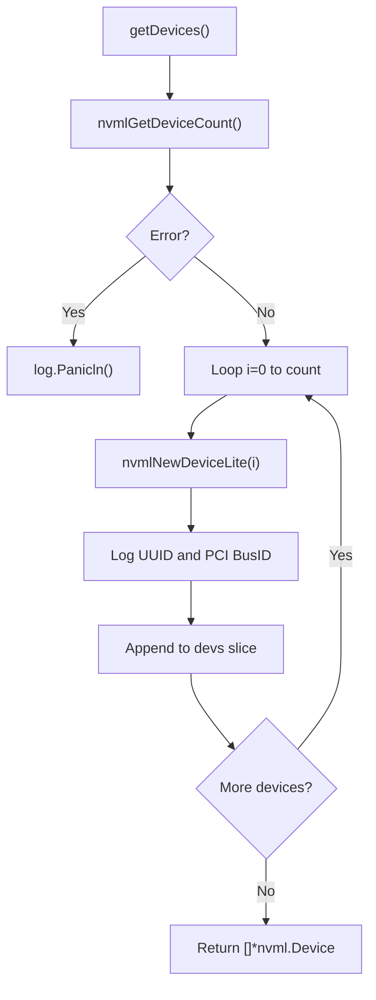
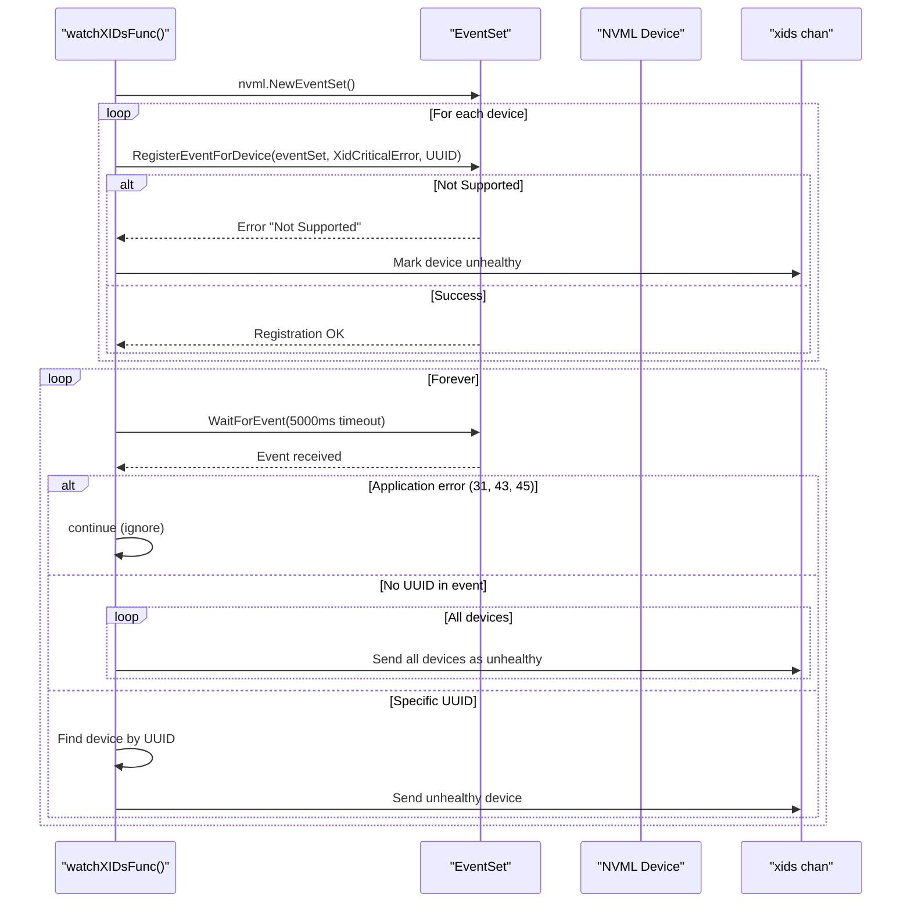
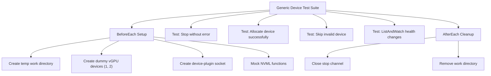

<!-- source: DeepWiki mcp.deepwiki.com · repo NVIDIA/kubevirt-gpu-device-plugin · page 3.4 Virtual GPU Device Plugin · fetched 2026-10-26 -->

# Virtual GPU Device Plugin

<details>
<summary>Relevant source files</summary>

The following files were used as context for generating this wiki page:

- [pkg/device_plugin/generic_device_plugin_test.go](pkg/device_plugin/generic_device_plugin_test.go)
- [pkg/device_plugin/generic_vgpu_device_plugin.go](pkg/device_plugin/generic_vgpu_device_plugin.go)
- [pkg/device_plugin/generic_vgpu_device_plugin_test.go](pkg/device_plugin/generic_vgpu_device_plugin_test.go)

</details>


## Purpose and Scope

This document describes the `GenericVGpuDevicePlugin` implementation, which manages virtual GPU (vGPU) resources for KubeVirt virtual machines. This plugin handles mediated device (mdev) based vGPUs, integrates with NVIDIA NVML for GPU health monitoring, and tracks XID errors to ensure device reliability.

For information about physical GPU management, see [Physical GPU Device Plugin](#3.3). For details on how devices are discovered and mapped, see [Device Discovery and Mapping](#3.2). For the broader integration with Kubernetes, see [Kubernetes Integration](#3.5).

---

## Overview

The Virtual GPU Device Plugin is responsible for managing vGPU devices created through the Linux mdev subsystem. Unlike physical GPU passthrough, vGPUs allow multiple virtual machines to share a single physical GPU by creating mediated devices that provide GPU functionality with resource partitioning.

The plugin operates as a Kubernetes Device Plugin, advertising vGPU resources to the kubelet and handling allocation requests from pods. It continuously monitors device health through both file system events and NVIDIA's NVML library, marking devices as unhealthy when critical errors occur.

**Key Responsibilities:**
- Discover and advertise mdev-based vGPU devices
- Monitor vGPU health through NVML XID error detection
- Allocate vGPU devices to KubeVirt VM pods
- Provide VFIO device access for GPU passthrough

**Sources:** [pkg/device_plugin/generic_vgpu_device_plugin.go:1-438]()

---

## GenericVGpuDevicePlugin Structure

### Core Structure

```mermaid
classDiagram
    class GenericVGpuDevicePlugin {
        -devs []*pluginapi.Device
        -server *grpc.Server
        -socketPath string
        -stop chan struct{}
        -term chan bool
        -healthy chan string
        -unhealthy chan string
        -devicePath string
        -deviceName string
        -devsHealth []*pluginapi.Device
        +Start(stop chan struct{}) error
        +Stop() error
        +restart() error
        +Register() error
        +ListAndWatch() error
        +Allocate() (*AllocateResponse, error)
        +healthCheck() error
    }
    
    class DevicePluginServer {
        <<interface>>
        +ListAndWatch()
        +Allocate()
        +GetDevicePluginOptions()
        +PreStartContainer()
        +GetPreferredAllocation()
    }
    
    class NVMLIntegration {
        +nvmlInit()
        +nvmlGetDeviceCount()
        +nvmlNewDeviceLite()
        +nvmlShutdown()
        +watchXIDsFunc()
    }
    
    class FSNotifyWatcher {
        +fsnotify.Watcher
        +Watch device paths
        +Watch socket path
    }
    
    GenericVGpuDevicePlugin ..|> DevicePluginServer
    GenericVGpuDevicePlugin --> NVMLIntegration
    GenericVGpuDevicePlugin --> FSNotifyWatcher
```

The `GenericVGpuDevicePlugin` struct [pkg/device_plugin/generic_vgpu_device_plugin.go:55-66]() contains:

| Field | Type | Purpose |
|-------|------|---------|
| `devs` | `[]*pluginapi.Device` | List of vGPU devices to advertise |
| `server` | `*grpc.Server` | gRPC server for device plugin API |
| `socketPath` | `string` | Unix socket path for kubelet communication |
| `stop` | `chan struct{}` | Channel to signal plugin shutdown |
| `term` | `chan bool` | Channel to detect kubelet restarts |
| `healthy` | `chan string` | Channel receiving healthy device IDs |
| `unhealthy` | `chan string` | Channel receiving unhealthy device IDs |
| `devicePath` | `string` | Base path for vGPU mdev devices |
| `deviceName` | `string` | vGPU type identifier (e.g., "nvidia-223") |

**Sources:** [pkg/device_plugin/generic_vgpu_device_plugin.go:55-66]()

---

## Initialization and Registration

### Plugin Creation

The plugin is instantiated using `NewGenericVGpuDevicePlugin()` [pkg/device_plugin/generic_vgpu_device_plugin.go:68-81]():



The socket path follows the pattern: `/var/lib/kubelet/device-plugins/kubevirt-{deviceName}.sock`

**Sources:** [pkg/device_plugin/generic_vgpu_device_plugin.go:68-81]()

### Start and Registration Flow



The `Start()` method [pkg/device_plugin/generic_vgpu_device_plugin.go:84-124]() performs:
1. Socket cleanup via `cleanup()` [pkg/device_plugin/generic_vgpu_device_plugin.go:249-255]()
2. gRPC server creation and start
3. Registration with kubelet via `Register()` [pkg/device_plugin/generic_vgpu_device_plugin.go:156-175]()
4. Health monitoring goroutine launch

**Sources:** [pkg/device_plugin/generic_vgpu_device_plugin.go:84-124](), [pkg/device_plugin/generic_vgpu_device_plugin.go:156-175]()

---

## Device Allocation

### Allocation Request Flow

The `Allocate()` method [pkg/device_plugin/generic_vgpu_device_plugin.go:209-247]() handles resource allocation requests from kubelet:



### Environment Variables

For each allocated vGPU device, the plugin sets an environment variable following the pattern:
- Key: `VGPU_{DEVICENAME_UPPERCASE}`
- Value: Comma-separated list of mdev device IDs

Example: `VGPU_NVIDIA_223=uuid1,uuid2`

**Sources:** [pkg/device_plugin/generic_vgpu_device_plugin.go:209-247](), [pkg/device_plugin/generic_vgpu_device_plugin.go:224-228]()

### Device Specifications

The allocation response includes a single `DeviceSpec` [pkg/device_plugin/generic_vgpu_device_plugin.go:230-234]():

| Field | Value | Purpose |
|-------|-------|---------|
| `HostPath` | `/dev/vfio` | VFIO character device |
| `ContainerPath` | `/dev/vfio` | Same path in container |
| `Permissions` | `"mrw"` | Memory read/write access |

Unlike physical GPU allocation, vGPU allocation only requires the base VFIO device, not individual IOMMU group devices.

**Sources:** [pkg/device_plugin/generic_vgpu_device_plugin.go:230-234]()

---

## Health Monitoring

### Health Check Architecture

The `healthCheck()` method [pkg/device_plugin/generic_vgpu_device_plugin.go:281-368]() implements a comprehensive monitoring system:



**Sources:** [pkg/device_plugin/generic_vgpu_device_plugin.go:281-368]()

### XID Error Monitoring

XID (X Infoframe Display) errors are NVIDIA-specific hardware errors that indicate GPU problems. The plugin monitors these through NVML:



**Filtered XID Errors:**
The plugin ignores certain application-level XID errors [pkg/device_plugin/generic_vgpu_device_plugin.go:419-421]():
- XID 31: GPU memory page fault
- XID 43: GPU stopped responding
- XID 45: GPU preemption timeout

These errors indicate application issues rather than hardware failures.

**Sources:** [pkg/device_plugin/generic_vgpu_device_plugin.go:388-437](), [pkg/device_plugin/generic_vgpu_device_plugin.go:419-421]()

### File System Event Monitoring

The plugin uses `fsnotify` to monitor device node existence [pkg/device_plugin/generic_vgpu_device_plugin.go:299-329]():

| Event Type | Action | Health Status |
|------------|--------|---------------|
| `fsnotify.Create` | Device node created | Mark healthy |
| `fsnotify.Remove` | Device node removed | Mark unhealthy |
| `fsnotify.Rename` | Device node renamed | Mark unhealthy |
| Socket removal | Kubelet restart detected | Restart plugin |

**Sources:** [pkg/device_plugin/generic_vgpu_device_plugin.go:341-363]()

### Kubelet Restart Detection

When the socket file is removed (kubelet restart), the plugin automatically restarts itself [pkg/device_plugin/generic_vgpu_device_plugin.go:353-362]():



**Sources:** [pkg/device_plugin/generic_vgpu_device_plugin.go:142-153](), [pkg/device_plugin/generic_vgpu_device_plugin.go:353-362]()

---

## ListAndWatch Implementation

The `ListAndWatch()` method [pkg/device_plugin/generic_vgpu_device_plugin.go:178-206]() provides a streaming interface for device updates:



The method operates as an infinite loop, listening on multiple channels:
- `unhealthy`: Device IDs that should be marked unhealthy
- `healthy`: Device IDs that should be marked healthy  
- `stop`: Signal to terminate the plugin
- `term`: Signal indicating kubelet termination

When a health status change occurs, the plugin updates the corresponding device in the `devs` slice [pkg/device_plugin/generic_vgpu_device_plugin.go:186-198]() and sends the updated list to kubelet.

**Sources:** [pkg/device_plugin/generic_vgpu_device_plugin.go:178-206]()

---

## NVML Integration

### Device Discovery

The `getDevices()` function [pkg/device_plugin/generic_vgpu_device_plugin.go:370-386]() queries NVML for physical GPUs:



Each `nvml.Device` contains:
- `UUID`: Unique device identifier
- `PCI.BusID`: PCI bus location (used for GPU-to-vGPU mapping)
- `Path`: Device node path

**Sources:** [pkg/device_plugin/generic_vgpu_device_plugin.go:370-386]()

### XID Event Registration

The `watchXIDsFunc()` [pkg/device_plugin/generic_vgpu_device_plugin.go:388-437]() registers for critical XID events:



**Sources:** [pkg/device_plugin/generic_vgpu_device_plugin.go:388-437]()

---

## Device Plugin API Implementation

### Required Interface Methods

The plugin implements the `DevicePlugin` interface from `k8s.io/kubelet/pkg/apis/deviceplugin/v1beta1`:

| Method | Implementation | Status |
|--------|----------------|--------|
| `GetDevicePluginOptions()` | Returns `PreStartRequired: false` | Implemented |
| `PreStartContainer()` | No-op | Implemented |
| `GetPreferredAllocation()` | Not implemented | Returns nil |
| `ListAndWatch()` | Streams device updates | Implemented |
| `Allocate()` | Allocates vGPU resources | Implemented |

**GetDevicePluginOptions:** [pkg/device_plugin/generic_vgpu_device_plugin.go:257-262]()
```
PreStartRequired: false
```
The plugin does not require pre-start container hooks.

**PreStartContainer:** [pkg/device_plugin/generic_vgpu_device_plugin.go:264-267]()
Returns empty response as no pre-start actions are needed.

**GetPreferredAllocation:** [pkg/device_plugin/generic_vgpu_device_plugin.go:270-278]()
Currently unimplemented. This method could be enhanced to provide NUMA-aware allocation hints.

**Sources:** [pkg/device_plugin/generic_vgpu_device_plugin.go:257-278]()

---

## Testing Infrastructure

### Test Structure

The test file [pkg/device_plugin/generic_vgpu_device_plugin_test.go:1-206]() uses Ginkgo BDD framework:



**Sources:** [pkg/device_plugin/generic_vgpu_device_plugin_test.go:87-205]()

### Mock Functions

The test suite provides mock implementations for NVML functions:

| Mock Function | Purpose | Return Value |
|---------------|---------|--------------|
| `fakeNvmlInit()` | NVML initialization | Always succeeds |
| `fakeNvmlGetDeviceCount()` | Device count | Returns 1 |
| `fakeNvmlNewDeviceLite()` | Device creation | Returns mock device with busID |
| `fakeNvmlShutdown()` | NVML cleanup | Always succeeds |
| `fakeWatchXIDsFunc()` | XID monitoring | Sends device after 5s delay |
| `fakeGetGpuVgpuMap()` | GPU-vGPU mapping | Returns busID -> [vGPU1] |

These mocks are assigned to package-level variables [pkg/device_plugin/generic_vgpu_device_plugin.go:47-52]() to enable test injection.

**Sources:** [pkg/device_plugin/generic_vgpu_device_plugin_test.go:54-85](), [pkg/device_plugin/generic_vgpu_device_plugin.go:47-52]()

### Key Test Cases

**Allocation Test:** [pkg/device_plugin/generic_vgpu_device_plugin_test.go:145-155]()
```
Input: DevicesIDs = ["1"]
Expected: 
  - envKey = "VGPU_VGPUID"
  - envValue = "1"
```

**Health Status Test:** [pkg/device_plugin/generic_vgpu_device_plugin_test.go:179-203]()
1. Initial state: Both devices healthy
2. Send "2" to `unhealthy` channel
3. Verify device "2" marked unhealthy
4. Send "2" to `healthy` channel  
5. Verify device "2" marked healthy again

**Sources:** [pkg/device_plugin/generic_vgpu_device_plugin_test.go:145-203]()

---

## Configuration and Constants

### Key Constants

The plugin uses several package-level constants defined in [pkg/device_plugin/device_plugin.go]():

| Constant | Value | Purpose |
|----------|-------|---------|
| `vgpuPrefix` | `"VGPU"` | Environment variable prefix |
| `vGpuBasePath` | `/sys/bus/mdev/devices` | mdev device base path |
| `vfioDevicePath` | `/dev/vfio` | VFIO device path |
| `DeviceNamespace` | `"nvidia.com"` | Kubernetes resource namespace |
| `connectionTimeout` | `5 * time.Second` | gRPC connection timeout |

### Environment Variable Format

For a vGPU type named "nvidia-223", allocated devices appear as:
```
VGPU_NVIDIA_223=uuid1,uuid2,uuid3
```

The key is constructed by [pkg/device_plugin/generic_vgpu_device_plugin.go:224]():
```
fmt.Sprintf("%s_%s", vgpuPrefix, strings.ToUpper(dpi.deviceName))
```

**Sources:** [pkg/device_plugin/generic_vgpu_device_plugin.go:224-228]()

---

## Comparison: vGPU vs Physical GPU Plugin

| Aspect | GenericVGpuDevicePlugin | GenericDevicePlugin |
|--------|-------------------------|---------------------|
| Device type | mdev virtual GPUs | VFIO-PCI physical GPUs |
| Discovery path | `/sys/bus/mdev/devices` | `/sys/bus/pci/devices` |
| IOMMU groups | Not used | Required for allocation |
| NVML integration | Yes (XID monitoring) | No |
| Device allocation | Single `/dev/vfio` | `/dev/vfio/vfio` + IOMMU group devices |
| Health monitoring | fsnotify + XID errors | fsnotify only |
| NUMA awareness | Not implemented | Topology hints provided |
| Environment prefix | `VGPU_` | `GPU_` |

The vGPU plugin is simpler in allocation (no IOMMU group management) but more sophisticated in health monitoring (XID error tracking).

**Sources:** [pkg/device_plugin/generic_vgpu_device_plugin.go:1-438](), [pkg/device_plugin/generic_device_plugin.go:1-400]()

---

## Error Handling

### Critical Errors

The plugin handles several categories of errors:

**Initialization Errors:**
- Socket creation failure → logged and returned [pkg/device_plugin/generic_vgpu_device_plugin.go:96-100]()
- Registration failure → logged and returned [pkg/device_plugin/generic_vgpu_device_plugin.go:114-117]()

**Runtime Errors:**
- NVML initialization failure → logged, continues without XID monitoring [pkg/device_plugin/generic_vgpu_device_plugin.go:296-297]()
- fsnotify watcher creation failure → logged and returned [pkg/device_plugin/generic_vgpu_device_plugin.go:300-303]()
- Device path stat failure → checked for not-exist, other errors returned [pkg/device_plugin/generic_vgpu_device_plugin.go:312-318]()

**Allocation Errors:**
- vGPU type mismatch → device skipped, logged [pkg/device_plugin/generic_vgpu_device_plugin.go:218-222]()

**NVML Errors:**
- Device count query failure → panic [pkg/device_plugin/generic_vgpu_device_plugin.go:373]()
- Device creation failure → panic [pkg/device_plugin/generic_vgpu_device_plugin.go:379]()
- XID registration "Not Supported" → device marked unhealthy [pkg/device_plugin/generic_vgpu_device_plugin.go:394-398]()
- Other XID registration errors → panic [pkg/device_plugin/generic_vgpu_device_plugin.go:401-403]()

**Sources:** [pkg/device_plugin/generic_vgpu_device_plugin.go:96-100](), [pkg/device_plugin/generic_vgpu_device_plugin.go:290-403]()

---

## Summary

The `GenericVGpuDevicePlugin` provides comprehensive vGPU resource management for KubeVirt with the following key capabilities:

1. **mdev Device Management**: Discovers and advertises virtual GPU devices from `/sys/bus/mdev/devices`
2. **NVML Integration**: Monitors GPU health through XID error detection, filtering application-level errors
3. **Dual Health Monitoring**: Combines file system events (fsnotify) and NVIDIA XID errors for robust health tracking
4. **Simple Allocation**: Provides `/dev/vfio` access without IOMMU group complexity
5. **Automatic Recovery**: Detects and recovers from kubelet restarts
6. **Kubernetes Native**: Implements standard Device Plugin API v1beta1

The plugin architecture separates concerns cleanly: device discovery, gRPC server management, health monitoring, and allocation logic operate independently through Go channels, enabling robust concurrent operation.

**Sources:** [pkg/device_plugin/generic_vgpu_device_plugin.go:1-438](), [pkg/device_plugin/generic_vgpu_device_plugin_test.go:1-206]()

---

