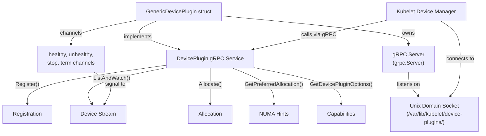
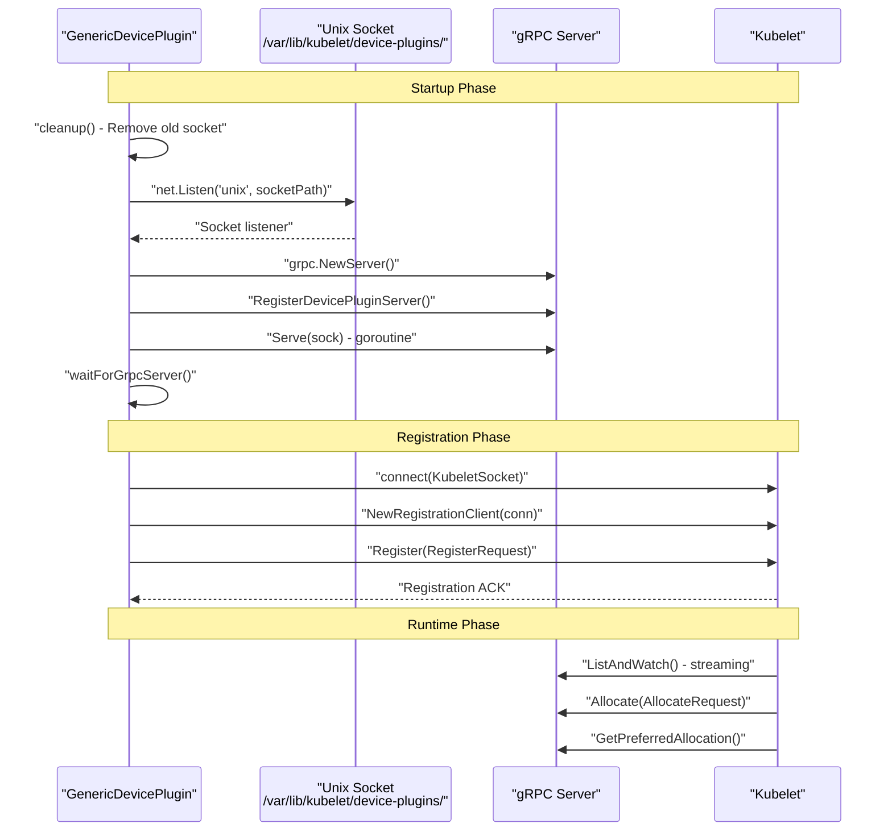
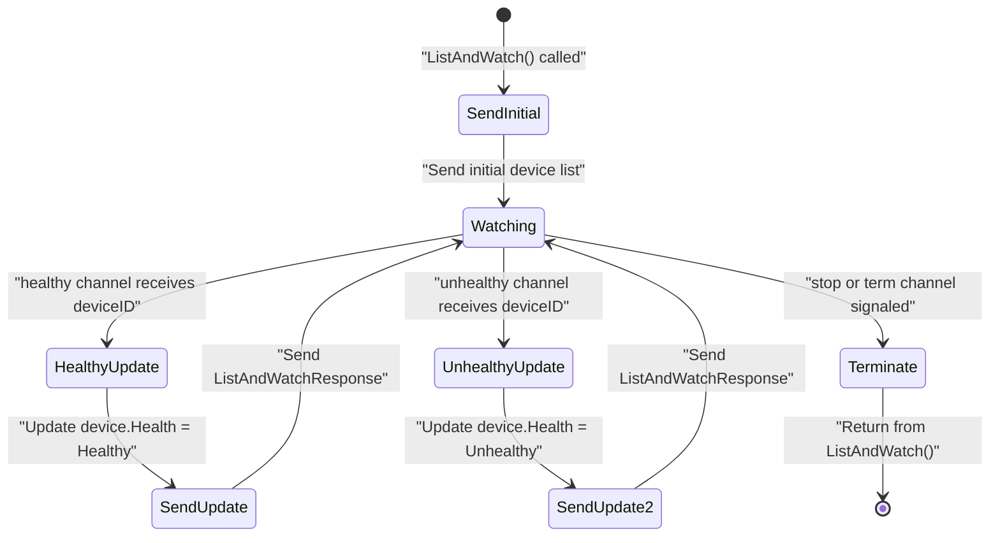
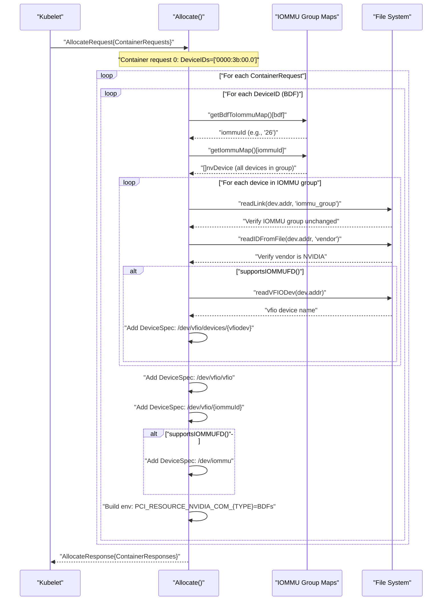
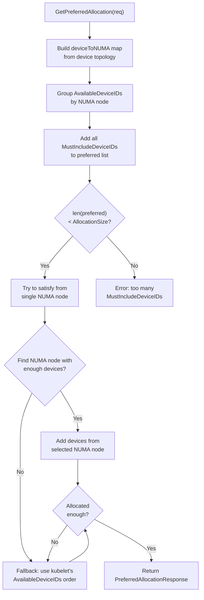
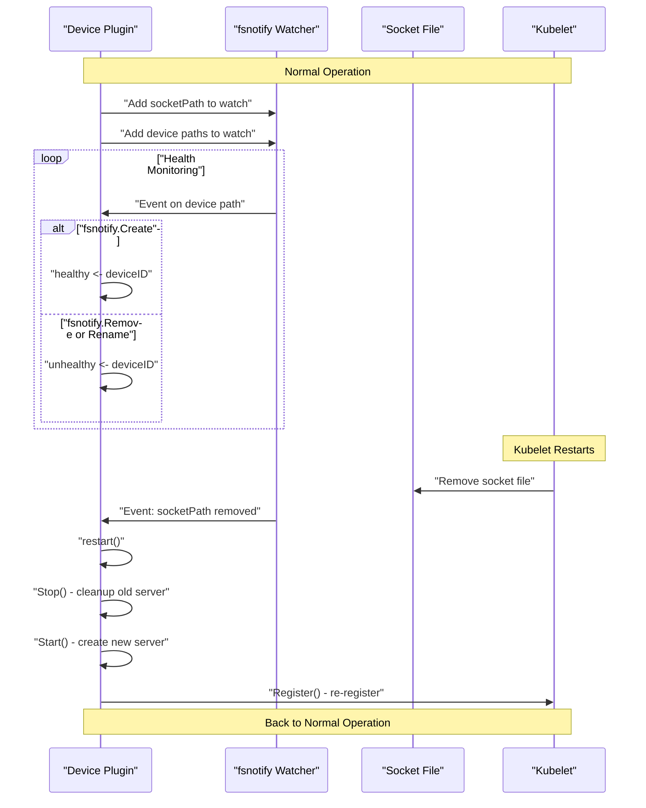

<!-- source: DeepWiki mcp.deepwiki.com · repo NVIDIA/kubevirt-gpu-device-plugin · page 3.5 Kubernetes Integration · fetched 2026-10-26 -->

# Kubernetes Integration

<details>
<summary>Relevant source files</summary>

The following files were used as context for generating this wiki page:

- [go.mod](go.mod)
- [manifests/nvidia-kubevirt-gpu-device-plugin.yaml](manifests/nvidia-kubevirt-gpu-device-plugin.yaml)
- [pkg/device_plugin/generic_device_plugin.go](pkg/device_plugin/generic_device_plugin.go)
- [vendor/modules.txt](vendor/modules.txt)

</details>


This page documents how the NVIDIA KubeVirt GPU Device Plugin integrates with Kubernetes through the Device Plugin API. It covers the gRPC communication protocol, resource registration and advertisement, device allocation mechanisms, and NUMA-aware scheduling support.

For implementation details of the physical GPU and vGPU plugins that use this integration layer, see [Physical GPU Device Plugin](#3.3) and [Virtual GPU Device Plugin](#3.4). For deployment configuration, see [Kubernetes Deployment](#4.3).

## Device Plugin API Overview

The device plugin implements the Kubernetes Device Plugin API v1beta1 from `k8s.io/kubelet/pkg/apis/deviceplugin/v1beta1`. This API defines a standard gRPC interface that allows external device vendors to advertise hardware resources to the Kubelet without modifying core Kubernetes code.

The `GenericDevicePlugin` struct [pkg/device_plugin/generic_device_plugin.go:63-74]() implements the full `DevicePlugin` service interface, providing methods for:

- **Registration**: Announcing the device plugin to Kubelet
- **ListAndWatch**: Streaming device availability and health status
- **Allocate**: Providing device-specific configuration when pods are scheduled
- **GetPreferredAllocation**: Optimizing device selection for NUMA topology
- **GetDevicePluginOptions**: Advertising plugin capabilities
- **PreStartContainer**: Pre-allocation hooks (currently unused)

**Core Implementation Structure**



Sources: [pkg/device_plugin/generic_device_plugin.go:63-74](), [go.mod:12]()

## gRPC Communication Architecture

The device plugin uses Unix domain sockets for gRPC communication with the Kubelet. This provides low-latency local IPC without network overhead.

**Socket and Connection Management**



Sources: [pkg/device_plugin/generic_device_plugin.go:130-170](), [pkg/device_plugin/generic_device_plugin.go:100-127]()

### Socket Path Construction

Each device type gets a unique socket file in the device plugin directory:

| Component | Value | Source |
|-----------|-------|--------|
| Base directory | `/var/lib/kubelet/device-plugins` | `pluginapi.DevicePluginPath` |
| Socket filename | `kubevirt-{deviceName}.sock` | [pkg/device_plugin/generic_device_plugin.go:79]() |
| Kubelet socket | `/var/lib/kubelet/device-plugins/kubelet.sock` | `pluginapi.KubeletSocket` |
| Connection timeout | 5 seconds | [pkg/device_plugin/generic_device_plugin.go:52]() |

The socket path is volume-mounted into the device plugin pod via the DaemonSet configuration [manifests/nvidia-kubevirt-gpu-device-plugin.yaml:28-36]().

Sources: [pkg/device_plugin/generic_device_plugin.go:50-57](), [pkg/device_plugin/generic_device_plugin.go:79]()

## Registration Process

The registration process announces the device plugin to Kubelet and establishes the resource namespace.

**Registration Flow**

```mermaid
graph LR
    A["Start()"] -->|"1. cleanup()"| B["Remove old socket"]
    B -->|"2. net.Listen()"| C["Create Unix socket"]
    C -->|"3. grpc.NewServer()"| D["Create gRPC server"]
    D -->|"4. RegisterDevicePluginServer()"| E["Register service"]
    E -->|"5. Serve() goroutine"| F["Start gRPC server"]
    F -->|"6. waitForGrpcServer()"| G["Verify connectivity"]
    G -->|"7. Register()"| H["Send RegisterRequest"]
    H -->|"8. healthCheck() goroutine"| I["Monitor device health"]
```



Sources: [pkg/device_plugin/generic_device_plugin.go:130-170]()

### RegisterRequest Structure

The `Register()` method [pkg/device_plugin/generic_device_plugin.go:202-223]() sends a `RegisterRequest` to Kubelet with:

```go
reqt := &pluginapi.RegisterRequest{
    Version:      pluginapi.Version,           // "v1beta1"
    Endpoint:     path.Base(dpi.socketPath),   // "kubevirt-{deviceName}.sock"
    ResourceName: fmt.Sprintf("%s/%s", DeviceNamespace, dpi.deviceName),
}
```

The resource name follows the format `nvidia.com/{deviceName}`, where:
- `DeviceNamespace` is `"nvidia.com"` [pkg/device_plugin/generic_device_plugin.go:51]()
- `{deviceName}` is the GPU type (e.g., `"GRID-V100D-8C"`, `"Tesla-T4"`)

Once registered, Kubelet tracks this resource and makes it available for pod scheduling.

Sources: [pkg/device_plugin/generic_device_plugin.go:202-223](), [pkg/device_plugin/generic_device_plugin.go:51]()

## Resource Advertisement (ListAndWatch)

The `ListAndWatch()` method [pkg/device_plugin/generic_device_plugin.go:226-263]() is a **streaming gRPC call** that continuously advertises device availability and health status to Kubelet.

**ListAndWatch Streaming Architecture**



Sources: [pkg/device_plugin/generic_device_plugin.go:226-263]()

### Device Information Advertised

Each device in the `ListAndWatchResponse` contains:

| Field | Type | Purpose | Example |
|-------|------|---------|---------|
| `ID` | string | Device identifier (BDF address) | `"0000:3b:00.0"` |
| `Health` | string | Health status | `pluginapi.Healthy` or `pluginapi.Unhealthy` |
| `Topology` | `*TopologyInfo` | NUMA node information | `Nodes: [{ID: 0}]` |

The topology information is critical for NUMA-aware scheduling. When present, it tells the Kubernetes Topology Manager which NUMA node the device is attached to, enabling co-location of CPUs and devices on the same NUMA node for optimal performance.

**Initial Advertisement Example**

```
[deviceName] ListAndWatch called, sending 2 devices:
  Device ID=0000:3b:00.0, Health=Healthy, NUMA=0
  Device ID=0000:af:00.0, Health=Healthy, NUMA=1
```

Sources: [pkg/device_plugin/generic_device_plugin.go:228-237]()

### Health State Updates

The plugin monitors device health through the `healthCheck()` goroutine [pkg/device_plugin/generic_device_plugin.go:528-607]() using `fsnotify` file system watchers. When a device's VFIO device node is removed or renamed, the plugin signals the `unhealthy` channel, which triggers a `ListAndWatch` update.

When Kubelet receives an `Unhealthy` device, it stops scheduling new pods requesting that device and may evict existing pods depending on the eviction policy.

Sources: [pkg/device_plugin/generic_device_plugin.go:239-262](), [pkg/device_plugin/generic_device_plugin.go:528-607]()

## Resource Allocation Flow

When Kubelet schedules a pod requesting GPU resources, it calls the `Allocate()` method [pkg/device_plugin/generic_device_plugin.go:266-361]() to obtain device-specific configuration.

**Allocation Request Processing**



Sources: [pkg/device_plugin/generic_device_plugin.go:266-361]()

### Allocation Response Components

The `AllocateResponse` [pkg/device_plugin/generic_device_plugin.go:352-358]() contains:

**1. Environment Variables**

Environment variables communicate device addresses to the container:

```
PCI_RESOURCE_NVIDIA_COM_{DEVICENAME}=0000:3b:00.0,0000:3b:00.1
```

The key format is: `{gpuPrefix}_{DEVICENAME}` where `gpuPrefix="PCI_RESOURCE_NVIDIA_COM"` [pkg/device_plugin/generic_device_plugin.go:55]().

For multi-function devices in the same IOMMU group, all BDF addresses are comma-separated [pkg/device_plugin/generic_device_plugin.go:92-98]().

**2. Device Specifications**

Device specifications mount host device nodes into the container:

| Device Path | Purpose | Permissions |
|-------------|---------|-------------|
| `/dev/vfio/vfio` | VFIO container device | `mrw` |
| `/dev/vfio/{iommuId}` | IOMMU group device | `mrw` |
| `/dev/vfio/devices/{vfiodev}` | IOMMUFD device (if supported) | `mrw` |
| `/dev/iommu` | IOMMU character device (if supported) | `mrw` |

The plugin detects IOMMUFD support [pkg/device_plugin/generic_device_plugin.go:609-618]() and includes additional device nodes when available for newer kernel versions.

Sources: [pkg/device_plugin/generic_device_plugin.go:276-342](), [pkg/device_plugin/generic_device_plugin.go:344-349]()

### Allocation Validation

Before allocation, the plugin performs strict validation [pkg/device_plugin/generic_device_plugin.go:296-310]():

1. **IOMMU Group Integrity**: Verifies the IOMMU group hasn't changed
2. **Vendor ID Check**: Confirms the device is still an NVIDIA GPU
3. **Device Existence**: Ensures all devices in the IOMMU group are present

If any validation fails, allocation returns an error and Kubelet will not start the pod.

Sources: [pkg/device_plugin/generic_device_plugin.go:296-310]()

## NUMA-Aware Allocation

The `GetPreferredAllocation()` method [pkg/device_plugin/generic_device_plugin.go:387-525]() provides hints to the Kubernetes Topology Manager for NUMA-aware device selection. This is critical for achieving optimal performance on multi-socket NUMA systems.

**Preferred Allocation Algorithm**



Sources: [pkg/device_plugin/generic_device_plugin.go:387-525]()

### Allocation Strategy

The preference algorithm follows this priority order:

**1. Respect MustIncludeDeviceIDs** [pkg/device_plugin/generic_device_plugin.go:437-450]()

Devices in `MustIncludeDeviceIDs` are always included first. These are devices that the Topology Manager requires for policy compliance.

**2. Single NUMA Node Optimization** [pkg/device_plugin/generic_device_plugin.go:458-493]()

The algorithm attempts to allocate all devices from a single NUMA node:
- First tries NUMA nodes that already have selected devices
- Then tries other NUMA nodes in the order they were discovered
- Selects the first node that can satisfy the full allocation

**3. Fallback to Kubelet Order** [pkg/device_plugin/generic_device_plugin.go:496-505]()

If no single NUMA node has enough devices, falls back to the kubelet-provided device order in `AvailableDeviceIDs`.

**Example Log Output**

```
[GRID-V100D-8C] GetPreferredAllocation called with 1 container request(s)
[GRID-V100D-8C] Container request 0: Available devices=[0000:3b:00.0, 0000:af:00.0], 
                MustInclude=[], AllocationSize=2
[GRID-V100D-8C] Selecting NUMA node 0 (have 0 selected, 2 available) to satisfy 2 devices
[GRID-V100D-8C] Preferred allocation for container 0: [0000:3b:00.0, 0000:af:00.0] 
                (NUMA nodes: [0, 0])
```

Sources: [pkg/device_plugin/generic_device_plugin.go:388-395](), [pkg/device_plugin/generic_device_plugin.go:507-516]()

### Topology Manager Integration

When the Topology Manager is enabled with the `single-numa-node` policy, Kubelet uses `GetPreferredAllocation()` hints to ensure:
- All GPU devices for a container come from the same NUMA node
- CPU cores are allocated from the same NUMA node
- Memory is allocated from the same NUMA node

This reduces cross-NUMA memory access latency and maximizes PCIe bandwidth.

Sources: [pkg/device_plugin/generic_device_plugin.go:384-386](), [pkg/device_plugin/generic_device_plugin.go:271-272]()

## Socket Management and Health Monitoring

The device plugin implements robust socket lifecycle management and automatic recovery from Kubelet restarts.

**Socket Lifecycle and Restart Detection**



Sources: [pkg/device_plugin/generic_device_plugin.go:528-607]()

### Health Check Implementation

The `healthCheck()` goroutine [pkg/device_plugin/generic_device_plugin.go:528-607]() monitors:

**1. Device Path Monitoring**

For each device, watches the VFIO device path `/dev/vfio/{iommuId}` [pkg/device_plugin/generic_device_plugin.go:557-575]():
- **Create event**: Device became healthy → signal `healthy` channel
- **Remove/Rename event**: Device became unhealthy → signal `unhealthy` channel

**2. Socket Path Monitoring**

Watches the device plugin socket directory to detect Kubelet restarts [pkg/device_plugin/generic_device_plugin.go:542-546]():
- When socket file is removed, triggers `restart()` [pkg/device_plugin/generic_device_plugin.go:594-603]()
- Stops old gRPC server, creates new server, re-registers with Kubelet

**3. Termination Signal**

Listens on the `stop` channel [pkg/device_plugin/generic_device_plugin.go:579-580]() for graceful shutdown.

Sources: [pkg/device_plugin/generic_device_plugin.go:528-607](), [pkg/device_plugin/generic_device_plugin.go:188-199]()

### Restart Recovery Process

When Kubelet restarts, it removes all device plugin socket files. The plugin detects this via fsnotify and automatically:

1. **Stop old server** [pkg/device_plugin/generic_device_plugin.go:194](): Send termination signal to `ListAndWatch()`
2. **Clean up** [pkg/device_plugin/generic_device_plugin.go:184](): Remove socket file and stop gRPC server
3. **Start new server** [pkg/device_plugin/generic_device_plugin.go:198](): Create new Unix socket and gRPC server
4. **Re-register** [pkg/device_plugin/generic_device_plugin.go:159](): Send new `RegisterRequest` to Kubelet

This ensures zero-downtime recovery without manual intervention.

Sources: [pkg/device_plugin/generic_device_plugin.go:188-199]()

## Device Plugin Options

The `GetDevicePluginOptions()` method [pkg/device_plugin/generic_device_plugin.go:371-377]() advertises plugin capabilities to Kubelet.

**Current Options Configuration**

```go
options := &pluginapi.DevicePluginOptions{
    PreStartRequired:                false,
    GetPreferredAllocationAvailable: true,
}
```

| Option | Value | Meaning |
|--------|-------|---------|
| `PreStartRequired` | `false` | No pre-start container hook needed |
| `GetPreferredAllocationAvailable` | `true` | Plugin supports NUMA-aware hints |

The `GetPreferredAllocationAvailable` flag tells Kubelet that the plugin implements `GetPreferredAllocation()`, enabling Topology Manager integration.

The `PreStartContainer()` method [pkg/device_plugin/generic_device_plugin.go:379-382]() is implemented but returns an empty response, as no pre-start actions are required for VFIO device passthrough.

Sources: [pkg/device_plugin/generic_device_plugin.go:371-377](), [pkg/device_plugin/generic_device_plugin.go:379-382]()

## Resource Namespace and Naming

All GPU resources are advertised under the `nvidia.com` namespace [pkg/device_plugin/generic_device_plugin.go:51]() to avoid conflicts with other device plugins.

**Resource Name Format**

```
nvidia.com/{deviceName}
```

Where `{deviceName}` is the GPU model or vGPU type. Example resource names:

- Physical GPUs: `nvidia.com/Tesla-T4`, `nvidia.com/V100-SXM2-32GB`
- Virtual GPUs: `nvidia.com/GRID-V100D-8C`, `nvidia.com/GRID-T4-4Q`

These resource names appear in pod specifications:

```yaml
resources:
  limits:
    nvidia.com/GRID-V100D-8C: 1
```

And in node capacity:

```yaml
status:
  capacity:
    nvidia.com/GRID-V100D-8C: "2"
    nvidia.com/Tesla-T4: "1"
```

Sources: [pkg/device_plugin/generic_device_plugin.go:51](), [pkg/device_plugin/generic_device_plugin.go:213]()

---

