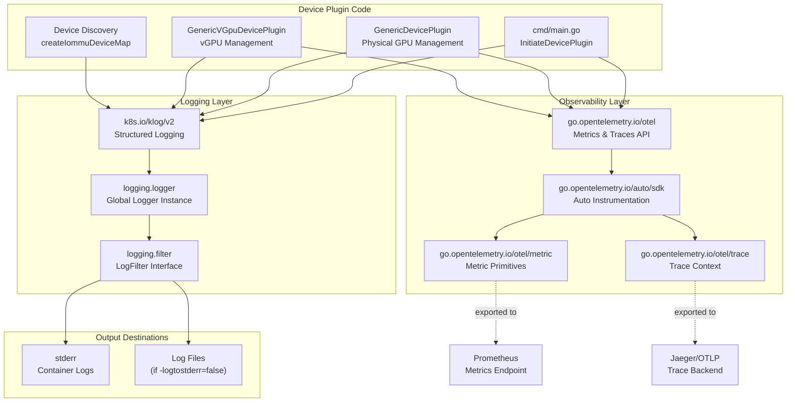
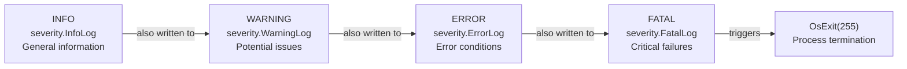
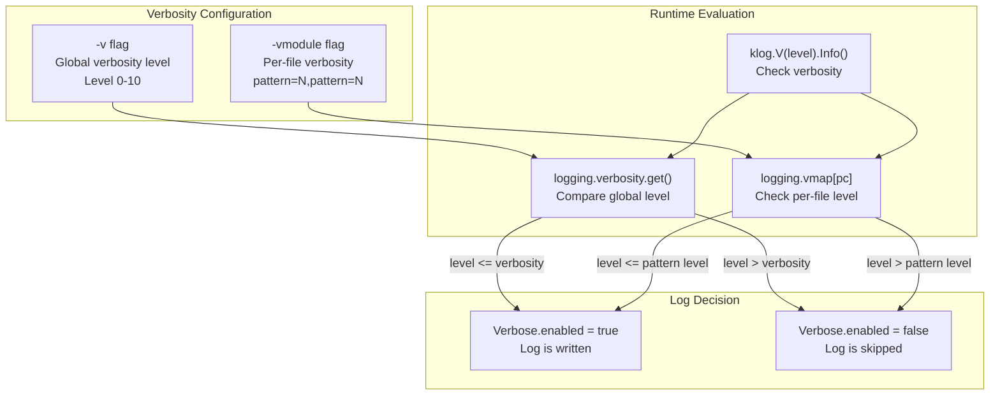
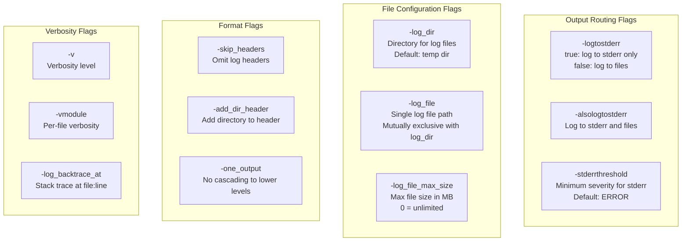
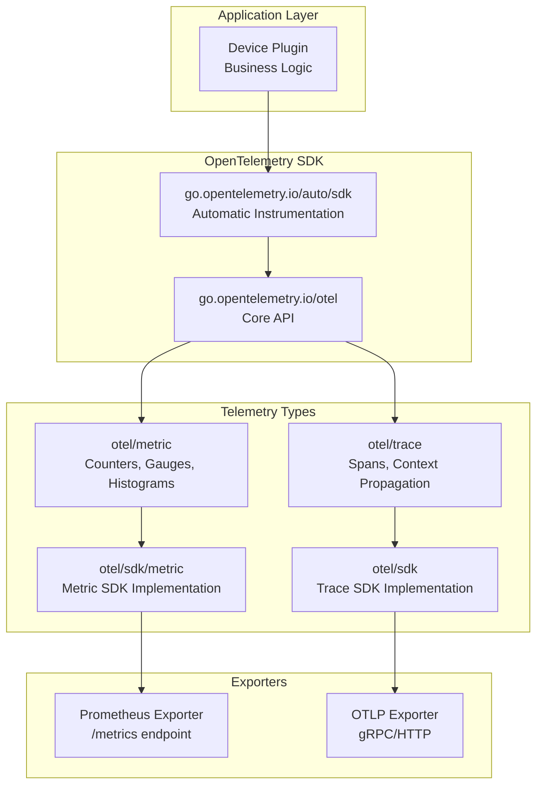
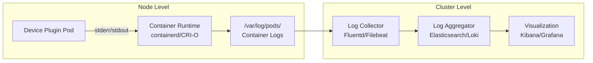
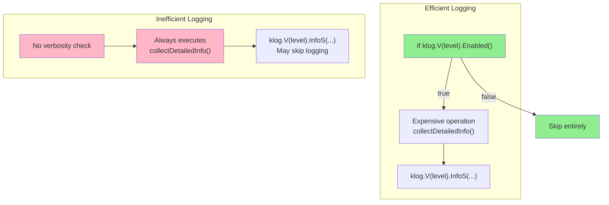

<!-- source: DeepWiki mcp.deepwiki.com · repo NVIDIA/kubevirt-gpu-device-plugin · page 3.6 Logging and Observability · fetched 2026-10-26 -->

# Logging and Observability

<details>
<summary>Relevant source files</summary>

The following files were used as context for generating this wiki page:

- [go.mod](go.mod)
- [go.sum](go.sum)
- [vendor/k8s.io/klog/v2/klog.go](vendor/k8s.io/klog/v2/klog.go)

</details>


## Purpose and Scope

This document describes the logging and observability infrastructure of the NVIDIA KubeVirt GPU Device Plugin. It covers the implementation of structured logging using klog v2, OpenTelemetry integration for metrics and traces, configuration options, and best practices for adding instrumentation to the codebase.

For information about testing the system, see [Testing](#5.2). For deployment configuration, see [Kubernetes Deployment](#4.3).

---

## Logging Architecture

The device plugin uses **klog v2** as its primary logging framework, following Kubernetes conventions for structured logging. OpenTelemetry provides metrics and distributed tracing capabilities.

### System Components



**Sources**: [go.mod:1-34](), [vendor/k8s.io/klog/v2/klog.go:1-116]()

---

## klog v2 Structured Logging

### Dependency Configuration

The device plugin imports klog v2 as its logging framework:

| Dependency | Version | Purpose |
|------------|---------|---------|
| `k8s.io/klog/v2` | v2.130.1 | Primary logging framework |
| `github.com/go-logr/logr` | v1.4.3 | Logging interface (indirect) |

**Sources**: [go.mod:11-16](), [go.sum:106-107]()

### Log Severity Levels

klog implements four severity levels that control log routing and filtering:



Each severity level cascades to higher severities unless the `-one_output` flag is set.

**Sources**: [vendor/k8s.io/klog/v2/klog.go:181-189](), [vendor/k8s.io/klog/v2/klog.go:914-928]()

### Logging API Functions

klog provides both unstructured and structured logging interfaces:

#### Unstructured Logging

| Function | Severity | Description |
|----------|----------|-------------|
| `klog.Info(args...)` | INFO | Printf-style logging |
| `klog.Infof(format, args...)` | INFO | Formatted output |
| `klog.Infoln(args...)` | INFO | Println-style logging |
| `klog.Warning(args...)` | WARNING | Warning messages |
| `klog.Error(args...)` | ERROR | Error messages |
| `klog.Fatal(args...)` | FATAL | Fatal errors (exits process) |

**Sources**: [vendor/k8s.io/klog/v2/klog.go:1486-1673]()

#### Structured Logging

Structured logging is the recommended approach for Kubernetes components:

| Function | Usage Example |
|----------|---------------|
| `klog.InfoS(msg, keysAndValues...)` | `klog.InfoS("Device discovered", "pciAddress", addr, "deviceName", name)` |
| `klog.ErrorS(err, msg, keysAndValues...)` | `klog.ErrorS(err, "Failed to allocate device", "deviceID", id)` |

**Output Format**:
```
I1025 00:15:15.525108       1 device_plugin.go:116] "Device discovered" pciAddress="0000:00:05.0" deviceName="NVIDIA A100"
E1025 00:15:16.123456       1 device_plugin.go:234] "Failed to allocate device" err="device busy" deviceID="GPU-abc123"
```

**Sources**: [vendor/k8s.io/klog/v2/klog.go:1522-1532](), [vendor/k8s.io/klog/v2/klog.go:1606-1617](), [vendor/k8s.io/klog/v2/klog.go:811-825]()

### Verbosity Control

The verbosity system allows fine-grained control over log detail levels:



**Usage Example**:
```go
// Only logs if -v=2 or higher
if klog.V(2).Enabled() {
    klog.InfoS("Detailed GPU topology", "numaNode", node, "devices", devices)
}

// Equivalent shorter form
klog.V(2).InfoS("Detailed GPU topology", "numaNode", node, "devices", devices)
```

**vmodule Pattern Matching**:
```bash
# Enable verbose logging for specific files
-vmodule=device_plugin=2,generic_device_plugin=3
```

**Sources**: [vendor/k8s.io/klog/v2/klog.go:1353-1392](), [vendor/k8s.io/klog/v2/klog.go:237-324](), [vendor/k8s.io/klog/v2/klog.go:1295-1317]()

---

## Log Format and Configuration

### Log Entry Format

klog uses a structured format based on Google's glog:

```
Lmmdd hh:mm:ss.uuuuuu threadid file:line] msg...
```

| Field | Description |
|-------|-------------|
| `L` | Severity level (I=Info, W=Warning, E=Error, F=Fatal) |
| `mmdd` | Month and day (zero-padded) |
| `hh:mm:ss.uuuuuu` | Time with microsecond precision |
| `threadid` | Thread/goroutine ID |
| `file:line` | Source file and line number |
| `msg` | Log message with key-value pairs |

**Sources**: [vendor/k8s.io/klog/v2/klog.go:632-651](), [vendor/k8s.io/klog/v2/klog.go:652-679]()

### Command Line Flags

klog exposes extensive configuration through command-line flags:



**Default Configuration**:
- `-logtostderr=true` (container-friendly)
- `-v=0` (minimal verbosity)
- `-stderrthreshold=ERROR`

**Sources**: [vendor/k8s.io/klog/v2/klog.go:410-434]()

### Initialization

klog must be initialized before use:

```go
import (
    "flag"
    "k8s.io/klog/v2"
)

func main() {
    klog.InitFlags(nil) // Initialize with default flag set
    flag.Parse()        // Parse command-line flags
    defer klog.Flush()  // Flush logs before exit
    
    // Application code
}
```

**Sources**: [vendor/k8s.io/klog/v2/klog.go:436-449](), [vendor/k8s.io/klog/v2/klog.go:451-454]()

---

## OpenTelemetry Integration

### Dependency Configuration

The device plugin includes OpenTelemetry for metrics and distributed tracing:

| Package | Version | Purpose |
|---------|---------|---------|
| `go.opentelemetry.io/otel` | v1.38.0 | Core OpenTelemetry API |
| `go.opentelemetry.io/auto/sdk` | v1.2.1 | Automatic instrumentation SDK |
| `go.opentelemetry.io/otel/metric` | v1.38.0 | Metrics API |
| `go.opentelemetry.io/otel/trace` | v1.38.0 | Distributed tracing API |

**Sources**: [go.mod:24-25](), [go.sum:50-61]()

### Observability Components



**Sources**: [go.mod:24-25](), [go.sum:50-61]()

### Metrics Primitives

OpenTelemetry provides standard metric types for observability:

| Metric Type | Use Case | Example |
|-------------|----------|---------|
| **Counter** | Monotonically increasing values | Total devices allocated, request count |
| **Gauge** | Current value snapshots | Available GPU count, memory usage |
| **Histogram** | Distribution of values | Allocation latency, device health check duration |

### Traces and Spans

Distributed tracing tracks operations across the system:

| Concept | Description | Example |
|---------|-------------|---------|
| **Trace** | End-to-end request flow | Complete device allocation lifecycle |
| **Span** | Single operation within a trace | Device health check, IOMMU group validation |
| **Context** | Propagation of trace information | Span context passed between functions |

**Sources**: [go.sum:60-61]()

---

## Usage Patterns

### Recommended Logging Practices

#### 1. Use Structured Logging for Events

```go
// Good: Structured logging with key-value pairs
klog.InfoS("GPU device discovered", 
    "pciAddress", "0000:00:05.0",
    "deviceName", "NVIDIA A100-SXM4-40GB",
    "numaNode", 0)

// Avoid: Unstructured logging
klog.Infof("Found GPU %s at %s on NUMA %d", name, addr, node)
```

#### 2. Log Errors with Context

```go
// Good: Error with structured context
klog.ErrorS(err, "Failed to validate IOMMU group",
    "pciAddress", pciAddr,
    "iommuGroup", group,
    "expectedDevices", expected)

// Avoid: Error without context
klog.Errorf("IOMMU validation failed: %v", err)
```

#### 3. Use Verbosity Levels Appropriately

```go
// V(0): Always visible, critical information
klog.InfoS("Device plugin starting", "version", version)

// V(2): Detailed operational information
klog.V(2).InfoS("Device list updated", "count", len(devices))

// V(4): Debug-level details
klog.V(4).InfoS("Scanning PCI device", 
    "path", path, 
    "driver", driver)
```

#### 4. Conditional Verbose Logging

```go
// Check before expensive operations
if klog.V(4).Enabled() {
    detailedInfo := collectDetailedDeviceInfo(device)
    klog.V(4).InfoS("Detailed device info", 
        "device", deviceID,
        "details", detailedInfo)
}
```

**Sources**: [vendor/k8s.io/klog/v2/klog.go:1522-1532](), [vendor/k8s.io/klog/v2/klog.go:1606-1617](), [vendor/k8s.io/klog/v2/klog.go:1353-1392]()

### Log Level Guidelines

| Level | Purpose | Examples |
|-------|---------|----------|
| **V(0)** | Essential information | Startup, shutdown, configuration changes |
| **V(1)** | Important events | Device registration, allocation requests |
| **V(2)** | Detailed operations | Health checks, periodic scans |
| **V(3)** | Debug information | Device state changes, internal calculations |
| **V(4+)** | Trace-level details | File system operations, low-level device interactions |

### Error Handling Pattern

```go
// Pattern for error logging with appropriate severity
func allocateDevice(deviceID string) error {
    klog.V(2).InfoS("Attempting device allocation", "deviceID", deviceID)
    
    if err := validateDevice(deviceID); err != nil {
        // Error that prevents operation
        klog.ErrorS(err, "Device validation failed", 
            "deviceID", deviceID)
        return err
    }
    
    if err := performAllocation(deviceID); err != nil {
        // Critical error requiring immediate attention
        klog.ErrorS(err, "Failed to allocate device", 
            "deviceID", deviceID,
            "state", "allocated")
        return err
    }
    
    klog.InfoS("Device allocated successfully", "deviceID", deviceID)
    return nil
}
```

---

## Container Logging Configuration

### DaemonSet Logging Setup

When deployed as a DaemonSet, the device plugin uses container-friendly defaults:

```yaml
# Default configuration for containerized deployment
args:
  - -logtostderr=true     # Log to stderr (captured by container runtime)
  - -v=2                  # Moderate verbosity
  - -alsologtostderr=false
```

Container logs are automatically collected by:
- Kubernetes container runtime (containerd/CRI-O)
- kubectl logs command
- Centralized logging systems (Fluentd, Loki, etc.)

### Viewing Logs

```bash
# View device plugin logs
kubectl logs -n kube-system daemonset/nvidia-kubevirt-gpu-device-plugin

# Follow logs in real-time
kubectl logs -n kube-system daemonset/nvidia-kubevirt-gpu-device-plugin -f

# View logs from specific node
kubectl logs -n kube-system -l name=nvidia-kubevirt-gpu-device-plugin \
    --field-selector spec.nodeName=node-1

# Increase verbosity for debugging
kubectl set env daemonset/nvidia-kubevirt-gpu-device-plugin -n kube-system \
    VERBOSITY=4
```

### Log Aggregation



**Sources**: [vendor/k8s.io/klog/v2/klog.go:410-434]()

---

## Observability Best Practices

### Logging Guidelines

1. **Use Structured Logging**: Always use `InfoS` and `ErrorS` for structured key-value pairs
2. **Include Context**: Add relevant identifiers (deviceID, pciAddress, iommuGroup) to all logs
3. **Appropriate Severity**: Use ERROR for actual errors, WARNING for potential issues, INFO for normal operations
4. **Verbosity Levels**: Place detailed debug information behind `klog.V()` checks
5. **Avoid Secrets**: Never log sensitive information (tokens, keys, credentials)

### Performance Considerations



**Key Principle**: Check verbosity before expensive operations:

```go
// Good: Conditional execution
if klog.V(4).Enabled() {
    details := collectExpensiveDetails() // Only runs if V(4) is enabled
    klog.V(4).InfoS("Details", "data", details)
}

// Bad: Always executes expensive operation
details := collectExpensiveDetails() // Always runs
klog.V(4).InfoS("Details", "data", details) // May not log
```

**Sources**: [vendor/k8s.io/klog/v2/klog.go:1394-1399](), [vendor/k8s.io/klog/v2/klog.go:1353-1392]()

### Buffer Flushing

```go
import "k8s.io/klog/v2"

func main() {
    // Ensure logs are flushed before exit
    defer klog.Flush()
    
    // Application code
    
    // Flush is called automatically on exit
}
```

The flush daemon periodically writes buffered logs to disk:
- Default interval: 5 seconds
- Configurable via `StartFlushDaemon(interval)`
- Manual flush via `Flush()`

**Sources**: [vendor/k8s.io/klog/v2/klog.go:1100-1150](), [vendor/k8s.io/klog/v2/klog.go:1183-1188]()

### State Capture and Restoration

klog provides state management for testing and configuration changes:

```go
// Capture current logging state
state := klog.CaptureState()

// Modify settings temporarily
klog.SetLogFilter(customFilter)

// Restore previous state
state.Restore()
```

**Sources**: [vendor/k8s.io/klog/v2/klog.go:583-630]()

---

## Summary

The NVIDIA KubeVirt GPU Device Plugin uses a comprehensive observability stack:

- **klog v2** (v2.130.1) for Kubernetes-native structured logging
- **OpenTelemetry** (v1.38.0) for metrics and distributed tracing
- Container-friendly defaults with stderr output
- Fine-grained verbosity control via `-v` and `-vmodule` flags
- Structured logging with key-value pairs for machine-readable output
- Best practices for performance-conscious logging with verbosity guards

All logs are captured by the Kubernetes container runtime and can be viewed with `kubectl logs` or aggregated through cluster-level logging solutions.

**Sources**: [go.mod:1-34](), [vendor/k8s.io/klog/v2/klog.go:1-116]()

---

