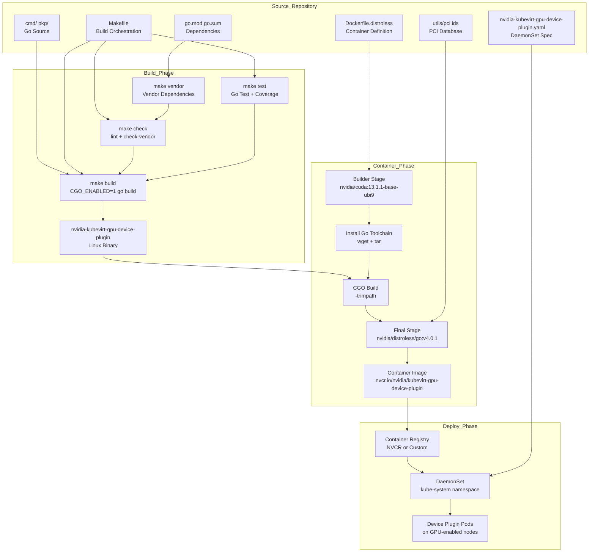
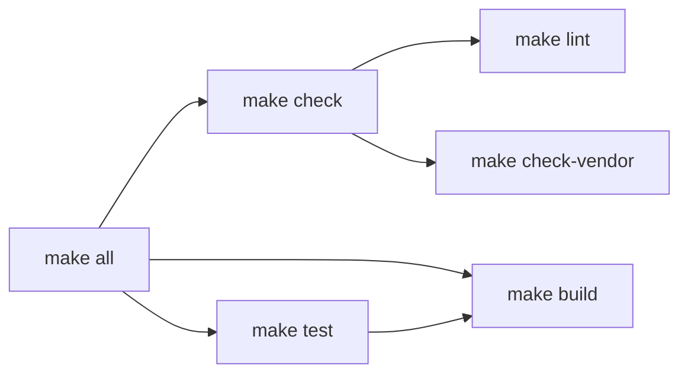
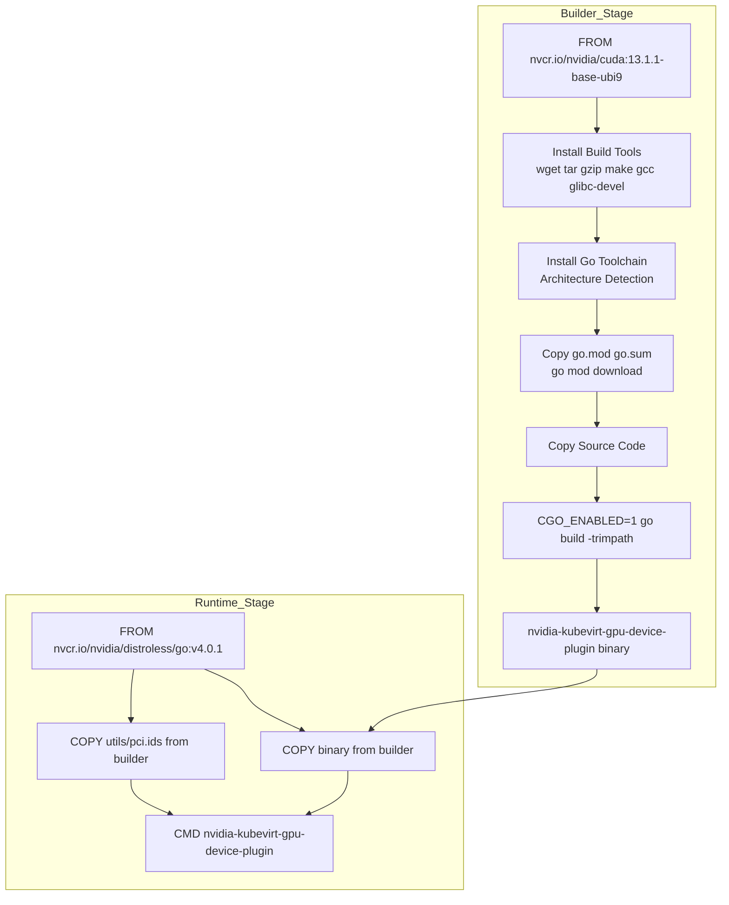
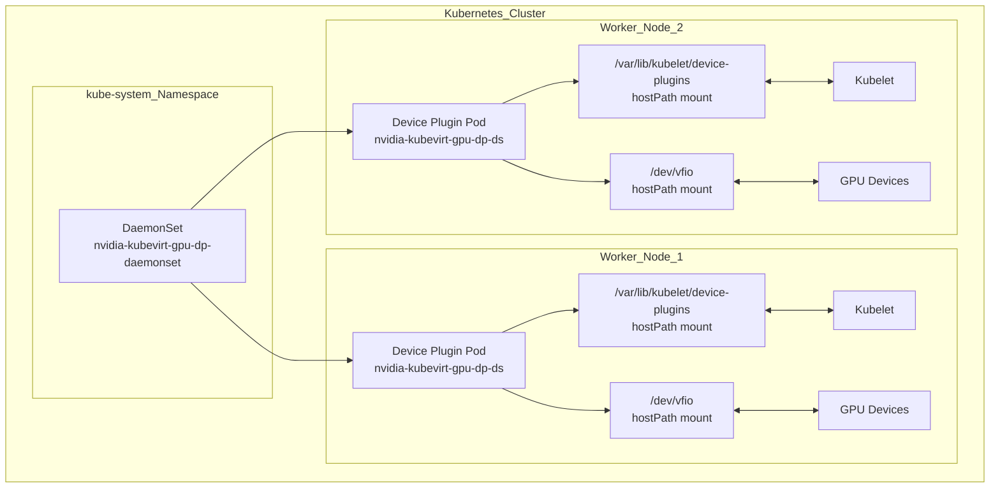

<!-- source: DeepWiki mcp.deepwiki.com · repo NVIDIA/kubevirt-gpu-device-plugin · page 4 Build and Deployment · fetched 2026-10-26 -->

# Build and Deployment

<details>
<summary>Relevant source files</summary>

The following files were used as context for generating this wiki page:

- [Makefile](Makefile)
- [deployments/container/Dockerfile.distroless](deployments/container/Dockerfile.distroless)
- [manifests/nvidia-kubevirt-gpu-device-plugin.yaml](manifests/nvidia-kubevirt-gpu-device-plugin.yaml)

</details>


## Purpose and Scope

This document provides a comprehensive guide to building, containerizing, and deploying the NVIDIA KubeVirt GPU Device Plugin. It covers the complete lifecycle from source code compilation to production deployment on Kubernetes clusters.

For detailed information about:
- Build system targets and toolchain requirements, see [Build System](#4.1)
- Container image construction and multi-stage builds, see [Container Images](#4.2)
- Kubernetes DaemonSet configuration and deployment procedures, see [Kubernetes Deployment](#4.3)
- Development environment setup and testing, see [Development Guide](#5)
- CI/CD automation workflows, see [CI/CD Pipeline](#5.3)

---

## Overview

The build and deployment process follows a standard cloud-native pattern with three main phases:

1. **Build Phase**: Compilation of Go source code into a static binary using Makefile targets
2. **Containerization Phase**: Multi-stage Docker build producing a minimal distroless container image
3. **Deployment Phase**: Installation as a Kubernetes DaemonSet on GPU-enabled nodes

The build system is designed for both local development and automated CI/CD pipelines, providing consistent builds across environments.

**Sources**: [Makefile:1-94](), [deployments/container/Dockerfile.distroless:1-78](), [manifests/nvidia-kubevirt-gpu-device-plugin.yaml:1-40]()

---

## Build and Deployment Pipeline

The following diagram illustrates the complete pipeline from source code to running pods:



**Sources**: [Makefile:28-94](), [deployments/container/Dockerfile.distroless:28-78](), [manifests/nvidia-kubevirt-gpu-device-plugin.yaml:1-40]()

---

## Makefile Targets

The build system provides the following primary targets:

| Target | Description | Dependencies |
|--------|-------------|--------------|
| `build` | Compile the binary for Linux | Source files, go.mod |
| `check` | Run linting checks | `lint`, `check-vendor` |
| `test` | Execute unit tests with coverage | `build` |
| `fmt` | Format Go source code | - |
| `vendor` | Download and vendor dependencies | `mod-tidy`, `mod-vendor`, `mod-verify` |
| `check-vendor` | Verify vendored dependencies are up-to-date | `vendor` |
| `update-pcidb` | Download latest PCI IDs database | - |
| `clean` | Remove build artifacts | - |



### Build Command

The core build command compiles a Linux binary with CGO enabled:

```bash
GOOS=linux go build -trimpath -o nvidia-kubevirt-gpu-device-plugin ./cmd
```

Key build flags:
- `GOOS=linux`: Target Linux operating system
- `-trimpath`: Remove absolute file paths from binary for reproducibility
- CGO enabled by default (required for NVML bindings)

**Sources**: [Makefile:37-38](), [Makefile:28-41]()

---

## Container Build Process

The container image is built using a multi-stage Dockerfile that separates the build environment from the runtime environment:



### Builder Stage

The builder stage uses `nvcr.io/nvidia/cuda:13.1.1-base-ubi9` as the base image, providing:
- CUDA libraries required for NVML bindings
- Red Hat UBI (Universal Base Image) for enterprise compatibility
- Build toolchain (gcc, make, glibc-devel)

The Go toolchain is downloaded dynamically with architecture detection for amd64, ppc64le, and arm64.

**Sources**: [deployments/container/Dockerfile.distroless:28-58]()

### Runtime Stage

The final stage uses `nvcr.io/nvidia/distroless/go:v4.0.1`, a minimal container image containing only:
- Go runtime dependencies
- The compiled binary at `/usr/bin/nvidia-kubevirt-gpu-device-plugin`
- PCI IDs database at `/usr/pci.ids`

This distroless approach provides:
- Reduced attack surface (no shell, package manager, or unnecessary tools)
- Smaller image size
- Improved security posture for production deployments

**Sources**: [deployments/container/Dockerfile.distroless:60-77]()

---

## Kubernetes Deployment Architecture

The device plugin is deployed as a DaemonSet, ensuring exactly one pod runs on each GPU-capable node:



### DaemonSet Configuration

Key configuration elements from the manifest:

| Field | Value | Purpose |
|-------|-------|---------|
| `namespace` | `kube-system` | Deploy in system namespace |
| `priorityClassName` | `system-node-critical` | Ensure pod survives node pressure |
| `image` | `nvcr.io/nvidia/kubevirt-gpu-device-plugin:v1.4.0` | Container image reference |
| `securityContext.allowPrivilegeEscalation` | `false` | Prevent privilege escalation |
| `securityContext.capabilities.drop` | `["ALL"]` | Drop all Linux capabilities |

**Sources**: [manifests/nvidia-kubevirt-gpu-device-plugin.yaml:1-40]()

### Volume Mounts

The device plugin requires two critical hostPath volume mounts:

1. **Device Plugin Socket Directory**: `/var/lib/kubelet/device-plugins`
   - Purpose: Communication with Kubelet via Unix domain socket
   - Required for gRPC Device Plugin API registration

2. **VFIO Device Directory**: `/dev/vfio`
   - Purpose: Access to VFIO devices for GPU enumeration and validation
   - Required for physical GPU and vGPU discovery

**Sources**: [manifests/nvidia-kubevirt-gpu-device-plugin.yaml:28-39]()

### Tolerations

The DaemonSet includes a toleration for `CriticalAddonsOnly` to ensure the device plugin remains scheduled even when nodes are under resource pressure or in maintenance mode.

**Sources**: [manifests/nvidia-kubevirt-gpu-device-plugin.yaml:16-20]()

---

## Quick Start Commands

### Local Build

```bash
# Install dependencies
make vendor

# Run quality checks
make check

# Run tests with coverage
make test

# Build binary
make build
```

### Container Build

```bash
# Build container image
docker build -f deployments/container/Dockerfile.distroless \
  --build-arg GOLANG_VERSION=1.23.1 \
  --build-arg VERSION=v1.4.0 \
  -t kubevirt-gpu-device-plugin:latest .
```

### Deployment

```bash
# Deploy DaemonSet
kubectl apply -f manifests/nvidia-kubevirt-gpu-device-plugin.yaml

# Verify pods are running
kubectl get pods -n kube-system -l name=nvidia-kubevirt-gpu-dp-ds

# Check logs
kubectl logs -n kube-system -l name=nvidia-kubevirt-gpu-dp-ds
```

**Sources**: [Makefile:37-62](), [deployments/container/Dockerfile.distroless:1-78](), [manifests/nvidia-kubevirt-gpu-device-plugin.yaml:1-40]()

---

## Build Artifacts

The build process produces the following artifacts:

| Artifact | Location | Description |
|----------|----------|-------------|
| Binary | `nvidia-kubevirt-gpu-device-plugin` | Linux executable (GOOS=linux) |
| Coverage Report | `coverage.out` | Test coverage data |
| Vendor Directory | `vendor/` | Vendored Go dependencies |
| Container Image | Tag specified by `IMAGE_NAME` | Multi-arch container image |

The binary is statically linked with CGO enabled, including NVML bindings for GPU monitoring capabilities.

**Sources**: [Makefile:38](), [Makefile:55-61](), [Makefile:72-77]()

---

## Configuration Variables

The build system supports customization via environment variables:

| Variable | Default | Description |
|----------|---------|-------------|
| `DOCKER` | `docker` | Docker command to use |
| `MKDIR` | `mkdir` | Mkdir command to use |
| `GO` | `go` | Go command to use |
| `PCI_IDS_URL` | `https://pci-ids.ucw.cz/v2.2/pci.ids` | URL for PCI IDs database |
| `REGISTRY` | `nvidia` | Container registry prefix |
| `IMAGE_NAME` | `$(REGISTRY)/kubevirt-gpu-device-plugin` | Full image name |
| `GOOS` | `linux` | Target operating system |

Example custom build:

```bash
# Use custom registry
REGISTRY=myregistry.example.com make build

# Build for different architecture
GOOS=linux GOARCH=arm64 make build
```

**Sources**: [Makefile:15-35]()

---

## Deployment Requirements

Before deploying the device plugin, ensure the following prerequisites are met on each node:

1. **IOMMU enabled** in BIOS/UEFI and kernel command line
2. **VFIO-PCI driver** bound to GPU devices (for physical GPU passthrough)
3. **NVIDIA vGPU Manager** installed (for vGPU support)
4. **KubeVirt** deployed with appropriate feature gates enabled
5. **Device permissions** configured for VFIO access

For detailed setup instructions, see [Prerequisites and Host Setup](#2.1).

**Sources**: [manifests/nvidia-kubevirt-gpu-device-plugin.yaml:1-40]()

---

## Security Considerations

The deployment manifest implements several security best practices:

- **Least Privilege**: Drops all Linux capabilities via `capabilities.drop: ["ALL"]`
- **No Privilege Escalation**: Sets `allowPrivilegeEscalation: false`
- **Distroless Image**: Uses minimal runtime image without shell or package manager
- **System Priority**: Uses `system-node-critical` priority class for cluster stability
- **Namespace Isolation**: Deployed in `kube-system` namespace with appropriate RBAC

The device plugin requires host access to `/dev/vfio` and the Kubelet device plugin directory but does not need privileged mode or additional capabilities.

**Sources**: [manifests/nvidia-kubevirt-gpu-device-plugin.yaml:24-27](), [deployments/container/Dockerfile.distroless:60-77]()

---

