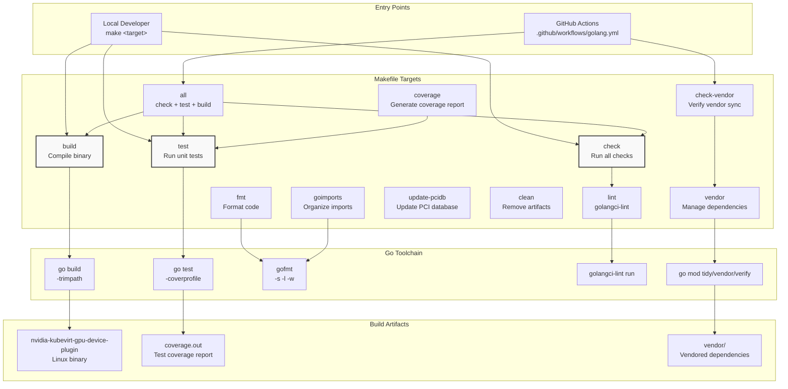
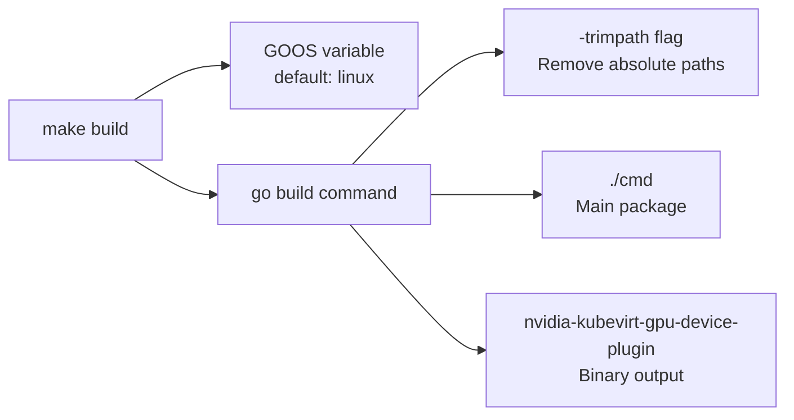
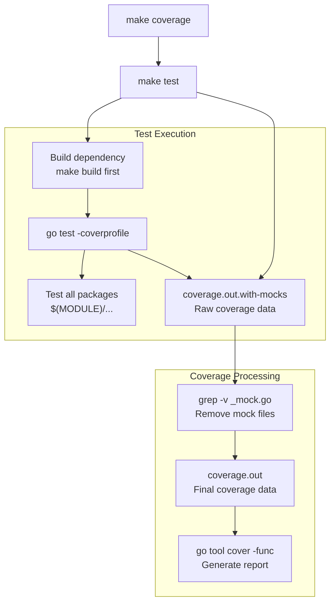
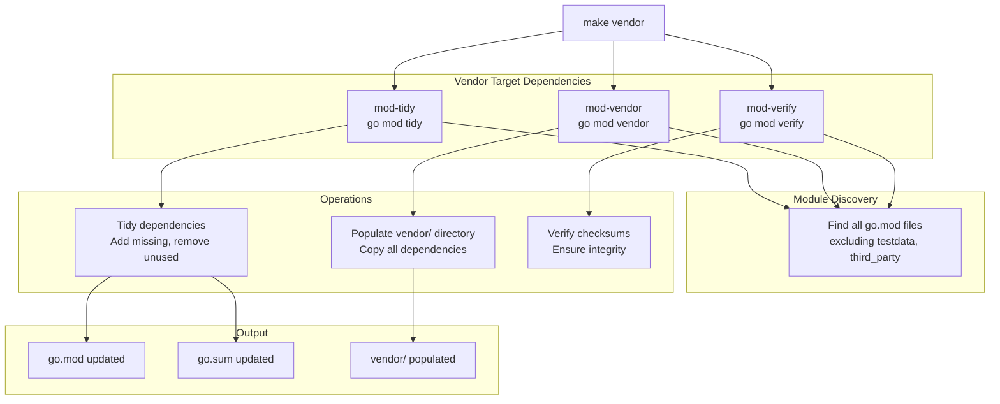
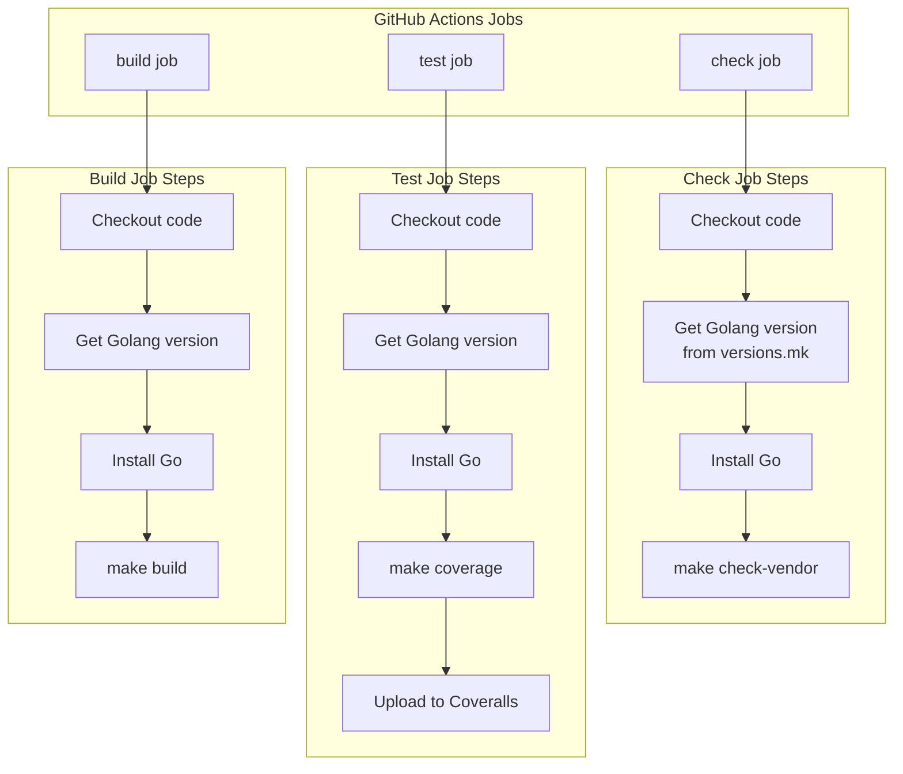

<!-- source: DeepWiki mcp.deepwiki.com · repo NVIDIA/kubevirt-gpu-device-plugin · page 4.1 Build System · fetched 2026-10-26 -->

# Build System

<details>
<summary>Relevant source files</summary>

The following files were used as context for generating this wiki page:

- [.github/workflows/golang.yml](.github/workflows/golang.yml)
- [.gitignore](.gitignore)
- [Makefile](Makefile)

</details>


## Purpose and Scope

This document describes the build system for the NVIDIA KubeVirt GPU Device Plugin, focusing on the Makefile-based build orchestration, compilation process, code quality checks, testing framework, and dependency management. For information about container image creation, see [Container Images](#4.2). For deployment configuration, see [Kubernetes Deployment](#4.3). For CI/CD pipeline details, see [CI/CD Pipeline](#5.3).

The build system is implemented in [Makefile:1-94]() and provides a comprehensive set of targets for building, testing, linting, and managing the project's dependencies.

## Build System Architecture

The build system follows a make-based orchestration pattern with multiple targets that can be invoked individually or as part of larger workflows. The system is designed to support both local development and automated CI/CD execution.



**Sources:** [Makefile:1-94](), [.github/workflows/golang.yml:1-105]()

## Core Build Targets

### Build Target

The `build` target compiles the main binary for the device plugin. It uses Go's native build system with specific flags for production builds.



The build command is defined at [Makefile:37-38]():

```
build:
	GOOS=$(GOOS) go build -trimpath -o nvidia-kubevirt-gpu-device-plugin ./cmd
```

**Key characteristics:**
- **Target OS**: Defaults to `linux` via the `GOOS` variable [Makefile:35]()
- **Trim Path**: Uses `-trimpath` to remove absolute file paths from the compiled binary, improving reproducibility and security
- **Source**: Compiles the `./cmd` package which contains `main.go`
- **Output**: Produces `nvidia-kubevirt-gpu-device-plugin` binary

**Sources:** [Makefile:35-38]()

### All Target

The `all` target provides a convenient way to run the complete build pipeline: code quality checks, tests, and compilation.

```
all: check test build
```

This target is defined at [Makefile:40]() and serves as the primary entry point for comprehensive build validation.

**Sources:** [Makefile:40]()

## Code Quality Targets

The build system includes multiple targets for maintaining code quality and consistency across the codebase.

### Target Summary

| Target | Purpose | Tool | Makefile Line |
|--------|---------|------|---------------|
| `check` | Run all check targets | Orchestrator | [Makefile:41]() |
| `fmt` | Format Go code | `gofmt` | [Makefile:44-46]() |
| `goimports` | Organize imports | `goimports` | [Makefile:48-50]() |
| `lint` | Run linter checks | `golangci-lint` | [Makefile:52-53]() |

### Format Target

The `fmt` target applies standard Go formatting to the entire codebase:

```
fmt:
	go list -f '{{.Dir}}' $(MODULE)/... \
		| xargs gofmt -s -l -w
```

**Flags:**
- `-s`: Simplify code where possible
- `-l`: List files that differ from gofmt's format
- `-w`: Write result to source file

The target uses `go list` to find all package directories and pipes them to `gofmt` for batch processing.

**Sources:** [Makefile:44-46]()

### Goimports Target

The `goimports` target organizes import statements with local package preference:

```
goimports:
	go list -f {{.Dir}} $(MODULE)/... \
		| xargs goimports -local $(MODULE) -w
```

The `-local` flag ensures that imports from the current module are grouped separately from standard library and external dependencies.

**Sources:** [Makefile:48-50]()

### Lint Target

The `lint` target runs `golangci-lint` across the entire codebase:

```
lint:
	golangci-lint run ./...
```

This target is part of the `CHECK_TARGETS` list [Makefile:27]() and is invoked by the `check` target.

**Note:** The GitHub Actions workflow currently has linting disabled (commented out at [.github/workflows/golang.yml:43-49]()) pending resolution of existing lint errors.

**Sources:** [Makefile:52-53](), [.github/workflows/golang.yml:43-49]()

## Testing and Coverage

The build system provides comprehensive testing support with coverage reporting.



### Test Target

The `test` target runs all unit tests with coverage profiling:

```
test: build
	go test -coverprofile=$(COVERAGE_FILE).with-mocks $(MODULE)/...
```

**Key points:**
- Depends on successful `build` to ensure compilation works before testing
- Uses `-coverprofile` to generate coverage data
- Tests all packages matching `$(MODULE)/...`
- Generates `coverage.out.with-mocks` file [Makefile:55-57]()

**Sources:** [Makefile:55-57]()

### Coverage Target

The `coverage` target post-processes test results to generate a clean coverage report:

```
coverage: test
	cat $(COVERAGE_FILE).with-mocks | grep -v "_mock.go" > $(COVERAGE_FILE)
	go tool cover -func=$(COVERAGE_FILE)
```

**Processing steps:**
1. Runs the `test` target
2. Filters out mock file coverage (files matching `_mock.go`)
3. Writes cleaned data to `coverage.out`
4. Generates function-level coverage report using `go tool cover`

The filtered coverage file is used by CI/CD for upload to Coveralls [.github/workflows/golang.yml:76-80]().

**Sources:** [Makefile:59-61](), [.github/workflows/golang.yml:73-80]()

## Dependency Management

The build system provides comprehensive Go module and vendor management through several coordinated targets.

### Vendor Management Flow



### Vendor Target

The `vendor` target is defined as an orchestration of three sub-targets:

```
vendor:  | mod-tidy mod-vendor mod-verify
```

This uses make's order-only prerequisites (the `|` syntax) to ensure the targets run in sequence.

**Sources:** [Makefile:63]()

### Mod-Tidy Target

The `mod-tidy` target ensures all module files have correct dependency declarations:

```
mod-tidy:
	@for mod in $$(find . -name go.mod -not -path "./testdata/*" -not -path "./third_party/*"); do \
	    echo "Tidying $$mod..."; ( \
	        cd $$(dirname $$mod) && go mod tidy \
            ) || exit 1; \
	done
```

**Behavior:**
- Finds all `go.mod` files except those in `testdata/` and `third_party/`
- Runs `go mod tidy` in each module directory
- Adds missing dependencies and removes unused ones
- Exits on first failure

**Sources:** [Makefile:65-70]()

### Mod-Vendor Target

The `mod-vendor` target populates the `vendor/` directory:

```
mod-vendor:
	@for mod in $$(find . -name go.mod -not -path "./testdata/*" -not -path "./third_party/*" -not -path "./deployments/*"); do \
		echo "Vendoring $$mod..."; ( \
			cd $$(dirname $$mod) && go mod vendor \
			) || exit 1; \
	done
```

**Behavior:**
- Similar to `mod-tidy` but also excludes `deployments/` directory
- Copies all dependencies into `vendor/` directory
- Ensures offline builds are possible

**Sources:** [Makefile:72-77]()

### Mod-Verify Target

The `mod-verify` target validates dependency checksums:

```
mod-verify:
	@for mod in $$(find . -name go.mod -not -path "./testdata/*" -not -path "./third_party/*"); do \
	    echo "Verifying $$mod..."; ( \
	        cd $$(dirname $$mod) && go mod verify | sed 's/^/  /g' \
	    ) || exit 1; \
	done
```

**Behavior:**
- Verifies that dependencies in `vendor/` match their checksums in `go.sum`
- Indents output with `sed` for better readability
- Critical for ensuring dependency integrity

**Sources:** [Makefile:79-84]()

### Check-Vendor Target

The `check-vendor` target validates that vendor state is synchronized with source control:

```
check-vendor: vendor
	git diff --exit-code HEAD -- go.mod go.sum vendor
```

**Behavior:**
- Runs the full `vendor` target
- Uses `git diff` to check if any changes were made
- Returns non-zero exit code if differences exist
- Used by CI/CD to ensure developers commit vendored dependencies

This target is critical in the CI pipeline [.github/workflows/golang.yml:51-53]() to prevent builds that rely on uncommitted dependency changes.

**Sources:** [Makefile:86-87](), [.github/workflows/golang.yml:51-53]()

## Utility Targets

### Update-PciDB Target

The `update-pcidb` target fetches the latest PCI device database:

```
update-pcidb:
	wget $(PCI_IDS_URL) -O $(CURDIR)/utils/pci.ids
```

**Configuration:**
- **Source URL**: Configured via `PCI_IDS_URL` variable [Makefile:18]()
- **Default**: `https://pci-ids.ucw.cz/v2.2/pci.ids`
- **Destination**: `utils/pci.ids` in the repository root

This database is used by the device plugin to resolve PCI vendor and device IDs to human-readable names. For more information about the PCI database structure and usage, see [PCI Device Database](#6.1).

**Sources:** [Makefile:18](), [Makefile:89-90]()

### Clean Target

The `clean` target removes build artifacts:

```
clean:
	rm -rf nvidia-kubevirt-gpu-device-plugin && rm -rf coverage.out
```

**Artifacts removed:**
- `nvidia-kubevirt-gpu-device-plugin`: The compiled binary
- `coverage.out`: Test coverage report

These files are also listed in [.gitignore:3-4]() to prevent accidental commits.

**Sources:** [Makefile:92-93](), [.gitignore:3-4]()

## Build Configuration

### Variables and Defaults

The Makefile defines several configurable variables with sensible defaults:

| Variable | Default | Purpose | Line |
|----------|---------|---------|------|
| `DOCKER` | `docker` | Docker command for container operations | [Makefile:15]() |
| `MKDIR` | `mkdir` | Directory creation command | [Makefile:16]() |
| `GO` | `go` | Go toolchain command | [Makefile:17]() |
| `PCI_IDS_URL` | `https://pci-ids.ucw.cz/v2.2/pci.ids` | PCI database source | [Makefile:18]() |
| `GOOS` | `linux` | Target operating system | [Makefile:35]() |
| `REGISTRY` | `nvidia` | Container registry name | [Makefile:23]() |
| `IMAGE_NAME` | `$(REGISTRY)/kubevirt-gpu-device-plugin` | Full image name | [Makefile:24]() |
| `COVERAGE_FILE` | `coverage.out` | Coverage output file | [Makefile:55]() |

### Version Management

The Makefile includes an external version configuration:

```
include $(CURDIR)/versions.mk
```

This file (referenced at [Makefile:20]()) contains version information for dependencies and tooling. The GitHub Actions workflow extracts the Go version from this file:

```yaml
GOLANG_VERSION=$( grep "GOLANG_VERSION ?=" versions.mk )
echo "GOLANG_VERSION=${GOLANG_VERSION##GOLANG_VERSION ?= }" >> $GITHUB_ENV
```

**Sources:** [Makefile:20](), [.github/workflows/golang.yml:34-36]()

### Target Organization

The Makefile defines target groups for organization:

```
CHECK_TARGETS := lint
MAKE_TARGETS := build check fmt test check-vendor update-pcidb clean $(CHECK_TARGETS)
TARGETS := $(MAKE_TARGETS)
```

These variables allow for:
- Easy extension of check targets
- Consistent target naming
- Potential Docker wrapper targets (though not currently implemented)

**Sources:** [Makefile:27-30]()

## CI/CD Integration

The GitHub Actions workflow leverages the Makefile targets for continuous integration:



### Job Breakdown

**Check Job** ([.github/workflows/golang.yml:26-53]()):
- Validates that vendored dependencies are synchronized
- Runs `make check-vendor` target
- Ensures no uncommitted vendor changes

**Test Job** ([.github/workflows/golang.yml:55-80]()):
- Executes unit tests with coverage
- Runs `make coverage` target
- Uploads coverage report to Coveralls

**Build Job** ([.github/workflows/golang.yml:82-105]()):
- Compiles the binary
- Runs `make build` target
- Validates successful compilation

All jobs extract the Go version from `versions.mk` to ensure consistent toolchain versions between local development and CI environments.

**Sources:** [.github/workflows/golang.yml:26-105]()

## Build Artifacts

The build system produces several artifacts that are excluded from version control:

| Artifact | Purpose | Gitignored |
|----------|---------|------------|
| `nvidia-kubevirt-gpu-device-plugin` | Compiled binary | Yes ([.gitignore:4]()) |
| `coverage.out` | Final test coverage report | Yes ([.gitignore:3]()) |
| `coverage.out.with-mocks` | Raw coverage with mocks | Implied |
| `vendor/` | Vendored dependencies | Partially ([.gitignore:2]()) |
| `_out/` | Build output directory | Yes ([.gitignore:1]()) |

The `.gitignore` configuration at [.gitignore:1-5]() specifically excludes test files in the vendor directory (`vendor/**/*_test.go`) to reduce repository size while keeping vendored source code.

**Sources:** [.gitignore:1-5]()

---

