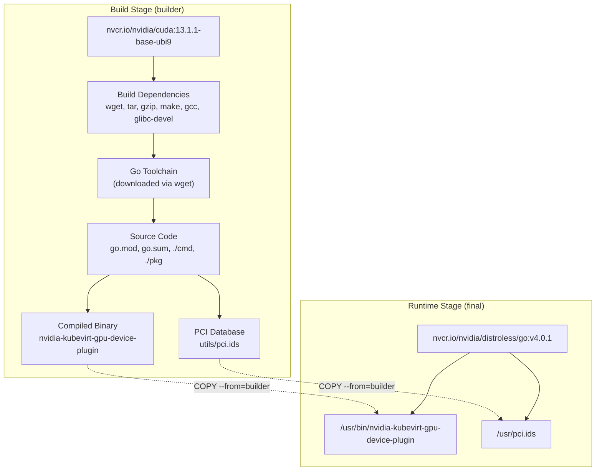
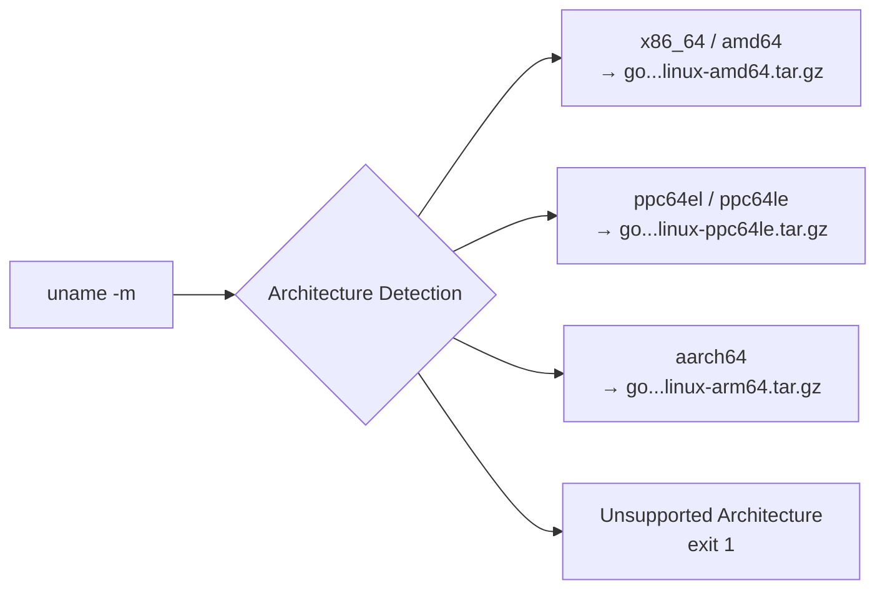
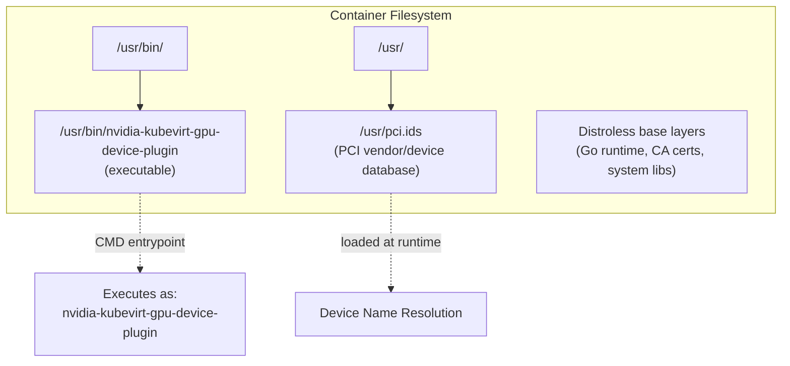
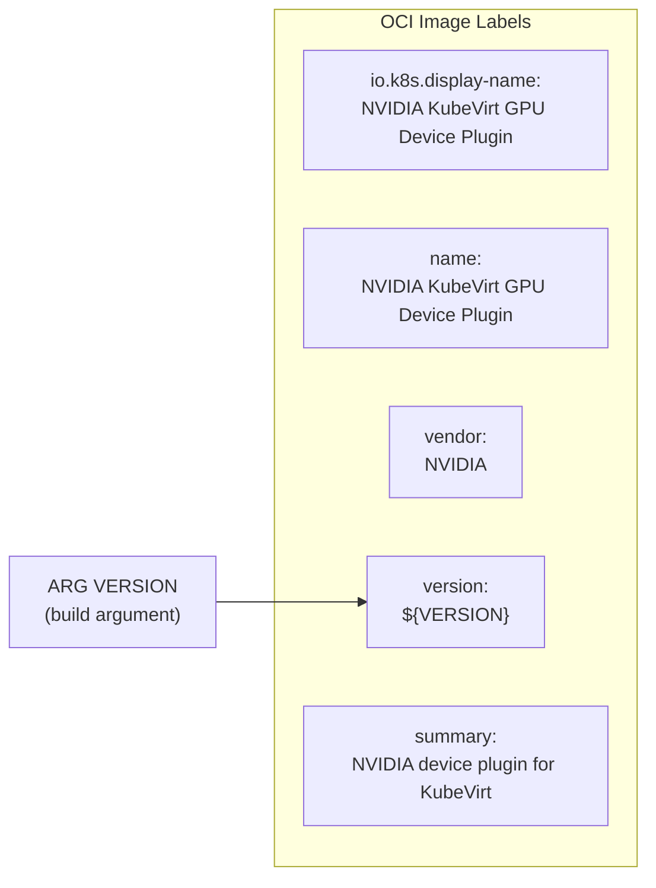
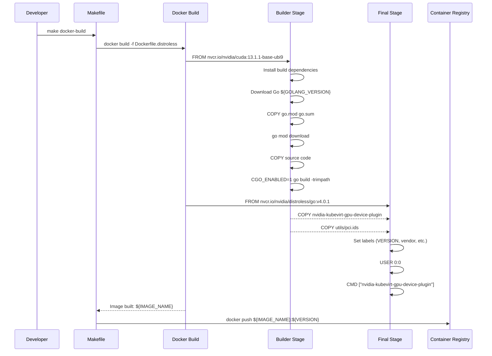
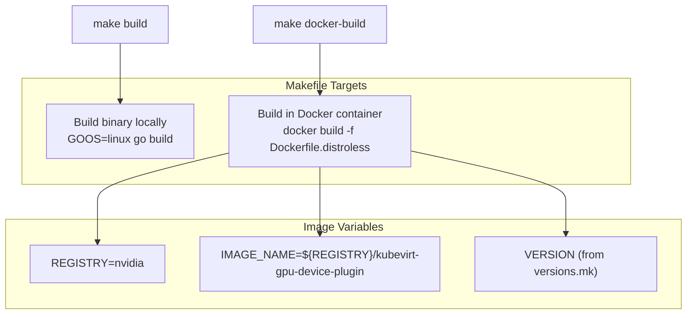

<!-- source: DeepWiki mcp.deepwiki.com · repo NVIDIA/kubevirt-gpu-device-plugin · page 4.2 Container Images · fetched 2026-10-26 -->

# Container Images

<details>
<summary>Relevant source files</summary>

The following files were used as context for generating this wiki page:

- [.gitignore](.gitignore)
- [Makefile](Makefile)
- [deployments/container/Dockerfile.distroless](deployments/container/Dockerfile.distroless)

</details>


## Purpose and Scope

This document details the container image build process for the NVIDIA KubeVirt GPU Device Plugin, including the multi-stage Dockerfile architecture, base image selection, and final image composition. It covers how the Go binary and supporting resources are packaged into a minimal, security-hardened container image suitable for production deployment.

For information about building the Go binary itself, see [Build System](#4.1). For deployment of the containerized plugin, see [Kubernetes Deployment](#4.3).

---

## Multi-Stage Build Architecture

The device plugin uses a sophisticated multi-stage Docker build defined in [deployments/container/Dockerfile.distroless:1-78]() that separates build-time dependencies from runtime dependencies. This approach produces a minimal final image containing only the compiled binary and essential data files.

### Build Stage Architecture



**Sources**: [deployments/container/Dockerfile.distroless:28-78]()

### Build Stage Details

The builder stage ([deployments/container/Dockerfile.distroless:28-58]()) performs the following operations:

| Step | Description | Files/Commands |
|------|-------------|----------------|
| **Base Image** | CUDA-enabled UBI9 base with NVIDIA libraries | `nvcr.io/nvidia/cuda:13.1.1-base-ubi9` |
| **System Dependencies** | Install build toolchain | `yum install wget tar gzip make gcc glibc-devel` |
| **Go Installation** | Download and install Go based on architecture | `wget https://go.dev/dl/go${GOLANG_VERSION}.linux-${ARCH}.tar.gz` |
| **Dependency Download** | Fetch Go module dependencies | `go mod download` (uses `go.mod`, `go.sum`) |
| **Binary Compilation** | Build device plugin binary with CGO enabled | `CGO_ENABLED=1 go build -trimpath -o nvidia-kubevirt-gpu-device-plugin ./cmd` |

The build stage uses CGO (`CGO_ENABLED=1`) because the device plugin requires C bindings for NVML (NVIDIA Management Library) integration, which provides GPU monitoring capabilities.

**Sources**: [deployments/container/Dockerfile.distroless:28-58]()

### Architecture Detection

The Dockerfile includes architecture detection logic to download the appropriate Go binary:



This multi-architecture support ([deployments/container/Dockerfile.distroless:36-41]()) enables the same Dockerfile to build images for different CPU architectures commonly used in Kubernetes clusters.

**Sources**: [deployments/container/Dockerfile.distroless:34-44]()

---

## Runtime Stage and Distroless Base

### Distroless Image Selection

The final stage uses `nvcr.io/nvidia/distroless/go:v4.0.1` ([deployments/container/Dockerfile.distroless:60]()), a minimal container image that contains only:

- The Go runtime libraries required for Go binaries
- CA certificates for TLS
- Essential system libraries
- **No** package managers, shells, or other utilities

This distroless approach provides significant security benefits:

| Security Aspect | Benefit |
|----------------|---------|
| **Reduced Attack Surface** | No shells or package managers that could be exploited |
| **Minimal Dependencies** | Fewer components that could contain vulnerabilities |
| **Smaller Image Size** | Faster pull times and reduced storage requirements |
| **Immutable Runtime** | No tools available to modify the running container |

**Sources**: [deployments/container/Dockerfile.distroless:60-78]()

### Final Image Contents



The final image contains exactly two files copied from the builder stage:

1. **Device Plugin Binary** ([deployments/container/Dockerfile.distroless:72]()): 
   - Source: `/workspace/nvidia-kubevirt-gpu-device-plugin` from builder
   - Destination: `/usr/bin/nvidia-kubevirt-gpu-device-plugin`
   - Purpose: The compiled device plugin executable

2. **PCI Database** ([deployments/container/Dockerfile.distroless:73]()):
   - Source: `/workspace/utils/pci.ids` from builder
   - Destination: `/usr/pci.ids`
   - Purpose: Human-readable GPU device name resolution (see [PCI Device Database](#6.1))

**Sources**: [deployments/container/Dockerfile.distroless:72-77]()

---

## Image Metadata and Labels

The Dockerfile includes Kubernetes-compatible OCI labels for image identification:



These labels ([deployments/container/Dockerfile.distroless:64-70]()) enable Kubernetes and container registries to properly identify and catalog the image. The `VERSION` argument is typically passed during the build process to tag the image with the current release version.

**Sources**: [deployments/container/Dockerfile.distroless:62-70]()

---

## Image Naming and Registry Configuration

Image naming is controlled through the Makefile with customizable registry and image name parameters:

| Variable | Default Value | Purpose |
|----------|---------------|---------|
| `REGISTRY` | `nvidia` | Container registry or organization name |
| `IMAGE_NAME` | `${REGISTRY}/kubevirt-gpu-device-plugin` | Full image name |

The default configuration ([Makefile:22-25]()) produces the image name:

```
nvidia/kubevirt-gpu-device-plugin
```

For NVIDIA's production registry, this becomes:

```
nvcr.io/nvidia/kubevirt-gpu-device-plugin:<version>
```

### Customizing Image Names

Users can override the default image name when building:

```bash
# Use custom registry
make docker-build IMAGE_NAME=myregistry.io/myorg/gpu-device-plugin

# Use custom registry via REGISTRY variable
make docker-build REGISTRY=myregistry.io/myorg
```

**Sources**: [Makefile:15-25]()

---

## Build Arguments

The Dockerfile accepts two build-time arguments:

### GOLANG_VERSION

```dockerfile
ARG GOLANG_VERSION
```

Specifies the Go version to download and use for compilation ([deployments/container/Dockerfile.distroless:30]()). This is typically set in `versions.mk` and passed during the build process. The flexible architecture detection ensures the correct Go binary is downloaded for the target platform.

### VERSION

```dockerfile
ARG VERSION
```

Sets the version label in the image metadata ([deployments/container/Dockerfile.distroless:62]()). This typically corresponds to the git tag or release version of the device plugin.

**Sources**: [deployments/container/Dockerfile.distroless:30](), [deployments/container/Dockerfile.distroless:62]()

---

## Runtime Configuration

### User and Permissions

The container runs as user `0:0` (root) ([deployments/container/Dockerfile.distroless:75]()):

```dockerfile
USER 0:0
```

Root privileges are required because the device plugin needs to:
- Access `/sys/bus/pci/devices/` and `/sys/bus/mdev/devices/` for device discovery
- Interact with `/dev/vfio/*` devices for GPU passthrough
- Create and manage UNIX sockets for gRPC communication with Kubelet

In Kubernetes deployment, security contexts and capabilities are further managed through the DaemonSet configuration (see [Kubernetes Deployment](#4.3)).

### Entrypoint

The container uses a simple CMD directive ([deployments/container/Dockerfile.distroless:77]()):

```dockerfile
CMD ["nvidia-kubevirt-gpu-device-plugin"]
```

This executes the binary at `/usr/bin/nvidia-kubevirt-gpu-device-plugin` with no default arguments. All configuration is handled through environment variables and command-line flags passed via the Kubernetes DaemonSet.

**Sources**: [deployments/container/Dockerfile.distroless:75-77]()

---

## Build Artifacts and Exclusions

The `.gitignore` file ([.gitignore:1-5]()) identifies build artifacts that should not be committed to version control:

| Pattern | Description |
|---------|-------------|
| `_out` | Output directory for build artifacts |
| `vendor/**/*_test.go` | Test files in vendored dependencies |
| `coverage.out` | Test coverage reports |
| `nvidia-kubevirt-gpu-device-plugin` | Compiled binary (built locally) |

These artifacts are generated during local development and CI builds but are not included in the Git repository. The compiled binary is created fresh in the Docker build process rather than being copied from a local build.

**Sources**: [.gitignore:1-5]()

---

## Image Build Process Flow



This sequence illustrates the complete build pipeline from developer invocation through to registry push. The multi-stage approach ensures that build-time dependencies (compiler, build tools, source code) remain in the builder stage and never make it into the final image, resulting in a lean production container.

**Sources**: [deployments/container/Dockerfile.distroless:28-78](), [Makefile:15-25]()

---

## Security Considerations

The container image design incorporates several security best practices:

### Minimal Runtime Environment

By using distroless base images, the attack surface is drastically reduced:
- No shell (`/bin/sh`, `/bin/bash`) available for exploitation
- No package manager that could be used to install malicious software
- No debugging tools that could be leveraged by attackers

### Binary Compilation Options

The build process uses `-trimpath` flag ([deployments/container/Dockerfile.distroless:58]()):

```bash
go build -trimpath -o nvidia-kubevirt-gpu-device-plugin ./cmd
```

This removes file system paths from the compiled binary, preventing information leakage about the build environment.

### Dependency Verification

The build process uses Go modules with checksums (`go.mod`, `go.sum`) to ensure dependency integrity. The `go mod download` step ([deployments/container/Dockerfile.distroless:53]()) verifies all dependencies against their expected checksums before compilation.

**Sources**: [deployments/container/Dockerfile.distroless:52-58]()

---

## Relationship to Build System

The container build integrates with the Makefile-based build system (see [Build System](#4.1)):



While `make build` compiles the binary locally, `make docker-build` performs the entire build within Docker, ensuring consistency across different development environments.

**Sources**: [Makefile:15-25](), [Makefile:37-38]()

---

