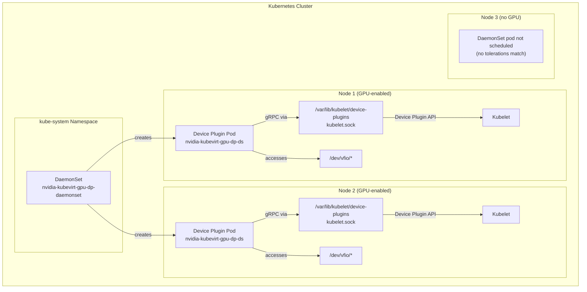
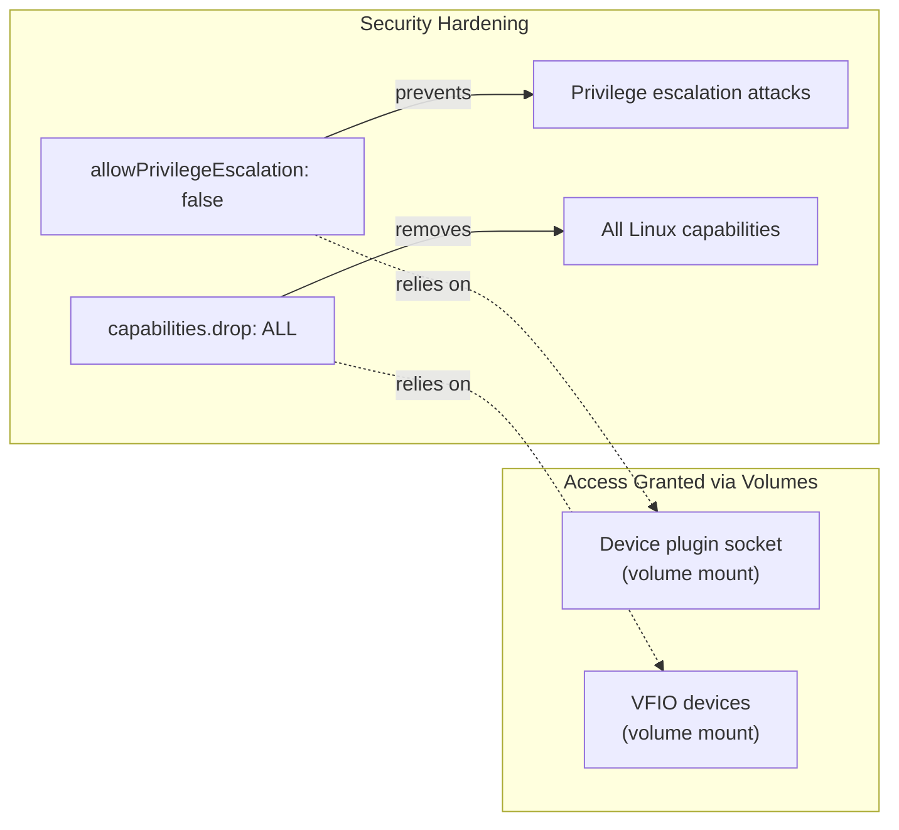
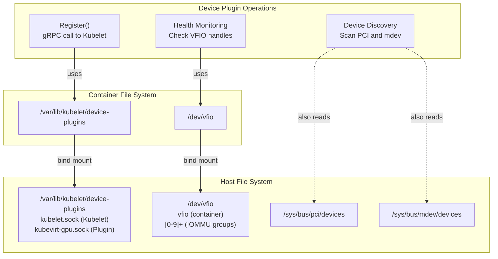
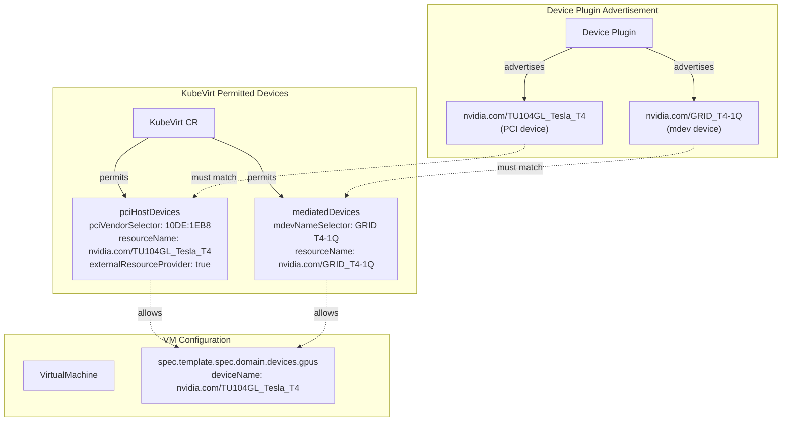
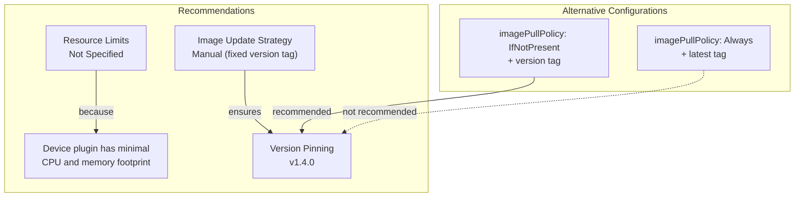

<!-- source: DeepWiki mcp.deepwiki.com · repo NVIDIA/kubevirt-gpu-device-plugin · page 4.3 Kubernetes Deployment · fetched 2026-10-26 -->

# Kubernetes Deployment

<details>
<summary>Relevant source files</summary>

The following files were used as context for generating this wiki page:

- [README.md](README.md)
- [examples/kubevirt-featuregate-cm.yaml](examples/kubevirt-featuregate-cm.yaml)
- [manifests/nvidia-kubevirt-gpu-device-plugin.yaml](manifests/nvidia-kubevirt-gpu-device-plugin.yaml)

</details>


This document details the Kubernetes deployment configuration for the NVIDIA KubeVirt GPU Device Plugin. It covers the DaemonSet manifest structure, security context, volume mounts, tolerations, scheduling configuration, and integration with KubeVirt. For information about building the container image, see [Container Images](#4.2). For details on the device plugin implementation, see [Kubernetes Integration](#3.5).

## DaemonSet Architecture

The device plugin deploys as a DaemonSet in the `kube-system` namespace, ensuring that one instance runs on every GPU-enabled node in the cluster. This deployment pattern is essential for the Kubernetes Device Plugin framework, as the device plugin must run locally on each node to discover hardware and communicate with the local Kubelet via a Unix domain socket.



**Diagram: DaemonSet Deployment Pattern**

The DaemonSet controller ensures pod placement on all GPU-enabled nodes, with each pod maintaining independent communication with its local Kubelet.

Sources: [manifests/nvidia-kubevirt-gpu-device-plugin.yaml:1-40](), [README.md:175-179]()

## Manifest Configuration

### Core Metadata

The DaemonSet manifest defines the fundamental resource metadata:

| Field | Value | Purpose |
|-------|-------|---------|
| `apiVersion` | `apps/v1` | Stable DaemonSet API |
| `kind` | `DaemonSet` | Ensures one pod per node |
| `metadata.name` | `nvidia-kubevirt-gpu-dp-daemonset` | DaemonSet resource identifier |
| `metadata.namespace` | `kube-system` | System namespace for cluster infrastructure |

The `kube-system` namespace placement is intentional, marking this as a critical cluster infrastructure component. The DaemonSet name `nvidia-kubevirt-gpu-dp-daemonset` follows Kubernetes naming conventions for multi-word identifiers.

Sources: [manifests/nvidia-kubevirt-gpu-device-plugin.yaml:1-5]()

### Pod Selection and Labeling

The pod template uses label selectors for pod management:

```yaml
spec:
  selector:
    matchLabels:
      name: nvidia-kubevirt-gpu-dp-ds
  template:
    metadata:
      labels:
        name: nvidia-kubevirt-gpu-dp-ds
```

The label `name: nvidia-kubevirt-gpu-dp-ds` links the DaemonSet controller to the pods it manages. This label must match between `spec.selector.matchLabels` and `spec.template.metadata.labels` or the DaemonSet will fail validation.

Sources: [manifests/nvidia-kubevirt-gpu-device-plugin.yaml:7-13]()

## Container Specification

### Image Configuration

The container specification references the official NVIDIA container image:

| Field | Value | Notes |
|-------|-------|-------|
| `name` | `nvidia-kubevirt-gpu-dp-ctr` | Container name within pod |
| `image` | `nvcr.io/nvidia/kubevirt-gpu-device-plugin:v1.4.0` | Official NVCR registry image |

The image is hosted on NVIDIA Container Registry (NVCR) at `nvcr.io/nvidia/kubevirt-gpu-device-plugin`. Version `v1.4.0` is specified in the manifest, but operators should verify the latest stable release. For custom builds, this image reference can be changed to a private registry. See [Container Images](#4.2) for details on building custom images.

Sources: [manifests/nvidia-kubevirt-gpu-device-plugin.yaml:22-23](), [README.md:189-206]()

## Security Configuration

### Security Context

The device plugin implements a restrictive security context that follows Kubernetes security best practices:

```yaml
securityContext:
  allowPrivilegeEscalation: false
  capabilities:
    drop: ["ALL"]
```



**Diagram: Security Context Configuration**

The security model prevents privilege escalation (`allowPrivilegeEscalation: false`) and drops all Linux capabilities (`drop: ["ALL"]`). Despite this restrictive stance, the container can still function because it accesses required resources through volume mounts rather than elevated privileges. This approach minimizes the attack surface while maintaining necessary functionality.

Note that the device plugin does **not** require:
- Root user execution
- Privileged security context
- Host namespace access (PID, IPC, network)
- Specific capability grants (CAP_SYS_ADMIN, CAP_NET_ADMIN, etc.)

This security posture is possible because:
1. Device plugin socket communication requires only file system access
2. VFIO device access is granted via volume mount with host path access
3. The distroless container image contains no shell or utilities that could be exploited

Sources: [manifests/nvidia-kubevirt-gpu-device-plugin.yaml:24-27]()

## Volume Mounts and Host Access

The device plugin requires two critical volume mounts for host system integration:

### Device Plugin Socket Mount

```yaml
volumes:
  - name: device-plugin
    hostPath:
      path: /var/lib/kubelet/device-plugins
volumeMounts:
  - name: device-plugin
    mountPath: /var/lib/kubelet/device-plugins
```

| Aspect | Configuration |
|--------|---------------|
| Host path | `/var/lib/kubelet/device-plugins` |
| Container mount | `/var/lib/kubelet/device-plugins` |
| Purpose | gRPC communication with Kubelet |
| Access pattern | Read-write for socket creation |
| Socket file | `kubevirt-gpu.sock` (created by plugin) |

The device plugin creates a Unix domain socket at `/var/lib/kubelet/device-plugins/kubevirt-gpu.sock` and registers with Kubelet via the registration socket at `/var/lib/kubelet/device-plugins/kubelet.sock`. This is the standard Kubernetes Device Plugin API communication mechanism defined in `k8s.io/kubelet/pkg/apis/deviceplugin/v1beta1`.

Sources: [manifests/nvidia-kubevirt-gpu-device-plugin.yaml:28-36]()

### VFIO Device Access

```yaml
volumes:
  - name: vfio
    hostPath:
      path: /dev/vfio
volumeMounts:
  - name: vfio
    mountPath: /dev/vfio
```

| Aspect | Configuration |
|--------|---------------|
| Host path | `/dev/vfio` |
| Container mount | `/dev/vfio` |
| Purpose | Device health checks and IOMMU group discovery |
| Access pattern | Read for device enumeration and status |
| Contents | `/dev/vfio/vfio` (container), `/dev/vfio/[group-id]` (IOMMU groups) |

The VFIO mount enables the device plugin to:
1. Enumerate IOMMU groups via `/dev/vfio/[0-9]+` files
2. Validate device health by checking VFIO device handles
3. Gather topology information for NUMA-aware allocation
4. Report device status to Kubelet

The device plugin does **not** perform VFIO operations that would require elevated privileges. It only reads device metadata and validates device accessibility.

Sources: [manifests/nvidia-kubevirt-gpu-device-plugin.yaml:31-39]()



**Diagram: Volume Mount Integration**

Note that the device plugin also accesses `/sys/bus/pci/devices` and `/sys/bus/mdev/devices` on the host, but these are accessible via the default container file system view without explicit volume mounts because the container does not use a separate mount namespace for `/sys`.

Sources: [manifests/nvidia-kubevirt-gpu-device-plugin.yaml:28-39]()

## Scheduling Configuration

### Priority Class

```yaml
priorityClassName: system-node-critical
```

The `system-node-critical` priority class ensures that the device plugin pod has high scheduling priority and protection from preemption. This priority class is predefined in Kubernetes and indicates that the pod is critical to node functionality.

| Priority Class | Priority Value | Preemption | Use Case |
|----------------|----------------|------------|----------|
| `system-node-critical` | 2000001000 | Cannot be preempted | Node-level infrastructure (CNI, device plugins) |
| `system-cluster-critical` | 2000000000 | Cannot be preempted | Cluster-level infrastructure (DNS, scheduler) |
| Default | 0 | Can be preempted | Application workloads |

With this priority class, the device plugin pod will:
1. Be scheduled before lower-priority pods during resource contention
2. Never be evicted to make room for lower-priority pods
3. Only be evicted for higher-priority system pods (extremely rare)

Sources: [manifests/nvidia-kubevirt-gpu-device-plugin.yaml:15]()

### Tolerations

```yaml
tolerations:
  - key: CriticalAddonsOnly
    operator: Exists
```

The toleration allows the pod to be scheduled on nodes with the `CriticalAddonsOnly` taint. This taint is applied to nodes during critical maintenance or when nodes are in a limited scheduling mode.

| Field | Value | Meaning |
|-------|-------|---------|
| `key` | `CriticalAddonsOnly` | Taint key to tolerate |
| `operator` | `Exists` | Match if taint exists regardless of value |
| Effect | (not specified) | Tolerates all effects (NoSchedule, PreferNoSchedule, NoExecute) |

This configuration ensures that:
1. During cluster upgrades, the device plugin continues running
2. When nodes enter maintenance mode, critical add-ons remain scheduled
3. The pod is not evicted when the taint is added to running nodes

The comment in the manifest indicates this is intentional for critical add-on functionality: "Allow this pod to be rescheduled while the node is in 'critical add-ons only' mode."

Sources: [manifests/nvidia-kubevirt-gpu-device-plugin.yaml:16-20]()

## KubeVirt Integration

The device plugin integrates with KubeVirt through the KubeVirt Custom Resource (CR) configuration. KubeVirt must be configured to permit GPU and vGPU device assignment before virtual machines can use these devices.

### Feature Gates

KubeVirt requires the `GPU` feature gate to be enabled:

```yaml
spec:
  configuration:
    developerConfiguration:
      featureGates:
        - GPU
```

The GPU feature gate activates KubeVirt's GPU passthrough functionality, enabling the virt-launcher to configure VFIO device assignment for virtual machines.

Sources: [examples/kubevirt-featuregate-cm.yaml:20-22]()

### Permitted Devices Configuration



**Diagram: Device Permit Flow**

Two types of devices must be explicitly permitted in the KubeVirt CR:

#### PCI Host Devices (Physical GPUs)

```yaml
permittedHostDevices:
  pciHostDevices:
    - pciVendorSelector: "10DE:1EB8"
      resourceName: "nvidia.com/TU104GL_Tesla_T4"
      externalResourceProvider: true
```

| Field | Purpose | Example |
|-------|---------|---------|
| `pciVendorSelector` | PCI vendor:device ID pair | `"10DE:1EB8"` (NVIDIA Tesla T4) |
| `resourceName` | Must match device plugin resource name | `"nvidia.com/TU104GL_Tesla_T4"` |
| `externalResourceProvider` | Indicates device plugin provides resource | `true` |

The `pciVendorSelector` uses the format `VENDOR_ID:DEVICE_ID` where both are hexadecimal PCI IDs. The `10DE` vendor ID is NVIDIA's PCI vendor ID. Device IDs vary by GPU model.

#### Mediated Devices (vGPUs)

```yaml
permittedHostDevices:
  mediatedDevices:
    - mdevNameSelector: "GRID T4-1Q"
      resourceName: "nvidia.com/GRID_T4-1Q"
```

| Field | Purpose | Example |
|-------|---------|---------|
| `mdevNameSelector` | Human-readable vGPU type name | `"GRID T4-1Q"` |
| `resourceName` | Must match device plugin resource name | `"nvidia.com/GRID_T4-1Q"` |

The `mdevNameSelector` matches the vGPU type name as reported by the NVIDIA vGPU Manager in `/sys/bus/mdev/devices/[uuid]/mdev_type/name`.

**Critical**: The `resourceName` in the KubeVirt CR must exactly match the resource name advertised by the device plugin. Mismatches will prevent VM creation even though the device plugin reports resources as available to Kubernetes.

Sources: [examples/kubevirt-featuregate-cm.yaml:10-18](), [README.md:31-32]()

## Deployment Process

### Prerequisites

Before deploying the device plugin, verify the following prerequisites are met:

1. **Kubernetes cluster**: Version >= 1.11
2. **KubeVirt**: Version >= 0.36.0 installed and operational
3. **GPU configuration**: GPUs bound to VFIO-PCI driver or vGPUs configured
4. **KubeVirt feature gate**: GPU feature gate enabled in KubeVirt CR
5. **Permitted devices**: GPU resources whitelisted in KubeVirt CR

For detailed GPU preparation instructions, see [Prerequisites and Host Setup](#2.1).

Sources: [README.md:21-25]()

### Applying the DaemonSet Manifest

Deploy the device plugin using `kubectl`:

```bash
kubectl apply -f manifests/nvidia-kubevirt-gpu-device-plugin.yaml
```

This command creates the DaemonSet in the `kube-system` namespace. The DaemonSet controller will immediately begin scheduling pods on GPU-enabled nodes.

Alternatively, for the manifest hosted in the repository:

```bash
kubectl apply -f https://raw.githubusercontent.com/NVIDIA/kubevirt-gpu-device-plugin/main/manifests/nvidia-kubevirt-gpu-device-plugin.yaml
```

Sources: [README.md:177-179]()

### Verification Steps

After deployment, verify the device plugin is functioning correctly:

#### 1. Check DaemonSet Status

```bash
kubectl get daemonset -n kube-system nvidia-kubevirt-gpu-dp-daemonset
```

Expected output:
```
NAME                              DESIRED   CURRENT   READY   UP-TO-DATE   AVAILABLE   NODE SELECTOR   AGE
nvidia-kubevirt-gpu-dp-daemonset   2         2         2       2            2           <none>          30s
```

Verify that `DESIRED`, `CURRENT`, and `READY` counts match the number of GPU-enabled nodes.

#### 2. Check Pod Status

```bash
kubectl get pods -n kube-system -l name=nvidia-kubevirt-gpu-dp-ds
```

Expected output:
```
NAME                                    READY   STATUS    RESTARTS   AGE
nvidia-kubevirt-gpu-dp-daemonset-abc12   1/1     Running   0          30s
nvidia-kubevirt-gpu-dp-daemonset-def34   1/1     Running   0          30s
```

All pods should show `STATUS: Running` and `READY: 1/1`.

#### 3. Check Pod Logs

```bash
kubectl logs -n kube-system -l name=nvidia-kubevirt-gpu-dp-ds
```

Expected log patterns:
```
I1124 10:30:45.123456       1 device_plugin.go:123] Starting NVIDIA KubeVirt GPU Device Plugin
I1124 10:30:45.234567       1 device_plugin.go:234] Discovered 2 GPU devices
I1124 10:30:45.345678       1 device_plugin.go:345] Registered with Kubelet
```

Look for successful device discovery and Kubelet registration messages.

#### 4. Verify Node Capacity

```bash
kubectl describe node <node-name> | grep -A 10 "Capacity:"
```

Expected output should include GPU resources:
```
Capacity:
  cpu:                           32
  memory:                        128Gi
  nvidia.com/TU104GL_Tesla_T4:   1
  pods:                          110
Allocatable:
  cpu:                           32
  memory:                        128Gi
  nvidia.com/TU104GL_Tesla_T4:   1
  pods:                          110
```

The presence of `nvidia.com/[DEVICE_NAME]` resources in both `Capacity` and `Allocatable` confirms successful device plugin registration.

Sources: [README.md:175-179]()

## Deployment Best Practices

### Resource Management



**Diagram: Deployment Configuration Recommendations**

| Aspect | Recommendation | Rationale |
|--------|----------------|-----------|
| Resource limits | Not set by default | Device plugin has minimal resource footprint; setting limits may cause unnecessary throttling |
| Resource requests | Not set by default | Allows scheduler flexibility; consider setting in production if cluster has resource contention |
| Image pull policy | `IfNotPresent` (default) | Reduces registry load; version tags ensure consistency |
| Version pinning | Use specific version tags | `v1.4.0` prevents unexpected updates; test new versions before rollout |
| Namespace | `kube-system` | Standard namespace for cluster infrastructure; enables system-level RBAC policies |

### High Availability Considerations

The DaemonSet deployment pattern inherently provides high availability by ensuring the device plugin runs on every GPU-enabled node. However, consider these aspects:

1. **Node maintenance**: When draining nodes, ensure the device plugin pods are gracefully terminated before GPU workloads
2. **Updates**: Use a rolling update strategy by default (implicit in DaemonSet)
3. **Monitoring**: Integrate pod logs with cluster logging infrastructure (Fluentd, Promtail)
4. **Alerting**: Monitor pod status and restart counts; frequent restarts indicate configuration issues

### Security Hardening

The manifest already implements several security best practices:

1. **Non-privileged execution**: No elevated privileges required
2. **Capability dropping**: All capabilities removed via `drop: ["ALL"]`
3. **No privilege escalation**: `allowPrivilegeEscalation: false` prevents exploitation
4. **Read-only root filesystem**: Consider adding `readOnlyRootFilesystem: true` for additional hardening
5. **Non-root user**: The distroless image runs as non-root by default

Additional hardening options:

```yaml
securityContext:
  allowPrivilegeEscalation: false
  capabilities:
    drop: ["ALL"]
  readOnlyRootFilesystem: true    # Additional hardening
  runAsNonRoot: true               # Explicit non-root enforcement
  runAsUser: 65532                 # Distroless nonroot user
  seccompProfile:                  # Seccomp profile
    type: RuntimeDefault
```

### Multi-Cluster Deployments

For organizations managing multiple Kubernetes clusters:

1. **Centralized manifest management**: Store manifests in Git repositories with versioning
2. **GitOps workflows**: Use ArgoCD or Flux for automated deployment
3. **Configuration management**: Use Kustomize overlays for cluster-specific configurations:
   - Different image registries per environment
   - Environment-specific toleration rules
   - Custom resource names per cluster

Example Kustomize structure:
```
base/
  nvidia-kubevirt-gpu-device-plugin.yaml
overlays/
  production/
    kustomization.yaml
  staging/
    kustomization.yaml
```

### Troubleshooting Common Issues

| Issue | Symptom | Resolution |
|-------|---------|------------|
| Pods not scheduled | `DESIRED: 0` in DaemonSet | Add appropriate tolerations for node taints |
| Pods pending | `STATUS: Pending` | Check node selector; verify GPU nodes are available |
| Device not discovered | No GPU resources in node capacity | Verify VFIO-PCI driver binding; check `/dev/vfio` exists |
| Registration failure | Logs show gRPC errors | Verify `/var/lib/kubelet/device-plugins` is writable |
| VM creation fails | VM pending with resource allocation error | Check KubeVirt permitted devices configuration matches resource names |

Sources: [manifests/nvidia-kubevirt-gpu-device-plugin.yaml:1-40](), [README.md:175-179](), [examples/kubevirt-featuregate-cm.yaml:1-22]()

---

Sources: [manifests/nvidia-kubevirt-gpu-device-plugin.yaml:1-40](), [README.md:1-211](), [examples/kubevirt-featuregate-cm.yaml:1-22]()

---

