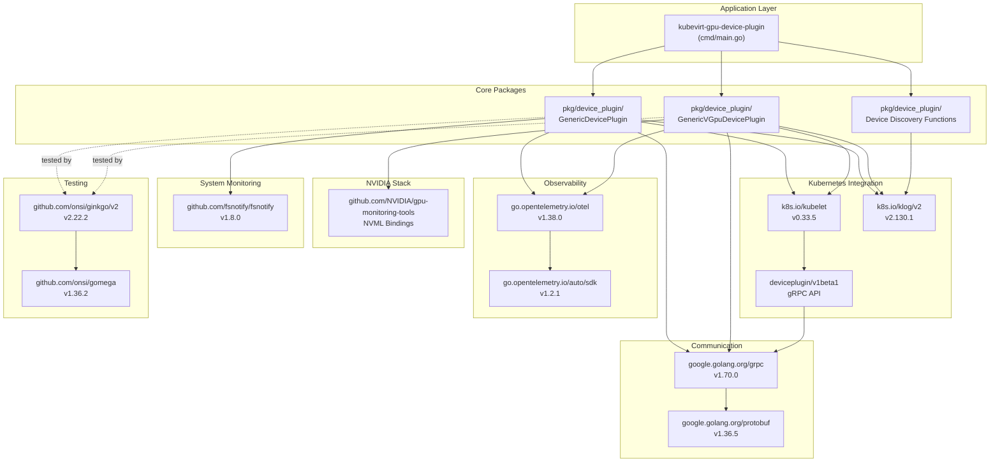
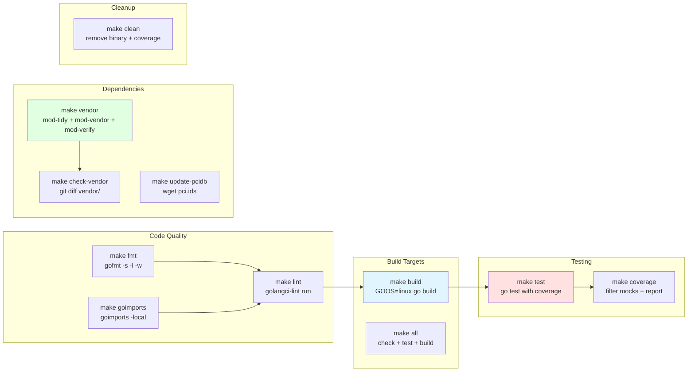
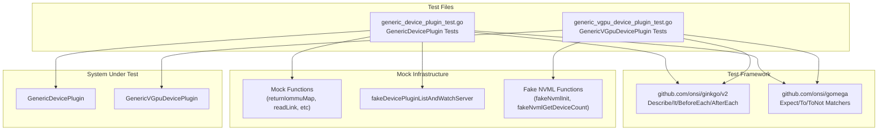
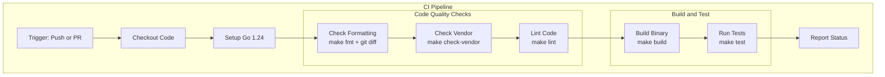

<!-- source: DeepWiki mcp.deepwiki.com · repo NVIDIA/kubevirt-gpu-device-plugin · page 5 Development Guide · fetched 2026-10-26 -->

# Development Guide

<details>
<summary>Relevant source files</summary>

The following files were used as context for generating this wiki page:

- [Makefile](Makefile)
- [go.mod](go.mod)
- [pkg/device_plugin/generic_device_plugin_test.go](pkg/device_plugin/generic_device_plugin_test.go)
- [pkg/device_plugin/generic_vgpu_device_plugin_test.go](pkg/device_plugin/generic_vgpu_device_plugin_test.go)

</details>


This guide provides comprehensive documentation for developers contributing to or extending the NVIDIA KubeVirt GPU Device Plugin. It covers the build system, testing framework, dependency management, and CI/CD pipeline.

For deployment instructions, see [Build and Deployment](#4). For architectural details of the device plugin implementations, see [Architecture](#3).

---

## Project Structure and Dependencies

### Repository Layout

The codebase follows standard Go project conventions with a clear separation between application entrypoint, core functionality, and deployment artifacts:

```
kubevirt-gpu-device-plugin/
├── cmd/                    # Application entrypoint (main.go)
├── pkg/                    # Core packages
│   └── device_plugin/      # GenericDevicePlugin, GenericVGpuDevicePlugin
├── utils/                  # Utilities and data files
│   └── pci.ids            # PCI vendor/device ID database
├── vendor/                 # Vendored dependencies (Go modules)
├── manifests/             # Kubernetes DaemonSet definitions
├── deployments/           # Dockerfile and container build configuration
├── .github/               # GitHub Actions CI/CD workflows
│   └── workflows/
│       └── golang.yml     # Continuous integration pipeline
├── go.mod                 # Go module definition
├── go.sum                 # Cryptographic checksums for dependencies
├── Makefile              # Build system orchestration
└── versions.mk           # Version constants for builds
```

The primary code is located in two directories:
- [`cmd/`]() contains the main application entrypoint that initializes device plugin instances
- [`pkg/device_plugin/`]() contains the core device plugin implementations and device discovery logic

**Sources:** Makefile structure, go.mod module definition, repository file layout

---

### Go Module and Dependencies

The project is defined as a Go module named `kubevirt-gpu-device-plugin` and requires Go 1.24.0 or later ([go.mod:1-3]()).

#### Core Dependencies

The following table lists the primary direct dependencies and their purposes:

| Dependency | Version | Purpose |
|------------|---------|---------|
| `k8s.io/kubelet` | v0.33.5 | Device Plugin API v1beta1 implementation |
| `google.golang.org/grpc` | v1.70.0 | gRPC communication with Kubelet |
| `github.com/NVIDIA/gpu-monitoring-tools` | v0.0.0-20211102125545-5a2c58442e48 | NVML bindings for GPU monitoring |
| `github.com/fsnotify/fsnotify` | v1.8.0 | File system event monitoring for health checks |
| `k8s.io/klog/v2` | v2.130.1 | Kubernetes-native structured logging |
| `github.com/onsi/ginkgo/v2` | v2.22.2 | BDD-style testing framework |
| `github.com/onsi/gomega` | v1.36.2 | Matcher/assertion library for tests |

([go.mod:5-12]())

#### Observability Dependencies

The project includes OpenTelemetry for metrics and traces:
- `go.opentelemetry.io/otel` (v1.38.0) - Core OpenTelemetry API
- `go.opentelemetry.io/auto/sdk` (v1.2.1) - Automatic instrumentation

([go.mod:24-25]())

#### Dependency Visualization



**Sources:** [go.mod:5-34](), dependency usage in device_plugin package

---

### Vendoring Strategy

The project uses Go module vendoring to ensure reproducible builds and eliminate external dependencies during compilation. All dependencies are stored in the `vendor/` directory.

Vendor management is handled through three coordinated Makefile targets ([Makefile:63-84]()):

1. **`make mod-tidy`** - Removes unused dependencies and adds missing ones for all go.mod files
2. **`make mod-vendor`** - Downloads and vendors all dependencies into `vendor/` directory
3. **`make mod-verify`** - Cryptographically verifies that vendored modules match go.sum checksums

The combined target `make vendor` executes all three operations in sequence ([Makefile:63]()).

**Sources:** [Makefile:63-84](), go.mod, vendor directory structure

---

## Build System

### Makefile Targets

The build system is orchestrated through a comprehensive Makefile that provides targets for all development tasks. The main targets are defined at [Makefile:28]().

#### Development Workflow Diagram



**Sources:** [Makefile:28-94]()

### Primary Build Targets

#### `make build`

Compiles the device plugin binary for Linux ([Makefile:37-38]()):
```
GOOS=linux go build -trimpath -o nvidia-kubevirt-gpu-device-plugin ./cmd
```

The `-trimpath` flag removes absolute file system paths from the compiled binary for reproducibility.

#### `make all`

Executes the complete build pipeline: `check` + `test` + `build` ([Makefile:40]()).

#### `make check`

Runs all code quality checks defined in `CHECK_TARGETS`, currently only `lint` ([Makefile:27,41]()).

### Code Quality Targets

#### `make fmt`

Applies Go standard formatting to all code ([Makefile:44-46]()):
```
go list -f '{{.Dir}}' $(MODULE)/... | xargs gofmt -s -l -w
```

The `-s` flag applies simplifications, `-l` lists modified files, `-w` writes changes.

#### `make goimports`

Organizes imports and applies formatting with local package prioritization ([Makefile:48-50]()):
```
go list -f {{.Dir}} $(MODULE)/... | xargs goimports -local $(MODULE) -w
```

#### `make lint`

Runs `golangci-lint` across the entire codebase ([Makefile:52-53]()):
```
golangci-lint run ./...
```

This enforces code style, identifies bugs, and checks for common mistakes.

### Testing Targets

#### `make test`

Executes all tests with coverage profiling ([Makefile:56-57]()):
```
go test -coverprofile=coverage.out.with-mocks $(MODULE)/...
```

Coverage data includes mock files initially for complete coverage tracking.

#### `make coverage`

Filters mock implementations from coverage and displays results ([Makefile:59-61]()):
```
cat coverage.out.with-mocks | grep -v "_mock.go" > coverage.out
go tool cover -func=coverage.out
```

This provides accurate coverage metrics excluding generated mock code.

### Dependency Management Targets

#### `make vendor`

Performs complete dependency vendoring: tidy → vendor → verify ([Makefile:63]()).

#### `make check-vendor`

Validates that vendored dependencies match repository state ([Makefile:86-87]()):
```
git diff --exit-code HEAD -- go.mod go.sum vendor
```

This target is critical for CI to ensure developers have committed vendor changes.

### Utility Targets

#### `make update-pcidb`

Downloads the latest PCI device ID database ([Makefile:89-90]()):
```
wget https://pci-ids.ucw.cz/v2.2/pci.ids -O utils/pci.ids
```

This database maps vendor/device IDs to human-readable GPU names.

#### `make clean`

Removes build artifacts ([Makefile:92-93]()):
```
rm -rf nvidia-kubevirt-gpu-device-plugin && rm -rf coverage.out
```

**Sources:** [Makefile:37-93]()

---

## Testing

### Testing Framework Architecture

The project uses Ginkgo (BDD testing framework) and Gomega (matcher library) for comprehensive test coverage. Tests are located in the same package as the code under test.



**Sources:** [pkg/device_plugin/generic_device_plugin_test.go](), [pkg/device_plugin/generic_vgpu_device_plugin_test.go]()

---

### Test Structure and Organization

#### Ginkgo BDD Pattern

Tests follow the Behavior-Driven Development pattern with descriptive nested blocks ([generic_device_plugin_test.go:100-270]()):

```
Describe("Generic Device", func() {
    var workDir string
    var dpi *GenericDevicePlugin
    var stop chan struct{}
    
    BeforeEach(func() {
        // Setup test environment, create temp directories, initialize mocks
    })
    
    AfterEach(func() {
        // Cleanup resources, close channels, remove temp files
    })
    
    It("Should register a new device without error", func() {
        // Test case implementation with assertions
    })
})
```

#### Test Lifecycle Hooks

- **`BeforeEach`** - Executed before each test case to set up fresh test state ([generic_device_plugin_test.go:107-140]())
- **`AfterEach`** - Executed after each test case for cleanup ([generic_device_plugin_test.go:142-145]())

### Mock Implementation Strategy

The test suite uses function variable reassignment for dependency injection, allowing real implementations to be swapped with mock versions at runtime.

#### Physical GPU Device Plugin Mocks

Key mock functions defined in [generic_device_plugin_test.go:65-98]():

| Mock Function | Purpose | Test Setup Line |
|--------------|---------|-----------------|
| `returnIommuMap` | Returns fake IOMMU group mappings | [generic_device_plugin_test.go:108]() |
| `returnBdfToIommuMap` | Returns fake BDF to IOMMU mappings | [generic_device_plugin_test.go:109]() |
| `readLink` | Simulates reading IOMMU group symlinks | [generic_device_plugin_test.go:110]() |
| `readIDFromFile` | Simulates reading PCI vendor IDs | [generic_device_plugin_test.go:111]() |

Example mock implementation ([generic_device_plugin_test.go:82-90]()):
```go
func getFakeLink(basePath string, deviceAddress string, link string) (string, error) {
    if deviceAddress == pciAddress1 {
        return iommuGroup1, nil
    } else if deviceAddress == pciAddress2 {
        return iommuGroup2, nil
    } else {
        return "", errors.New("Incorrect operation")
    }
}
```

#### Virtual GPU Device Plugin Mocks

NVML-related mocks defined in [generic_vgpu_device_plugin_test.go:44-85]():

| Mock Function | Purpose | Test Setup Line |
|--------------|---------|-----------------|
| `nvmlInit` | Mocks NVML initialization | [generic_vgpu_device_plugin_test.go:127]() |
| `nvmlGetDeviceCount` | Returns fake GPU count | [generic_vgpu_device_plugin_test.go:128]() |
| `nvmlNewDeviceLite` | Creates fake NVML device objects | [generic_vgpu_device_plugin_test.go:129]() |
| `nvmlShutdown` | Mocks NVML cleanup | [generic_vgpu_device_plugin_test.go:130]() |
| `watchXIDs` | Simulates XID error monitoring | [generic_vgpu_device_plugin_test.go:131]() |
| `returnGpuVgpuMap` | Returns fake GPU-to-vGPU mappings | [generic_vgpu_device_plugin_test.go:132]() |

#### Fake gRPC Server

For testing `ListAndWatch` functionality, a minimal fake server implementation is used ([generic_device_plugin_test.go:56-63]()):

```go
type fakeDevicePluginListAndWatchServer struct {
    grpc.ServerStream
}

func (x *fakeDevicePluginListAndWatchServer) Send(m *pluginapi.ListAndWatchResponse) error {
    devices = m.Devices  // Capture devices for assertion
    return nil
}
```

**Sources:** [pkg/device_plugin/generic_device_plugin_test.go:56-98](), [pkg/device_plugin/generic_vgpu_device_plugin_test.go:44-85]()

---

### Test Coverage

#### Physical GPU Device Plugin Tests

Located in [generic_device_plugin_test.go:100-270](), the test suite covers:

1. **Plugin Lifecycle**
   - Device plugin stop/cleanup ([generic_device_plugin_test.go:147-151]())

2. **Device Allocation**
   - Successful allocation with VFIO devices ([generic_device_plugin_test.go:153-169]())
   - Allocation with iommufd support ([generic_device_plugin_test.go:171-198]())
   - Error handling for invalid device addresses ([generic_device_plugin_test.go:200-229]())

3. **Health Monitoring**
   - File system event monitoring ([generic_device_plugin_test.go:231-243]())
   - Device health state transitions ([generic_device_plugin_test.go:245-269]())

4. **ListAndWatch**
   - Initial device listing ([generic_device_plugin_test.go:245-254]())
   - Health status updates (healthy → unhealthy → healthy) ([generic_device_plugin_test.go:256-268]())

#### Virtual GPU Device Plugin Tests

Located in [generic_vgpu_device_plugin_test.go:87-205](), the test suite covers:

1. **Plugin Lifecycle**
   - Cleanup without errors ([generic_vgpu_device_plugin_test.go:140-143]())

2. **Device Allocation**
   - Successful vGPU allocation ([generic_vgpu_device_plugin_test.go:145-155]())
   - Error handling for unknown devices ([generic_vgpu_device_plugin_test.go:157-167]())

3. **Health Monitoring**
   - ListAndWatch functionality ([generic_vgpu_device_plugin_test.go:179-203]())
   - Device health state management

**Sources:** [pkg/device_plugin/generic_device_plugin_test.go:100-270](), [pkg/device_plugin/generic_vgpu_device_plugin_test.go:87-205]()

---

### Running Tests

#### Execute All Tests

Run the complete test suite with coverage ([Makefile:56-57]()):
```bash
make test
```

This generates `coverage.out.with-mocks` containing coverage data for all code including mocks.

#### View Coverage Report

Generate and display coverage metrics excluding mock files ([Makefile:59-61]()):
```bash
make coverage
```

Output format:
```
kubevirt-gpu-device-plugin/pkg/device_plugin/device_plugin.go:45:    FunctionName    75.0%
kubevirt-gpu-device-plugin/pkg/device_plugin/generic_device_plugin.go:78:    Allocate    100.0%
...
total:    (statements)    XX.X%
```

#### Run Specific Tests

Execute tests for a specific package:
```bash
go test ./pkg/device_plugin/
```

Run tests matching a pattern with Ginkgo focus:
```bash
go test ./pkg/device_plugin/ -ginkgo.focus="Should allocate"
```

#### Verbose Test Output

Enable detailed test execution logs:
```bash
go test -v ./pkg/device_plugin/
```

**Sources:** [Makefile:56-61](), Ginkgo test framework documentation

---

## CI/CD Pipeline

### GitHub Actions Workflow

The continuous integration pipeline is defined in [.github/workflows/golang.yml](). It automates code quality checks, testing, and validation on every push and pull request.

#### Workflow Triggers

The workflow executes on:
- Push events to any branch
- Pull request events targeting any branch

#### Workflow Jobs and Steps



**Sources:** [.github/workflows/golang.yml]() (referenced from Makefile CI targets)

---

### Automated Validation Checks

The CI pipeline enforces the following requirements:

#### 1. Code Formatting

Ensures all code adheres to Go formatting standards:
```bash
make fmt
git diff --exit-code
```

Fails if `gofmt` produces any changes, indicating unformatted code was committed.

#### 2. Vendor Synchronization

Validates that vendored dependencies match `go.mod` and `go.sum` ([Makefile:86-87]()):
```bash
make check-vendor
```

This prevents issues where developers modify dependencies without committing vendor changes.

#### 3. Linting

Runs static analysis to catch bugs and style violations ([Makefile:52-53]()):
```bash
make lint
```

Uses `golangci-lint` with default configuration.

#### 4. Build Success

Compiles the binary to ensure no compilation errors ([Makefile:37-38]()):
```bash
make build
```

#### 5. Test Execution

Runs the complete test suite with coverage ([Makefile:56-57]()):
```bash
make test
```

All tests must pass for the CI pipeline to succeed.

---

### Dependabot Configuration

The repository uses GitHub Dependabot for automated dependency updates. This is configured through `.github/dependabot.yml` (not shown in provided files but standard for NVIDIA projects).

Dependabot automatically:
- Scans `go.mod` for outdated dependencies
- Creates pull requests with version updates
- Runs CI checks on update PRs
- Provides release notes and changelogs

#### Reviewing Dependency Updates

When Dependabot creates a PR:

1. Review the changelog for breaking changes
2. Check CI test results
3. Verify vendor changes are included
4. Test locally if needed:
   ```bash
   git checkout dependabot/go_modules/<dependency>
   make all
   ```
5. Merge if all checks pass

**Sources:** [go.mod](), [Makefile:86-87](), standard GitHub Dependabot practices

---

## Development Workflow

### Standard Development Cycle

```mermaid
graph LR
    subgraph "Development"
        BRANCH["Create Feature Branch"]
        CODE["Write Code"]
        FORMAT["make fmt<br/>make goimports"]
    end
    
    subgraph "Local Testing"
        LINT["make lint"]
        TEST["make test"]
        BUILD["make build"]
    end
    
    subgraph "Prepare Commit"
        VENDOR["make vendor<br/>(if deps changed)"]
        CHECK["make check-vendor"]
        COMMIT["git commit"]
    end
    
    subgraph "Continuous Integration"
        PUSH["git push"]
        PR["Create Pull Request"]
        CI["CI Checks Run"]
    end
    
    BRANCH --> CODE
    CODE --> FORMAT
    FORMAT --> LINT
    LINT --> TEST
    TEST --> BUILD
    BUILD --> VENDOR
    VENDOR --> CHECK
    CHECK --> COMMIT
    COMMIT --> PUSH
    PUSH --> PR
    PR --> CI
```



### Step-by-Step Guide

#### 1. Clone and Setup

```bash
git clone https://github.com/NVIDIA/kubevirt-gpu-device-plugin.git
cd kubevirt-gpu-device-plugin
```

#### 2. Install Development Tools

Required tools:
- Go 1.24 or later
- `golangci-lint` for linting
- `make` for build orchestration

Install golangci-lint:
```bash
go install github.com/golangci/golangci-lint/cmd/golangci-lint@latest
```

#### 3. Create Feature Branch

```bash
git checkout -b feature/my-enhancement
```

#### 4. Make Changes

Edit source files in `cmd/` or `pkg/device_plugin/`

#### 5. Format Code

```bash
make fmt
make goimports
```

#### 6. Run Quality Checks

```bash
make lint
```

Fix any reported issues.

#### 7. Run Tests

```bash
make test
make coverage  # View coverage report
```

Write new tests for added functionality.

#### 8. Build Binary

```bash
make build
```

Verify the binary compiles without errors.

#### 9. Update Dependencies (if needed)

If you modified `go.mod`:
```bash
make vendor
make check-vendor  # Ensure vendor is synchronized
```

#### 10. Commit Changes

```bash
git add .
git commit -m "Descriptive commit message"
```

#### 11. Push and Create PR

```bash
git push origin feature/my-enhancement
```

Create a pull request on GitHub. The CI pipeline will automatically run all checks.

**Sources:** [Makefile](), development best practices

---

## Best Practices for Contributors

### Code Organization

1. **Package Structure**: Place new device plugin implementations in `pkg/device_plugin/`
2. **Testing**: Co-locate tests with source files (`*_test.go`)
3. **Mocks**: Use function variables for testable external dependencies
4. **Logging**: Use `klog` for all logging with structured key-value pairs

### Testing Guidelines

1. **Coverage**: Maintain high test coverage for all new code
2. **Behavior-Driven**: Write descriptive Ginkgo `Describe` and `It` blocks
3. **Isolation**: Use mocks to avoid dependencies on physical hardware
4. **Cleanup**: Always implement `AfterEach` for resource cleanup

### Code Quality

1. **Formatting**: Run `make fmt` before committing
2. **Linting**: Fix all `golangci-lint` issues
3. **Imports**: Keep imports organized with `make goimports`
4. **Vendor**: Update vendor directory when dependencies change

### Commit Guidelines

1. **Atomicity**: Each commit should represent a single logical change
2. **Messages**: Write clear, descriptive commit messages
3. **Sign-off**: Include `Signed-off-by` line for DCO compliance
4. **Vendor**: Include vendor changes in the same commit as `go.mod` changes

**Sources:** Project development practices, [Makefile]() target organization

---

