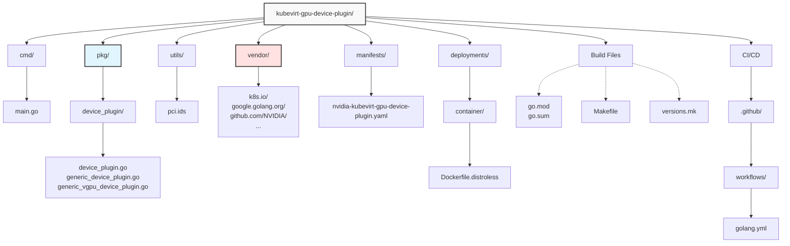
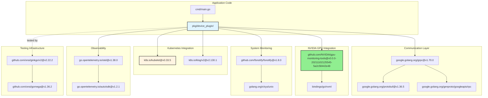
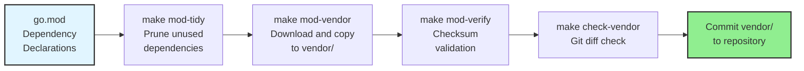
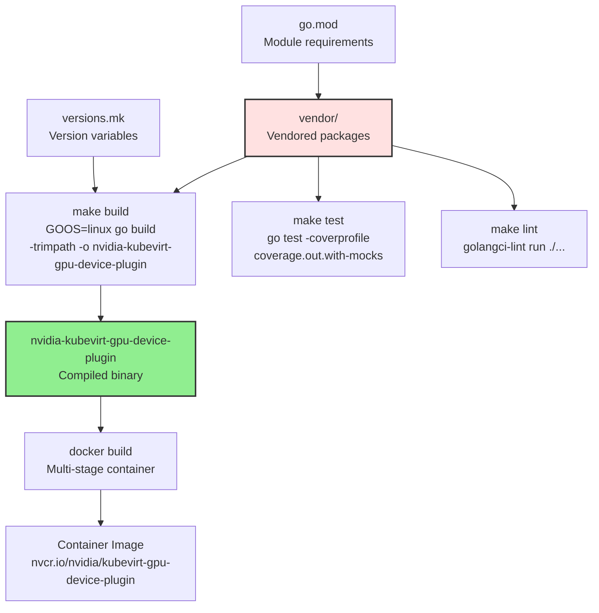

<!-- source: DeepWiki mcp.deepwiki.com · repo NVIDIA/kubevirt-gpu-device-plugin · page 5.1 Project Structure and Dependencies · fetched 2026-10-26 -->

# Project Structure and Dependencies

<details>
<summary>Relevant source files</summary>

The following files were used as context for generating this wiki page:

- [Makefile](Makefile)
- [go.mod](go.mod)
- [go.sum](go.sum)
- [vendor/modules.txt](vendor/modules.txt)

</details>


This document describes the repository layout, Go module configuration, and dependency management for the NVIDIA KubeVirt GPU Device Plugin. It is intended for developers who want to understand how the codebase is organized and how to work with its dependencies.

For information about the build process and compilation, see [Build System](#4.1). For details on testing infrastructure, see [Testing](#5.2).

---

## Repository Structure

The repository follows a standard Go project layout with clear separation between application code, deployment artifacts, and utilities.

### Directory Layout



**Sources:** [Makefile:1-94](), [go.mod:1-35](), [vendor/modules.txt:1-233]()

### Key Directories

| Directory | Purpose | Key Files |
|-----------|---------|-----------|
| `cmd/` | Application entrypoint | `main.go` - Initializes and starts device plugins |
| `pkg/device_plugin/` | Core device plugin logic | `device_plugin.go`, `generic_device_plugin.go`, `generic_vgpu_device_plugin.go` |
| `utils/` | Utility files and data | `pci.ids` - PCI vendor/device database (1.5MB+) |
| `vendor/` | Vendored dependencies | All third-party Go packages |
| `manifests/` | Kubernetes deployment | DaemonSet YAML configuration |
| `deployments/container/` | Container build | `Dockerfile.distroless` for multi-stage builds |
| `.github/workflows/` | CI/CD automation | `golang.yml` - GitHub Actions workflow |

**Sources:** [Makefile:38](), repository structure analysis

---

## Go Module Configuration

The project uses Go modules for dependency management with the module name `kubevirt-gpu-device-plugin` and requires Go 1.24.0 or later.

### Module Declaration

[go.mod:1-3]()
```
module kubevirt-gpu-device-plugin
go 1.24.0
```

The module name is used as the base import path for all packages within the project. For example, device plugin code is imported as `kubevirt-gpu-device-plugin/pkg/device_plugin`.

**Sources:** [go.mod:1-3]()

---

## Core Dependencies

The project has a carefully curated set of dependencies organized by functional area. The following diagram maps dependency categories to specific Go packages:



**Sources:** [go.mod:5-13](), [vendor/modules.txt:1-233]()

### Kubernetes Dependencies

| Package | Version | Purpose |
|---------|---------|---------|
| `k8s.io/kubelet` | v0.33.5 | Provides `deviceplugin/v1beta1` API for device plugin registration and allocation |
| `k8s.io/klog/v2` | v2.130.1 | Kubernetes-native structured logging framework |

These packages are essential for implementing the Kubernetes Device Plugin API. The `kubelet` package defines the gRPC service interfaces (`Registration`, `DevicePlugin`) and protocol buffer message types (`Device`, `AllocateResponse`, etc.).

**Sources:** [go.mod:11-12](), [vendor/modules.txt:221-232]()

### NVIDIA GPU Monitoring

| Package | Version | Purpose |
|---------|---------|---------|
| `github.com/NVIDIA/gpu-monitoring-tools` | v0.0.0-20211102125545-5a2c58442e48 | NVML bindings for GPU health monitoring and XID error detection |

This dependency provides Go bindings to NVIDIA Management Library (NVML), enabling the device plugin to:
- Query GPU health status
- Monitor XID errors (critical GPU errors)
- Retrieve GPU device information

The specific subpackage used is `github.com/NVIDIA/gpu-monitoring-tools/bindings/go/nvml`.

**Sources:** [go.mod:6](), [vendor/modules.txt:1-3]()

### Communication Infrastructure

| Package | Version | Purpose |
|---------|---------|---------|
| `google.golang.org/grpc` | v1.70.0 | gRPC framework for implementing Kubernetes Device Plugin API server |
| `google.golang.org/protobuf` | v1.36.5 | Protocol buffer serialization for gRPC messages |
| `google.golang.org/genproto/googleapis/rpc` | v0.0.0-20241209162323-e6fa225c2576 | Common RPC types for status codes and error handling |

The gRPC stack enables bidirectional streaming communication with kubelet, including:
- Device registration
- `ListAndWatch()` streaming of device availability
- `Allocate()` RPC for resource allocation
- `GetPreferredAllocation()` for NUMA-aware scheduling

**Sources:** [go.mod:10](), [go.sum:97-100](), [vendor/modules.txt:122-180]()

### System Integration

| Package | Version | Purpose |
|---------|---------|---------|
| `github.com/fsnotify/fsnotify` | v1.8.0 | Cross-platform file system event notifications |
| `golang.org/x/sys` | v0.40.0 | Low-level system calls for Unix/Linux operations |

`fsnotify` is used to monitor device file system changes in `/sys/bus/pci/devices/`, `/sys/bus/mdev/devices/`, and `/dev/vfio/*` to detect GPU hotplug events and device state changes.

**Sources:** [go.mod:7](), [vendor/modules.txt:4-7](), [vendor/modules.txt:88-91]()

### Observability Stack

| Package | Version | Purpose |
|---------|---------|---------|
| `go.opentelemetry.io/otel` | v1.38.0 | OpenTelemetry API for metrics and distributed tracing |
| `go.opentelemetry.io/auto/sdk` | v1.2.1 | Automatic instrumentation SDK |

These packages enable production observability through:
- Metrics collection for device allocation rates and health status
- Distributed tracing for allocation request flows
- Integration with OpenTelemetry collectors

**Sources:** [go.mod:24-25](), [go.sum:50-61](), [vendor/modules.txt:72-75]()

### Testing Framework

| Package | Version | Purpose |
|---------|---------|---------|
| `github.com/onsi/ginkgo/v2` | v2.22.2 | BDD-style testing framework |
| `github.com/onsi/gomega` | v1.36.2 | Matcher and assertion library |

Ginkgo provides the test structure with `Describe`, `Context`, and `It` blocks, while Gomega provides expressive matchers like `Expect`, `Eventually`, and `Consistently`. These are used together for comprehensive unit and integration testing.

**Sources:** [go.mod:8-9](), [vendor/modules.txt:33-67](), [Makefile:56-61]()

---

## Dependency Vendoring

The project uses Go module vendoring to ensure reproducible builds and reduce external dependencies during compilation. All dependencies are committed to the `vendor/` directory.

### Vendoring Process



**Sources:** [Makefile:63-87]()

### Makefile Vendor Targets

The `Makefile` provides four targets for dependency management:

| Target | Command | Purpose |
|--------|---------|---------|
| `mod-tidy` | `go mod tidy` | Remove unused dependencies and add missing ones |
| `mod-vendor` | `go mod vendor` | Copy all dependencies into `vendor/` directory |
| `mod-verify` | `go mod verify` | Verify checksums of downloaded dependencies |
| `check-vendor` | `git diff --exit-code` | Ensure `vendor/` is in sync with `go.mod` and `go.sum` |

**Implementation:** [Makefile:65-87]()

The `check-vendor` target is particularly important for CI/CD, as it ensures that any changes to dependencies are properly vendored before code review. This prevents build failures due to missing or outdated vendor directories.

### Vendor Directory Structure

The `vendor/` directory contains a complete copy of all dependencies, organized by import path:

```
vendor/
├── modules.txt                     # Index of all vendored modules
├── github.com/
│   ├── NVIDIA/
│   │   └── gpu-monitoring-tools/
│   │       └── bindings/go/nvml/
│   ├── fsnotify/fsnotify/
│   ├── onsi/
│   │   ├── ginkgo/v2/
│   │   └── gomega/
├── k8s.io/
│   ├── klog/v2/
│   └── kubelet/
│       └── pkg/apis/deviceplugin/v1beta1/
├── google.golang.org/
│   ├── grpc/
│   └── protobuf/
└── golang.org/x/
    ├── net/
    ├── sys/
    └── text/
```

The `vendor/modules.txt` file serves as the source of truth for which packages are vendored and from which module versions they come.

**Sources:** [vendor/modules.txt:1-233]()

---

## Build System Integration

The dependency structure is tightly integrated with the build system through the Makefile and version management.

### Build Dependencies Flow



**Sources:** [Makefile:20](), [Makefile:37-61]()

### Compilation Command

The build process uses specific Go compiler flags for optimization and reproducibility:

[Makefile:37-38]()
```makefile
build:
	GOOS=$(GOOS) go build -trimpath -o nvidia-kubevirt-gpu-device-plugin ./cmd
```

- `GOOS=linux`: Cross-compile for Linux target (default: `linux`)
- `-trimpath`: Remove file system paths from compiled binary for reproducible builds
- `-o nvidia-kubevirt-gpu-device-plugin`: Output binary name
- `./cmd`: Build entry point at `cmd/main.go`

The vendored dependencies are automatically used by the Go toolchain when the `vendor/` directory is present, eliminating network calls during build.

**Sources:** [Makefile:35-38]()

### External Data Dependencies

In addition to Go packages, the project includes a PCI device database:

| File | Source | Purpose | Update Command |
|------|--------|---------|----------------|
| `utils/pci.ids` | https://pci-ids.ucw.cz/v2.2/pci.ids | Maps PCI vendor/device IDs to human-readable names | `make update-pcidb` |

The PCI database is downloaded from an external source and committed to the repository. It is used at runtime to resolve GPU device names for logging and resource labels.

**Sources:** [Makefile:18](), [Makefile:89-90]()

---

## Version Management

The project uses a separate `versions.mk` file for managing version variables, which is included by the Makefile:

[Makefile:20]()
```makefile
include $(CURDIR)/versions.mk
```

This allows centralized management of:
- Container image registry and name
- Version tags for releases
- Base image versions

The version variables are referenced throughout the build and deployment process, particularly in container image tagging and Kubernetes manifest generation.

**Sources:** [Makefile:20-25]()

---

## Development Workflow

A typical development workflow with dependencies involves:

1. **Add/Update Dependency**: Edit `go.mod` to add or change a package version
2. **Tidy**: Run `make mod-tidy` to update dependency graph
3. **Vendor**: Run `make mod-vendor` to copy packages to `vendor/`
4. **Verify**: Run `make mod-verify` to validate checksums
5. **Test**: Run `make test` to ensure code works with new dependencies
6. **Check**: Run `make check-vendor` to verify vendor sync
7. **Commit**: Commit changes to `go.mod`, `go.sum`, and `vendor/`

The `make vendor` target combines steps 2-4 automatically:

[Makefile:63]()
```makefile
vendor:  | mod-tidy mod-vendor mod-verify
```

This ensures all vendoring steps are executed in the correct order.

**Sources:** [Makefile:63-87]()

---

