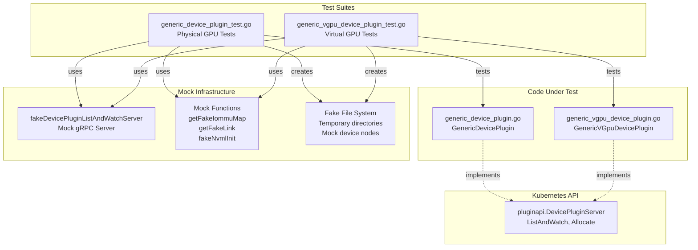
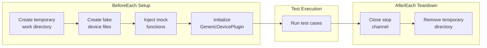
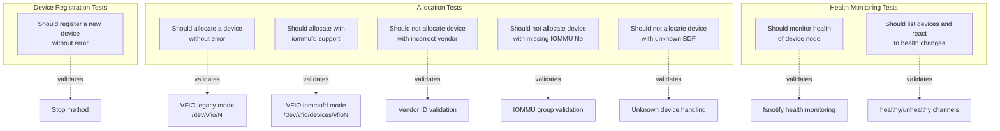
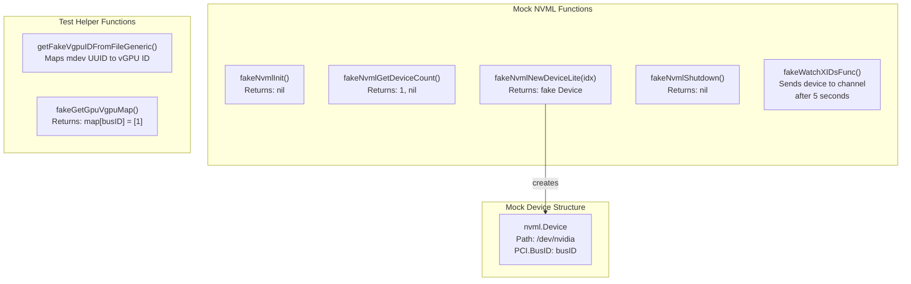
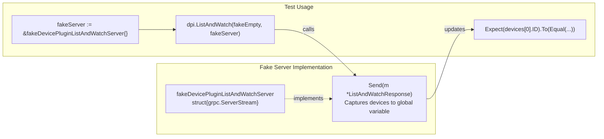
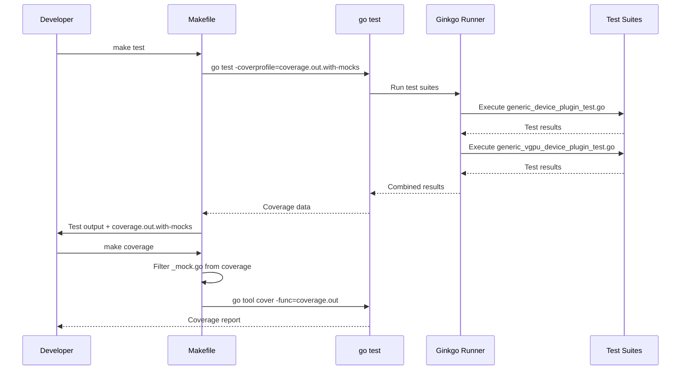
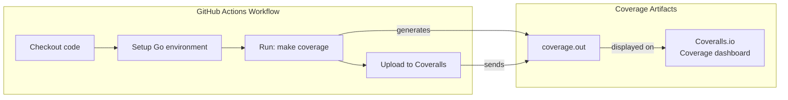

<!-- source: DeepWiki mcp.deepwiki.com · repo NVIDIA/kubevirt-gpu-device-plugin · page 5.2 Testing · fetched 2026-10-26 -->

# Testing

<details>
<summary>Relevant source files</summary>

The following files were used as context for generating this wiki page:

- [.github/workflows/golang.yml](.github/workflows/golang.yml)
- [Makefile](Makefile)
- [pkg/device_plugin/generic_device_plugin_test.go](pkg/device_plugin/generic_device_plugin_test.go)
- [pkg/device_plugin/generic_vgpu_device_plugin_test.go](pkg/device_plugin/generic_vgpu_device_plugin_test.go)

</details>


This document describes the testing infrastructure for the NVIDIA KubeVirt GPU Device Plugin, including the test framework, test structure, mock implementations, and how to run and evaluate tests. For information about the CI/CD pipeline that runs these tests automatically, see [CI/CD Pipeline](#5.3).

## Testing Framework

The device plugin uses **Ginkgo v2** as the Behavior-Driven Development (BDD) test framework and **Gomega** as the matcher/assertion library. These tools provide expressive, readable test specifications that document the expected behavior of the system.

### Framework Dependencies

| Dependency | Version | Purpose |
|------------|---------|---------|
| `github.com/onsi/ginkgo/v2` | v2.22.2 | BDD test framework with structured test organization |
| `github.com/onsi/gomega` | v1.36.2 | Matcher library for assertions |
| `google.golang.org/grpc` | v1.70.0 | gRPC testing utilities for device plugin API |
| `k8s.io/kubelet/pkg/apis/deviceplugin/v1beta1` | v0.33.5 | Kubernetes device plugin API types for testing |

**Sources:** [go.mod](), [pkg/device_plugin/generic_device_plugin_test.go:39-43](), [pkg/device_plugin/generic_vgpu_device_plugin_test.go:38-42]()

## Test Suite Organization



**Test Suite Structure:** The codebase contains two primary test suites that mirror the dual device plugin architecture. Each suite tests one device plugin implementation and uses mock infrastructure to simulate Kubernetes API interactions and hardware resources.

**Sources:** [pkg/device_plugin/generic_device_plugin_test.go:100-270](), [pkg/device_plugin/generic_vgpu_device_plugin_test.go:87-205]()

## Physical GPU Device Plugin Tests

The physical GPU device plugin tests in [pkg/device_plugin/generic_device_plugin_test.go]() validate the `GenericDevicePlugin` implementation, which manages physical NVIDIA GPUs with VFIO-PCI passthrough.

### Test Setup and Teardown



**Setup Process:** Each test creates an isolated environment with temporary directories and mock device nodes at [pkg/device_plugin/generic_device_plugin_test.go:107-140](). Mock functions are injected to replace system calls that access hardware resources.

**Sources:** [pkg/device_plugin/generic_device_plugin_test.go:107-145]()

### Mock Implementations for Physical GPU Tests

| Mock Function | Purpose | Return Values |
|---------------|---------|---------------|
| `getFakeIommuMap` | Simulates IOMMU group mappings | Map of IOMMU groups to GPU devices with NUMA nodes |
| `getFakeBdfToIommuMap` | Maps PCI addresses to IOMMU groups | Map of BDF to IOMMU group strings |
| `getFakeLink` | Simulates reading IOMMU group symlinks | IOMMU group number or error |
| `getFakeIDFromFile` | Simulates reading vendor/device IDs | NVIDIA vendor ID "10de" or error |

**Mock Function Injection:** The test suite uses function pointer replacement to inject mocks at [pkg/device_plugin/generic_device_plugin_test.go:108-111]():

```
returnIommuMap = getFakeIommuMap
returnBdfToIommuMap = getFakeBdfToIommuMap
readLink = getFakeLink
readIDFromFile = getFakeIDFromFile
```

**Sources:** [pkg/device_plugin/generic_device_plugin_test.go:65-98](), [pkg/device_plugin/generic_device_plugin_test.go:108-111]()

### Physical GPU Test Cases



**Test Coverage:** The suite validates core device plugin functionality including device registration, allocation with both legacy VFIO and modern iommufd support, and continuous health monitoring.

**Sources:** [pkg/device_plugin/generic_device_plugin_test.go:147-269]()

### Allocation Test Examples

The allocation tests validate that the device plugin correctly constructs `AllocateResponse` objects with appropriate device mounts and environment variables.

**Legacy VFIO Allocation Test:** [pkg/device_plugin/generic_device_plugin_test.go:153-169]() validates that allocating device `pciAddress1` returns:
- Environment variable: `NVIDIA_GPU_FOO=11` (PCI address)
- Device mount: `/dev/vfio/vfio` with `mrw` permissions
- Device mount: `/dev/vfio/1` (IOMMU group) with `mrw` permissions

**iommufd Allocation Test:** [pkg/device_plugin/generic_device_plugin_test.go:171-198]() validates modern VFIO allocation with:
- Device mount: `/dev/vfio/devices/vfio3` with `mrw` permissions
- Device mount: `/dev/vfio/vfio` with `mrw` permissions
- Device mount: `/dev/vfio/1` (IOMMU group) with `mrw` permissions
- Device mount: `/dev/iommu` with `mrw` permissions

**Sources:** [pkg/device_plugin/generic_device_plugin_test.go:153-198]()

### Health Monitoring Test

The health monitoring test at [pkg/device_plugin/generic_device_plugin_test.go:231-243]() validates that:
1. The `healthCheck()` goroutine monitors device node existence
2. Removing a device node triggers health status updates
3. Creating a device node allows recovery

**Sources:** [pkg/device_plugin/generic_device_plugin_test.go:231-243]()

## Virtual GPU Device Plugin Tests

The virtual GPU device plugin tests in [pkg/device_plugin/generic_vgpu_device_plugin_test.go]() validate the `GenericVGpuDevicePlugin` implementation, which manages NVIDIA vGPU mdev devices.

### Mock NVML Implementation



**Mock NVML Injection:** Tests inject mock NVML functions at [pkg/device_plugin/generic_vgpu_device_plugin_test.go:127-132]():

```
nvmlInit = fakeNvmlInit
nvmlGetDeviceCount = fakeNvmlGetDeviceCount
nvmlNewDeviceLite = fakeNvmlNewDeviceLite
nvmlShutdown = fakeNvmlShutdown
watchXIDs = fakeWatchXIDsFunc
returnGpuVgpuMap = fakeGetGpuVgpuMap
```

**Sources:** [pkg/device_plugin/generic_vgpu_device_plugin_test.go:54-85](), [pkg/device_plugin/generic_vgpu_device_plugin_test.go:127-132]()

### Virtual GPU Test Cases

The virtual GPU test suite includes:

1. **Stop Test** [pkg/device_plugin/generic_vgpu_device_plugin_test.go:140-143](): Validates clean shutdown
2. **Successful Allocation** [pkg/device_plugin/generic_vgpu_device_plugin_test.go:145-155](): Validates allocation with correct environment variable `NVIDIA_VGPU_VGPUID=1`
3. **Failed Allocation** [pkg/device_plugin/generic_vgpu_device_plugin_test.go:157-167](): Validates handling of invalid device IDs
4. **Health Monitoring** [pkg/device_plugin/generic_vgpu_device_plugin_test.go:179-203](): Validates `ListAndWatch` and health state transitions

**Sources:** [pkg/device_plugin/generic_vgpu_device_plugin_test.go:140-203]()

## Fake gRPC Server

Both test suites use a fake gRPC server implementation to test the `ListAndWatch` method without requiring a real Kubelet connection.



**Implementation:** The fake server at [pkg/device_plugin/generic_device_plugin_test.go:56-63]() implements the `Send` method to capture device lists in a global variable for assertions.

**Sources:** [pkg/device_plugin/generic_device_plugin_test.go:56-63](), [pkg/device_plugin/generic_device_plugin_test.go:245-269]()

## Running Tests

### Test Execution Flow



**Sources:** [Makefile:56-61]()

### Make Targets for Testing

| Target | Command | Purpose |
|--------|---------|---------|
| `test` | `make test` | Runs all tests with coverage profiling |
| `coverage` | `make coverage` | Runs tests and generates human-readable coverage report |
| `build` | `make build` | Builds binary (prerequisite for tests) |

**Test Target:** [Makefile:56-57]()
```
test: build
	go test -coverprofile=$(COVERAGE_FILE).with-mocks $(MODULE)/...
```

**Coverage Target:** [Makefile:59-61]()
```
coverage: test
	cat $(COVERAGE_FILE).with-mocks | grep -v "_mock.go" > $(COVERAGE_FILE)
	go tool cover -func=$(COVERAGE_FILE)
```

**Coverage Filtering:** The coverage target filters out mock files (`_mock.go`) from the coverage report to focus on production code coverage.

**Sources:** [Makefile:55-61]()

### Running Tests Locally

To run tests locally:

```bash
# Run all tests with coverage
make test

# Generate and view coverage report
make coverage

# Run all checks and tests
make all
```

The test output includes:
- Pass/fail status for each test case
- Test execution time
- Coverage statistics per package
- Overall coverage percentage

**Sources:** [Makefile:40-41](), [Makefile:56-61]()

## Coverage Reporting

### Coverage File Structure

The coverage workflow creates two files:

1. **`coverage.out.with-mocks`**: Raw coverage data including mock files
2. **`coverage.out`**: Filtered coverage data excluding `_mock.go` files

**Coverage Output Format:** The `go tool cover -func` command produces a function-level coverage report showing:
- File path
- Function name
- Coverage percentage per function
- Total coverage percentage

**Sources:** [Makefile:55-61]()

### CI Coverage Integration



**GitHub Actions Integration:** The CI pipeline at [.github/workflows/golang.yml:55-81]() runs the coverage target and uploads results to Coveralls using the `coverallsapp/github-action@v2` action.

**Sources:** [.github/workflows/golang.yml:73-80]()

## Test Isolation and Best Practices

### Isolation Mechanisms

Each test maintains isolation through:

1. **Temporary Directories**: Tests create unique temporary directories using `os.MkdirTemp()`
2. **Mock Function Injection**: Global function pointers are replaced per test suite
3. **Stop Channels**: Each device plugin instance gets a unique stop channel
4. **Cleanup Hooks**: `AfterEach` blocks ensure resource cleanup

**Temporary Directory Creation:** [pkg/device_plugin/generic_device_plugin_test.go:113-114]()
```
workDir, err = os.MkdirTemp("", "kubevirt-test")
Expect(err).ToNot(HaveOccurred())
```

**Sources:** [pkg/device_plugin/generic_device_plugin_test.go:107-145](), [pkg/device_plugin/generic_vgpu_device_plugin_test.go:92-138]()

### Test Data Constants

Tests use predefined constants for consistent test data:

| Constant | Value | Purpose |
|----------|-------|---------|
| `iommuGroup1` | "1" | First IOMMU group identifier |
| `iommuGroup2` | "2" | Second IOMMU group identifier |
| `pciAddress1` | "11" | First PCI device address |
| `pciAddress2` | "22" | Second PCI device address |
| `nvVendorID` | "10de" | NVIDIA vendor ID |

**Sources:** [pkg/device_plugin/generic_device_plugin_test.go:45-54]()

## Test Execution in CI/CD

The GitHub Actions workflow defines three jobs that execute tests:

### Check Job

Validates code quality and vendoring:
- Verifies Go modules with `make check-vendor`
- Ensures dependencies are correctly vendored

**Sources:** [.github/workflows/golang.yml:26-53]()

### Test Job

Executes the test suite:
1. Checks out code
2. Sets up Go environment from `versions.mk`
3. Runs `make coverage` to execute tests with coverage
4. Uploads coverage report to Coveralls

**Sources:** [.github/workflows/golang.yml:55-81]()

### Build Job

Validates that the code compiles:
- Runs `make build` to compile the binary
- Ensures no compilation errors

**Sources:** [.github/workflows/golang.yml:82-105]()

## Test Maintenance

### Updating Mocks

When modifying production code that changes function signatures:

1. Update mock function implementations in test files
2. Update function pointer assignments in `BeforeEach` blocks
3. Adjust test assertions if return values change

**Mock Function Locations:**
- Physical GPU mocks: [pkg/device_plugin/generic_device_plugin_test.go:65-98]()
- Virtual GPU mocks: [pkg/device_plugin/generic_vgpu_device_plugin_test.go:44-85]()

### Adding New Tests

To add new test cases:

1. Create new `It()` blocks within existing `Describe()` blocks
2. Use existing mock infrastructure and helper functions
3. Follow naming convention: "Should [action] [expected result]"
4. Ensure proper cleanup in test or `AfterEach` block

**Example Test Structure:**
```
It("Should [action] [expected result]", func() {
    // Arrange: Set up test data
    // Act: Execute code under test
    // Assert: Verify expected behavior using Gomega matchers
})
```

**Sources:** [pkg/device_plugin/generic_device_plugin_test.go:147-269]()

---

