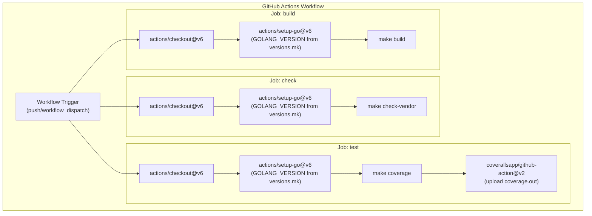
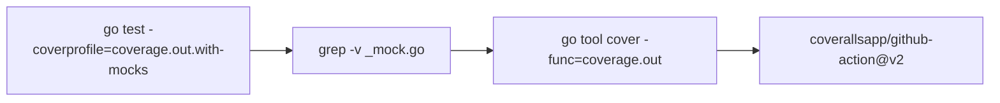
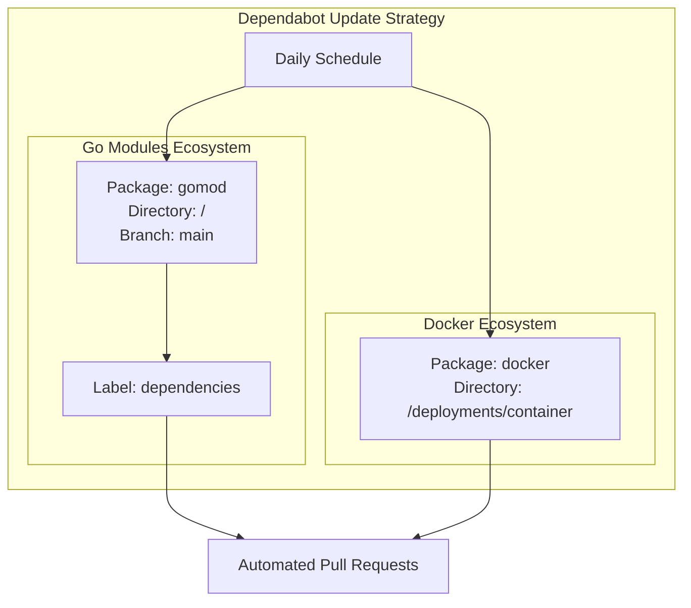
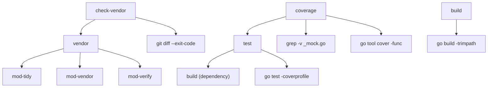

<!-- source: DeepWiki mcp.deepwiki.com · repo NVIDIA/kubevirt-gpu-device-plugin · page 5.3 CI/CD Pipeline · fetched 2026-10-26 -->

# CI/CD Pipeline

<details>
<summary>Relevant source files</summary>

The following files were used as context for generating this wiki page:

- [.github/dependabot.yml](.github/dependabot.yml)
- [.github/workflows/golang.yml](.github/workflows/golang.yml)
- [Makefile](Makefile)

</details>


## Purpose and Scope

This document describes the continuous integration and deployment (CI/CD) infrastructure for the NVIDIA KubeVirt GPU Device Plugin. It covers the GitHub Actions workflows that automate code quality checks, testing, and building, as well as the automated dependency management system. 

For information about the build system and make targets used by the CI pipeline, see [Build System](#4.1). For details on containerization and image publishing, see [Container Images](#4.2).

---

## GitHub Actions Workflow Overview

The project uses a single GitHub Actions workflow defined in [.github/workflows/golang.yml:1-105]() that orchestrates three parallel jobs: code quality checks, unit testing with coverage reporting, and binary compilation.

### Workflow Triggers

The workflow executes on the following events:

| Trigger Type | Branches/Pattern | Purpose |
|-------------|-----------------|---------|
| `push` | `master` | Main development branch |
| `push` | `pull-request/[0-9]+` | Pull request validation |
| `push` | `release-*` | Release branch testing |
| `workflow_dispatch` | N/A | Manual execution |

**Sources:** [.github/workflows/golang.yml:17-23]()

---

## Continuous Integration Jobs

The workflow consists of three independent jobs that run in parallel, each validating a different aspect of the codebase.



**Diagram: GitHub Actions Workflow Execution Flow**

**Sources:** [.github/workflows/golang.yml:25-105]()

---

### Check Job

The `check` job validates that the vendored dependencies are synchronized with `go.mod` and `go.sum`.

#### Execution Steps

1. **Checkout**: Uses `actions/checkout@v6` to clone the repository [.github/workflows/golang.yml:29-30]()
2. **Go Version Discovery**: Extracts `GOLANG_VERSION` from `versions.mk` [.github/workflows/golang.yml:32-36]()
3. **Go Installation**: Installs the specified Go version using `actions/setup-go@v6` [.github/workflows/golang.yml:38-41]()
4. **Vendor Verification**: Executes `make check-vendor` to verify vendored dependencies [.github/workflows/golang.yml:51-53]()

The `check-vendor` target performs the following operations [Makefile:86-87]():
- Regenerates vendor directory using `make vendor`
- Runs `git diff` to detect any changes to `go.mod`, `go.sum`, or `vendor/` directory
- Fails if differences are detected, indicating out-of-sync dependencies

#### Linting (Currently Disabled)

The workflow includes commented-out linting configuration [.github/workflows/golang.yml:43-49](). When enabled, it would use `golangci/golangci-lint-action@v9` to run `golangci-lint` with a 5-minute timeout.

**Sources:** [.github/workflows/golang.yml:26-53](), [Makefile:86-87]()

---

### Test Job

The `test` job executes the unit test suite and generates coverage reports that are uploaded to Coveralls.

#### Execution Steps

1. **Checkout**: Clones the repository using `actions/checkout@v6` [.github/workflows/golang.yml:59-60]()
2. **Go Setup**: Extracts Go version from `versions.mk` and installs it [.github/workflows/golang.yml:62-71]()
3. **Coverage Generation**: Runs `make coverage` which:
   - Executes `make test` to run tests with `-coverprofile` flag [Makefile:56-57]()
   - Filters out mock files from coverage report [Makefile:60]()
   - Generates human-readable coverage statistics using `go tool cover` [Makefile:61]()
4. **Coverage Upload**: Uploads `coverage.out` to Coveralls using `coverallsapp/github-action@v2` [.github/workflows/golang.yml:76-80]()

#### Coverage Workflow



**Diagram: Test Coverage Generation Pipeline**

The coverage workflow excludes mock files to provide accurate metrics for production code [Makefile:60]().

**Sources:** [.github/workflows/golang.yml:55-81](), [Makefile:55-61]()

---

### Build Job

The `build` job compiles the device plugin binary to verify that the code successfully builds.

#### Execution Steps

1. **Checkout**: Uses `actions/checkout@v6` [.github/workflows/golang.yml:89-90]()
2. **Go Setup**: Reads Go version from `versions.mk` and configures Go environment [.github/workflows/golang.yml:92-101]()
3. **Compilation**: Executes `make build` which runs:
   ```bash
   GOOS=linux go build -trimpath -o nvidia-kubevirt-gpu-device-plugin ./cmd
   ```
   [Makefile:37-38]()

#### Build Configuration

| Flag | Purpose |
|------|---------|
| `GOOS=linux` | Targets Linux operating system |
| `-trimpath` | Removes file system paths from binary for reproducible builds |
| `-o nvidia-kubevirt-gpu-device-plugin` | Output binary name |
| `./cmd` | Entry point package |

#### Permissions

The build job declares explicit permissions [.github/workflows/golang.yml:85-87]():
- `contents: read` - Read repository contents
- `id-token: write` - Write ID tokens (for future signing/attestation)

**Sources:** [.github/workflows/golang.yml:82-105](), [Makefile:35-38]()

---

## Automated Dependency Management

The project uses GitHub Dependabot to automatically monitor and update dependencies.

### Dependabot Configuration

Dependabot is configured in [.github/dependabot.yml:1-17]() with two package ecosystems:



**Diagram: Dependabot Dependency Management**

### Go Modules Updates

Configuration [.github/dependabot.yml:6-12]():
- **Package Ecosystem**: `gomod`
- **Target Branch**: `main`
- **Directory**: `/` (root directory)
- **Schedule**: Daily at a default time
- **Labels**: Automatically adds `dependencies` label to pull requests

### Docker Base Image Updates

Configuration [.github/dependabot.yml:14-17]():
- **Package Ecosystem**: `docker`
- **Directory**: `/deployments/container`
- **Schedule**: Daily monitoring
- **Target**: Updates base images in Dockerfile

When Dependabot detects outdated dependencies, it automatically creates pull requests with:
1. Updated `go.mod` and `go.sum` files (for Go dependencies)
2. Updated `FROM` statements in Dockerfiles (for container base images)
3. Changelogs and compatibility notes
4. CI/CD validation via GitHub Actions workflow

**Sources:** [.github/dependabot.yml:1-17]()

---

## Build System Integration

The CI/CD pipeline leverages make targets defined in the project Makefile. The following table maps CI operations to their corresponding make targets:

| CI Operation | Make Target | Description |
|-------------|-------------|-------------|
| Vendor Check | `make check-vendor` | Verifies vendored dependencies match go.mod |
| Testing | `make coverage` | Runs tests and generates coverage report |
| Build | `make build` | Compiles the device plugin binary |
| Linting | `make lint` | Runs golangci-lint (future use) |
| Formatting | `make fmt` | Applies gofmt to codebase |

### Make Target Dependencies



**Diagram: Make Target Dependency Graph**

**Sources:** [Makefile:1-94]()

---

## Version Management

The CI/CD pipeline dynamically reads the Go toolchain version from the `versions.mk` file, ensuring consistency across all jobs and developer environments.

### Version Extraction

Each job executes the following pattern [.github/workflows/golang.yml:32-36]():
```bash
GOLANG_VERSION=$( grep "GOLANG_VERSION ?=" versions.mk )
echo "GOLANG_VERSION=${GOLANG_VERSION##GOLANG_VERSION ?= }" >> $GITHUB_ENV
```

This approach:
1. Extracts the line containing `GOLANG_VERSION ?=` from `versions.mk`
2. Uses shell parameter expansion to strip the prefix
3. Sets the version as a GitHub Actions environment variable
4. Makes it available to subsequent steps via `${{ env.GOLANG_VERSION }}`

**Sources:** [.github/workflows/golang.yml:32-36](), [.github/workflows/golang.yml:62-66](), [.github/workflows/golang.yml:92-96]()

---

## Release Process

The project currently does not have an automated release or container image publishing workflow in the GitHub Actions configuration. Release processes would typically include:

1. **Container Image Building**: Multi-stage Docker build using [deployments/container/Dockerfile.distroless]()
2. **Image Tagging**: Versioning scheme based on Git tags or semantic versioning
3. **Registry Publishing**: Pushing images to container registries (e.g., `nvcr.io/nvidia/kubevirt-gpu-device-plugin`)
4. **Artifact Signing**: Using cosign or similar tools for supply chain security

The `build` job already declares `id-token: write` permission [.github/workflows/golang.yml:87](), which suggests future support for signing or attestation workflows.

**Manual Release Process**

Until automated release workflows are implemented, releases likely follow this pattern:
1. Tag a commit with semantic version (e.g., `v1.0.0`)
2. Manually build container image: `docker build -f deployments/container/Dockerfile.distroless`
3. Tag and push to container registry
4. Update deployment manifests in [manifests/]() directory

**Sources:** [.github/workflows/golang.yml:82-105]()

---

## Best Practices and Recommendations

### Current Implementation Strengths

1. **Parallel Job Execution**: Check, test, and build jobs run concurrently for faster feedback
2. **Version Consistency**: Single source of truth for Go version in `versions.mk`
3. **Coverage Tracking**: Automated upload to Coveralls for visibility
4. **Dependency Automation**: Dependabot reduces maintenance burden
5. **Vendor Verification**: Ensures reproducible builds

### Recommended Enhancements

| Enhancement | Priority | Description |
|------------|----------|-------------|
| Enable Linting | High | Uncomment golangci-lint action [.github/workflows/golang.yml:43-49]() |
| Add Release Workflow | High | Automate container image building and publishing |
| Container Scanning | Medium | Add vulnerability scanning for built images |
| SBOM Generation | Medium | Generate Software Bill of Materials for supply chain security |
| Integration Tests | Medium | Add E2E testing against real Kubernetes clusters |
| Pre-commit Hooks | Low | Enforce formatting and linting locally |

**Sources:** [.github/workflows/golang.yml:1-105](), [.github/dependabot.yml:1-17](), [Makefile:1-94]()

---

