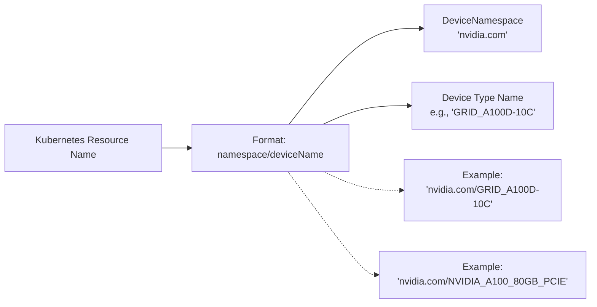
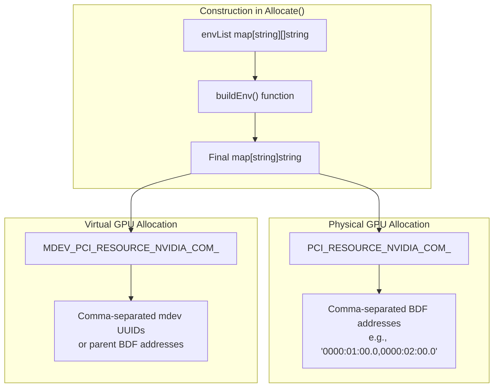
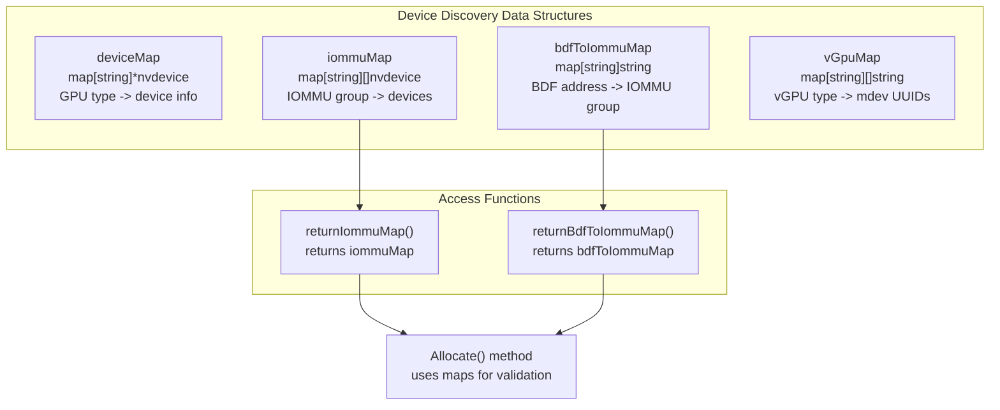
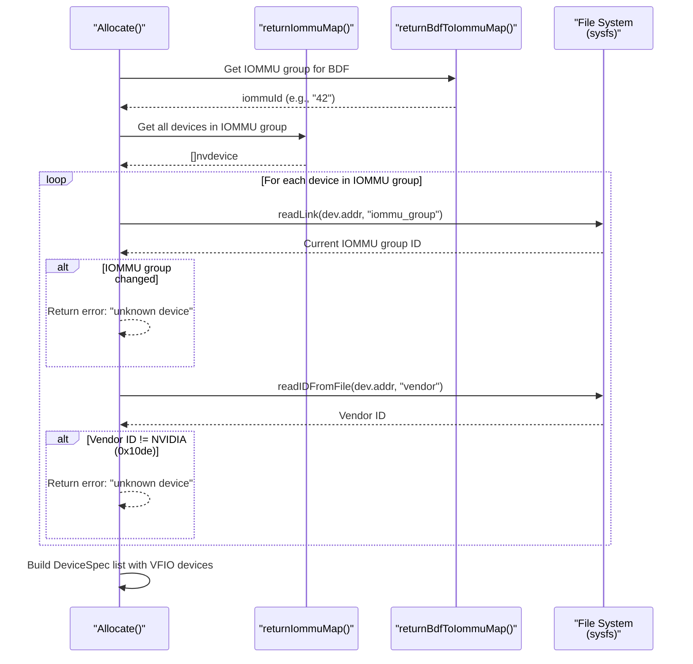
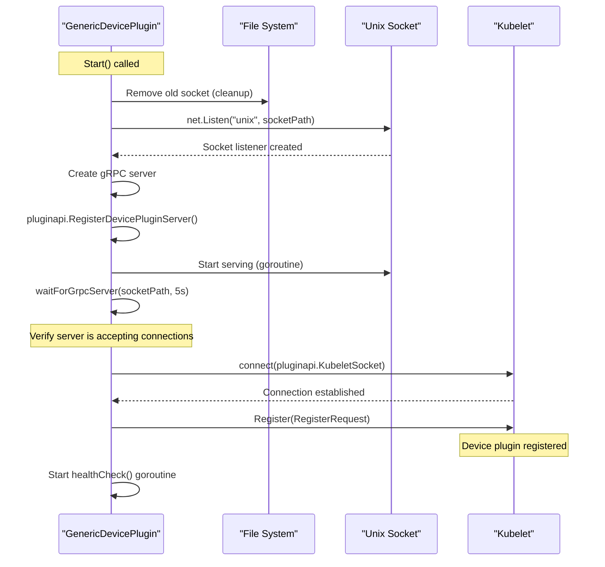
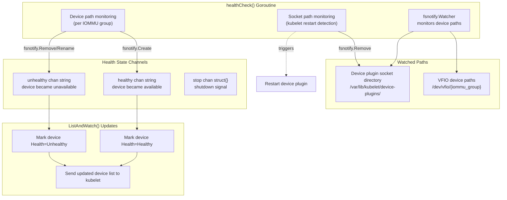
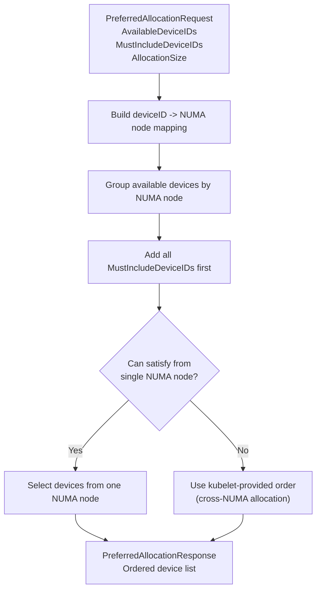
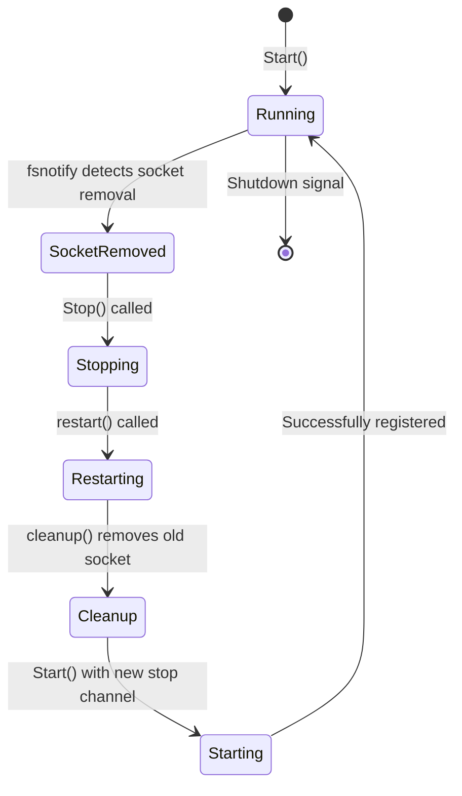
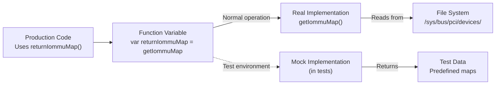

<!-- source: DeepWiki mcp.deepwiki.com · repo NVIDIA/kubevirt-gpu-device-plugin · page 6 Reference · fetched 2026-10-26 -->

# Reference

<details>
<summary>Relevant source files</summary>

The following files were used as context for generating this wiki page:

- [pkg/device_plugin/generic_device_plugin.go](pkg/device_plugin/generic_device_plugin.go)
- [utils/pci.ids](utils/pci.ids)

</details>


This page provides technical reference documentation for the NVIDIA KubeVirt GPU Device Plugin, including constants, data structures, file system paths, naming conventions, and API implementation details. This material is intended for developers and operators who need to understand the internal mechanics of the device plugin or troubleshoot issues.

For detailed information about the PCI device database structure and usage, see [PCI Device Database](#6.1). For comprehensive documentation of the Device Plugin API methods, see [Device Plugin API Reference](#6.2).

---

## Constants and Configuration Values

The device plugin uses several constants that define its behavior and integration points with Kubernetes and the Linux kernel.

### Core Constants

| Constant | Value | Purpose | Source Location |
|----------|-------|---------|-----------------|
| `DeviceNamespace` | `"nvidia.com"` | Kubernetes resource namespace for GPU devices | [pkg/device_plugin/generic_device_plugin.go:51]() |
| `connectionTimeout` | `5 * time.Second` | gRPC connection timeout for device plugin registration | [pkg/device_plugin/generic_device_plugin.go:52]() |
| `vfioDevicePath` | `"/dev/vfio"` | VFIO device node location in the file system | [pkg/device_plugin/generic_device_plugin.go:53]() |
| `iommuDevicePath` | `"/dev/iommu"` | IOMMU device node for IOMMUFD support | [pkg/device_plugin/generic_device_plugin.go:54]() |
| `gpuPrefix` | `"PCI_RESOURCE_NVIDIA_COM"` | Environment variable prefix for physical GPU resources | [pkg/device_plugin/generic_device_plugin.go:55]() |
| `vgpuPrefix` | `"MDEV_PCI_RESOURCE_NVIDIA_COM"` | Environment variable prefix for virtual GPU resources | [pkg/device_plugin/generic_device_plugin.go:56]() |

**Sources:** [pkg/device_plugin/generic_device_plugin.go:50-57]()

---

## Resource Naming Conventions

The device plugin advertises GPU resources to Kubernetes using a structured naming convention that combines the device namespace with a device-specific identifier.



### Resource Name Construction

The resource name is constructed in the `Register()` method using the following pattern:

```
fmt.Sprintf("%s/%s", DeviceNamespace, dpi.deviceName)
```

This produces resource names like:
- `nvidia.com/NVIDIA_A100_80GB_PCIE` (for physical GPUs)
- `nvidia.com/GRID_A100D-10C` (for virtual GPUs)

The `deviceName` component is derived from:
- **Physical GPUs**: The PCI device name from the PCI IDs database, with spaces and special characters replaced by underscores
- **Virtual GPUs**: The mdev type name as defined in the Linux mdev subsystem

**Sources:** [pkg/device_plugin/generic_device_plugin.go:210-214]()

---

## Environment Variables

The device plugin injects environment variables into containers to communicate allocated GPU device addresses. These variables follow specific naming patterns based on device type.

### Environment Variable Format



### Environment Variable Construction

The environment variables are built in the `Allocate()` method:

| Function | Purpose | Location |
|----------|---------|----------|
| `Allocate()` | Builds `envList` map with device type as key and BDF addresses as values | [pkg/device_plugin/generic_device_plugin.go:266-361]() |
| `buildEnv()` | Converts `envList` to final environment variable map by joining address lists with commas | [pkg/device_plugin/generic_device_plugin.go:92-98]() |

**Example Environment Variables:**

```bash
# Physical GPU allocation
PCI_RESOURCE_NVIDIA_COM_NVIDIA_A100_80GB_PCIE=0000:01:00.0,0000:02:00.0

# Virtual GPU allocation
MDEV_PCI_RESOURCE_NVIDIA_COM_GRID_A100D_10C=a1b2c3d4-e5f6-7890-abcd-ef1234567890
```

**Sources:** [pkg/device_plugin/generic_device_plugin.go:92-98](), [pkg/device_plugin/generic_device_plugin.go:344-348]()

---

## File System Paths and Locations

The device plugin interacts with multiple file system locations for device discovery, health monitoring, and resource allocation.

### Critical File System Paths

| Path | Purpose | Usage Context |
|------|---------|---------------|
| `/sys/bus/pci/devices/` | PCI device enumeration | Device discovery: scanning for NVIDIA GPUs with VFIO-PCI driver |
| `/sys/bus/mdev/devices/` | mdev (mediated device) enumeration | Virtual GPU discovery: scanning for vGPU instances |
| `/dev/vfio/vfio` | VFIO container device | Mounted into containers for GPU passthrough |
| `/dev/vfio/<iommu_group>` | VFIO IOMMU group device node | Per-IOMMU group device access |
| `/dev/vfio/devices/vfio<N>` | IOMMUFD device nodes | Individual device access with IOMMUFD (kernel 6.2+) |
| `/dev/iommu` | IOMMUFD device node | IOMMUFD support detection and access |
| `/var/lib/kubelet/device-plugins/` | Kubelet device plugin socket directory | Device plugin socket registration location |

**Sources:** [pkg/device_plugin/generic_device_plugin.go:50-54]()

### Device Plugin Socket Path

The device plugin creates a Unix domain socket for gRPC communication with kubelet:

```
{pluginapi.DevicePluginPath}/kubevirt-{deviceName}.sock
```

Where:
- `pluginapi.DevicePluginPath` = `/var/lib/kubelet/device-plugins/`
- `deviceName` = The GPU device type (e.g., `NVIDIA_A100_80GB_PCIE`)

Example: `/var/lib/kubelet/device-plugins/kubevirt-NVIDIA_A100_80GB_PCIE.sock`

**Sources:** [pkg/device_plugin/generic_device_plugin.go:79]()

---

## Data Structures

The device plugin uses several key data structures to manage GPU devices and communicate with Kubernetes.

### GenericDevicePlugin Structure

```mermaid
classDiagram
    class GenericDevicePlugin {
        -devs []*pluginapi.Device
        -server *grpc.Server
        -socketPath string
        -stop chan struct{}
        -term chan bool
        -healthy chan string
        -unhealthy chan string
        -devicePath string
        -deviceName string
        -devsHealth []*pluginapi.Device
        
        +Start(stop chan struct{}) error
        +Stop() error
        +Register() error
        +ListAndWatch() error
        +Allocate() (*pluginapi.AllocateResponse, error)
        +GetPreferredAllocation() (*pluginapi.PreferredAllocationResponse, error)
        +GetDevicePluginOptions() (*pluginapi.DevicePluginOptions, error)
        +PreStartContainer() (*pluginapi.PreStartContainerResponse, error)
        -healthCheck() error
        -restart() error
        -cleanup() error
    }
    
    class pluginapi_Device {
        <<external>>
        +ID string
        +Health string
        +Topology *TopologyInfo
    }
    
    class grpc_Server {
        <<external>>
        +Serve()
        +Stop()
    }
    
    GenericDevicePlugin --> pluginapi_Device : manages
    GenericDevicePlugin --> grpc_Server : uses
```

**Field Descriptions:**

| Field | Type | Purpose |
|-------|------|---------|
| `devs` | `[]*pluginapi.Device` | List of GPU devices managed by this plugin instance |
| `server` | `*grpc.Server` | gRPC server instance for device plugin API |
| `socketPath` | `string` | Unix socket path for kubelet communication |
| `stop` | `chan struct{}` | Channel to signal plugin shutdown |
| `term` | `chan bool` | Channel to detect kubelet restarts |
| `healthy` | `chan string` | Channel for marking devices healthy |
| `unhealthy` | `chan string` | Channel for marking devices unhealthy |
| `devicePath` | `string` | File system path to monitor for device health |
| `deviceName` | `string` | GPU device type name (used in resource name) |
| `devsHealth` | `[]*pluginapi.Device` | Health status tracking for devices |

**Sources:** [pkg/device_plugin/generic_device_plugin.go:63-74]()

### Device Discovery Maps

The device plugin maintains several internal maps for device tracking:



These maps are accessed through function variables to enable testing:

```go
var returnIommuMap = getIommuMap
var returnBdfToIommuMap = getBdfToIommuMap
```

**Sources:** [pkg/device_plugin/generic_device_plugin.go:59-60](), [pkg/device_plugin/generic_device_plugin.go:282-283]()

---

## IOMMU and VFIO Integration

The device plugin integrates with Linux IOMMU and VFIO subsystems to enable GPU passthrough to virtual machines.

### IOMMU Group Validation

During allocation, the device plugin validates IOMMU group consistency to ensure secure device isolation:



**Key Validation Steps:**

1. **IOMMU Group Lookup**: Map BDF address to IOMMU group ID using `bdfToIommuMap`
2. **Device List Retrieval**: Get all devices in the IOMMU group from `iommuMap`
3. **Dynamic Verification**: Re-read IOMMU group from sysfs to detect changes
4. **Vendor Validation**: Verify all devices in the group are NVIDIA devices

**Sources:** [pkg/device_plugin/generic_device_plugin.go:282-325]()

### VFIO Device Specification

The device plugin provides VFIO device access through `DeviceSpec` entries in the allocation response:

| Device | Host Path | Container Path | Permissions | Purpose |
|--------|-----------|----------------|-------------|---------|
| VFIO Container | `/dev/vfio/vfio` | `/dev/vfio/vfio` | `mrw` | VFIO container access |
| IOMMU Group | `/dev/vfio/{group_id}` | `/dev/vfio/{group_id}` | `mrw` | Specific IOMMU group device |
| IOMMUFD Device (optional) | `/dev/vfio/devices/vfio{N}` | `/dev/vfio/devices/vfio{N}` | `mrw` | Per-device IOMMUFD access (kernel 6.2+) |
| IOMMUFD Node (optional) | `/dev/iommu` | `/dev/iommu` | `mrw` | IOMMUFD support |

**Sources:** [pkg/device_plugin/generic_device_plugin.go:316-342]()

### IOMMUFD Support Detection

The device plugin detects IOMMUFD support (introduced in Linux kernel 6.2) to provide enhanced device isolation:

```go
func supportsIOMMUFD() (bool, error) {
    _, err := os.Stat(filepath.Join(rootPath, iommuDevicePath))
    if err != nil {
        if errors.Is(err, fs.ErrNotExist) {
            return false, nil  // IOMMUFD not available
        }
        return false, err  // Error checking
    }
    return true, nil  // IOMMUFD available
}
```

When IOMMUFD is available:
- Individual device nodes (`/dev/vfio/devices/vfio{N}`) are added to the allocation
- The `/dev/iommu` device is mounted into the container
- Enhanced per-device access control is enabled

**Sources:** [pkg/device_plugin/generic_device_plugin.go:609-618](), [pkg/device_plugin/generic_device_plugin.go:619-633]()

---

## gRPC Communication

The device plugin implements the Kubernetes Device Plugin API via gRPC over Unix domain sockets.

### Connection Establishment



**Connection Functions:**

| Function | Purpose | Timeout |
|----------|---------|---------|
| `connect()` | Establish gRPC connection to a Unix socket with context deadline | `connectionTimeout` or context deadline |
| `waitForGrpcServer()` | Verify gRPC server is accepting connections | `connectionTimeout` (5 seconds) |

**Sources:** [pkg/device_plugin/generic_device_plugin.go:100-127](), [pkg/device_plugin/generic_device_plugin.go:130-170]()

### Socket Path Monitoring

The device plugin monitors its socket path to detect kubelet restarts:

```go
// In healthCheck()
watcher.Add(filepath.Dir(dpi.socketPath))

// Handle socket removal event
if event.Name == dpi.socketPath && event.Op == fsnotify.Remove {
    log.Printf("Socket path was removed, kubelet likely restarted")
    dpi.restart()  // Re-register with kubelet
}
```

This mechanism ensures the device plugin automatically recovers from kubelet restarts without requiring pod recreation.

**Sources:** [pkg/device_plugin/generic_device_plugin.go:542-604]()

---

## Health Monitoring

The device plugin implements continuous health monitoring using file system watches to detect device availability changes.

### Health Check Architecture



### File System Event Handling

| Event Type | Action | Health Status |
|------------|--------|---------------|
| `fsnotify.Create` | Device path created | Mark device as `Healthy` |
| `fsnotify.Remove` | Device path removed | Mark device as `Unhealthy` |
| `fsnotify.Rename` | Device path renamed | Mark device as `Unhealthy` |

**Path Construction for Monitoring:**

For each device, the health check monitors:
```
{devicePath}/{iommuID}
```

Example: `/dev/vfio/42` for device in IOMMU group 42

**Sources:** [pkg/device_plugin/generic_device_plugin.go:528-607]()

### Device Health State Updates

Health state changes are communicated to kubelet through the `ListAndWatch()` stream:

1. **Health Check Detects Change**: File system event triggers health state change
2. **Channel Communication**: Health status sent via `healthy` or `unhealthy` channel
3. **Device List Update**: `ListAndWatch()` updates device health in device list
4. **Kubelet Notification**: Updated device list sent to kubelet via gRPC stream

This mechanism allows Kubernetes to make informed scheduling decisions based on real-time device availability.

**Sources:** [pkg/device_plugin/generic_device_plugin.go:226-263]()

---

## Topology and NUMA Awareness

The device plugin provides NUMA topology information to enable the Kubernetes Topology Manager to make NUMA-aware scheduling decisions.

### NUMA Node Information

Each device advertised to kubelet includes topology information:

```go
dev.Topology = &pluginapi.TopologyInfo{
    Nodes: []*pluginapi.NUMANode{
        {ID: numaNodeID},
    },
}
```

This topology information is used by:
- **Kubernetes Topology Manager**: To make NUMA-aware pod placement decisions
- **GetPreferredAllocation()**: To prefer devices from the same NUMA node when possible

### Preferred Allocation Algorithm

The `GetPreferredAllocation()` method implements a NUMA-aware device selection strategy:



**Algorithm Steps:**

1. **Map Devices to NUMA Nodes**: Create `deviceToNUMA` map from device topology information
2. **Honor Must-Include Devices**: Always include devices from `MustIncludeDeviceIDs` first
3. **Single NUMA Node Preference**: Try to satisfy allocation from a single NUMA node
4. **Fallback**: If single-node allocation is impossible, use kubelet-provided device order

**Sources:** [pkg/device_plugin/generic_device_plugin.go:387-525]()

---

## Error Handling and Recovery

The device plugin implements several error handling and recovery mechanisms to maintain reliability.

### Kubelet Restart Detection



When the device plugin detects its socket has been removed (indicating a kubelet restart):

1. **Detection**: File system watcher detects `fsnotify.Remove` on socket path
2. **Graceful Shutdown**: Call `Stop()` to cleanly shut down current server
3. **Cleanup**: Remove stale resources
4. **Re-registration**: Call `Start()` to create new server and re-register with kubelet
5. **Resume**: Continue normal operation with new gRPC connection

**Sources:** [pkg/device_plugin/generic_device_plugin.go:594-604](), [pkg/device_plugin/generic_device_plugin.go:188-199]()

### Allocation Validation Errors

During allocation, several validation checks can fail:

| Error Condition | Error Message | Cause |
|----------------|---------------|-------|
| Unknown device | `"invalid allocation request: unknown device: {bdf}"` | Device not in `bdfToIommuMap` |
| IOMMU group changed | `"IommuGroup has changed on the system"` | IOMMU group ID mismatch during validation |
| Vendor changed | `"Vendor has changed on the system"` | Device vendor ID is not NVIDIA (0x10de) |
| IOMMUFD read failure | `"could not determine iommufd device"` | Unable to read vfio-dev directory |
| Must-include overflow | `"number of MustIncludeDeviceIDs exceeds allocation size"` | More must-include devices than allocation size |

These errors cause the allocation to fail, preventing potentially unsafe GPU assignments.

**Sources:** [pkg/device_plugin/generic_device_plugin.go:284-325]()

---

## Testing and Mocking Support

The device plugin uses function variables to enable testing and mocking of system interactions.

### Mockable Functions

```go
// Function variables for testing
var returnIommuMap = getIommuMap
var returnBdfToIommuMap = getBdfToIommuMap
```

These variables can be replaced in tests to provide mock implementations of device maps without requiring actual hardware or file system access.

**Testing Strategy:**



This pattern allows comprehensive testing of allocation logic, error handling, and edge cases without requiring GPU hardware.

**Sources:** [pkg/device_plugin/generic_device_plugin.go:59-60]()

---

