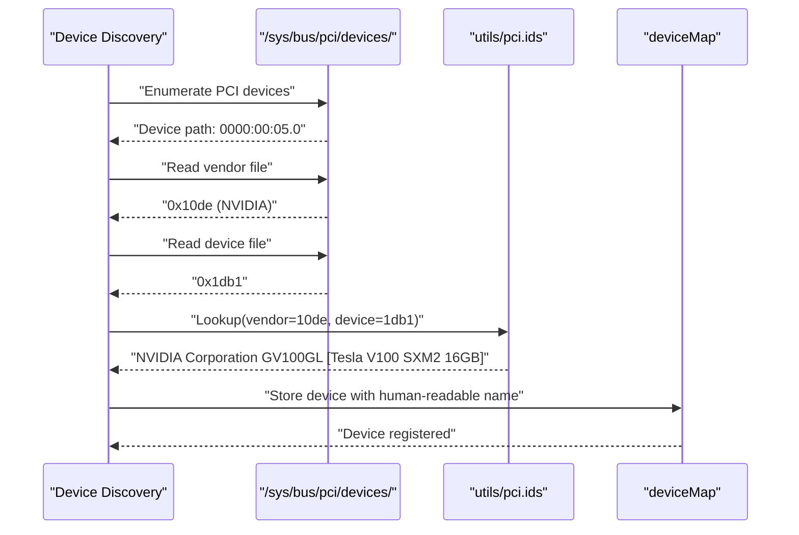
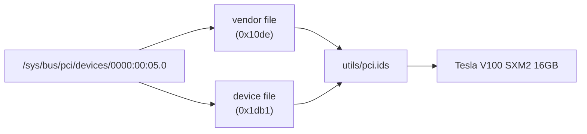
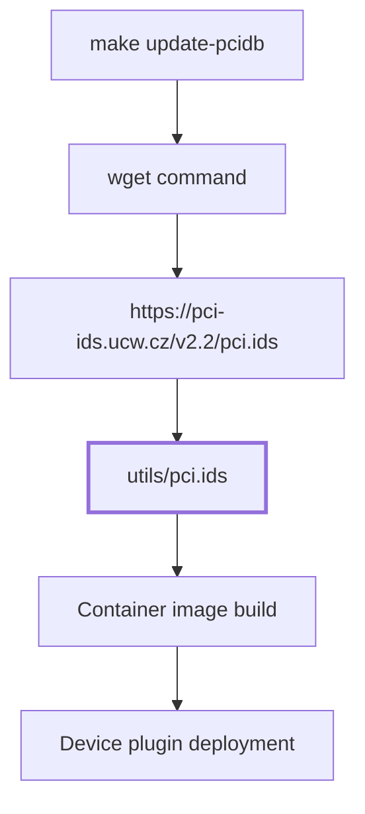
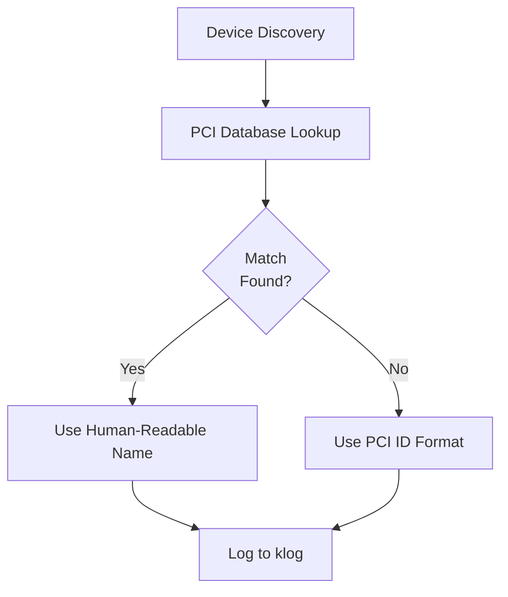

<!-- source: DeepWiki mcp.deepwiki.com · repo NVIDIA/kubevirt-gpu-device-plugin · page 6.1 PCI Device Database · fetched 2026-10-26 -->

# PCI Device Database

<details>
<summary>Relevant source files</summary>

The following files were used as context for generating this wiki page:

- [Makefile](Makefile)
- [utils/pci.ids](utils/pci.ids)

</details>


## Purpose and Scope

This document describes the PCI device database (`utils/pci.ids`) used by the NVIDIA KubeVirt GPU Device Plugin for translating hardware vendor and device identifiers into human-readable device names. The database provides a mapping between numerical PCI IDs (vendor ID and device ID pairs) and their corresponding manufacturer and product names, enabling the device plugin to report meaningful GPU names in logs and resource advertisements.

For information about how devices are discovered and mapped during plugin initialization, see [Device Discovery and Mapping](#3.2). For details on the physical GPU device plugin implementation that consumes these names, see [Physical GPU Device Plugin](#3.3).

---

## Overview

The PCI IDs database is a community-maintained reference file that catalogues all known PCI (Peripheral Component Interconnect) devices by their vendor and device identifiers. The device plugin includes a local copy of this database to resolve GPU hardware identifiers into descriptive names without requiring external network access during runtime.

### Key Characteristics

| Aspect | Description |
|--------|-------------|
| **Source** | https://pci-ids.ucw.cz/v2.2/pci.ids |
| **Location** | `utils/pci.ids` |
| **Format** | Plain text with hierarchical structure |
| **Purpose** | Vendor/Device ID to human-readable name translation |
| **Update Mechanism** | Manual via `make update-pcidb` |
| **Container Inclusion** | Embedded in device plugin container image |

**Sources:** [Makefile:18](), [Makefile:89-90]()

---

## Database Structure and Format

The `pci.ids` file follows a specific hierarchical text format where vendor entries are followed by their associated device entries. The structure uses indentation to denote relationships between vendors, devices, and subdevices.

### Format Specification

```
vendor_id  vendor_name
	device_id  device_name
		subvendor_id subdevice_id  subsystem_name
```

### NVIDIA GPU Example

```
10de  NVIDIA Corporation
	1db1  GV100GL [Tesla V100 SXM2 16GB]
	1db4  GV100GL [Tesla V100 PCIe 16GB]
	1db5  GV100GL [Tesla V100 PCIe 32GB]
	1db6  GV100GL [Tesla V100 SXM2 32GB]
	1df0  GV100GL [Tesla PG500-216]
	2230  GA102GL [RTX A6000]
	2231  GA102GL [RTX A5000]
```

### Structure Elements

The database contains several types of entries:

| Entry Type | Prefix | Description |
|------------|--------|-------------|
| **Vendor** | 4-digit hex | PCI vendor identifier (e.g., `10de` for NVIDIA) |
| **Device** | 4-digit hex (indented) | Device identifier under a vendor |
| **Subdevice** | 8-digit hex (double indented) | Subsystem/subvendor identifiers |
| **Class** | `C` prefix | Device class codes |
| **Comment** | `#` prefix | Human-readable comments |

**Sources:** [Makefile:18](), [Makefile:89-90]()

---

## Integration with Device Discovery

The device plugin reads the PCI IDs database during the device discovery phase to enrich hardware information with human-readable names. This integration occurs in the device discovery layer before the device plugin registers resources with Kubelet.

### Device Name Resolution Flow



**Sources:** [Makefile:18](), [Makefile:89-90]()

### PCI ID Extraction from sysfs

During device discovery, the plugin extracts vendor and device IDs from sysfs attributes:



The vendor and device files in sysfs contain hexadecimal values that are used as lookup keys in the PCI database. The plugin strips the `0x` prefix and uses the 4-digit hex values to search the database.

**Sources:** [Makefile:18]()

---

## Updating the Database

The PCI IDs database is periodically updated by the community to include newly released hardware. The device plugin provides a Makefile target to download the latest version from the upstream source.

### Update Process

The database can be updated using the `update-pcidb` Make target:

```bash
make update-pcidb
```

This command performs the following operation:

```bash
wget https://pci-ids.ucw.cz/v2.2/pci.ids -O utils/pci.ids
```

**Sources:** [Makefile:18](), [Makefile:89-90]()

### Update Workflow



### When to Update

The PCI database should be updated when:

| Scenario | Reason |
|----------|--------|
| **New GPU models** | Ensure latest NVIDIA GPUs are recognized with correct names |
| **Unknown device warnings** | Device IDs appear in logs but lack human-readable names |
| **Periodic maintenance** | Keep database current with quarterly or biannual updates |
| **Before major releases** | Ensure released images include recent hardware definitions |

### Update Considerations

After updating the database:

1. **Rebuild container image**: The updated `pci.ids` file must be included in the container build
2. **Test device discovery**: Verify that new GPU models are recognized correctly
3. **Commit changes**: Add the updated file to version control
4. **Document changes**: Note significant additions in release notes

**Sources:** [Makefile:18](), [Makefile:89-90]()

---

## Container Image Inclusion

The PCI database is embedded in the device plugin container image during the build process. This ensures the plugin has access to the database at runtime without external dependencies.

### Build Integration


The database file is copied into the container image during the multi-stage build process, making it available at the same relative path (`utils/pci.ids`) within the container filesystem.

**Sources:** [Makefile:28](), [Makefile:89-90]()

---

## Database Query Patterns

The device plugin uses specific query patterns to extract device information from the PCI database during initialization.

### Vendor Lookup Pattern

```
Search Pattern: ^10de\s+(.+)$
Example Match:  10de  NVIDIA Corporation
Result:         "NVIDIA Corporation"
```

### Device Lookup Pattern

```
Search Pattern: ^\t1db1\s+(.+)$
Example Match:  	1db1  GV100GL [Tesla V100 SXM2 16GB]
Result:         "GV100GL [Tesla V100 SXM2 16GB]"
```

### Combined Name Format

The device plugin typically combines vendor and device names to create fully qualified device identifiers:

```
Format:   <Vendor Name> <Device Name>
Example:  NVIDIA Corporation GV100GL [Tesla V100 SXM2 16GB]
```

**Sources:** [Makefile:18]()

---

## Fallback Behavior

When the PCI database lookup fails or returns no results, the device plugin implements fallback behavior to ensure operational continuity.

### Device Name Resolution Hierarchy



### Fallback Formats

| Scenario | Format | Example |
|----------|--------|---------|
| **Successful lookup** | `<Vendor> <Device>` | `NVIDIA Corporation GV100GL [Tesla V100]` |
| **Unknown device** | `<VendorID>:<DeviceID>` | `10de:1db1` |
| **Missing vendor** | `Unknown:<DeviceID>` | `Unknown:1db1` |
| **Parse error** | `<BDF Address>` | `0000:00:05.0` |

**Sources:** [Makefile:18]()

---

## Practical Examples

### Example 1: Common NVIDIA GPUs in Database

```
10de  NVIDIA Corporation
	1db1  GV100GL [Tesla V100 SXM2 16GB]
	1db4  GV100GL [Tesla V100 PCIe 16GB]
	1db5  GV100GL [Tesla V100 PCIe 32GB]
	1e30  TU102GL [Quadro RTX 6000/8000]
	2204  GA102 [GeForce RTX 3090]
	2230  GA102GL [RTX A6000]
	2231  GA102GL [RTX A5000]
	25b6  GA107GL [A2]
	26b5  GA107GL [A10G]
```

### Example 2: Lookup Process

Given a GPU at PCI address `0000:00:05.0`:

1. Read `/sys/bus/pci/devices/0000:00:05.0/vendor` → `0x10de`
2. Read `/sys/bus/pci/devices/0000:00:05.0/device` → `0x2230`
3. Search `utils/pci.ids` for vendor `10de` → `NVIDIA Corporation`
4. Search under vendor `10de` for device `2230` → `GA102GL [RTX A6000]`
5. Result: `NVIDIA Corporation GA102GL [RTX A6000]`

### Example 3: Update Command Output

```bash
$ make update-pcidb
wget https://pci-ids.ucw.cz/v2.2/pci.ids -O utils/pci.ids
--2024-01-15 10:30:45--  https://pci-ids.ucw.cz/v2.2/pci.ids
Resolving pci-ids.ucw.cz... 217.31.205.50
Connecting to pci-ids.ucw.cz|217.31.205.50|:443... connected.
HTTP request sent, awaiting response... 200 OK
Length: 868234 (848K) [text/plain]
Saving to: 'utils/pci.ids'

utils/pci.ids       100%[==================>] 847.88K  1.50MB/s    in 0.6s

2024-01-15 10:30:46 (1.50 MB/s) - 'utils/pci.ids' saved [868234/868234]
```

**Sources:** [Makefile:18](), [Makefile:89-90]()

---

## Maintenance Guidelines

### Regular Maintenance Tasks

| Task | Frequency | Command |
|------|-----------|---------|
| **Update database** | Quarterly | `make update-pcidb` |
| **Verify format** | After update | Manual inspection of `utils/pci.ids` |
| **Rebuild image** | After update | Container build pipeline |
| **Test discovery** | After deployment | Check device plugin logs |

### Database Integrity Checks

Before committing an updated database:

1. **File size check**: Verify the file is 500KB-1MB (typical size range)
2. **Format check**: Ensure NVIDIA vendor entry (`10de`) exists
3. **UTF-8 encoding**: Confirm file uses UTF-8 encoding
4. **No binary content**: Verify file contains only text

### Version Control Considerations

The `utils/pci.ids` file should be committed to version control to ensure:

- Reproducible builds across environments
- Consistent device naming in different deployments
- Ability to track which hardware definitions were available at release time

**Sources:** [Makefile:28](), [Makefile:89-90]()

---

## Summary

The PCI device database serves as a critical reference for translating hardware identifiers into human-readable device names. The device plugin embeds this database at build time and queries it during device discovery to provide meaningful GPU names in logs and Kubernetes resource advertisements. The database is maintained via a simple Make target that downloads the latest version from the upstream community source, ensuring support for new GPU models as they are released.

**Sources:** [Makefile:18](), [Makefile:28](), [Makefile:89-90]()

---

