<!-- source: DeepWiki mcp.deepwiki.com · repo NVIDIA/kubevirt-gpu-device-plugin · page 6.2 Device Plugin API Reference · fetched 2026-10-26 -->

# Device Plugin API Reference

<details>
<summary>Relevant source files</summary>

The following files were used as context for generating this wiki page:

- [go.mod](go.mod)
- [pkg/device_plugin/generic_device_plugin.go](pkg/device_plugin/generic_device_plugin.go)
- [pkg/device_plugin/generic_vgpu_device_plugin.go](pkg/device_plugin/generic_vgpu_device_plugin.go)

</details>


This page provides a detailed technical reference for the Kubernetes Device Plugin API implementation in the NVIDIA KubeVirt GPU Device Plugin. It documents all methods, request/response structures, and behavioral specifications for both physical GPU and virtual GPU device plugins.

For architectural overview and component interactions, see [System Architecture Overview](#3.1). For information about device discovery and device mapping, see [Device Discovery and Mapping](#3.2). For deployment configuration, see [Kubernetes Deployment](#4.3).

## API Interface Overview

The device plugin implements the `DevicePlugin` gRPC service defined in `k8s.io/kubelet/pkg/apis/deviceplugin/v1beta1`. The system provides two distinct implementations:

| Implementation | Type | File | Resource Pattern |
|----------------|------|------|------------------|
| `GenericDevicePlugin` | Physical GPU | `pkg/device_plugin/generic_device_plugin.go` | `nvidia.com/<device_name>` |
| `GenericVGpuDevicePlugin` | Virtual GPU (mdev) | `pkg/device_plugin/generic_vgpu_device_plugin.go` | `nvidia.com/<vgpu_type>` |

Both implementations expose the same gRPC interface but differ in allocation logic, health monitoring mechanisms, and device passthrough strategies.

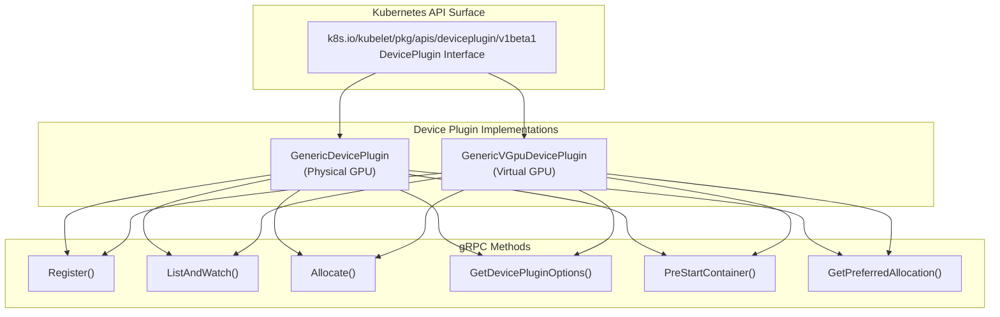

**Sources:** [pkg/device_plugin/generic_device_plugin.go:62-74](), [pkg/device_plugin/generic_vgpu_device_plugin.go:54-66](), [go.mod:12]()

## Registration Phase

### Register()

The `Register()` method establishes communication between the device plugin and kubelet by registering the plugin as a resource provider.

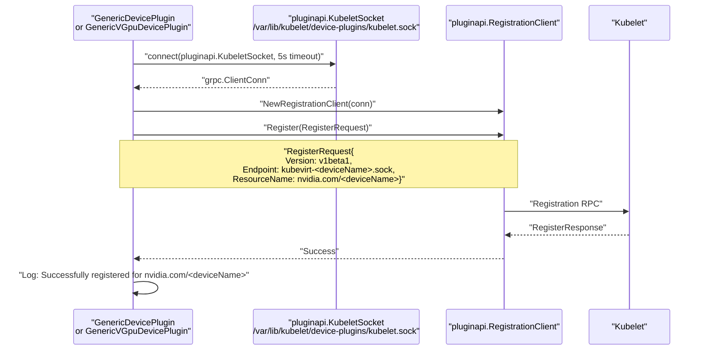

**Method Signature:**
```go
func (dpi *GenericDevicePlugin) Register() error
func (dpi *GenericVGpuDevicePlugin) Register() error
```

**Behavior:**
- Establishes gRPC connection to kubelet socket with 5-second timeout [pkg/device_plugin/generic_device_plugin.go:203]()
- Constructs `RegisterRequest` with API version, socket endpoint, and resource name [pkg/device_plugin/generic_device_plugin.go:210-214]()
- Resource name format: `nvidia.com/<deviceName>` where `DeviceNamespace = "nvidia.com"` [pkg/device_plugin/generic_device_plugin.go:51]()
- Socket endpoint format: `kubevirt-<deviceName>.sock` [pkg/device_plugin/generic_device_plugin.go:79]()
- Logs successful registration with full resource path [pkg/device_plugin/generic_device_plugin.go:220-221]()

**Error Conditions:**
- Connection timeout if kubelet socket unavailable
- Registration failure if resource name conflicts
- Socket path permission errors

**Sources:** [pkg/device_plugin/generic_device_plugin.go:201-223](), [pkg/device_plugin/generic_vgpu_device_plugin.go:156-175]()

## Device Discovery and Advertisement

### ListAndWatch()

The `ListAndWatch()` method provides a streaming gRPC endpoint that advertises available devices and continuously updates their health status.

**Method Signature:**
```go
func (dpi *GenericDevicePlugin) ListAndWatch(
    e *pluginapi.Empty, 
    s pluginapi.DevicePlugin_ListAndWatchServer
) error
```

**Device Structure:**

| Field | Type | Description |
|-------|------|-------------|
| `ID` | string | Device identifier (BDF address for physical GPUs, mdev UUID for vGPUs) |
| `Health` | string | `pluginapi.Healthy` or `pluginapi.Unhealthy` |
| `Topology` | `*TopologyInfo` | NUMA node information (physical GPUs only) |

**Physical GPU Implementation Behavior:**

1. **Initial Advertisement** [pkg/device_plugin/generic_device_plugin.go:228-235]():
   - Sends complete device list with health status and NUMA topology
   - Logs each device with ID, health status, and NUMA node ID
   - Device IDs are PCI BDF addresses (e.g., `0000:01:00.0`)

2. **Continuous Monitoring** [pkg/device_plugin/generic_device_plugin.go:239-262]():
   - Listens on `healthy` and `unhealthy` channels
   - Updates device health and sends `ListAndWatchResponse` on state change
   - Monitors `stop` and `term` channels for shutdown/restart signals

**Virtual GPU Implementation Behavior:**

1. **Initial Advertisement** [pkg/device_plugin/generic_vgpu_device_plugin.go:180]():
   - Sends device list with mdev UUIDs as device IDs
   - No NUMA topology information included
   - Device IDs are mdev UUIDs (e.g., `a2c6d3d1-3891-42e7-bd3e-3a8e1c3b77d9`)

2. **Continuous Monitoring** [pkg/device_plugin/generic_vgpu_device_plugin.go:182-205]():
   - Same channel-based health monitoring as physical GPUs
   - Health updates triggered by XID errors or mdev device removal

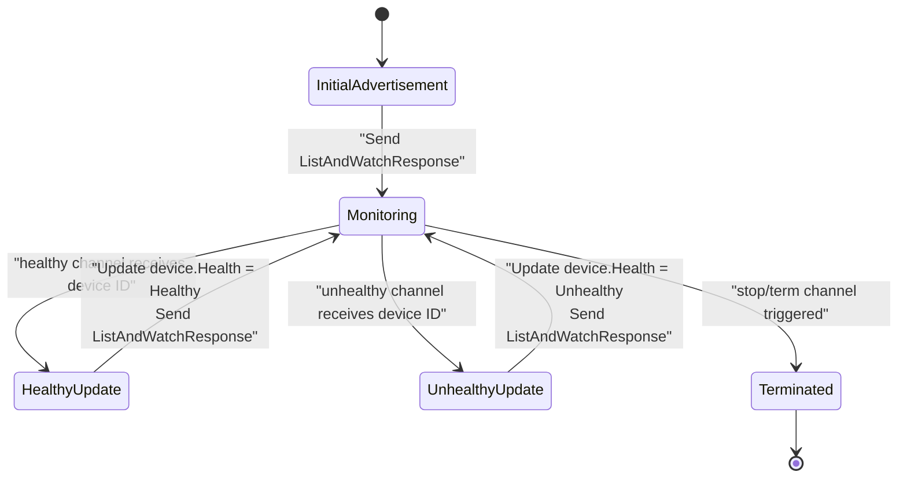

**Sources:** [pkg/device_plugin/generic_device_plugin.go:225-263](), [pkg/device_plugin/generic_vgpu_device_plugin.go:177-206]()

## Resource Allocation

### Allocate()

The `Allocate()` method performs device allocation for container workloads, providing device access through VFIO passthrough and environment variables.

**Method Signature:**
```go
func (dpi *GenericDevicePlugin) Allocate(
    ctx context.Context, 
    reqs *pluginapi.AllocateRequest
) (*pluginapi.AllocateResponse, error)
```

**Request Structure:**

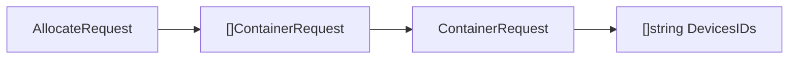

**Physical GPU Allocation Flow:**

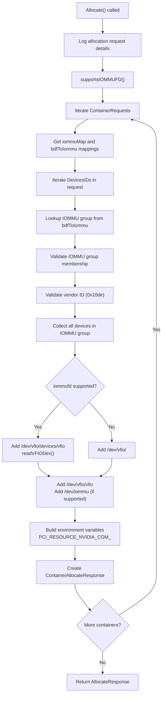

**Response Structure:**

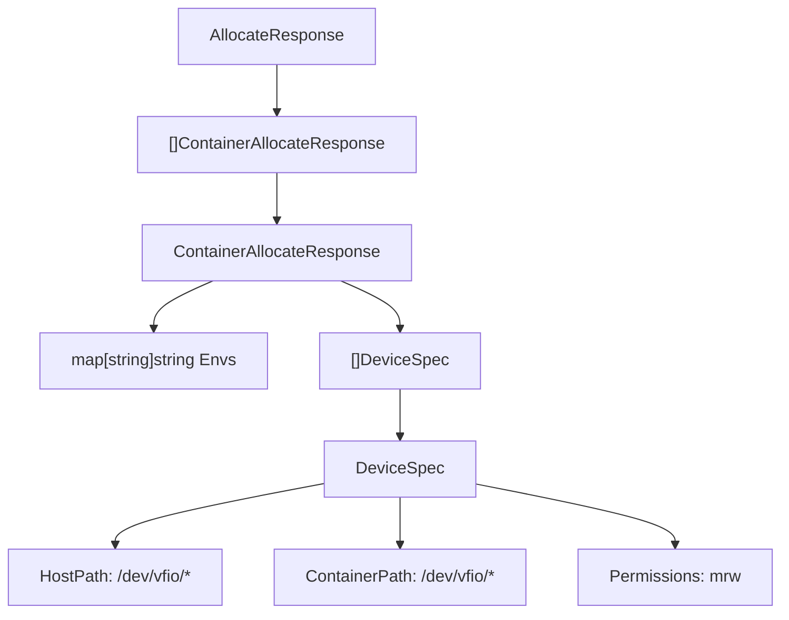

**Physical GPU Allocation Details:**

| Aspect | Implementation | Code Reference |
|--------|----------------|----------------|
| **IOMMU Group Validation** | Verifies IOMMU group membership via `readLink()` | [pkg/device_plugin/generic_device_plugin.go:296-300]() |
| **Vendor ID Check** | Validates NVIDIA vendor ID (0x10de) via `readIDFromFile()` | [pkg/device_plugin/generic_device_plugin.go:301-305]() |
| **VFIO Device Specs** | Adds `/dev/vfio/<iommuGroup>` and `/dev/vfio/vfio` | [pkg/device_plugin/generic_device_plugin.go:326-335]() |
| **IOMMUFD Support** | Adds `/dev/vfio/devices/vfio<N>` and `/dev/iommu` if supported | [pkg/device_plugin/generic_device_plugin.go:311-342]() |
| **Environment Variables** | `PCI_RESOURCE_NVIDIA_COM_<DEVICE_NAME>=<bdf_list>` | [pkg/device_plugin/generic_device_plugin.go:344-348]() |

**Virtual GPU Allocation Details:**

| Aspect | Implementation | Code Reference |
|--------|----------------|----------------|
| **vGPU Type Validation** | Reads `mdev_type/name` from sysfs to verify type | [pkg/device_plugin/generic_vgpu_device_plugin.go:218-222]() |
| **VFIO Device Specs** | Adds `/dev/vfio` directory passthrough | [pkg/device_plugin/generic_vgpu_device_plugin.go:230-234]() |
| **Environment Variables** | `MDEV_PCI_RESOURCE_NVIDIA_COM_<VGPU_TYPE>=<uuid_list>` | [pkg/device_plugin/generic_vgpu_device_plugin.go:224-228]() |

**Environment Variable Format:**

Physical GPU:
```
PCI_RESOURCE_NVIDIA_COM_<DEVICE_NAME>=0000:01:00.0,0000:01:00.1
```

Virtual GPU:
```
MDEV_PCI_RESOURCE_NVIDIA_COM_<VGPU_TYPE>=a2c6d3d1-3891-42e7-bd3e-3a8e1c3b77d9
```

**Sources:** [pkg/device_plugin/generic_device_plugin.go:265-361](), [pkg/device_plugin/generic_vgpu_device_plugin.go:208-247]()

## Topology-Aware Allocation

### GetPreferredAllocation()

The `GetPreferredAllocation()` method provides allocation hints to the Kubernetes Topology Manager for NUMA-aware device placement. This method is only fully implemented for physical GPUs.

**Method Signature:**
```go
func (dpi *GenericDevicePlugin) GetPreferredAllocation(
    ctx context.Context, 
    in *pluginapi.PreferredAllocationRequest
) (*pluginapi.PreferredAllocationResponse, error)
```

**Request/Response Structure:**

| Structure | Field | Type | Description |
|-----------|-------|------|-------------|
| `PreferredAllocationRequest` | `ContainerRequests` | `[]ContainerPreferredAllocationRequest` | List of allocation requests |
| `ContainerPreferredAllocationRequest` | `AvailableDeviceIDs` | `[]string` | Devices kubelet considers available |
| | `MustIncludeDeviceIDs` | `[]string` | Devices that must be included |
| | `AllocationSize` | `int32` | Number of devices to allocate |
| `PreferredAllocationResponse` | `ContainerResponses` | `[]ContainerPreferredAllocationResponse` | Allocation decisions |
| `ContainerPreferredAllocationResponse` | `DeviceIDs` | `[]string` | Preferred device list |

**Physical GPU Allocation Algorithm:**

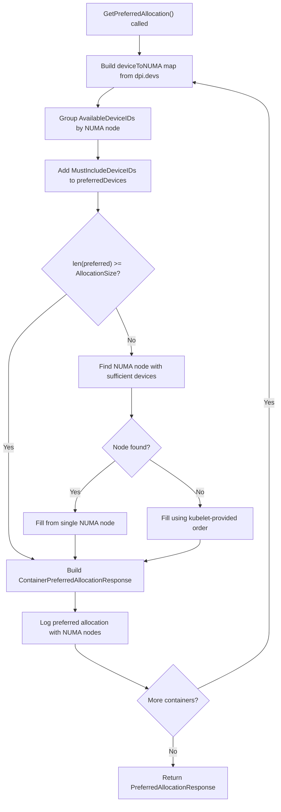

**NUMA Preference Strategy:**

1. **Phase 1: Must-Include Devices** [pkg/device_plugin/generic_device_plugin.go:438-455]()
   - Always include devices specified in `MustIncludeDeviceIDs`
   - Track selected NUMA nodes
   - Validate that must-include count doesn't exceed allocation size

2. **Phase 2: Single NUMA Node Preference** [pkg/device_plugin/generic_device_plugin.go:458-493]()
   - Attempts to satisfy allocation from a single NUMA node
   - Prioritizes NUMA nodes already containing must-include devices
   - Fallback to other NUMA nodes if insufficient devices on preferred nodes
   - Logs selected NUMA node and device counts

3. **Phase 3: Cross-NUMA Fallback** [pkg/device_plugin/generic_device_plugin.go:496-505]()
   - If single-node allocation impossible, uses kubelet-provided device order
   - Fills remaining slots without NUMA affinity constraints
   - Logs fallback behavior

**Virtual GPU Implementation:**

The virtual GPU implementation returns `nil` for `GetPreferredAllocation()`, delegating allocation decisions entirely to kubelet [pkg/device_plugin/generic_vgpu_device_plugin.go:269-278]().

**Example Allocation Scenarios:**

| Scenario | Available Devices | Must Include | Allocation Size | Result |
|----------|-------------------|--------------|-----------------|--------|
| **Single NUMA** | Node 0: [dev0, dev1, dev2]<br/>Node 1: [dev3, dev4] | [] | 2 | [dev0, dev1] (NUMA 0) |
| **Must Include** | Node 0: [dev0, dev1]<br/>Node 1: [dev2, dev3] | [dev2] | 2 | [dev2, dev3] (NUMA 1) |
| **Cross-NUMA** | Node 0: [dev0]<br/>Node 1: [dev1] | [] | 2 | [dev0, dev1] (Mixed) |

**Sources:** [pkg/device_plugin/generic_device_plugin.go:384-525](), [pkg/device_plugin/generic_vgpu_device_plugin.go:269-278]()

## Plugin Capabilities

### GetDevicePluginOptions()

The `GetDevicePluginOptions()` method declares plugin capabilities to kubelet.

**Method Signature:**
```go
func (dpi *GenericDevicePlugin) GetDevicePluginOptions(
    ctx context.Context, 
    e *pluginapi.Empty
) (*pluginapi.DevicePluginOptions, error)
```

**Physical GPU Options:**

```go
DevicePluginOptions{
    PreStartRequired:                false,
    GetPreferredAllocationAvailable: true,
}
```

**Virtual GPU Options:**

```go
DevicePluginOptions{
    PreStartRequired: false,
    GetPreferredAllocationAvailable: false, // Implicitly, as method returns nil
}
```

| Option | Physical GPU | Virtual GPU | Description |
|--------|-------------|-------------|-------------|
| `PreStartRequired` | `false` | `false` | No pre-start container hook needed |
| `GetPreferredAllocationAvailable` | `true` | `false` | NUMA-aware allocation only for physical GPUs |

**Sources:** [pkg/device_plugin/generic_device_plugin.go:371-377](), [pkg/device_plugin/generic_vgpu_device_plugin.go:257-262]()

### PreStartContainer()

The `PreStartContainer()` method is a no-op in both implementations, as indicated by `PreStartRequired: false`.

**Method Signature:**
```go
func (dpi *GenericDevicePlugin) PreStartContainer(
    ctx context.Context, 
    in *pluginapi.PreStartContainerRequest
) (*pluginapi.PreStartContainerResponse, error)
```

**Behavior:**
- Returns empty `PreStartContainerResponse` without performing any actions
- Both implementations are identical [pkg/device_plugin/generic_device_plugin.go:379-382](), [pkg/device_plugin/generic_vgpu_device_plugin.go:264-267]()

**Sources:** [pkg/device_plugin/generic_device_plugin.go:379-382](), [pkg/device_plugin/generic_vgpu_device_plugin.go:264-267]()

## Server Lifecycle Management

### Start()

The `Start()` method initializes the gRPC server and begins serving the device plugin API.

**Initialization Sequence:**

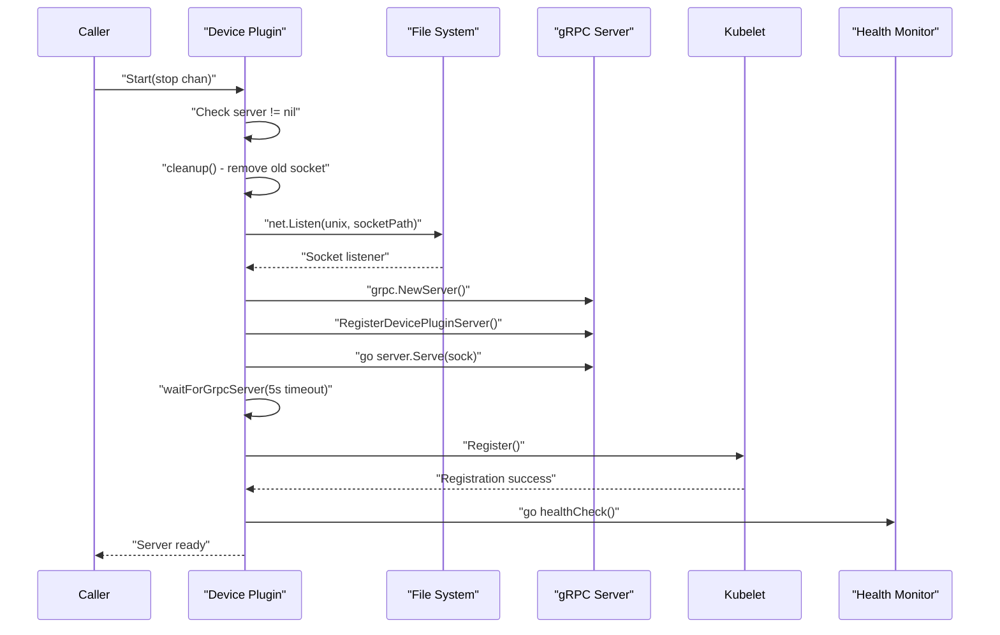

**Socket Path Format:**
- Pattern: `/var/lib/kubelet/device-plugins/kubevirt-<deviceName>.sock`
- Defined in: [pkg/device_plugin/generic_device_plugin.go:79]()

**Sources:** [pkg/device_plugin/generic_device_plugin.go:129-170](), [pkg/device_plugin/generic_vgpu_device_plugin.go:83-124]()

### Stop()

The `Stop()` method gracefully shuts down the gRPC server.

**Shutdown Sequence:**

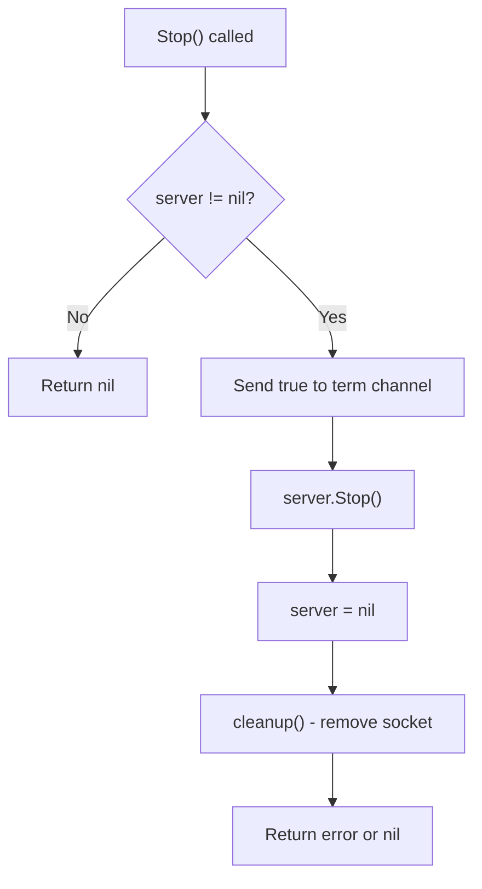

**Sources:** [pkg/device_plugin/generic_device_plugin.go:172-185](), [pkg/device_plugin/generic_vgpu_device_plugin.go:126-139]()

### restart()

The `restart()` method handles kubelet restart scenarios by reinitializing the device plugin.

**Restart Trigger:**
- Detected by fsnotify watching the socket path for removal events
- Occurs when kubelet restarts and cleans up device plugin sockets
- Implementation: [pkg/device_plugin/generic_device_plugin.go:187-199]()

**Restart Flow:**
1. Call `Stop()` to clean up existing server
2. Create new stop channel
3. Call `Start()` with new channel
4. Re-register with kubelet

**Sources:** [pkg/device_plugin/generic_device_plugin.go:187-199](), [pkg/device_plugin/generic_vgpu_device_plugin.go:141-153]()

## Health Monitoring Integration

The device plugin API integrates with health monitoring systems that feed the `healthy` and `unhealthy` channels used by `ListAndWatch()`.

**Physical GPU Health Monitoring:**

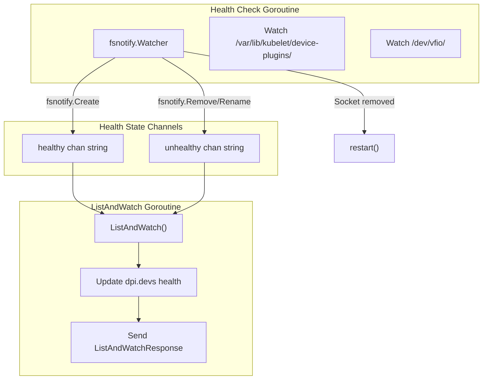

**Virtual GPU Health Monitoring:**

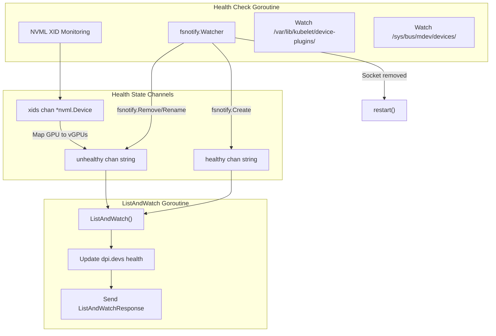

**Health Check Implementation Details:**

| Plugin Type | Health Indicators | Implementation |
|-------------|------------------|----------------|
| Physical GPU | VFIO device file existence<br/>Socket removal detection | [pkg/device_plugin/generic_device_plugin.go:527-607]() |
| Virtual GPU | mdev device file existence<br/>NVML XID errors<br/>Socket removal detection | [pkg/device_plugin/generic_vgpu_device_plugin.go:280-368]() |

**Sources:** [pkg/device_plugin/generic_device_plugin.go:527-607](), [pkg/device_plugin/generic_vgpu_device_plugin.go:280-368]()

## API Method Summary

| Method | Physical GPU | Virtual GPU | Purpose |
|--------|-------------|-------------|---------|
| `Register()` | ✅ Implemented | ✅ Implemented | Register plugin with kubelet |
| `ListAndWatch()` | ✅ With NUMA topology | ✅ Without topology | Stream device list and health |
| `Allocate()` | ✅ IOMMU-aware, IOMMUFD support | ✅ mdev-based | Allocate devices to containers |
| `GetDevicePluginOptions()` | ✅ PreferredAllocation=true | ✅ PreferredAllocation=false | Declare capabilities |
| `PreStartContainer()` | ✅ No-op | ✅ No-op | Pre-start hook (unused) |
| `GetPreferredAllocation()` | ✅ NUMA-aware algorithm | ❌ Returns nil | Topology hints |

**Sources:** [pkg/device_plugin/generic_device_plugin.go:62-634](), [pkg/device_plugin/generic_vgpu_device_plugin.go:54-438]()