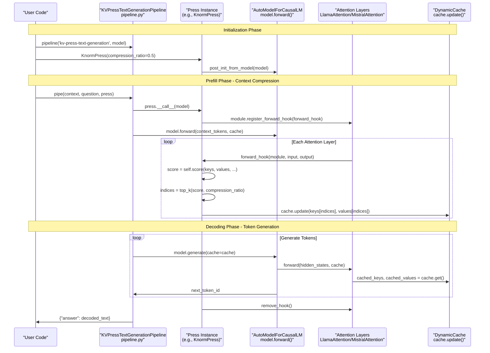

<!-- source: DeepWiki mcp.deepwiki.com · repo NVIDIA/kvpress · page 1 Overview · fetched 2026-10-26 -->

# Overview

<details>
<summary>Relevant source files</summary>

The following files were used as context for generating this wiki page:

- [README.md](README.md)
- [kvpress/__init__.py](kvpress/__init__.py)
- [pyproject.toml](pyproject.toml)

</details>


KVPress is a library for implementing and evaluating KV cache compression methods for large language models (LLMs). The library provides a unified framework for reducing memory consumption during long-context inference by selectively pruning or transforming key-value pairs in the transformer attention mechanism. KVPress integrates with the HuggingFace transformers ecosystem and supports over 30 compression strategies across multiple model architectures.

This page introduces the library's purpose, architecture, and fundamental concepts. For installation instructions, see [Installation and Dependencies](#1.1). For practical usage examples, see [Quick Start Guide](#1.2). For detailed information about the compression mechanism, see [Core Architecture](#2).

**Sources:** [README.md:1-213](), [kvpress/__init__.py:1-102]()

## Purpose and Problem Statement

Long-context LLMs require storing key-value (KV) pairs for every token processed during inference. This KV cache grows linearly with sequence length, creating significant memory constraints. For example, processing 1 million tokens with Llama 3.1-70B in float16 requires approximately 330GB of memory just for the KV cache.

KVPress addresses this problem by providing compression methods that reduce the KV cache size while maintaining model performance. The library focuses on **training-free** methods that can be applied to pre-trained models without modification.

**Sources:** [README.md:11-13]()

## Core Components and Architecture

**System Architecture Diagram:**

KVPress consists of four primary systems that work together to provide KV cache compression:

```mermaid
graph TB
    subgraph Core["Core Library"]
        [Init]["__init__.py<br/>Imports & Registration"]
        [Pipeline]["KVPressTextGenerationPipeline"]
        [BasePress]["BasePress"]
        [ScorerPress]["ScorerPress"]
        [Presses]["30+ Press Classes<br/>KnormPress, SnapKVPress, etc."]
        [AttnPatch]["patch_attention_functions()"]
    end
    
    subgraph Integration["HuggingFace Integration"]
        [Registry]["PIPELINE_REGISTRY<br/>'kv-press-text-generation'"]
        [AutoModel]["AutoModelForCausalLM"]
        [DynCache]["DynamicCache"]
        [QuantCache]["QuantizedCache"]
        [Hooks]["forward_hooks on attention layers"]
    end
    
    subgraph Eval["Evaluation System"]
        [EvalRunner]["EvaluationRunner"]
        [PressReg]["PRESS_REGISTRY"]
        [DatasetReg]["DATASET_REGISTRY"]
        [ScorerReg]["SCORER_REGISTRY"]
        [Benchmarks"]["RULER, LongBench, Loogle, etc."]
    end
    
    subgraph Entry["User Entry Points"]
        [ImportKV]["import kvpress"]
        [PipelineCall]["pipeline('kv-press-text-generation')"]
        [EvaluatePy]["python evaluate.py"]
    end
    
    [ImportKV] --> [Init]
    [Init] --> [AttnPatch]
    [Init] --> [Pipeline]
    
    [PipelineCall] --> [Pipeline]
    [Pipeline] --> [BasePress]
    [BasePress] --> [ScorerPress]
    [ScorerPress] --> [Presses]
    [Pipeline] --> [Hooks]
    
    [Pipeline] --> [Registry]
    [Pipeline] --> [AutoModel]
    [Pipeline] --> [DynCache]
    [Pipeline] --> [QuantCache]
    
    [EvaluatePy] --> [EvalRunner]
    [EvalRunner] --> [Pipeline]
    [EvalRunner] --> [PressReg]
    [EvalRunner] --> [DatasetReg]
    [EvalRunner] --> [ScorerReg]
    [EvalRunner] --> [Benchmarks]
```

**Sources:** [kvpress/__init__.py:5-102](), [README.md:39-55](), [kvpress/pipeline.py:1-50]()

### Component Descriptions

| Component | Purpose | Key File | Key Methods/Attributes |
|-----------|---------|----------|------------------------|
| `BasePress` | Abstract base class defining compression interface | [kvpress/presses/base_press.py]() | `compress()`, `forward_hook()`, `compression_ratio` |
| `ScorerPress` | Base class for score-based pruning strategies | [kvpress/presses/scorer_press.py]() | `score()`, abstract method for scoring |
| Press Implementations | 30+ concrete compression algorithms | [kvpress/presses/*.py]() | Each implements specific scoring/compression logic |
| `KVPressTextGenerationPipeline` | HuggingFace pipeline for compressed generation | [kvpress/pipeline.py]() | `__call__()`, handles context/question separation |
| `patch_attention_functions()` | Global patching for head-wise compression support | [kvpress/attention_patch.py]() | Called at import time in `__init__.py` |
| `SUPPORTED_MODELS` | Registry of compatible model architectures | [kvpress/presses/base_press.py]() | List of model type strings |

**Sources:** [kvpress/__init__.py:5-53](), [README.md:101-117](), [kvpress/presses/base_press.py:1-50]()

## Press Hierarchy

**Press Class Hierarchy Diagram:**

The library organizes compression methods into a class hierarchy with four main categories:

```mermaid
graph TB
    [BasePressNode]["BasePress<br/>base_press.py<br/>compress(), forward_hook()"]
    
    subgraph Scoring["ScorerPress Subclasses<br/>(16+ implementations)"]
        [ScorerPressNode]["ScorerPress<br/>scorer_press.py<br/>abstract score() method"]
        [KnormPressNode]["KnormPress<br/>knorm_press.py<br/>score via key norm"]
        [SnapKVPressNode]["SnapKVPress<br/>snapkv_press.py<br/>recent attention avg"]
        [ExpectedAttnNode]["ExpectedAttentionPress<br/>expected_attention_press.py<br/>future query distribution"]
        [ObservedAttnNode]["ObservedAttentionPress<br/>observed_attention_press.py<br/>prefill attention avg"]
        [StreamingLLMNode]["StreamingLLMPress<br/>streaming_llm_press.py<br/>initial + recent tokens"]
        [TOVAPressNode]["TOVAPress<br/>tova_press.py<br/>last query attention"]
        [RandomPressNode]["RandomPress<br/>random_press.py<br/>random scores"]
        [QFilterPressNode]["QFilterPress<br/>qfilter_press.py<br/>SVD projection"]
        [PyramidKVPressNode]["PyramidKVPress<br/>pyramidkv_press.py<br/>layer-specific ratios"]
        [LagKVPressNode]["LagKVPress<br/>lagkv_press.py<br/>lag-relative info"]
        [KeyDiffPressNode]["KeyDiffPress<br/>keydiff_press.py<br/>key similarity"]
    end
    
    subgraph Alternative["Non-Scoring/Specialized Presses"]
        [ThinKPressNode]["ThinKPress<br/>think_press.py<br/>channel compression"]
        [SimLayerKVNode]["SimLayerKVPress<br/>simlayerkv_press.py<br/>lazy layer detection"]
        [DuoAttentionNode]["DuoAttentionPress<br/>duo_attention_press.py<br/>retrieval/streaming split"]
        [FinchPressNode]["FinchPress<br/>finch_press.py<br/>dynamic window + rerotation"]
        [KVzipPressNode]["KVzipPress<br/>kvzip_press.py<br/>context reconstruction"]
        [KVzapPressNode]["KVzapPress<br/>kvzap_press.py<br/>surrogate models"]
    end
    
    subgraph Wrappers["Wrapper & Composite Presses"]
        [AdaKVPressNode]["AdaKVPress<br/>adakv_press.py<br/>head-wise compression"]
        [CriticalKVNode]["CriticalKVPress<br/>criticalkv_press.py<br/>two-stage selection"]
        [ComposedPressNode]["ComposedPress<br/>composed_press.py<br/>chain multiple presses"]
        [DecodingPressNode]["DecodingPress<br/>decoding_press.py<br/>periodic decoding compression"]
        [PrefillDecodingNode]["PrefillDecodingPress<br/>prefill_decoding_press.py<br/>combined prefill+decoding"]
        [PerLayerPressNode]["PerLayerCompressionPress<br/>per_layer_compression_press.py<br/>layer-specific ratios"]
    end
    
    [BasePressNode] --> [ScorerPressNode]
    [BasePressNode] --> [Alternative]
    [BasePressNode] --> [Wrappers]
    
    [ScorerPressNode] --> [KnormPressNode]
    [ScorerPressNode] --> [SnapKVPressNode]
    [ScorerPressNode] --> [ExpectedAttnNode]
    [ScorerPressNode] --> [ObservedAttnNode]
    [ScorerPressNode] --> [StreamingLLMNode]
    [ScorerPressNode] --> [TOVAPressNode]
    [ScorerPressNode] --> [RandomPressNode]
    [ScorerPressNode] --> [QFilterPressNode]
    [ScorerPressNode] --> [PyramidKVPressNode]
    [ScorerPressNode] --> [LagKVPressNode]
    [ScorerPressNode] --> [KeyDiffPressNode]
    
    [AdaKVPressNode] -.wraps.-> [ScorerPressNode]
    [CriticalKVNode] -.wraps.-> [ScorerPressNode]
    [DecodingPressNode] -.wraps.-> [ScorerPressNode]
    [PrefillDecodingNode] -.combines.-> [DecodingPressNode]
```

**Press Categories:**

| Category | Base Class | Pattern | Example Methods |
|----------|-----------|---------|-----------------|
| **Scoring-Based** | `ScorerPress` | Implement `score()` method to assign importance scores | `score()`, `compress()` |
| **Non-Scoring** | `BasePress` | Custom compression logic without scoring | `compress()`, `forward_hook()` |
| **Wrappers** | `BasePress` | Wrap/enhance other presses | Delegate to wrapped press |
| **Phase-Specific** | `BasePress` | Target prefill vs decoding phases | `compression_interval`, `target_size` |

For detailed documentation of each press type, see [Press Implementations](#3).

**Sources:** [kvpress/__init__.py:7-102](), [README.md:101-117](), [kvpress/presses/base_press.py:1-100](), [kvpress/presses/scorer_press.py:1-50]()

## Compression Workflow

**Compression Execution Flow Diagram:**

The following diagram illustrates how compression is applied during model inference, showing the interaction between code entities:



**Key execution phases:**
1. **Initialization:** Press validates model compatibility using `SUPPORTED_MODELS`.
2. **Prefill:** Context tokens processed through `model.forward()`, each attention layer triggers `forward_hook()` to compress via `score()` and top-k selection.
3. **Question:** Question tokens appended to cache (optionally without compression if using the pipeline).
4. **Decoding:** `model.generate()` uses compressed cache for efficient token generation.

For details on the hook mechanism, see [Forward Hook System](#2.4). For attention patching, see [Attention Patching Mechanism](#2.3).

**Sources:** [README.md:39-93](), [kvpress/pipeline.py:1-200](), [kvpress/presses/base_press.py:1-100]()

## Key Concepts

### Compression Ratio

Each press accepts a `compression_ratio` parameter that controls the aggressiveness of compression:

```python
press = KnormPress(compression_ratio=0.4)  # Keep 40% of KV pairs
```

The compression ratio represents the fraction of KV pairs retained after compression. Lower values mean more aggressive compression.

**Sources:** [README.md:39-55](), [kvpress/presses/base_press.py:14]()

### Prefill vs Decoding Compression

KVPress primarily focuses on **prefill compression**, where the full context is compressed once before generation begins.

**Decoding compression** (experimental) compresses the cache periodically during token generation using the `DecodingPress` wrapper. This allows managing cache growth during long generation sequences by specifying a `target_size` and `compression_interval`.

For details, see [Phase-Specific Presses](#3.4).

**Sources:** [README.md:58-97]()

### Head-Wise Compression

The `patch_attention_functions()` call in `__init__.py` enables **head-wise compression**, where different attention heads can have different compression ratios. This is utilized by wrapper presses like `AdaKVPress`.

For technical details, see [Attention Patching Mechanism](#2.3).

**Sources:** [kvpress/__init__.py:52-53](), [kvpress/attention_patch.py:1-100]()

### Context Manager Usage

Presses can be used as context managers with raw transformers models:

```python
with press(model):
    outputs = model(inputs)
```

This pattern automatically registers and unregisters hooks for the scope of the context.

For detailed usage patterns, see [Context Manager Usage](#4.2).

**Sources:** [kvpress/presses/base_press.py:65-74]()

## Supported Models

KVPress supports models with compatible attention implementations. The `SUPPORTED_MODELS` registry in [kvpress/presses/base_press.py:8]() lists compatible architectures, including Llama, Mistral, Qwen, Gemma, and Phi.

For compatibility details, see [Model Compatibility](#4.5).

**Sources:** [kvpress/presses/base_press.py:8]()

## Integration with HuggingFace Ecosystem

**HuggingFace Integration Diagram:**

KVPress deeply integrates with HuggingFace transformers through pipeline registration and attention patching:

```mermaid
graph TB
    subgraph UserCode["User Code"]
        [Import]["from transformers import pipeline<br/>from kvpress import ExpectedAttentionPress"]
        [Create]["pipe = pipeline('kv-press-text-generation')"]
        [Call]["pipe(context, question, press)"]
    end
    
    subgraph KVPressCore["kvpress Package"]
        [InitPy]["__init__.py:6<br/>KVPressTextGenerationPipeline"]
        [PatchFunc]["attention_patch.py<br/>patch_attention_functions()"]
        [PressClasses]["Individual Press Classes<br/>forward_hook(), compress()"]
    end
    
    subgraph TransformersLib["transformers Library"]
        [SupportedTasks]["PIPELINE_REGISTRY"]
        [AutoModelClass]["AutoModelForCausalLM"]
        [CacheClasses]["DynamicCache<br/>QuantizedCache"]
    end
    
    [Import] --> [InitPy]
    [InitPy] --> [PatchFunc]
    
    [Create] --> [SupportedTasks]
    [SupportedTasks] --> [InitPy]
    [InitPy] --> [AutoModelClass]
    
    [Call] --> [PressClasses]
    [PressClasses] --> [CacheClasses]
```

For cache management details, see [Cache Management](#4.3).

**Sources:** [kvpress/__init__.py:1-102](), [kvpress/pipeline.py:1-50](), [kvpress/attention_patch.py:1-100]()

## Evaluation and Benchmarking

KVPress includes a comprehensive evaluation framework for benchmarking compression methods across multiple datasets like RULER, LongBench, and Loogle.

For evaluation instructions, see [Evaluation Framework](#5).

**Sources:** [pyproject.toml:27-35](), [README.md:157-169]()

## Development and Contributing

KVPress uses `uv` for dependency management and `pytest` for testing. Optional dependencies like `flash-attn` and `eval` are supported for enhanced performance and benchmarking.

For testing details, see [Testing Framework](#6.1). For contribution guidelines, see [Contribution Guide](#6.3).

**Sources:** [pyproject.toml:1-62](), [README.md:15-35]()

---

