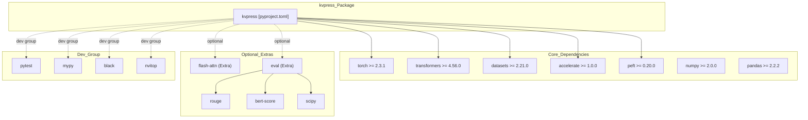
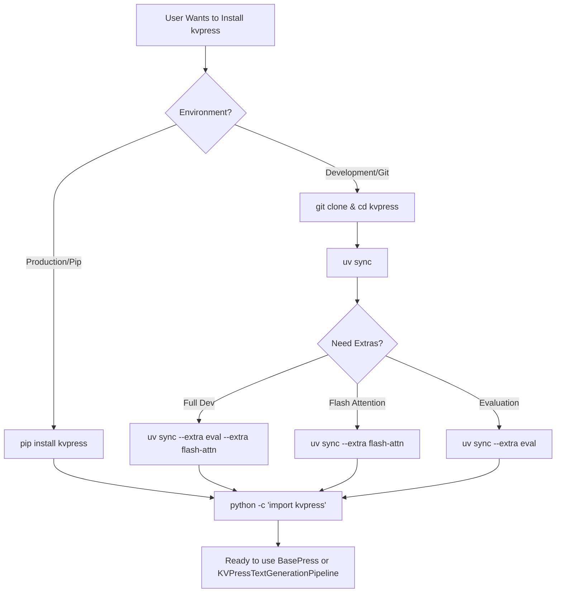

<!-- source: DeepWiki mcp.deepwiki.com · repo NVIDIA/kvpress · page 1.1 Installation and Dependencies · fetched 2026-10-26 -->

# Installation and Dependencies

<details>
<summary>Relevant source files</summary>

The following files were used as context for generating this wiki page:

- [README.md](README.md)
- [pyproject.toml](pyproject.toml)

</details>


This document details the installation procedures, dependency requirements, and build system configuration for `kvpress`. It covers basic pip installation, local development setup with `uv`, optional packages for flash attention and evaluation, and the complete dependency hierarchy.

---

## Purpose and Scope

This page provides comprehensive installation instructions for `kvpress` across different use cases:
- **Production use**: Simple pip installation for end users.
- **Development**: Local installation with all development tools and CI-aligned environments.
- **Optional features**: Flash attention and evaluation dependencies for benchmarking.
- **Build configuration**: Understanding the `hatchling` build system and `uv` workspace settings.

---

## Installation Methods

### Basic Installation

The simplest way to install `kvpress` is through pip from PyPI:

```bash
pip install kvpress
```

This installs the core `kvpress` package with all required dependencies for basic KV cache compression functionality.

**Sources:** [pyproject.toml:1-24](), [README.md:15-19]()

---

### Local Development Installation

For contributors and developers, the project uses `uv` as the primary package manager. The development environment includes specific linters, type checkers, and testing frameworks.

```bash
git clone https://github.com/NVIDIA/kvpress.git
cd kvpress
uv sync
```

For a full development environment including all optional extras:

```bash
uv sync --extra eval --extra flash-attn
```

This command:
- Clones the repository.
- Installs all core dependencies [pyproject.toml:13-24]().
- Includes development dependencies defined in the `dev` group [pyproject.toml:40-57]().
- Sets up the package in editable mode.

The `dev` group includes tools like `black`, `isort`, `flake8`, `mypy`, and `pytest` [pyproject.toml:41-47]().

**Sources:** [pyproject.toml:40-57](), [README.md:21-35]()

---

### Installation with Optional Dependencies

#### Flash Attention Support

For improved performance using Flash Attention 2, `kvpress` provides an optional extra. Note that `flash-attn` often requires specific build environments (CUDA Toolkit) and is configured to skip build isolation in `uv` to facilitate compilation [pyproject.toml:64-65]().

```bash
uv sync --extra flash-attn
```

**Sources:** [pyproject.toml:36-38](), [pyproject.toml:64-65](), [README.md:34-35]()

#### Evaluation Dependencies

For running the comprehensive evaluation suite (benchmarking against datasets like LongBench, RULER, or AIME25), the `eval` extra is required:

```bash
uv sync --extra eval
```

This group adds metrics and utility libraries [pyproject.toml:26-35]():

| Package | Purpose |
|---------|---------|
| `rouge` | ROUGE metrics for summarization tasks |
| `nltk` | Tokenization and NLP utilities |
| `tqdm` | Progress bars for evaluation loops |
| `scipy` | Statistical computations |
| `bert-score` | Semantic similarity metrics |
| `jieba` / `fuzzywuzzy` | String matching and Chinese text processing |

**Sources:** [pyproject.toml:26-35](), [README.md:34-35]()

---

## Core Dependencies

### Python Version Requirements

`kvpress` requires **Python 3.10 or higher** [pyproject.toml:11]().

### Required Dependencies

The core library relies on the following primary stacks [pyproject.toml:13-24]():

*   **Deep Learning**: `torch>=2.3.1`
*   **HuggingFace Ecosystem**: `transformers>=4.56.0`, `datasets>=2.21.0`, `accelerate>=1.0.0`, and `peft>=0.20.0`.
*   **Data Handling**: `numpy>=2.0.0`, `pandas>=2.2.2`.
*   **Utilities**: `requests`, `cachetools`, and `fire` for CLI generation.

**Sources:** [pyproject.toml:13-24]()

---

## Dependency Hierarchy Diagram

This diagram maps the `pyproject.toml` dependency specifications to the system components.



**Sources:** [pyproject.toml:13-57]()

---

## Build System and CI Configuration

### Build Backend
The project uses `hatchling` as the build backend [pyproject.toml:60-62]().

### Build Isolation
A critical configuration for `uv` users is the `no-build-isolation-package` setting for `flash-attn` [pyproject.toml:64-65](). This ensures that the build process can find system-level CUDA dependencies which are often missing in isolated virtual environments.

**Sources:** [pyproject.toml:60-65]()

---

## Code Quality Tools Configuration

The project enforces strict code style and typing through the following configurations in `pyproject.toml`:

*   **Black**: Configured for a line length of 120 [pyproject.toml:67-68]().
*   **isort**: Configured for compatibility with Black (multi-line output 3) [pyproject.toml:72-73]().
*   **mypy**: Strictness is adjusted for specific modules. For instance, `kvpress.presses.base_press` and `kvpress.pipeline` have certain error codes disabled (e.g., `attr-defined`, `assignment`) to handle dynamic patching and HuggingFace attribute injections [pyproject.toml:81-94]().

**Sources:** [pyproject.toml:67-94]()

---

## Installation Flow Diagram

This diagram associates the installation commands with the internal `pyproject.toml` entities.



**Sources:** [pyproject.toml:26-38](), [README.md:15-53]()

---

