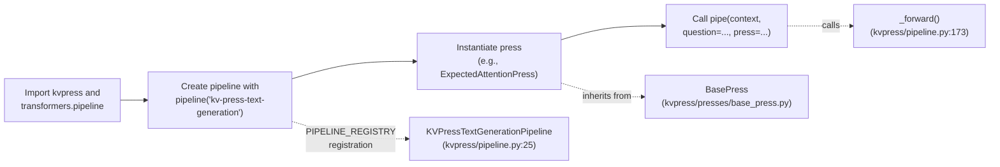
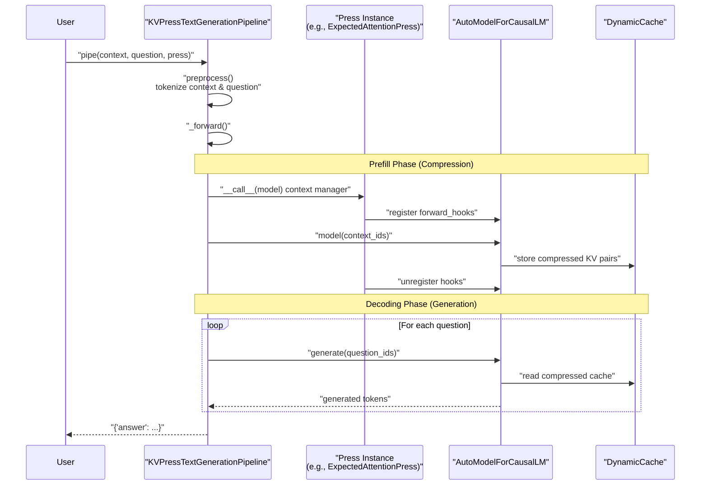
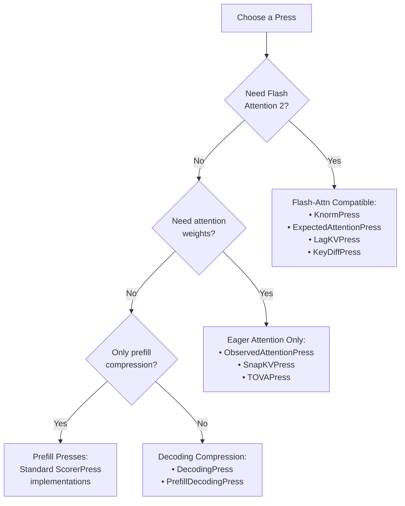
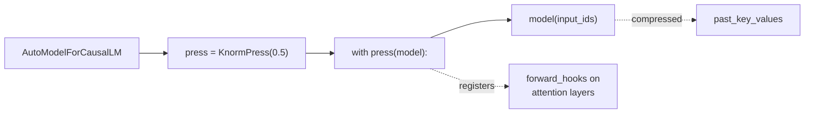

<!-- source: DeepWiki mcp.deepwiki.com · repo NVIDIA/kvpress · page 1.2 Quick Start Guide · fetched 2026-10-26 -->

# Quick Start Guide

<details>
<summary>Relevant source files</summary>

The following files were used as context for generating this wiki page:

- [README.md](README.md)
- [kvpress/pipeline.py](kvpress/pipeline.py)
- [notebooks/speed_and_memory.ipynb](notebooks/speed_and_memory.ipynb)
- [notebooks/wikipedia_demo.ipynb](notebooks/wikipedia_demo.ipynb)
- [tests/fixtures.py](tests/fixtures.py)
- [tests/integration/test_ruler.py](tests/integration/test_ruler.py)

</details>


This document provides minimal working examples for using KVPress to compress the KV cache in large language models. It covers basic pipeline usage, press selection, and common usage patterns. For detailed information about specific press implementations, see [Press Implementations](). For advanced configuration and evaluation, see [Evaluation Framework]().

## Basic Pipeline Usage

The simplest way to use KVPress is through the `KVPressTextGenerationPipeline`, which automatically registers with HuggingFace transformers as `"kv-press-text-generation"` when you import `kvpress` [kvpress/pipeline.py:11](), [README.md:39-40]().

### Standard Workflow



**Minimal Example:**

```python
from transformers import pipeline
from kvpress import ExpectedAttentionPress

# Initialize pipeline
device = "cuda:0"
model = "Qwen/Qwen3-8B"
pipe = pipeline("kv-press-text-generation", model=model, device=device, dtype="auto")

# Create a press with 50% compression
press = ExpectedAttentionPress(compression_ratio=0.5)

# Compress and generate
context = "A very long text you want to compress once and for all"
question = "\nA question about the compressed context"
answer = pipe(context, question=question, press=press)["answer"]
```

The pipeline handles:
- Chat template application and tokenization [kvpress/pipeline.py:139-163]()
- Context truncation based on `max_context_length` [kvpress/pipeline.py:165-171]()
- Efficient processing of long contexts via compression [kvpress/pipeline.py:25-30]()
- Greedy decoding for answer generation [kvpress/pipeline.py:262-314]()

**Sources:** [README.md:39-53](), [kvpress/pipeline.py:25-317](), [notebooks/wikipedia_demo.ipynb:59-64]()

## Compression Process Flow



During prefill, the press compresses the context by registering forward hooks that intercept KV pairs [kvpress/pipeline.py:206-207](). During decoding, the model reads from the compressed cache without further compression, unless a `DecodingPress` is explicitly used [README.md:60-67]().

**Sources:** [kvpress/pipeline.py:173-254](), [README.md:39-55]()

## Available Press Types

KVPress provides multiple press implementations organized by their scoring logic:

| Press Category | Example Classes | Key Logic | Use Case |
|----------------|----------------|-----------|-----------|
| **Scoring-Based** | `KnormPress`, `SnapKVPress`, `ExpectedAttentionPress`, `ObservedAttentionPress` | Prune based on importance scores | General-purpose compression |
| **Structural** | `StreamingLLMPress`, `PyramidKVPress`, `LagKVPress` | Keep tokens based on position or layer | Streaming or specific model dynamics |
| **Wrapper** | `DecodingPress`, `PrefillDecodingPress` | Wrap other presses for specific phases | Compression during generation |

### Common Press Examples

```python
from kvpress import (
    KnormPress,              # Prune by inverse key norm
    SnapKVPress,             # Average attention of last queries
    ExpectedAttentionPress,  # Expected attention during generation phase
    StreamingLLMPress,       # Keep initial and recent tokens
    LagKVPress,              # Query-free, lag-relative information
)

# Most presses accept compression_ratio (0.0 = no compression, 1.0 = remove all)
press1 = KnormPress(compression_ratio=0.4)  # Remove 40% of tokens
press2 = SnapKVPress(compression_ratio=0.6)
press3 = ExpectedAttentionPress(compression_ratio=0.5)
```

**Compression Ratio:** The fraction of KV pairs to **remove** during prefilling [README.md:39-40](). A ratio of 0.5 means 50% of tokens are discarded.

**Sources:** [README.md:101-118](), [kvpress/pipeline.py:14-20](), [notebooks/wikipedia_demo.ipynb:104-108]()

## Press Selection Guide



**Flash Attention 2 Compatibility:**
- **Compatible:** `KnormPress`, `ExpectedAttentionPress`, `LagKVPress`, `KeyDiffPress` [README.md:106-115]().
- **Requires Eager:** `ObservedAttentionPress` (requires actual attention weights observed during forward pass) [README.md:111]().

To enable Flash Attention 2 in the pipeline:
```python
model_kwargs = {"attn_implementation": "flash_attention_2"}
pipe = pipeline("kv-press-text-generation", model=model, device=device, model_kwargs=model_kwargs)
```

**Sources:** [README.md:79-80](), [notebooks/wikipedia_demo.ipynb:63-64]()

## Decoding Compression

KVPress supports compression during the decoding (generation) phase via the `DecodingPress` wrapper. This compresses the cache periodically to a `target_size` [README.md:60-67]().

```python
from kvpress import KnormPress, DecodingPress

# Create decoding press that compresses every 10 steps to a target cache size of 512 tokens
decoding_press = DecodingPress(
    base_press=KnormPress(),
    compression_interval=10,
    target_size=512
)

context = "A very long text you want to compress during generation"
question = "Tell me a long story about this context"
response = pipe(context, question=question, press=decoding_press)["answer"]
```

**Key Parameters for DecodingPress:**
- `base_press`: Any `ScorerPress` (e.g., `KnormPress`) [README.md:62]().
- `compression_interval`: Steps between compression events [README.md:63]().
- `target_size`: Target size of the cache after compression [README.md:64]().
- `hidden_states_buffer_size`: Number of hidden states to buffer before compression [README.md:65]().

**Sources:** [README.md:58-97](), [kvpress/pipeline.py:15]()

## Context Manager Usage (Alternative)

Presses can be used directly as context managers for granular control over the model's forward pass [README.md:101]().



**Example:**

```python
import torch
from transformers import AutoModelForCausalLM
from kvpress import KnormPress

device = "cuda:0"
model = AutoModelForCausalLM.from_pretrained("Qwen/Qwen3-8B").to(device)
press = KnormPress(compression_ratio=0.5)

inputs = torch.randint(0, 1000, (1, 1024)).to(device)

# With compression context manager
with torch.no_grad(), press(model):
    output = model(inputs)
    # output.past_key_values will contain compressed KV pairs
```

This approach bypasses the `KVPressTextGenerationPipeline` but requires manual handling of tokenization and chat templates.

**Sources:** [README.md:101](), [kvpress/pipeline.py:206-207](), [notebooks/speed_and_memory.ipynb:124-138]()

## Model and Cache Support

The pipeline supports various model configurations and cache types:

- **Quantization:** Compatible with `QuantizedCache` [kvpress/pipeline.py:10](), [notebooks/speed_and_memory.ipynb:73-86]().
- **Device Mapping:** Supports `device_map="auto"` for multi-GPU setups [README.md:46]().
- **Dtype:** Automatically handles precision via `dtype="auto"` [README.md:46]().

**Sources:** [README.md:45-46](), [kvpress/pipeline.py:10-48](), [notebooks/speed_and_memory.ipynb:127-128]()

---

