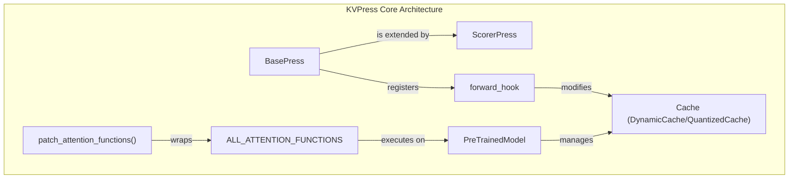
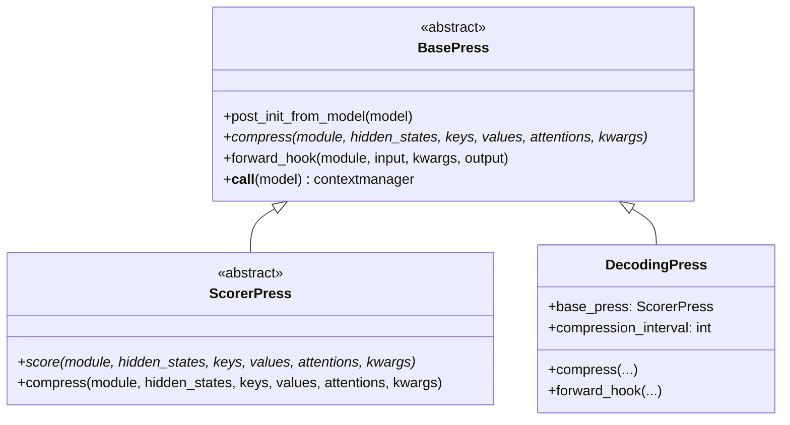
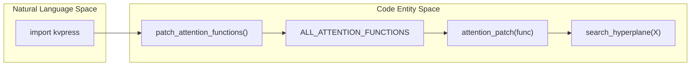

<!-- source: DeepWiki mcp.deepwiki.com · repo NVIDIA/kvpress · page 2 Core Architecture · fetched 2026-10-26 -->

# Core Architecture

Relevant source files

The following files were used as context for generating this wiki page:

- [kvpress/__init__.py](kvpress/__init__.py)
- [kvpress/attention_patch.py](kvpress/attention_patch.py)
- [kvpress/presses/base_press.py](kvpress/presses/base_press.py)
- [kvpress/presses/decoding_press.py](kvpress/presses/decoding_press.py)
- [kvpress/presses/prefill_decoding_press.py](kvpress/presses/prefill_decoding_press.py)
- [tests/test_attention_patch.py](tests/test_attention_patch.py)

This document explains the fundamental architecture of KVPress, focusing on the core components and their interactions that form the foundation of the KV cache compression system. 

## Overview

The KVPress library is designed around a unified architecture that enables KV cache compression for transformer-based language models. This architecture centers on the `BasePress` class, which provides the foundation for all compression methods, and an attention patching mechanism that enables global head-wise compression.

Sources: [kvpress/presses/base_press.py:44-53](), [kvpress/attention_patch.py:90-110](), [kvpress/__init__.py:52-53]()

## KV Cache Compression Concepts

KV cache compression aims to reduce the memory footprint of LLMs by pruning or merging Key and Value tensors. KVPress distinguishes between the **prefilling phase** (where the initial context is processed and compressed) and the **decoding phase** (where new tokens are generated). The library provides specific utilities like `is_prefilling` to detect these phases during the forward pass [kvpress/presses/base_press.py:37-40]().

For details, see [KV Cache Compression Concepts](#2.1).

## Press Hierarchy and BasePress

The `BasePress` class is the cornerstone of KVPress, defining the interface that all compression methods must implement. It utilizes a hook-based system to intercept and modify the KV cache during the forward pass.

The hierarchy consists of three main tiers:
1.  **BasePress**: The abstract root defining the `compress` method [kvpress/presses/base_press.py:44-99]().
2.  **ScorerPress**: A specialized subclass for methods that compute an importance `score` for tokens before pruning [kvpress/presses/scorer_press.py:45-45]().
3.  **Wrappers and Specialized Presses**: Classes like `ComposedPress` [kvpress/presses/composed_press.py:15-15](), `PrefillDecodingPress` [kvpress/presses/prefill_decoding_press.py:20-20](), and `DecodingPress` [kvpress/presses/decoding_press.py:23-23]() that manage phase-specific logic or sequential chaining.

For details, see [Press Hierarchy and BasePress](#2.2).

Sources: [kvpress/presses/base_press.py:44-99](), [kvpress/presses/scorer_press.py:45-45](), [kvpress/presses/decoding_press.py:23-48]()

## Attention Patching Mechanism

To support head-wise compression (where different attention heads prune different KV pairs), KVPress patches the global attention functions in the `transformers` library at import time. This is necessary because standard attention implementations often expect uniform sequence lengths across all heads in a batch.

The patching mechanism uses a "fake key" strategy: it identifies a hyperplane such that the dot product with queries is highly negative, effectively zeroing out the attention weight for pruned indices via `search_hyperplane` [kvpress/attention_patch.py:8-40](). This allows the model to "skip" specific KV pairs without changing the physical tensor shape during decoding [kvpress/attention_patch.py:65-79]().

For details, see [Attention Patching Mechanism](#2.3).

Sources: [kvpress/attention_patch.py:90-110](), [kvpress/attention_patch.py:43-87](), [kvpress/__init__.py:53-53]()

## Forward Hook System

KVPress uses PyTorch forward hooks to inject compression logic into the model's execution flow non-destructively. When a press is used as a context manager via `__call__`, it registers a `forward_hook` on every attention layer [kvpress/presses/base_press.py:165-193]().

### Hook Lifecycle
1.  **Registration**: `press(model)` context manager attaches hooks [kvpress/presses/base_press.py:186-190]().
2.  **Execution**: During the forward pass, the hook extracts keys/values, calls `compress()`, and updates the cache [kvpress/presses/base_press.py:101-162]().
3.  **Cleanup**: Hooks are removed when exiting the context manager [kvpress/presses/base_press.py:192-192]().

The system explicitly handles both standard `torch.Tensor` storage and `QuantizedCache` implementations by re-quantizing compressed tensors [kvpress/presses/base_press.py:152-157](). For decoding, `DecodingPress` manages a `hidden_states_buffer` to accumulate context between compression intervals [kvpress/presses/decoding_press.py:53-54]().

For details, see [Forward Hook System](#2.4).

Sources: [kvpress/presses/base_press.py:101-162](), [kvpress/presses/base_press.py:165-193](), [kvpress/presses/decoding_press.py:113-140]()

## Model Compatibility

KVPress maintains a `SUPPORTED_MODELS` registry to ensure compatibility with specific `transformers` architectures.

| Model Class | Source |
| :--- | :--- |
| `LlamaForCausalLM` | [kvpress/presses/base_press.py:28-28]() |
| `MistralForCausalLM` | [kvpress/presses/base_press.py:29-29]() |
| `Phi3ForCausalLM` | [kvpress/presses/base_press.py:30-30]() |
| `Qwen2ForCausalLM` | [kvpress/presses/base_press.py:31-31]() |
| `Qwen3ForCausalLM` | [kvpress/presses/base_press.py:32-32]() |
| `Gemma3ForConditionalGeneration` | [kvpress/presses/base_press.py:33-33]() |

Sources: [kvpress/presses/base_press.py:27-34]()

---

