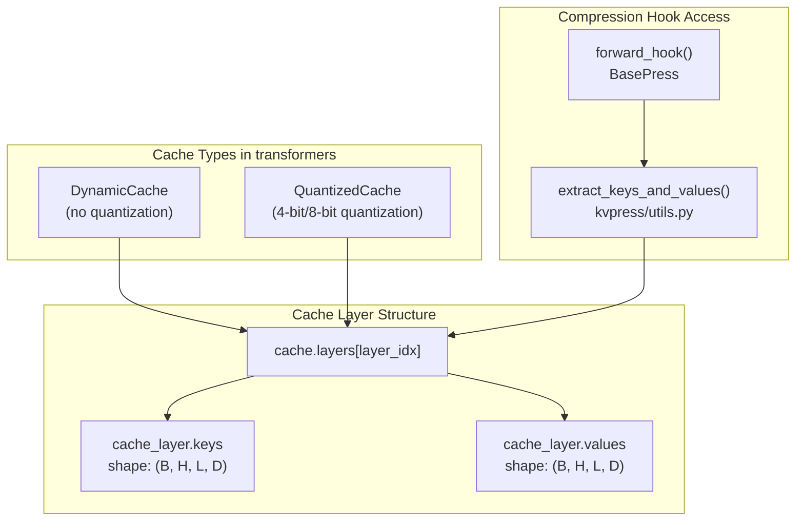
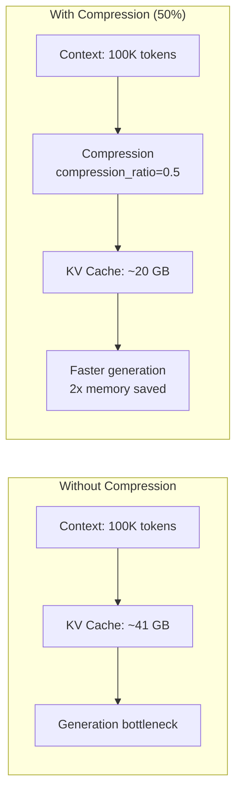
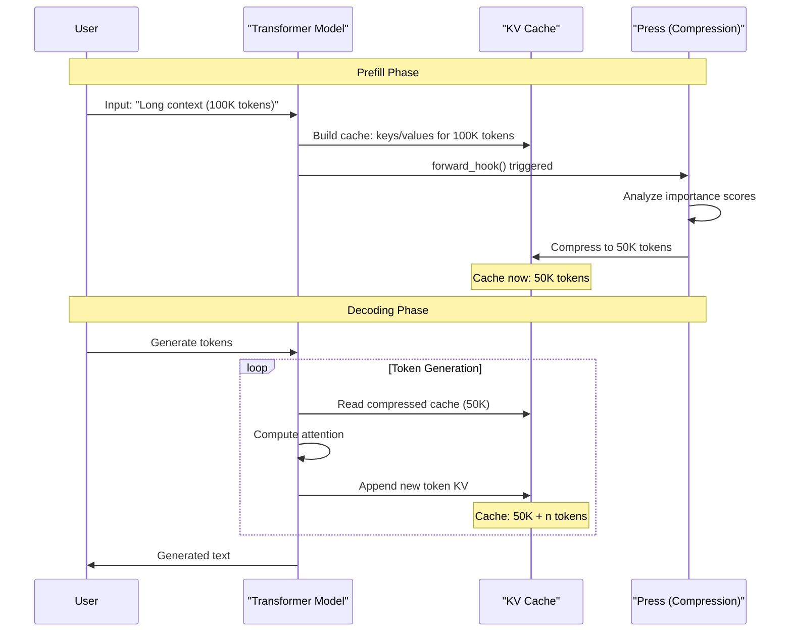
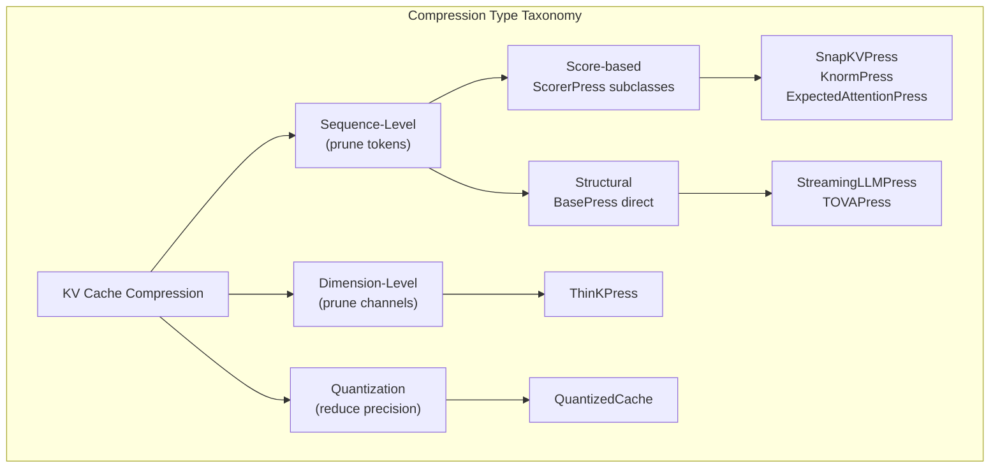

<!-- source: DeepWiki mcp.deepwiki.com · repo NVIDIA/kvpress · page 2.1 KV Cache Compression Concepts · fetched 2026-10-26 -->

# KV Cache Compression Concepts

<details>
<summary>Relevant source files</summary>

The following files were used as context for generating this wiki page:

- [README.md](README.md)
- [kvpress/presses/base_press.py](kvpress/presses/base_press.py)
- [kvpress/presses/decoding_press.py](kvpress/presses/decoding_press.py)
- [kvpress/presses/prefill_decoding_press.py](kvpress/presses/prefill_decoding_press.py)

</details>


## Purpose and Scope

This page explains the fundamental concepts underlying KV cache compression in transformer models. It covers what KV caches are, why they need compression, the distinction between prefill and decoding phases, and how compression is measured. For implementation details of compression methods, see [Press Hierarchy and BasePress](2.2). For evaluation metrics and benchmarking, see [Evaluation Metrics](5.5).

---

## What is a KV Cache?

Transformer models compute attention by comparing queries (Q) against keys (K) to determine attention weights, then using those weights to aggregate values (V). During autoregressive text generation, each new token's attention must consider all previous tokens. To avoid recomputing keys and values for previous tokens, models cache them in a **key-value (KV) cache**.

### Cache Structure

The KV cache stores keys and values for each attention layer. For a model with `num_layers` layers, `num_kv_heads` key-value heads, and `head_dim` dimensions per head:

| Component | Shape | Description |
|-----------|-------|-------------|
| Keys | `(batch_size, num_kv_heads, seq_len, head_dim)` | Cached key vectors for attention |
| Values | `(batch_size, num_kv_heads, seq_len, head_dim)` | Cached value vectors for attention |
| Cache per layer | 2 tensors (keys, values) | Each layer maintains separate cache |

**Sources:** [kvpress/presses/base_press.py:69-86](), [README.md:13-13]()

### Cache Implementation in Transformers



**Diagram: Cache Storage in Transformers**

In the codebase, caches are accessed via `kwargs["past_key_values"]` during forward hooks [kvpress/presses/base_press.py:140-140](). The `extract_keys_and_values()` utility handles both quantized and unquantized cache types, returning tensors ready for compression [kvpress/presses/base_press.py:148-148](). If a `QuantizedCache` is used, the `BasePress.forward_hook` handles re-quantization after compression [kvpress/presses/base_press.py:152-157]().

**Sources:** [kvpress/presses/base_press.py:140-160](), [kvpress/presses/base_press.py:12-21](), [kvpress/utils.py:1-1]()

---

## Why Compression is Needed

### Memory Growth Problem

KV cache memory grows **linearly** with sequence length. For a single layer with float16 precision:

```
Memory per layer = 2 × num_kv_heads × seq_len × head_dim × 2 bytes
                 = 4 × num_kv_heads × seq_len × head_dim bytes
```

For a full model:
```
Total KV cache = Memory per layer × num_layers
```

### Example: Llama 3.1-70B

According to the README, handling 1M tokens with Llama 3.1-70B in float16 requires **up to 330GB** of memory just for the KV cache. This creates severe deployment constraints:

| Context Length | Cache Size | Constraint |
|----------------|------------|------------|
| 4K tokens | ~5 GB | Fits single GPU |
| 32K tokens | ~40 GB | Requires high-end GPU |
| 128K tokens | ~160 GB | Multi-GPU required |
| 1M tokens | ~330 GB | Prohibitively expensive |

**Sources:** [README.md:13-13]()



**Diagram: Memory Savings from Compression**

**Sources:** [README.md:13-13](), [kvpress/presses/base_press.py:183-183]()

---

## Prefill vs Decoding Phases

Transformer text generation consists of two distinct phases with different compression opportunities.

### Prefill Phase

During prefill, the model processes the entire input context in a single forward pass:

- **Input:** Full context sequence (e.g., 100K tokens)
- **Processing:** Parallel attention across all tokens
- **Cache state:** Built from scratch, grows from 0 to `seq_len`
- **Compression opportunity:** High - entire context can be analyzed for importance

### Decoding Phase

During decoding, the model generates one token at a time:

- **Input:** Single new token per step
- **Processing:** Attends to full cached context + new token
- **Cache state:** Grows by 1 token per step
- **Compression opportunity:** Limited - must maintain coherence, but periodic pruning is possible



**Diagram: Prefill and Decoding Phases with Compression**

**Sources:** [kvpress/presses/base_press.py:140-146](), [README.md:39-60]()

### Default Compression Behavior

The base implementation in KVPress applies compression **only during prefill** by default:

```python
# From BasePress.forward_hook()
q_len = hidden_states.shape[1]

# Don't compress after pre-filling
if not is_prefilling(kwargs["cache_position"], q_len):
    return output
```

The `is_prefilling` utility function [kvpress/presses/base_press.py:37-40]() checks if the last cache position plus one equals the query length. During decoding, the query length `q_len` is typically 1, while `cache_position` is high, causing the check to fail and compression to be skipped.

**Sources:** [kvpress/presses/base_press.py:37-40](), [kvpress/presses/base_press.py:145-146](), [README.md:39-41]()

### Experimental Decoding Compression

KVPress provides the `DecodingPress` class for compressing during token generation [kvpress/presses/decoding_press.py:23-48](). This uses periodic compression:

- `compression_interval`: Steps between compressions (default: 512) [kvpress/presses/decoding_press.py:46-46]()
- `target_size`: Target cache size after compression (default: 2048) [kvpress/presses/decoding_press.py:47-47]()
- `hidden_states_buffer_size`: Number of hidden states to buffer before compression (default: 256) [kvpress/presses/decoding_press.py:48-48]()

It maintains a `hidden_states_buffer` per layer to provide context for scoring [kvpress/presses/decoding_press.py:53-53]().

**Sources:** [kvpress/presses/decoding_press.py:23-54](), [README.md:60-68]()

---

## Compression Approaches

KVPress implements multiple compression strategies that reduce cache size through different mechanisms.

### Sequence-Level Compression (Token Pruning)

Most presses reduce the **sequence length dimension** by pruning less important tokens. After compression, cache shape changes:

```
Before: (batch_size, num_kv_heads, seq_len, head_dim)
After:  (batch_size, num_kv_heads, compressed_len, head_dim)
```

**Scoring-based approaches** (inheriting from `ScorerPress`) assign importance scores to each token position, then prune lowest-scoring tokens:

| Approach | Score Basis | Example Press |
|----------|-------------|---------------|
| Attention-based | Observed or expected attention weights | `SnapKVPress`, `ExpectedAttentionPress` |
| Norm-based | Magnitude of key vectors | `KnormPress` |
| Similarity-based | Key similarity patterns | `KeyDiffPress` |
| Random | Random scores (baseline) | `RandomPress` |

**Sources:** [README.md:103-116](), [kvpress/presses/base_press.py:61-99]()

### Dimension-Level Compression (Channel Pruning)

Some presses reduce the **head dimension** instead of sequence length. `ThinKPress` is a primary example:

```
Before: (batch_size, num_kv_heads, seq_len, head_dim)
After:  (batch_size, num_kv_heads, seq_len, head_dim) # Low-importance channels zeroed
```

**Sources:** [README.md:136-136]()

### Quantization

Orthogonal to pruning, **quantization** reduces precision to save memory. `BasePress` natively supports `QuantizedCache`:

```python
# From BasePress.forward_hook
if isinstance(cache, QuantizedCache):
    cache_layer._quantized_keys = cache_layer._quantize(keys, axis=cache_layer.axis_key)
    cache_layer._quantized_values = cache_layer._quantize(values, axis=cache_layer.axis_value)
```

**Sources:** [kvpress/presses/base_press.py:152-157](), [kvpress/presses/base_press.py:12-21]()



**Diagram: Taxonomy of Compression Approaches**

**Sources:** [README.md:103-116](), [kvpress/presses/base_press.py:44-53]()

---

## Compression Metrics

### Compression Ratio

The primary metric is `compression_ratio`, defined as the **fraction of tokens removed**. Each press is associated with this attribute [README.md:39-39]().

In `ScorerPress`, this ratio is used to calculate the number of tokens to prune:
`n_pruned = int(k_len * self.compression_ratio)`

**Sources:** [README.md:39-41]()

### Target Size (Decoding Compression)

For `DecodingPress`, compression uses `target_size` instead of a static `compression_ratio` [kvpress/presses/decoding_press.py:47-47](). The ratio is automatically computed every `compression_interval` steps such that the size of the cache after compression equals `target_size` [kvpress/presses/decoding_press.py:103-104]().

**Sources:** [kvpress/presses/decoding_press.py:102-111](), [README.md:64-67]()

---

## Summary

KV cache compression in KVPress operates on the fundamental trade-off between memory efficiency and task quality:

1. **KV caches** store keys and values per layer, growing linearly with context length.
2. **Compression is needed** because long contexts (1M+ tokens) can require over 300GB of memory.
3. **Prefill phase** is the default target for compression, analyzing the context before generation begins.
4. **DecodingPress** allows for dynamic, periodic compression during the generation phase using a target cache size.
5. **BasePress** provides the hook mechanism to intercept attention layers and modify the `past_key_values` cache object in-place.

**Sources:** [README.md:13-116](), [kvpress/presses/base_press.py:37-162](), [kvpress/presses/decoding_press.py:23-111]()

---

