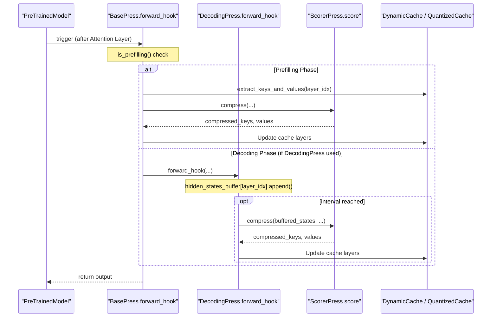

<!-- source: DeepWiki mcp.deepwiki.com · repo NVIDIA/kvpress · page 2.2 Press Hierarchy and BasePress · fetched 2026-10-26 -->

# Press Hierarchy and BasePress

<details>
<summary>Relevant source files</summary>

The following files were used as context for generating this wiki page:

- [kvpress/__init__.py](kvpress/__init__.py)
- [kvpress/presses/base_press.py](kvpress/presses/base_press.py)
- [kvpress/presses/decoding_press.py](kvpress/presses/decoding_press.py)
- [kvpress/presses/prefill_decoding_press.py](kvpress/presses/prefill_decoding_press.py)
- [kvpress/presses/scorer_press.py](kvpress/presses/scorer_press.py)

</details>


## Purpose and Scope

This document describes the hierarchical structure and relationships between the various press classes in the `kvpress` library. It explains the inheritance patterns, key base classes, and how different types of presses are organized in the codebase. The library utilizes a three-tier hierarchy consisting of the foundational `BasePress`, the score-based `ScorerPress`, and various Wrapper/Composite presses that modify or chain compression logic.

## Press Hierarchy Overview

`kvpress` is structured around a central class hierarchy where all compression methods inherit from `BasePress` and are further specialized through inheritance and composition patterns.

### Natural Language to Code Entity Space: Press Hierarchy
The following diagram maps high-level compression concepts to their specific class implementations in the `kvpress` codebase.

```mermaid
classDiagram
    class BasePress["BasePress (kvpress.presses.base_press)"] {
        +post_init_from_model(model)
        +compress(module, hidden_states, keys, values, attentions, kwargs)
        +forward_hook(module, input, kwargs, output)
        +__call__(model)
    }
    
    class ScorerPress["ScorerPress (kvpress.presses.scorer_press)"] {
        +compression_ratio: float
        +score(module, hidden_states, keys, values, attentions, kwargs)
        +compress(...)
    }
    
    BasePress <|-- ScorerPress
    BasePress <|-- DecodingPress["DecodingPress (kvpress.presses.decoding_press)"]
    BasePress <|-- PrefillDecodingPress["PrefillDecodingPress (kvpress.presses.prefill_decoding_press)"]
    
    class WrapperPress["Wrapper Pattern (Conceptual)"] {
        +press: BasePress
    }
    
    WrapperPress <|-- ComposedPress["ComposedPress (kvpress.presses.composed_press)"]
    WrapperPress <|-- AdaKVPress["AdaKVPress (kvpress.presses.adakv_press)"]
    
    ScorerPress <|-- KnormPress["KnormPress (kvpress.presses.knorm_press)"]
    ScorerPress <|-- SnapKVPress["SnapKVPress (kvpress.presses.snap_kv_press)"]
    ScorerPress <|-- ObservedAttentionPress["ObservedAttentionPress (kvpress.presses.observed_attention_press)"]
```

Sources: [kvpress/presses/base_press.py:44-188](), [kvpress/presses/scorer_press.py:17-102](), [kvpress/presses/decoding_press.py:23-49](), [kvpress/presses/prefill_decoding_press.py:20-37]()

## Core Base Classes

### BasePress
`BasePress` is the foundation of the entire library [kvpress/presses/base_press.py:44-53](). It defines the fundamental interface and behavior that all press implementations must adhere to.

**Key characteristics:**
*   **Context Manager**: Implements `__call__` as a context manager to register and automatically remove forward hooks from a `PreTrainedModel` [kvpress/presses/base_press.py:165-188]().
*   **Forward Hook**: Provides a default `forward_hook` that intercepts the model's attention layer outputs, extracts the cache, and applies compression only during the pre-filling phase by default [kvpress/presses/base_press.py:101-162]().
*   **Abstract Interface**: Defines the `compress` method which must be implemented by subclasses to perform the actual reduction of KV tensors [kvpress/presses/base_press.py:61-99]().
*   **Quantization Support**: The base hook handles `QuantizedCache` by re-quantizing compressed tensors and updating `cumulative_length` [kvpress/presses/base_press.py:152-157]().

Sources: [kvpress/presses/base_press.py:44-188]()

### ScorerPress
`ScorerPress` is a specialized subclass of `BasePress` that implements compression based on scoring the importance of key-value pairs [kvpress/presses/scorer_press.py:17-30]().

**Key characteristics:**
*   **Scoring Pattern**: Introduces the `score` method, where subclasses define the importance of each token position [kvpress/presses/scorer_press.py:35-75]().
*   **Automated Pruning**: Overrides `compress` to automatically select the top-k KV pairs based on the scores and the `compression_ratio` using `torch.topk` [kvpress/presses/scorer_press.py:76-102]().
*   **Uniform Interface**: Ensures all score-based methods (like `KnormPress` or `SnapKVPress`) follow a consistent pruning logic [kvpress/presses/scorer_press.py:94-100]().

Sources: [kvpress/presses/scorer_press.py:17-102]()

## Specialized Hierarchy Tiers

### Phase-Specific Hierarchy
Beyond static compression, `kvpress` introduces classes to handle different LLM phases (prefilling vs. decoding).

*   **DecodingPress**: A wrapper that specifically operates during the decoding phase. It maintains a `hidden_states_buffer` and applies compression every `compression_interval` steps [kvpress/presses/decoding_press.py:23-49](). It requires a `ScorerPress` or `AdaKVPress` as its `base_press` [kvpress/presses/decoding_press.py:52]().
*   **PrefillDecodingPress**: A composite press that allows defining separate strategies for the two phases by wrapping a `prefilling_press` and a `decoding_press` [kvpress/presses/prefill_decoding_press.py:20-37]().

Sources: [kvpress/presses/decoding_press.py:23-66](), [kvpress/presses/prefill_decoding_press.py:20-37]()

## Press Types Classification

The press classes in `kvpress` can be categorized into three major types based on their approach to compression:

| Category | Description | Key Entities |
| :--- | :--- | :--- |
| **Scoring-Based** | Prunes KV pairs based on an importance metric (e.g., norms, attention weights). | `KnormPress`, `SnapKVPress`, `ObservedAttentionPress`, `ScorerPress` |
| **Alternative Logic** | Implements unique compression like channel-wise reduction or layer-wise skipping. | `ThinKPress`, `SimLayerKVPress` |
| **Wrapper/Composite** | Enhances or chains other presses to add functionality like decoding support or phase delegation. | `ComposedPress`, `DecodingPress`, `PrefillDecodingPress`, `AdaKVPress` |

Sources: [kvpress/__init__.py:7-50](), [kvpress/presses/decoding_press.py:23-49]()

## Data Flow and Life Cycle

The following diagram illustrates the interaction between the `BasePress` hook mechanism and the model's attention layers during a forward pass, including the specialized decoding logic.

### Code Entity Space: Execution Flow


Sources: [kvpress/presses/base_press.py:101-162](), [kvpress/presses/decoding_press.py:113-162](), [kvpress/presses/scorer_press.py:76-102]()

---

