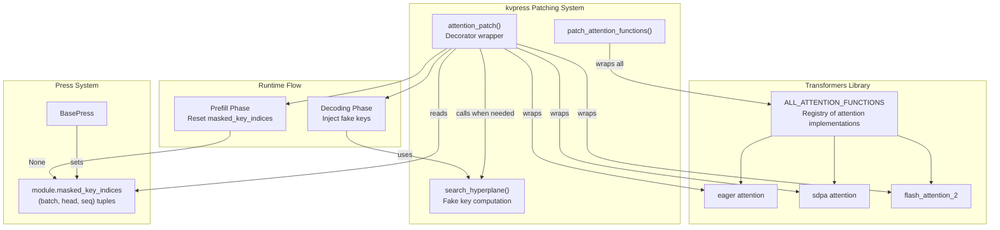
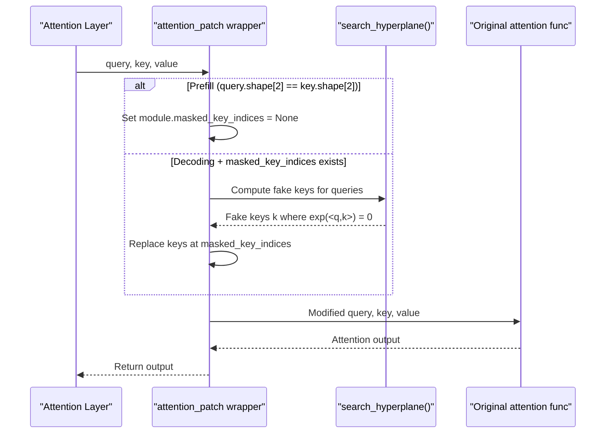

<!-- source: DeepWiki mcp.deepwiki.com · repo NVIDIA/kvpress · page 2.3 Attention Patching Mechanism · fetched 2026-10-26 -->

# Attention Patching Mechanism

<details>
<summary>Relevant source files</summary>

The following files were used as context for generating this wiki page:

- [kvpress/__init__.py](kvpress/__init__.py)
- [kvpress/attention_patch.py](kvpress/attention_patch.py)
- [tests/test_attention_patch.py](tests/test_attention_patch.py)

</details>


The attention patching mechanism is a global hook system that enables **head-wise KV cache compression** in kvpress. It allows compression methods to selectively mask out specific key-value pairs on a per-head basis during attention computation without physically removing them from the cache. This is achieved by injecting "fake keys" that produce zero attention weights.

## Purpose and Scope

The attention patching system solves a specific problem: some compression methods (like `AdaKVPress`) need to apply different compression strategies to different attention heads, but transformers' attention mechanisms operate on all heads simultaneously with shared KV caches. The patching system enables this by:

1.  **Intercepting** all attention computations before they occur.
2.  **Masking** specified key-value pairs by replacing them with specially constructed "fake keys".
3.  **Preserving** the original cache structure while achieving compression effects.

This mechanism operates at a lower level than the press system itself—it modifies how attention is computed globally, enabling head-specific compression that would otherwise be impossible.

Sources: [kvpress/attention_patch.py:43-59](), [kvpress/attention_patch.py:90-108]()

## Architecture Overview



**Diagram: Attention Patching Architecture** - Shows how the patching system intercepts all attention functions in the transformers library and coordinates with the press system through `module.masked_key_indices`.

Sources: [kvpress/attention_patch.py:43-87](), [kvpress/attention_patch.py:90-110](), [kvpress/presses/base_press.py:8-44]()

## Core Components

### The `masked_key_indices` Attribute

The communication channel between presses and the attention patching system is the `masked_key_indices` attribute set on attention modules.

| Attribute | Type | Purpose |
|-----------|------|---------|
| `module.masked_key_indices` | `tuple[Tensor, Tensor, Tensor]` or `None` | Contains `(batch_indices, head_indices, seq_indices)` specifying which keys to mask |

When a press wants to enable head-wise compression, it sets this attribute. The `attention_patch` decorator reads this attribute and applies masking accordingly [kvpress/attention_patch.py:65-79]().

### The `attention_patch()` Decorator

The `attention_patch()` function is a decorator that wraps attention computation functions. It intercepts the attention computation and modifies keys when masking is requested:



**Diagram: Attention Patch Execution Flow** - Shows the decision logic and fake key injection process during attention computation.

Sources: [kvpress/attention_patch.py:43-87]()

### The `search_hyperplane()` Algorithm

The core mathematical component is `search_hyperplane()`, which finds fake keys that produce zero attention weights:

**Goal**: Given query tensors `X` of shape `(bsz, seq_len, head_dim)`, find a hyperplane `Y` of shape `(bsz, head_dim)` such that for every query vector `q` in `X`: `<q, Y> ≤ 0` [kvpress/attention_patch.py:8-12]().

**Algorithm**:
1.  Initialize `Y` as the mean of all queries: `Y = X.mean(1)` [kvpress/attention_patch.py:34]().
2.  Iteratively refine `Y` by finding queries where `<X, Y> > 0` [kvpress/attention_patch.py:36]().
3.  Update `Y` by adding the mean of violating queries: `Y += (X * mask).sum(1) / mask.sum(1).clamp(min=1)` [kvpress/attention_patch.py:39]().
4.  Repeat until all queries satisfy `<X, Y> ≤ 0` or `max_iter` reached [kvpress/attention_patch.py:35-37]().
5.  Scale and return `Y` as `-1e5 * Y / ||Y||^2` to ensure `exp(<X, Y>) ≈ 0` [kvpress/attention_patch.py:38]().

Sources: [kvpress/attention_patch.py:8-40](), [tests/test_attention_patch.py:9-14]()

## Global Patching Process

The `patch_attention_functions()` function applies the attention patch decorator to all registered attention implementations in the transformers library:

**Patched Attention Types**:
The system iterates through `ALL_ATTENTION_FUNCTIONS` from `transformers.modeling_utils` and wraps each one [kvpress/attention_patch.py:109-110]().

The patching is applied **automatically at import time** in `kvpress/__init__.py`:

```python
# FILE: kvpress/__init__.py
from kvpress.attention_patch import patch_attention_functions
# ...
# Patch the attention functions to support head-wise compression
patch_attention_functions()
```
Sources: [kvpress/__init__.py:5-53](), [kvpress/attention_patch.py:90-110]()

## Lifecycle: Prefill vs Decoding

The attention patching system behaves differently during prefill and decoding phases:

### Prefill Phase
During prefill, the query sequence length equals the key sequence length (`query.shape[2] == key.shape[2]`). The decorator resets `module.masked_key_indices = None` [kvpress/attention_patch.py:62-64](). No masking is applied.

### Decoding Phase
During decoding, if `module.masked_key_indices` is not `None`, the system:
1.  Reshapes queries into groups based on the number of key-value heads [kvpress/attention_patch.py:72-73]().
2.  Computes one fake key per key group using `search_hyperplane` [kvpress/attention_patch.py:74-75]().
3.  Updates the `key` tensor at the specified indices with the computed fake keys [kvpress/attention_patch.py:78-79]().

### Flash Attention Compatibility
The system ensures compatibility with Flash Attention by updating `cu_seq_lens_k` if it exists in `kwargs`, ensuring the attention implementation respects the modified key shape [kvpress/attention_patch.py:82-84]().

Sources: [kvpress/attention_patch.py:61-85]()

## Technical Summary

| Aspect | Implementation Detail |
|--------|------------------------|
| **Communication** | `module.masked_key_indices` (batch, head, seq) |
| **Fake Key Logic** | Hyperplane search s.t. `exp(<q, k>) ≈ 0` |
| **Group Support** | Handles GQA/MQA by grouping queries per KV head [kvpress/attention_patch.py:69-75]() |
| **Scaling** | Scale factor of `-1e5` to force attention weights to zero [kvpress/attention_patch.py:38]() |
| **Iteration** | Default `max_iter=1000` for hyperplane search [kvpress/attention_patch.py:8]() |

Sources: [kvpress/attention_patch.py:1-110]()

---

