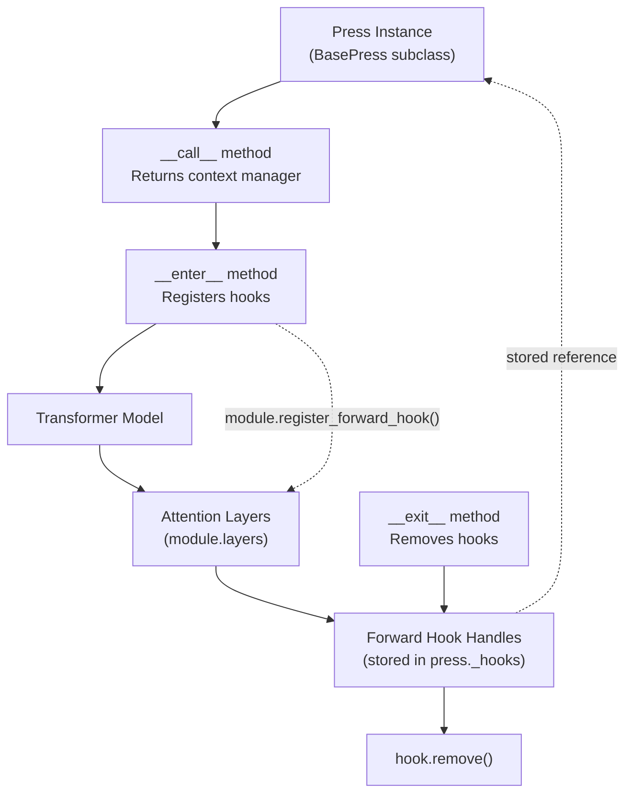
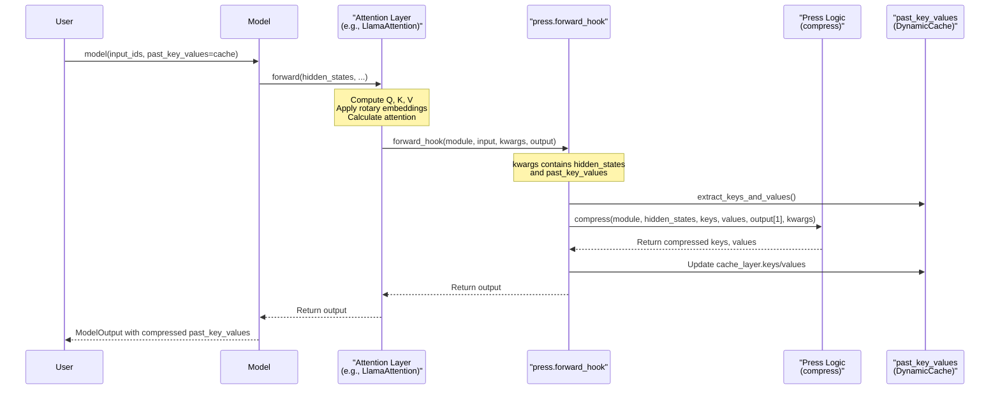
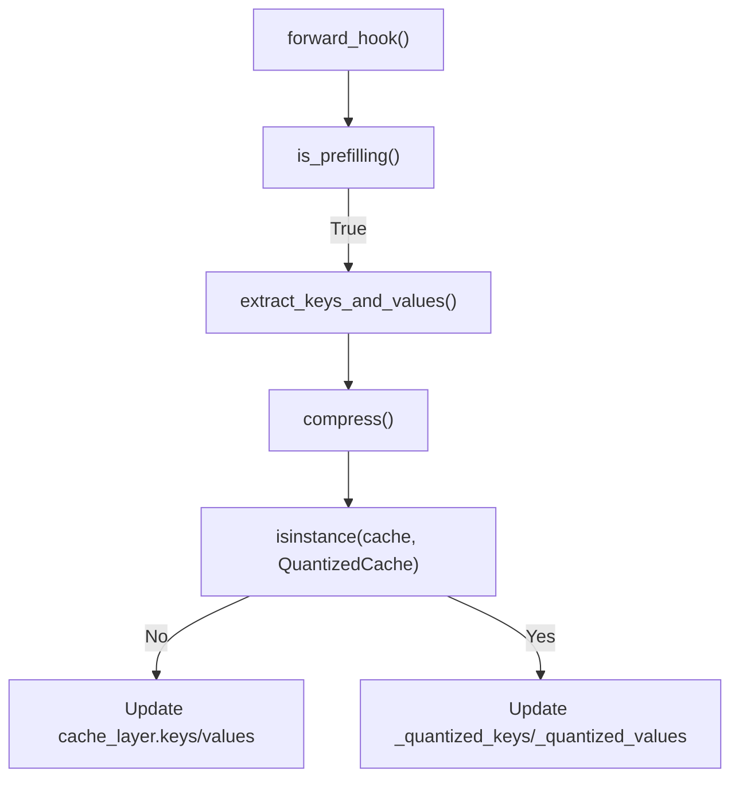
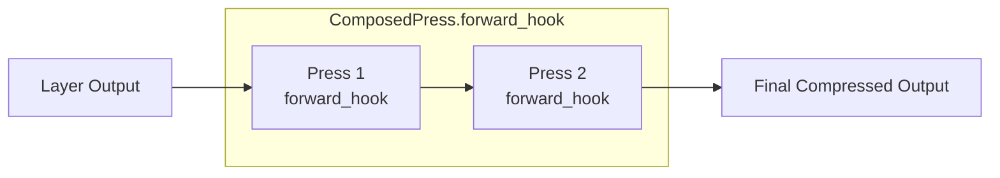

<!-- source: DeepWiki mcp.deepwiki.com · repo NVIDIA/kvpress · page 2.4 Forward Hook System · fetched 2026-10-26 -->

# Forward Hook System

Relevant source files

The following files were used as context for generating this wiki page:

- [kvpress/presses/base_press.py](kvpress/presses/base_press.py)
- [kvpress/presses/composed_press.py](kvpress/presses/composed_press.py)
- [kvpress/presses/decoding_press.py](kvpress/presses/decoding_press.py)
- [kvpress/presses/observed_attention_press.py](kvpress/presses/observed_attention_press.py)
- [kvpress/presses/prefill_decoding_press.py](kvpress/presses/prefill_decoding_press.py)

The Forward Hook System is the core mechanism by which presses intercept and modify KV cache contents during model inference. This system uses PyTorch's forward hook API to register callbacks on attention layers, allowing presses to compress keys and values non-destructively without modifying the model's computation graph.

For information about the overall press architecture and class hierarchy, see [2.2 Press Hierarchy and BasePress](). For details on how attention functions are patched to enable head-wise compression, see [2.3 Attention Patching Mechanism](). For practical usage patterns, see [4.2 Context Manager Usage]().

## Hook Registration Architecture

The forward hook system operates through a registration-and-execution pattern where presses register callback functions on specific model layers during a setup phase, and these callbacks are invoked automatically during forward passes.

**Diagram: Hook Registration Flow**

Sources: [kvpress/presses/base_press.py:164-188](), [kvpress/presses/base_press.py:193-200]()

The registration process follows these steps:

1.  **Context Manager Invocation**: User code invokes the press as a context manager via `with press(model):` [kvpress/presses/base_press.py:185-187]().
2.  **Hook Registration**: The `__enter__` method iterates through attention layers and calls `module.register_forward_hook(self.forward_hook)` [kvpress/presses/base_press.py:196-198]().
3.  **Handle Storage**: PyTorch returns hook handles that are stored in the press instance for later removal [kvpress/presses/base_press.py:198]().
4.  **Hook Removal**: The `__exit__` method calls `handle.remove()` on all stored handles to clean up [kvpress/presses/base_press.py:203-205]().

**Table: Hook Lifecycle Methods**

| Method | Purpose | Called By | Defined In |
| :--- | :--- | :--- | :--- |
| `__call__(model)` | Create context manager | User code with statement | [kvpress/presses/base_press.py:164-188]() |
| `__enter__()` | Register hooks on layers | Context manager entry | [kvpress/presses/base_press.py:193-200]() |
| `forward_hook(...)` | Process attention outputs | PyTorch during forward pass | [kvpress/presses/base_press.py:101-162]() |
| `__exit__()` | Remove registered hooks | Context manager exit | [kvpress/presses/base_press.py:202-206]() |

## Hook Execution Flow

When a forward pass executes with registered hooks, PyTorch automatically invokes the `forward_hook` method on each attention layer immediately after the layer's forward computation completes.

**Diagram: Hook Execution During Forward Pass**

Sources: [kvpress/presses/base_press.py:101-162](), [kvpress/presses/base_press.py:139-160]()

### Hook Parameters

The `forward_hook` method receives four parameters conforming to PyTorch's forward hook signature [kvpress/presses/base_press.py:101]():

*   `module`: The transformer attention layer (e.g., `LlamaAttention`).
*   `input`: Input tensors to the forward pass (not used in default implementation) [kvpress/presses/base_press.py:118-120]().
*   `kwargs`: Keyword arguments passed to the forward method, including `hidden_states`, `past_key_values`, and `cache_position` [kvpress/presses/base_press.py:121-127]().
*   `output`: Return value from the layer's forward pass, typically a list where `output[0]` is the hidden states and `output[1]` is attention weights [kvpress/presses/base_press.py:128-131]().

### Phase Detection

The hook system distinguishes between the **pre-filling** and **decoding** phases using the `is_prefilling` utility [kvpress/presses/base_press.py:37-40]().

*   **Standard BasePress**: Applies compression only during the pre-filling phase [kvpress/presses/base_press.py:145-146]().
*   **DecodingPress**: Accumulates hidden states in a `hidden_states_buffer` and applies compression every `compression_interval` steps during the decoding phase [kvpress/presses/decoding_press.py:113-162]().
*   **PrefillDecodingPress**: Acts as a dispatcher, calling the `prefilling_press` hook during pre-fill and the `decoding_press` hook during generation [kvpress/presses/prefill_decoding_press.py:67-81]().

## BasePress Hook Implementation

The `BasePress` class provides the default implementation for `forward_hook` that handles cache extraction, quantization, and in-place updates.

**Diagram: Code Entity Flow in BasePress**

Sources: [kvpress/presses/base_press.py:101-162](), [kvpress/utils.py:23]()

### Quantization Handling
The hook automatically detects if the cache is a `QuantizedCache`. If so, it re-quantizes the compressed keys and values using the cache layer's `_quantize` method before updating the `_quantized_keys` and `_quantized_values` attributes [kvpress/presses/base_press.py:152-157]().

## Hook Composition

The `ComposedPress` demonstrates how multiple hooks can be chained together. Its `forward_hook` iterates through a list of presses, passing the output of one into the next and accumulating the total `compression_ratio` [kvpress/presses/composed_press.py:56-62]().

**Diagram: Sequential Hook Chaining**

Sources: [kvpress/presses/composed_press.py:58-59]()

### Composition Constraints
Certain presses are incompatible with composition. `ComposedPress` explicitly checks for and forbids `AdaKVPress` and `KVzipPress` during initialization [kvpress/presses/composed_press.py:48-50]().

## Specialized Hook Logic

### DecodingPress Buffer Management
`DecodingPress` overrides `forward_hook` to manage a per-layer buffer of hidden states. It detaches and clones hidden states during decoding steps [kvpress/presses/decoding_press.py:134](). When the `compression_interval` is reached, it concatenates the buffer and calls `compress` [kvpress/presses/decoding_press.py:153-154]().

### ObservedAttentionPress
This press requires `attn_implementation="eager"` because its `score` function directly accesses the `attentions` tensor passed into the hook from the layer's output [kvpress/presses/observed_attention_press.py:40-44]().

Sources: [kvpress/presses/decoding_press.py:113-162](), [kvpress/presses/observed_attention_press.py:34-49]()
---
Sources: [kvpress/presses/base_press.py:37-206](), [kvpress/presses/decoding_press.py:22-162](), [kvpress/presses/composed_press.py:11-62](), [kvpress/presses/prefill_decoding_press.py:19-91](), [kvpress/presses/observed_attention_press.py:13-49]()

---

