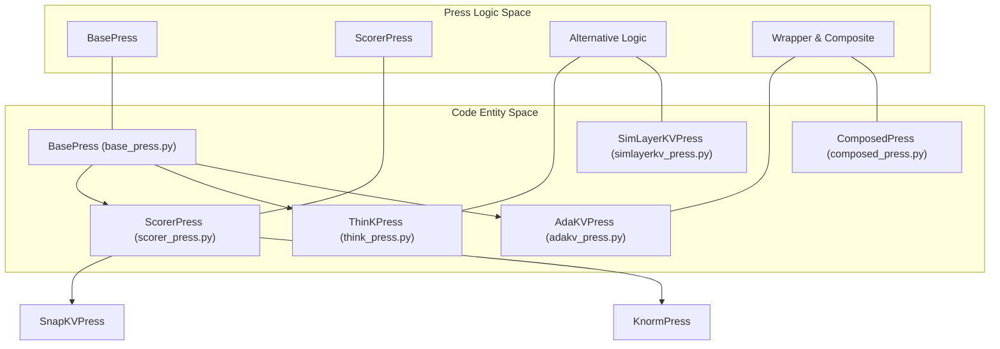
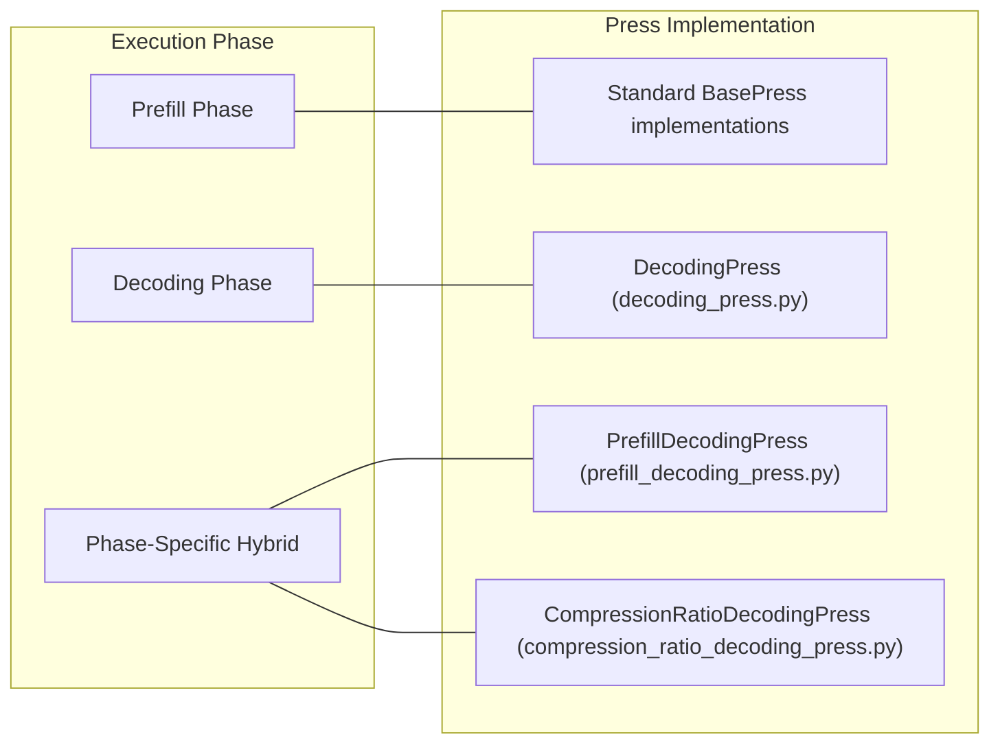

<!-- source: DeepWiki mcp.deepwiki.com · repo NVIDIA/kvpress · page 3 Press Implementations · fetched 2026-10-26 -->

# Press Implementations

Relevant source files

The following files were used as context for generating this wiki page:

- [kvpress/__init__.py](kvpress/__init__.py)
- [kvpress/presses/__init__.py](kvpress/presses/__init__.py)
- [tests/default_presses.py](tests/default_presses.py)
- [tests/presses/test_head_compression.py](tests/presses/test_head_compression.py)

This page provides a high-level catalog of the 30+ press implementations available in `kvpress`. A "press" is a module that implements a specific KV cache compression technique, inheriting from `BasePress` [kvpress/presses/base_press.py:15-17](). These implementations are designed to reduce memory usage during inference while maintaining model performance across various phases of LLM execution.

## Press Taxonomy

The `kvpress` library categorizes its implementations into several functional groups based on their compression logic and operational phase.

### Conceptual Hierarchy

Sources: [kvpress/__init__.py:7-50](), [kvpress/presses/base_press.py:15-17](), [kvpress/presses/scorer_press.py:12-14]()

### Operational Mapping

Sources: [kvpress/presses/decoding_press.py:19-21](), [kvpress/presses/prefill_decoding_press.py:40-42](), [kvpress/presses/compression_ratio_decoding_press.py:16-18]()

## Scoring-Based Presses (ScorerPress)

The majority of implementations follow the `ScorerPress` pattern, which computes an importance score for each KV pair and prunes those with the lowest scores [kvpress/presses/scorer_press.py:12-25]().

*   **Attention-Driven**: `SnapKVPress`, `ObservedAttentionPress`, `ExpectedAttentionPress`, and `TOVAPress` use various attention statistics to determine importance.
*   **Heuristic-Driven**: `KnormPress` uses key norms, while `KeyDiffPress` focuses on the difference between consecutive keys.
*   **Statistical**: `LagKVPress` and `CURPress` use statistical properties of the cache.

For detailed documentation on these scoring mechanisms, see [Scoring-Based Presses (ScorerPress)](#3.1).

Sources: [kvpress/__init__.py:15-44](), [kvpress/presses/scorer_press.py:12-14]()

## Alternative Logic Presses

Some presses depart from the standard token-pruning scoring pattern to optimize the KV cache through structural changes or context reconstruction.

*   **Structural**: `ThinKPress` performs channel-wise compression (reducing key dimensions) [kvpress/presses/think_press.py:17-19]().
*   **Layer-Selective**: `SimLayerKVPress` identifies "lazy" layers to apply more aggressive compression [kvpress/presses/simlayerkv_press.py:13-15]().
*   **Algorithmic**: `FinchPress` and `StreamingLLMPress` use fixed structural patterns (e.g., sinks and sliding windows).
*   **Reconstructive**: `KVzipPress` uses context reconstruction techniques.

For details on these non-scoring approaches, see [Alternative Logic Presses](#3.2).

Sources: [kvpress/presses/think_press.py:17-19](), [kvpress/presses/simlayerkv_press.py:13-15](), [kvpress/presses/streaming_llm_press.py:11-13]()

## Wrapper and Composite Presses

Wrapper presses take an existing press and modify its behavior or application scope.

*   **Head-Wise Optimization**: `AdaKVPress` and `CriticalKVPress` allow for different compression ratios across heads based on their importance [kvpress/presses/adakv_press.py:13-15]().
*   **Granularity Control**: `BlockPress` and `ChunkPress` apply compression logic to groups of tokens rather than individual ones [kvpress/presses/block_press.py:9-11]().
*   **Dynamic Thresholding**: `DMSPress` (Dynamic Mask Selection) and `ThresholdPress` use signal-based gating [kvpress/presses/dms_press.py:20-22]().
*   **Sequencing**: `ComposedPress` allows multiple presses to be applied in a pipeline [kvpress/presses/composed_press.py:15-17]().

For details on meta-presses and composition, see [Wrapper and Composite Presses](#3.3).

Sources: [kvpress/presses/adakv_press.py:13-15](), [kvpress/presses/composed_press.py:15-17](), [kvpress/presses/block_press.py:9-11]()

## Phase-Specific and Specialized Presses

These presses target specific stages of the generation process or use unique learned mechanisms.

*   **Phase-Specific**: `DecodingPress` manages compression during the autoregressive step, while `PrefillDecodingPress` combines strategies for both phases [kvpress/presses/decoding_press.py:19-21]().
*   **Learned Filters**: `QFilterPress` and `KVzapPress` use learned components or surrogate models to predict importance [kvpress/presses/kvzap_press.py:31-35]().
*   **Cache Merging**: `CAMPress` implements Context-Aware Masking/Merging to combine KV pairs rather than just pruning them [kvpress/presses/cam_press.py:10-12]().
*   **Hybrid Retrieval**: `DuoAttentionPress` splits heads into "retrieval" and "streaming" categories [kvpress/presses/duo_attention_press.py:21-23]().

For details on these advanced implementations, see [Phase-Specific Presses](#3.4) and [Specialized Presses](#3.5).

Sources: [kvpress/presses/decoding_press.py:19-21](), [kvpress/presses/cam_press.py:10-12](), [kvpress/presses/duo_attention_press.py:21-23](), [kvpress/presses/kvzap_press.py:31-35]()

## Summary Table of Key Implementations

| Category | Key Class | Source File |
| :--- | :--- | :--- |
| **Scoring** | `SnapKVPress` | [kvpress/presses/snapkv_press.py:13-15]() |
| **Scoring** | `ExpectedAttentionPress` | [kvpress/presses/expected_attention_press.py:23-25]() |
| **Structural** | `ThinKPress` | [kvpress/presses/think_press.py:17-19]() |
| **Structural** | `StreamingLLMPress` | [kvpress/presses/streaming_llm_press.py:11-13]() |
| **Wrapper** | `AdaKVPress` | [kvpress/presses/adakv_press.py:7-9]() |
| **Phase-Specific** | `DecodingPress` | [kvpress/presses/decoding_press.py:19-21]() |
| **Specialized** | `KVzipPress` | [kvpress/presses/kvzip_press.py:32-34]() |
| **Specialized** | `FastKVzipPress` | [kvpress/presses/fastkvzip_press.py:25-27]() |

Sources: [kvpress/__init__.py:7-50](), [tests/default_presses.py:104-187]()

---

