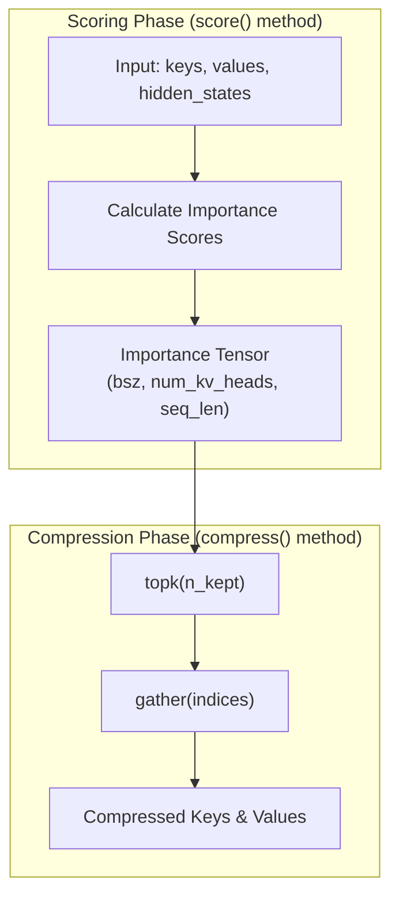
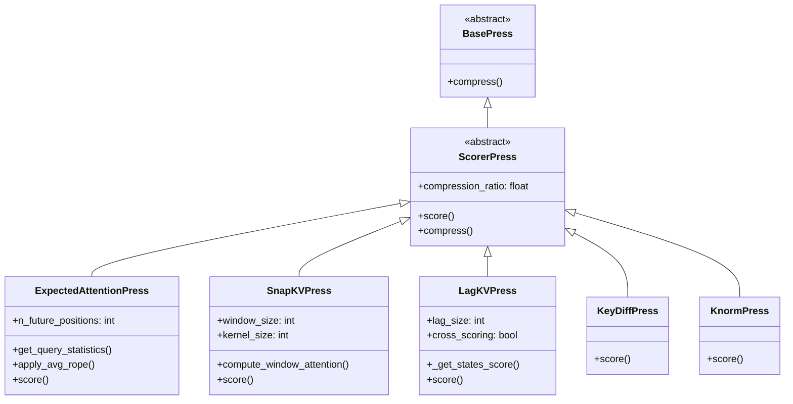

<!-- source: DeepWiki mcp.deepwiki.com · repo NVIDIA/kvpress · page 3.1 Scoring-Based Presses (ScorerPress) · fetched 2026-10-26 -->

# Scoring-Based Presses (ScorerPress)

<details>
<summary>Relevant source files</summary>

The following files were used as context for generating this wiki page:

- [kvpress/presses/block_press.py](kvpress/presses/block_press.py)
- [kvpress/presses/expected_attention_press.py](kvpress/presses/expected_attention_press.py)
- [kvpress/presses/keydiff_press.py](kvpress/presses/keydiff_press.py)
- [kvpress/presses/knorm_press.py](kvpress/presses/knorm_press.py)
- [kvpress/presses/lagkv_press.py](kvpress/presses/lagkv_press.py)
- [kvpress/presses/scorer_press.py](kvpress/presses/scorer_press.py)
- [kvpress/presses/snapkv_press.py](kvpress/presses/snapkv_press.py)
- [kvpress/presses/think_press.py](kvpress/presses/think_press.py)

</details>


Scoring-based presses are the primary mechanism in KVPress for reducing KV cache size by identifying and retaining only the most "important" tokens. These presses assign importance scores to key-value (KV) pairs and prune those with the lowest scores according to a specified `compression_ratio`.

## Overview

All scoring-based presses extend the `ScorerPress` abstract class [[kvpress/presses/scorer_press.py:17-17]](). They follow a standardized data flow where importance is calculated per head, allowing for fine-grained context management. The `compress` method in the base class handles the selection of top-K indices and the actual pruning of the tensors [[kvpress/presses/scorer_press.py:76-102]]().

**ScorerPress Data Flow**



Sources: [[kvpress/presses/scorer_press.py:17-102]](), [[kvpress/presses/expected_attention_press.py:126-165]]()

## ScorerPress Implementations

### ExpectedAttentionPress
`ExpectedAttentionPress` predicts future attention patterns using statistical modeling of queries. It computes the mean and covariance of queries before RoPE and applies an averaged RoPE rotation matrix to predict where future queries might attend [[kvpress/presses/expected_attention_press.py:18-32]]().

**Key Mechanism:**
1. **Query Stats**: Computes mean ($\mu$) and covariance ($\Sigma$) of pre-RoPE queries [[kvpress/presses/expected_attention_press.py:62-86]]().
2. **Averaged RoPE**: Computes an average rotation matrix $R$ over `n_future_positions` [[kvpress/presses/expected_attention_press.py:88-124]]().
3. **Expected Score**: Computes $E(A) = \exp(K \mu^T / \sqrt{d} + \frac{1}{2} K \Sigma K^T / d)$ [[kvpress/presses/expected_attention_press.py:149-152]]().
4. **Value Rescaling**: Optionally rescales scores by the L2 norm of value vectors to account for information magnitude [[kvpress/presses/expected_attention_press.py:159-160]]().

**Parameters:**
- `n_future_positions`: Number of future tokens to model (default: 512) [[kvpress/presses/expected_attention_press.py:56-56]]().
- `use_covariance`: Whether to use the covariance matrix for higher accuracy (default: True) [[kvpress/presses/expected_attention_press.py:58-58]]().
- `use_vnorm`: Rescale by $||V||_2$ (default: True) [[kvpress/presses/expected_attention_press.py:59-59]().

Sources: [[kvpress/presses/expected_attention_press.py:18-60]](), [[kvpress/presses/expected_attention_press.py:126-165]]()

### SnapKVPress
`SnapKVPress` implements the SnapKV algorithm, which uses the attention patterns of the most recent tokens to estimate the importance of historical KV pairs [[kvpress/presses/snapkv_press.py:18-25]]().

**Implementation Details:**
- **Observation Window**: Computes attention for the last `window_size` tokens [[kvpress/presses/snapkv_press.py:42-69]]().
- **Smoothing**: Applies an `avg_pool1d` kernel to the scores to smooth importance weights [[kvpress/presses/snapkv_press.py:96-96]]().
- **Protection**: The observation window tokens are preserved using maximum scores [[kvpress/presses/snapkv_press.py:103-103]]().

Sources: [[kvpress/presses/snapkv_press.py:18-40]](), [[kvpress/presses/snapkv_press.py:71-105]]()

### LagKVPress
`LagKVPress` identifies important tokens by analyzing lag-relative information. It divides the sequence into partitions and uses subsequent partitions as references to score tokens in prior ones [[kvpress/presses/lagkv_press.py:14-22]]().

**Scoring Logic:**
- Sequence is split into blocks of `lag_size` [[kvpress/presses/lagkv_press.py:42-42]]().
- For each block, it calculates how much the tokens vary relative to the min/max range of the *next* block (`ref`) [[kvpress/presses/lagkv_press.py:88-97]]().
- `cross_scoring`: When enabled, considers cross-partition dependencies [[kvpress/presses/lagkv_press.py:43-43]]().

Sources: [[kvpress/presses/lagkv_press.py:14-43]](), [[kvpress/presses/lagkv_press.py:45-86]]()

### KeyDiffPress
`KeyDiffPress` evicts tokens based on key vector similarity to an "average" key pattern. It identifies tokens with keys most similar to the mean key (anchor) and removes them, keeping tokens with distinctive key vectors [[kvpress/presses/keydiff_press.py:14-22]]().

**Score Calculation:**
The score is the negative cosine similarity to the normalized mean key [[kvpress/presses/keydiff_press.py:45-46]]().
```python
anchor = F.normalize(keys, p=2, dim=-1).mean(dim=2, keepdim=True)
return -F.cosine_similarity(keys, anchor, dim=-1)
```
Note: The paper's iterative block-wise compression is achieved by wrapping this in a `BlockPress` [[kvpress/presses/keydiff_press.py:24-28]]().

Sources: [[kvpress/presses/keydiff_press.py:14-46]](), [[kvpress/presses/block_press.py:14-34]]()

### KnormPress
A simple baseline press that scores tokens based on the L2 norm of their key vectors [[kvpress/presses/knorm_press.py:14-21]](). It returns the negative norm so that keys with larger magnitudes (more influence) receive higher scores [[kvpress/presses/knorm_press.py:38-38]]().

Sources: [[kvpress/presses/knorm_press.py:14-38]]()

## Architecture: From Logic to Code

The following diagram maps the logical scoring concepts to their specific class implementations and key methods within the `kvpress.presses` module.

**Entity Mapping: Scoring Logic to Code**



Sources: [[kvpress/presses/scorer_press.py:17-17]](), [[kvpress/presses/expected_attention_press.py:18-18]](), [[kvpress/presses/snapkv_press.py:18-18]](), [[kvpress/presses/lagkv_press.py:14-14]](), [[kvpress/presses/keydiff_press.py:14-14]](), [[kvpress/presses/knorm_press.py:14-14]]()

## Summary Table

| Press Class | Primary Signal | Key Parameters | Reference Paper |
| :--- | :--- | :--- | :--- |
| `ExpectedAttentionPress` | Statistical modeling of future queries | `n_future_positions`, `use_covariance` | - |
| `SnapKVPress` | Recent window attention | `window_size`, `kernel_size` | [SnapKV](https://arxiv.org/abs/2404.14469) |
| `LagKVPress` | Lag-relative information variance | `lag_size`, `cross_scoring` | [LagKV](https://arxiv.org/abs/2504.04704) |
| `KeyDiffPress` | Key vector distinctiveness | `compression_ratio` | [KeyDiff](https://arxiv.org/abs/2504.15364) |
| `KnormPress` | Key L2 norm | `compression_ratio` | [Knorm](https://arxiv.org/pdf/2406.11430) |
| `BlockPress` | Iterative block-wise scoring | `press` (ScorerPress), `block_size` | [KeyDiff](https://arxiv.org/abs/2504.15364) |

Sources: [[kvpress/presses/expected_attention_press.py:33-60]](), [[kvpress/presses/snapkv_press.py:27-39]](), [[kvpress/presses/lagkv_press.py:24-43]](), [[kvpress/presses/keydiff_press.py:30-34]](), [[kvpress/presses/knorm_press.py:23-27]](), [[kvpress/presses/block_press.py:24-34]]()

---

