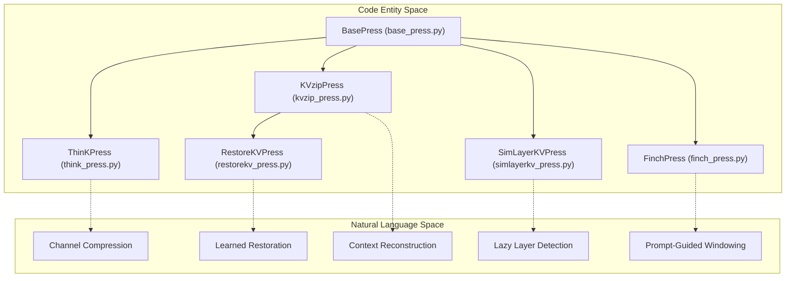
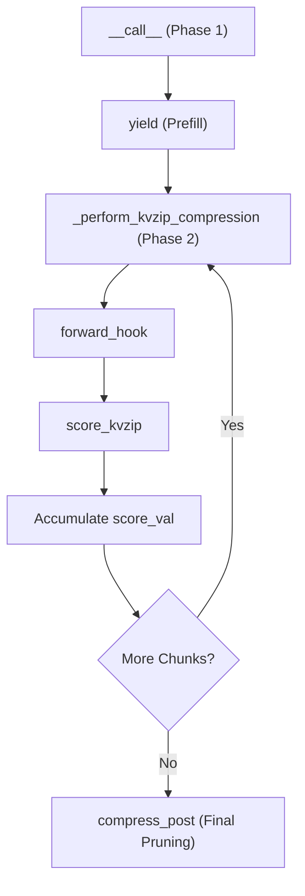

<!-- source: DeepWiki mcp.deepwiki.com · repo NVIDIA/kvpress · page 3.2 Alternative Logic Presses · fetched 2026-10-26 -->

# Alternative Logic Presses

<details>
<summary>Relevant source files</summary>

The following files were used as context for generating this wiki page:

- [kvpress/presses/expected_attention_press.py](kvpress/presses/expected_attention_press.py)
- [kvpress/presses/finch_press.py](kvpress/presses/finch_press.py)
- [kvpress/presses/key_rerotation_press.py](kvpress/presses/key_rerotation_press.py)
- [kvpress/presses/kvzip_press.py](kvpress/presses/kvzip_press.py)
- [kvpress/presses/per_layer_compression_press.py](kvpress/presses/per_layer_compression_press.py)
- [kvpress/presses/restorekv_press.py](kvpress/presses/restorekv_press.py)
- [kvpress/presses/simlayerkv_press.py](kvpress/presses/simlayerkv_press.py)
- [kvpress/presses/snapkv_press.py](kvpress/presses/snapkv_press.py)
- [kvpress/presses/think_press.py](kvpress/presses/think_press.py)
- [kvpress/presses/tova_press.py](kvpress/presses/tova_press.py)
- [tests/presses/test_key_rerotation_press_rope.py](tests/presses/test_key_rerotation_press_rope.py)

</details>


Alternative Logic Presses are KV cache compression implementations that do not follow the standard `ScorerPress` pattern of scoring and pruning key-value pairs. Instead, they implement fundamentally different compression strategies such as channel-wise dimension reduction, context reconstruction, query-aware windowing, and layer-level identification of "lazy" layers.

## Overview

Unlike `ScorerPress` implementations that inherit scoring-based compression logic, Alternative Logic Presses directly inherit from `BasePress` and implement custom `compress` methods or override the entire compression pipeline. These presses provide orthogonal or complementary approaches to sequence-length pruning:

- **Dimension compression**: Reducing the feature dimensions of keys rather than sequence length (e.g., `ThinKPress`).
- **Context reconstruction**: Using multi-pass reconstruction to identify important KV pairs (e.g., `KVzipPress`).
- **Learned restoration**: Applying LoRA-adapted passes to create context-conditioned restore tokens (e.g., `RestoreKVPress`).
- **Dynamic windowing**: Using delimiter tokens to determine observation windows (e.g., `FinchPress`).
- **Layer-wise logic**: Identifying "lazy" layers that can operate with significantly reduced cache sizes (e.g., `SimLayerKVPress`).

Sources: [kvpress/presses/kvzip_press.py:23-48](), [kvpress/presses/finch_press.py:17-46](), [kvpress/presses/simlayerkv_press.py:17-41](), [kvpress/presses/restorekv_press.py:20-30]()

## Alternative Logic Code Entity Mapping

The following diagram maps the Natural Language concepts of alternative compression to the specific Code Entities in the `kvpress` library.

Diagram: Alternative Logic Code Entity Mapping

Sources: [kvpress/presses/kvzip_press.py:23](), [kvpress/presses/finch_press.py:17](), [kvpress/presses/simlayerkv_press.py:17](), [kvpress/presses/restorekv_press.py:19]()

## ThinKPress: Channel Compression

`ThinKPress` compresses the dimensions of the keys rather than the sequence length. It can be combined with sequence-length presses using `ComposedPress` [kvpress/presses/think_press.py:21-22]().

### Implementation Details
- **Scoring**: It computes importance scores per dimension by multiplying the norm of recent query states with the norm of key states [kvpress/presses/think_press.py:79-82]().
- **Pruning**: Pruned dimensions are zeroed out using `scatter_` rather than physically removing them, ensuring compatibility with standard attention kernels while allowing for potential future memory optimizations [kvpress/presses/think_press.py:84-88]().
- **Windowing**: Uses a `window_size` (default 32) to compute the query statistics used for dimension scoring [kvpress/presses/think_press.py:41-55]().

Sources: [kvpress/presses/think_press.py:16-41](), [kvpress/presses/think_press.py:57-90]()

## KVzipPress: Context Reconstruction

`KVzipPress` identifies important KV pairs through context reconstruction, enabling query-agnostic compression. It performs multiple forward passes to reconstruct context chunks and accumulates cross-attention scores.

**Performance Note**: `KVzipPress` requires 2–3x the initial prefilling cost due to multiple forward passes for chunked reconstruction [kvpress/presses/kvzip_press.py:57-62]().

### Algorithm Flow
1. **Initial Prefilling**: The `__call__` context manager intercepts the first forward pass to store `_context_ids` and the `past_key_values` pointer [kvpress/presses/kvzip_press.py:117-126]().
2. **Reconstruction Phase**: After the first yield, `_perform_kvzip_compression` is called. It splits the context into chunks and prompts the model to repeat them [kvpress/presses/kvzip_press.py:186-219]().
3. **Scoring**: During reconstruction passes, `forward_hook` calls `score_kvzip` to calculate importance scores based on cross-attention weights [kvpress/presses/kvzip_press.py:145-160]().
4. **Final Compression**: Once all chunks are processed, `compress_post` is called to prune the cache based on the accumulated `score_val` [kvpress/presses/kvzip_press.py:356-391]().

Diagram: KVzipPress Data Flow

Sources: [kvpress/presses/kvzip_press.py:78-160](), [kvpress/presses/kvzip_press.py:356-360]()

## RestoreKVPress: Learned Restoration

`RestoreKVPress` extends `KVzipPress` by adding a context-conditioned restore cache. It uses LoRA-adapted passes to encode specific "restore tokens" that attend to the full KV cache before eviction [kvpress/presses/restorekv_press.py:20-30]().

- **Restore Tokens**: Typically 8 tokens that are appended to the cache to capture information from evicted pairs [kvpress/presses/restorekv_press.py:37-40]().
- **LoRA Integration**: Adapters are loaded from HuggingFace (e.g., `higokri/RestoreKV-Llama-3.1-8B-Instruct`) and are active only during the single restoration pass [kvpress/presses/restorekv_press.py:46-59]().
- **Lifecycle**: In `compress_post`, it first calls `append_restore_tokens` before letting the base `KVzipPress` logic evict the lowest-scored pairs [kvpress/presses/restorekv_press.py:89-100]().

Sources: [kvpress/presses/restorekv_press.py:19-59](), [kvpress/presses/restorekv_press.py:67-100]()

## FinchPress: Prompt-Guided Compression

`FinchPress` implements a SnapKV-style compression but with dynamic window sizing based on a delimiter token (e.g., `<|finch_sep|>`). It requires the input format: `context + delimiter_token + question`.

### Key Mechanisms
- **Delimiter Detection**: Uses `embed_token_forward_hook` to find the `delimiter_token_id` in the input stream and calculate `window_size` dynamically [kvpress/presses/finch_press.py:123-137]().
- **Score Normalization**: Unlike standard SnapKV, `FinchPress` includes a `normalize_scores` step that scales attention weights by the number of non-zero weights before averaging [kvpress/presses/finch_press.py:71-75]().
- **Key Rerotation**: Inherits from `BasePress` but can utilize `KeyRerotationPress.rerotate_keys` to maintain proper RoPE positional encodings after pruning [kvpress/presses/finch_press.py:111-113]().

Sources: [kvpress/presses/finch_press.py:17-54](), [kvpress/presses/finch_press.py:111-137]()

## SimLayerKVPress: Similarity-Based Layer Pruning

`SimLayerKVPress` identifies "lazy" layers—layers that focus heavily on initial (sink) and recent tokens. If a layer's attention concentration on these tokens exceeds a `lazy_threshold`, the middle of its KV cache is pruned.

### Lazy Layer Logic
A layer is considered lazy if:
`sum(attention_weights[last_tokens -> initial + recent]) > lazy_threshold` [kvpress/presses/simlayerkv_press.py:68-69]().

### Parameters
| Parameter | Default | Description |
|-----------|---------|-------------|
| `lazy_threshold` | 1.0 | Threshold for identifying lazy layers. Lower = more aggressive [kvpress/presses/simlayerkv_press.py:43](). |
| `n_recent` | 1024 | Number of recent tokens to preserve in lazy layers [kvpress/presses/simlayerkv_press.py:45](). |
| `n_initial` | 4 | Number of sink tokens to preserve [kvpress/presses/simlayerkv_press.py:46](). |

Sources: [kvpress/presses/simlayerkv_press.py:17-47](), [kvpress/presses/simlayerkv_press.py:52-69]()

## Key Rerotation: Positional Encoding Maintenance

`KeyRerotationPress` is a wrapper used to adjust RoPE (Rotary Position Embedding) after pruning. When tokens are removed, the remaining tokens' relative positions change. `KeyRerotationPress` computes the `delta_pos` between original and new positions to "re-rotate" keys back into a canonical RoPE space [kvpress/presses/key_rerotation_press.py:83-96]().

```python
# From kvpress/presses/key_rerotation_press.py:124-127
new_cos, new_sin = KeyRerotationPress._rerotate_cos_sin(keys, module.rotary_emb.inv_freq, indices)
indices = indices.unsqueeze(-1).expand(-1, -1, -1, module.head_dim)
keys = keys.gather(2, indices).contiguous()
return (keys * new_cos) + (rotate_half(keys) * new_sin)
```

Sources: [kvpress/presses/key_rerotation_press.py:16-32](), [kvpress/presses/key_rerotation_press.py:99-125]()

## Summary Table of Alternative Presses

| Press Class | Core Logic | Pruning Target | Primary Parameter |
|-------------|------------|----------------|-------------------|
| `ThinKPress` | Channel Pruning | Key Dimensions | `key_channel_compression_ratio` |
| `KVzipPress` | Reconstruction | Sequence Length | `compression_ratio` |
| `RestoreKVPress`| Reconstruction + LoRA | Sequence Length | `kvzip_plus_normalization` |
| `FinchPress` | Prompt-Guided | Sequence Length | `delimiter_token` |
| `SimLayerKVPress`| Lazy Layers | Specific Layers | `lazy_threshold` |

Sources: [kvpress/presses/kvzip_press.py:23](), [kvpress/presses/think_press.py:16](), [kvpress/presses/finch_press.py:17](), [kvpress/presses/simlayerkv_press.py:17](), [kvpress/presses/restorekv_press.py:19]()

---

