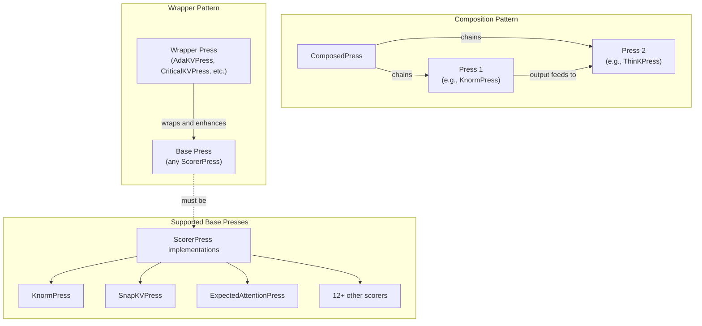
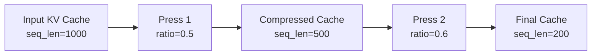
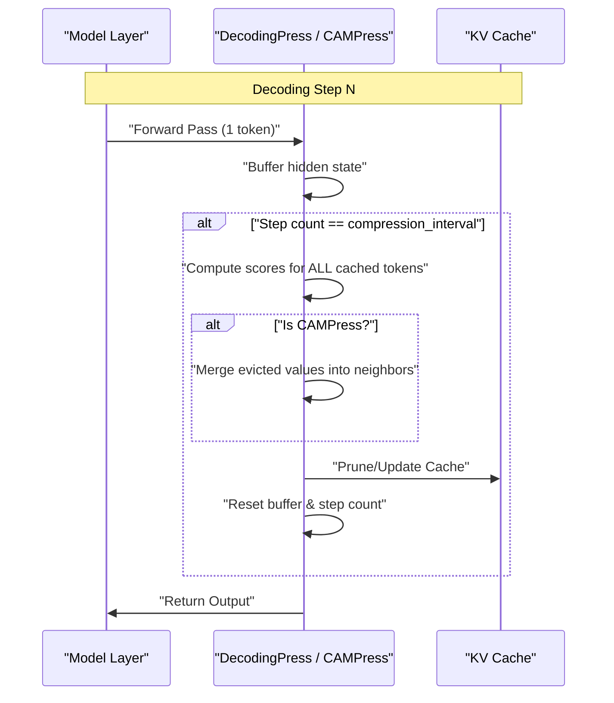

<!-- source: DeepWiki mcp.deepwiki.com · repo NVIDIA/kvpress · page 3.3 Wrapper and Composite Presses · fetched 2026-10-26 -->

# Wrapper and Composite Presses

Relevant source files

The following files were used as context for generating this wiki page:

- [kvpress/presses/adakv_press.py](kvpress/presses/adakv_press.py)
- [kvpress/presses/chunk_press.py](kvpress/presses/chunk_press.py)
- [kvpress/presses/chunkkv_press.py](kvpress/presses/chunkkv_press.py)
- [kvpress/presses/composed_press.py](kvpress/presses/composed_press.py)
- [kvpress/presses/criticalkv_press.py](kvpress/presses/criticalkv_press.py)
- [kvpress/presses/dms_press.py](kvpress/presses/dms_press.py)
- [kvpress/presses/merging_press.py](kvpress/presses/merging_press.py)
- [kvpress/presses/observed_attention_press.py](kvpress/presses/observed_attention_press.py)
- [tests/presses/test_merging_press.py](tests/presses/test_merging_press.py)

This page documents wrapper presses and composition mechanisms in kvpress. Wrapper presses enhance base presses with orthogonal features (adaptive compression, threshold-based eviction, structural changes), while `ComposedPress` enables sequential chaining of multiple compression strategies. For phase-specific compression (prefilling vs decoding), see [Phase-Specific Presses](#3.4). For the base press abstraction, see [Press Hierarchy and BasePress](#2.2).

## Purpose and Scope

Wrapper presses and composite presses extend the functionality of base presses without modifying their core logic. This design pattern enables:

- **Composition**: Chaining multiple presses sequentially via `ComposedPress`.
- **Enhancement**: Adding head-wise adaptation (`AdaKVPress`), threshold-based eviction (`DMSPress`), or two-stage selection (`CriticalKVPress`).
- **Structural Modification**: Applying compression in chunks (`ChunkPress`, `ChunkKVPress`) or merging evicted tokens (`MergingPress`).
- **Decoding Integration**: Specialized wrappers like `DecodingPress` and `CAMPress` for inference-phase management.

Sources: [kvpress/presses/composed_press.py:12-42](), [kvpress/presses/dms_press.py:16-46](), [kvpress/presses/merging_press.py:18-40]()

## Architecture Overview

Wrapper presses follow two distinct patterns in the codebase:

**Diagram: Wrapper and Composition Patterns**

Sources: [kvpress/presses/composed_press.py:12-62](), [kvpress/presses/adakv_press.py:14-36](), [kvpress/presses/criticalkv_press.py:17-35]()

## ComposedPress: Sequential Chaining

`ComposedPress` applies multiple compression methods sequentially. Each method operates on the output of the previous one, allowing users to combine complementary approaches like sequence pruning and dimension compression [kvpress/presses/composed_press.py:13-19]().

### Implementation

The `forward_hook` method in `ComposedPress` iterates through the list of internal presses, updating the `output` at each step and calculating a cumulative `retained_fraction` to update the final `compression_ratio` [kvpress/presses/composed_press.py:56-62]().

**Diagram: ComposedPress Sequential Application**

Sources: [kvpress/presses/composed_press.py:11-62]()

### Limitations

- **Incompatible Presses**: `AdaKVPress` and `KVzipPress` are explicitly disallowed in the constructor because their internal mechanisms (like attention masking or context reconstruction) do not chain linearly [kvpress/presses/composed_press.py:48-50]().
- **Feature Dependencies**: Combining a press that prunes keys (like `KnormPress`) with one that requires full attention weights (like `ObservedAttentionPress`) will fail because the attention weights will no longer match the sequence length of the keys [kvpress/presses/composed_press.py:30-34]().

## Wrapper Presses for Score Enhancement

### AdaKVPress: Head-Wise Adaptive Compression

`AdaKVPress` implements adaptive head-wise selection. Instead of pruning a fixed number of tokens from every head, it computes scores per head and then performs a global `topk` across all heads to identify tokens for pruning [kvpress/presses/adakv_press.py:69-71]().

**Safeguard Mechanism**: To prevent any single head from being completely emptied, it uses `alpha_safeguard` to ensure each head retains a minimum fraction of its original tokens [kvpress/presses/adakv_press.py:63-67]().

Sources: [kvpress/presses/adakv_press.py:14-78]()

### CriticalKVPress: Two-Stage Selection

`CriticalKVPress` enhances a base `ScorerPress` by rescaling its scores using the L1 norm of the output projection applied to values (`Wo @ values`). This captures how much each value contributes to the final layer output [kvpress/presses/criticalkv_press.py:18-24]().

**Algorithm**:
1. **Stage 1**: Select a fraction of the budget using the base scorer [kvpress/presses/criticalkv_press.py:82-83]().
2. **Stage 2**: Compute `vwl1norm` (Value-Weight L1 Norm) and rescale remaining scores [kvpress/presses/criticalkv_press.py:86-87]().

Sources: [kvpress/presses/criticalkv_press.py:17-92]()

### DMSPress: Threshold-Based Eviction

`DMSPress` (Dynamic Memory Sparsification) wraps a `ScorerPress` and evicts keys/values with scores below a given `threshold` rather than using a fixed ratio [kvpress/presses/dms_press.py:17-27]().

- **Adaptive Ratio**: The compression ratio is content-dependent and computed after the forward pass [kvpress/presses/dms_press.py:59-62]().
- **Sliding Window**: Recent tokens defined by `sliding_window_size` are protected from eviction [kvpress/presses/dms_press.py:41-42]().
- **Decoding Support**: Can be enabled for the decoding phase via the `decoding` parameter [kvpress/presses/dms_press.py:43-46]().

Sources: [kvpress/presses/dms_press.py:16-51]()

## Wrapper Presses for Structural Changes

### ChunkPress and ChunkKVPress

These wrappers change the granularity of compression:

| Class | Description | Implementation Detail |
| :--- | :--- | :--- |
| `ChunkPress` | Independent chunk processing. | Applies compression to each chunk separately to ensure uniform distribution across context [kvpress/presses/chunk_press.py:16-31](). |
| `ChunkKVPress` | Semantic-preserving selection. | Divides sequence into chunks and selects tokens proportionally based on global scores [kvpress/presses/chunkkv_press.py:16-32](). |

Sources: [kvpress/presses/chunk_press.py:14-31](), [kvpress/presses/chunkkv_press.py:14-35]()

### MergingPress: Merge-on-Evict

`MergingPress` replaces hard eviction with weighted value blending. Instead of deleting a token, its value is folded into its most cosine-similar surviving neighbor [kvpress/presses/merging_press.py:20-27]().

- **RoPE-Safe**: Keys are preserved to maintain positional integrity [kvpress/presses/merging_press.py:24-25]().
- **Similarity Gate**: Uses `similarity_threshold` to ensure merges only happen between similar vectors [kvpress/presses/merging_press.py:35-36]().
- **Precision**: Uses float32 accumulation for the merge to prevent numerical instability in half-precision [kvpress/presses/merging_press.py:162-166]().

Sources: [kvpress/presses/merging_press.py:18-45](), [kvpress/presses/merging_press.py:100-177]()

## Phase-Specific Wrapper: DecodingPress and CAMPress

`DecodingPress` and its subclass `CAMPress` are designed to manage compression during the auto-regressive decoding phase, where tokens are generated one by one.

### DecodingPress Logic
`DecodingPress` accumulates hidden states in a `hidden_states_buffer` and only triggers compression every `compression_interval` steps [kvpress/presses/decoding_press.py:133-139]().

### CAMPress (Cache Merging)
`CAMPress` extends `DecodingPress` but instead of just evicting tokens, it merges the value vectors of evicted tokens into their sequential neighbors using a Bernoulli merge mask [kvpress/presses/cam_press.py:28-32]().

**Diagram: Decoding-Phase Compression Flow**

Sources: [kvpress/presses/decoding_press.py:112-155](), [kvpress/presses/cam_press.py:102-121](), [tests/test_decoding_compression.py:51-82]()

## Composite Phase Management

`PrefillDecodingPress` allows users to specify different strategies for the prefilling and decoding phases. It detects the current phase by checking the `cache_position` in `kwargs` [kvpress/presses/prefill_decoding_press.py:57-60]().

Sources: [kvpress/presses/prefill_decoding_press.py:20-38](), [tests/test_decoding_compression.py:92-117]()

---

