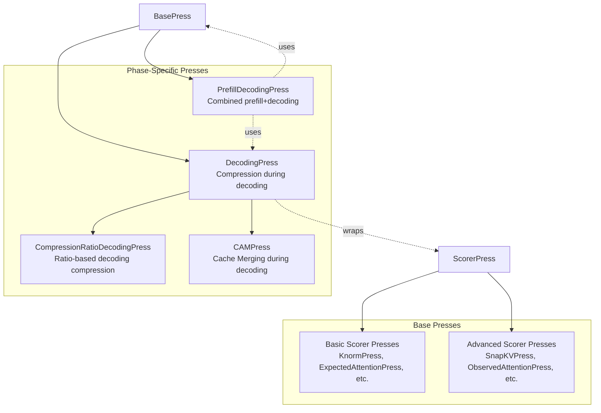
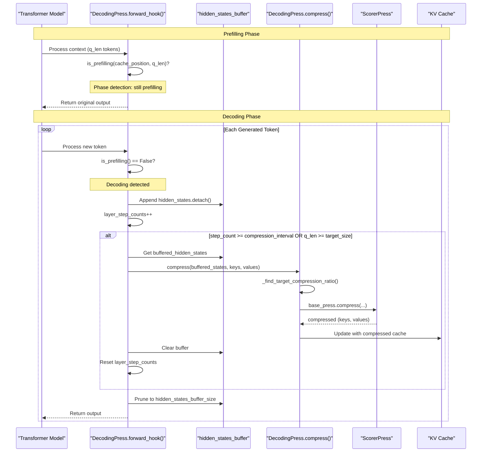
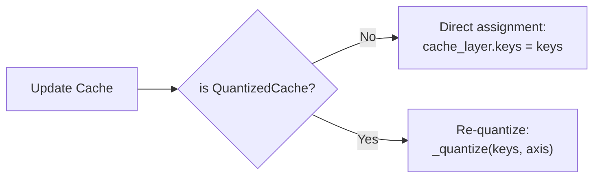

<!-- source: DeepWiki mcp.deepwiki.com · repo NVIDIA/kvpress · page 3.4 Phase-Specific Presses · fetched 2026-10-26 -->

# Phase-Specific Presses

<details>
<summary>Relevant source files</summary>

The following files were used as context for generating this wiki page:

- [.gitignore](.gitignore)
- [kvpress/presses/base_press.py](kvpress/presses/base_press.py)
- [kvpress/presses/cam_press.py](kvpress/presses/cam_press.py)
- [kvpress/presses/compression_ratio_decoding_press.py](kvpress/presses/compression_ratio_decoding_press.py)
- [kvpress/presses/decoding_press.py](kvpress/presses/decoding_press.py)
- [kvpress/presses/prefill_decoding_press.py](kvpress/presses/prefill_decoding_press.py)
- [tests/test_decoding_compression.py](tests/test_decoding_compression.py)

</details>


This page documents compression strategies that operate during specific phases of text generation: prefilling and decoding. Phase-specific presses enable different compression behaviors based on whether the model is processing the initial context (prefilling) or generating new tokens (decoding).

## Overview

Text generation in transformer models consists of two distinct phases:

1.  **Prefilling Phase**: Processing the entire input context in parallel. The KV cache is built from scratch and compression is typically applied once after processing all context tokens.
2.  **Decoding Phase**: Generating output tokens one at a time. The KV cache grows incrementally and may require periodic compression to maintain bounded memory usage.

Phase-specific presses provide specialized compression strategies optimized for each phase's characteristics.

**Diagram: Phase-Specific Press Classes**



**Sources:** [kvpress/presses/decoding_press.py:23-43](), [kvpress/presses/prefill_decoding_press.py:20-37](), [kvpress/presses/cam_press.py:24-58](), [kvpress/presses/compression_ratio_decoding_press.py:9-33]()

## DecodingPress

`DecodingPress` applies compression exclusively during the decoding phase, leaving the prefilling phase uncompressed. It maintains a buffer of recent hidden states and applies compression periodically when the cache exceeds a target size [kvpress/presses/decoding_press.py:23-43]().

### Parameters

| Parameter | Type | Default | Description |
| :--- | :--- | :--- | :--- |
| `base_press` | `ScorerPress` or `AdaKVPress` | Required | The scorer press used to compute importance scores for tokens during compression [kvpress/presses/decoding_press.py:45]() |
| `compression_interval` | `int` | 512 | Number of decoding steps between compression attempts [kvpress/presses/decoding_press.py:46]() |
| `target_size` | `int` | 2048 | Target number of tokens to keep after compression [kvpress/presses/decoding_press.py:47]() |
| `hidden_states_buffer_size` | `int` | 256 | Maximum number of hidden states to buffer before compression [kvpress/presses/decoding_press.py:48]() |

### Compression Strategy

**Diagram: DecodingPress Operation Flow**



**Sources:** [kvpress/presses/decoding_press.py:112-176](), [kvpress/presses/base_press.py:37-40]()

### Key Methods

*   **`compress()`**: Delegates compression to the `base_press` by temporarily overriding its `compression_ratio` with a value calculated via `_find_target_compression_ratio` to meet the `target_size` [kvpress/presses/decoding_press.py:68-110]().
*   **`forward_hook()`**: Detects the decoding phase, accumulates `hidden_states` in a `defaultdict(list)`, and triggers `compress()` when thresholds are met [kvpress/presses/decoding_press.py:112-176]().
*   **`_find_target_compression_ratio()`**: Uses binary search to find the exact float ratio that results in the desired integer `target_size` after rounding [kvpress/presses/decoding_press.py:182-225]().

## CAMPress (Cache Merging)

`CAMPress` extends `DecodingPress` to implement Cache Merging (CaM). Instead of simply evicting low-importance tokens, it merges their value vectors into sequential neighbors before pruning [kvpress/presses/cam_press.py:24-58]().

### Merging Mechanism
1.  **Selection**: The `base_press` scores tokens. The `n_to_evict` lowest-scored tokens are identified [kvpress/presses/cam_press.py:136-144]().
2.  **Probability**: A merge probability is computed as the ratio of an evicted token's cumulative attention to the mean attention of its "merge window" (next `merge_budget` kept tokens) [kvpress/presses/cam_press.py:102-121]().
3.  **Merge**: A Bernoulli mask is sampled. Tokens passing the mask have their values scatter-added into the target window [kvpress/presses/cam_press.py:118-120]().

**Sources:** [kvpress/presses/cam_press.py:73-121]()

## CompressionRatioDecodingPress

`CompressionRatioDecodingPress` is a specialized version of `DecodingPress` that maintains a fixed fraction of all tokens seen so far, rather than an absolute `target_size` [kvpress/presses/compression_ratio_decoding_press.py:9-33]().

*   **`target_compression_ratio`**: Fraction of total tokens to remove [kvpress/presses/compression_ratio_decoding_press.py:35]().
*   **Logical Positioning**: This press requires `position_ids` in `kwargs` to calculate the total tokens seen so far [kvpress/presses/compression_ratio_decoding_press.py:46-50]().

**Sources:** [kvpress/presses/compression_ratio_decoding_press.py:35-50]()

## PrefillDecodingPress

`PrefillDecodingPress` is a wrapper that delegates to separate presses for each phase [kvpress/presses/prefill_decoding_press.py:20-37]().

### Operation
It intercepts the `forward_hook` and `compress` calls, checking the `cache_position` via `is_prefilling` to determine if the model is currently in prefill or decoding [kvpress/presses/prefill_decoding_press.py:54-60]().

```python
# Phase detection logic
if is_prefilling(kwargs["cache_position"], q_len) and self.prefilling_press is not None:
    # Use prefilling_press
elif self.decoding_press is not None:
    # Use decoding_press
```

**Sources:** [kvpress/presses/prefill_decoding_press.py:45-81]()

## Implementation Details

### Cache Update Logic
Phase-specific presses must handle different cache types during update, specifically `QuantizedCache` vs. standard `DynamicCache` [kvpress/presses/decoding_press.py:154-163]().



**Sources:** [kvpress/presses/decoding_press.py:154-163]()

### Performance Considerations
*   **Memory Efficiency**: `DecodingPress` bounds memory to `target_size` but introduces a small overhead for the `hidden_states_buffer` [kvpress/presses/decoding_press.py:39-43]().
*   **Computation**: Compression every step (`compression_interval=1`) is expensive. Higher intervals reduce overhead by batching the eviction process [kvpress/presses/decoding_press.py:35-36]().

**Sources:** [kvpress/presses/decoding_press.py:34-43](), [tests/test_decoding_compression.py:52-83]()

---

