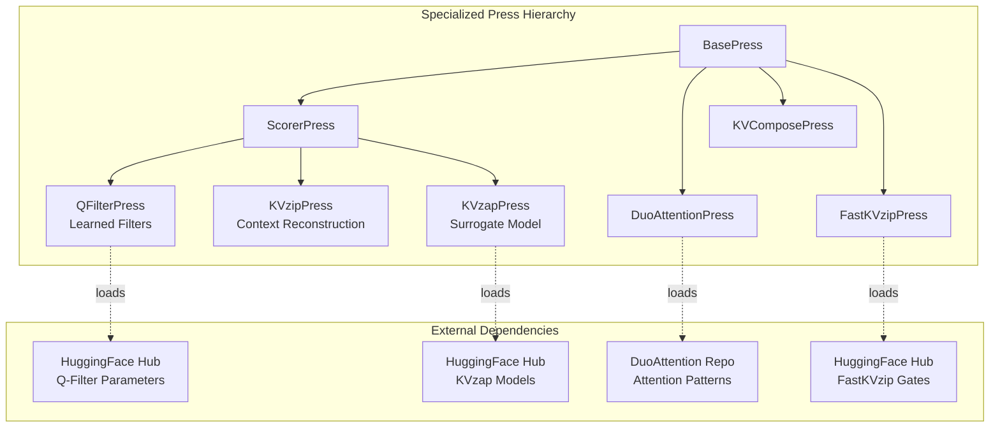
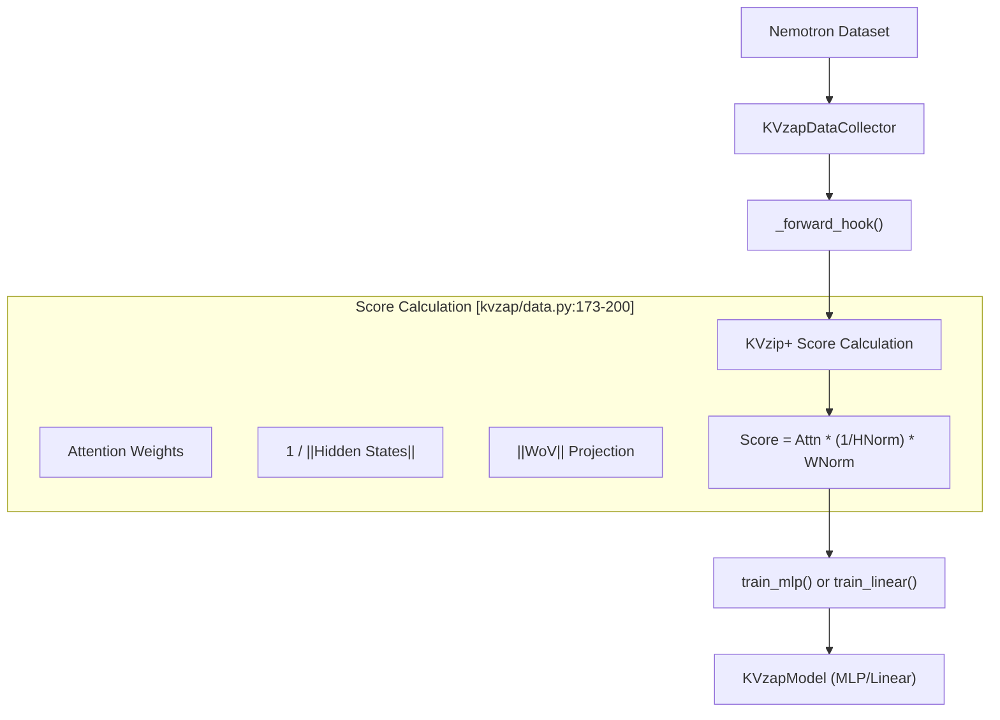

<!-- source: DeepWiki mcp.deepwiki.com · repo NVIDIA/kvpress · page 3.5 Specialized Presses · fetched 2026-10-26 -->

# Specialized Presses

Relevant source files

The following files were used as context for generating this wiki page:

- [.github/workflows/test.yml](.github/workflows/test.yml)
- [Makefile](Makefile)
- [evaluation/benchmarks/longbench/calculate_metrics.py](evaluation/benchmarks/longbench/calculate_metrics.py)
- [evaluation/benchmarks/loogle/calculate_metrics.py](evaluation/benchmarks/loogle/calculate_metrics.py)
- [kvpress/presses/compactor_press.py](kvpress/presses/compactor_press.py)
- [kvpress/presses/duo_attention_press.py](kvpress/presses/duo_attention_press.py)
- [kvpress/presses/fastkvzip_press.py](kvpress/presses/fastkvzip_press.py)
- [kvpress/presses/kvcompose_press.py](kvpress/presses/kvcompose_press.py)
- [kvpress/presses/kvzap_press.py](kvpress/presses/kvzap_press.py)
- [kvpress/presses/leverage_press.py](kvpress/presses/leverage_press.py)
- [kvpress/presses/lukv_press.py](kvpress/presses/lukv_press.py)
- [kvpress/presses/non_causal_attention_press.py](kvpress/presses/non_causal_attention_press.py)
- [kvpress/presses/qfilter_press.py](kvpress/presses/qfilter_press.py)
- [kvpress/utils.py](kvpress/utils.py)
- [kvzap/data.py](kvzap/data.py)
- [kvzap/evaluate_aime.py](kvzap/evaluate_aime.py)
- [kvzap/train.py](kvzap/train.py)

This page documents KVPress implementations with unique mechanisms that set them apart from standard scoring-based, structural, or wrapper presses. These presses employ specialized techniques such as learned parameters, surrogate models, context reconstruction, and hybrid attention mechanisms.

## Overview

Specialized presses in KVPress implement compression strategies that leverage advanced techniques beyond simple scoring heuristics:

| Press | Unique Capability | Key Mechanism |
|-------|------------------|---------------|
| `QFilterPress` | Learned filters | Pre-trained model-specific parameters from HuggingFace [kvpress/presses/qfilter_press.py:20-49]() |
| `KVzipPress` | Context reconstruction | Retains tokens based on their ability to reconstruct the prompt [kvpress/presses/kvzip_press.py:112-114]() |
| `FastKVzipPress` | Fast approximation | Uses trained gates to estimate KVzip scores efficiently [kvpress/presses/fastkvzip_press.py:144-170]() |
| `KVzapPress` | Surrogate model | Lightweight MLP/Linear model predicts importance from hidden states [kvpress/presses/kvzap_press.py:52-61]() |
| `DuoAttentionPress` | Hybrid attention | Splits heads into retrieval (full) and streaming (recent) types [kvpress/presses/duo_attention_press.py:32-63]() |
| `KVComposePress` | Structured alignment | Forms composite importance scores across heads/layers [kvpress/presses/kvcompose_press.py:103-140]() |

Sources: [kvpress/presses/qfilter_press.py:20-49](), [kvpress/presses/kvzip_press.py:112-114](), [kvpress/presses/fastkvzip_press.py:144-170](), [kvpress/presses/kvzap_press.py:52-61](), [kvpress/presses/duo_attention_press.py:32-63](), [kvpress/presses/kvcompose_press.py:103-140]()

## Architecture Overview

**Diagram: Specialized Press Hierarchy**
This diagram maps the relationship between core base classes and specialized implementations, including their external parameter sources.

Sources: [kvpress/presses/qfilter_press.py:53-67](), [kvpress/presses/fastkvzip_press.py:182-195](), [kvpress/presses/kvzap_press.py:64-69](), [kvpress/presses/duo_attention_press.py:76-81]()

## KVzap: Surrogate Model Compression

`KVzapPress` is a fast approximation of the KVzip+ method. It applies a lightweight surrogate model (MLP or Linear) to the hidden states to predict importance scores for every KV pair during both prefilling and decoding [kvpress/presses/kvzap_press.py:52-59]().

### Data Collection and Training
KVzap models are trained to predict `KVzip+` scores, which are extracted using a "repeat prompt" methodology [kvzap/data.py:90-119]().

**Diagram: KVzap Training Pipeline**
The pipeline extracts ground-truth scores by observing how well a model can repeat its own context, then trains a surrogate model to predict these scores from hidden states.

Sources: [kvzap/data.py:144-200](), [kvzap/train.py:28-119]()

### Implementation Details
- **Model Loading**: Automatically fetches pre-trained models from HuggingFace via `KVzapModel.from_pretrained` based on the backbone model name [kvpress/presses/kvzap_press.py:64-69]().
- **Scoring**: In the `score()` method, it passes hidden states through the `KVzapModel` layers corresponding to the current `module.layer_idx` [kvpress/presses/kvzap_press.py:70-82]().

## FastKVzip: Gated Importance Estimation

`FastKVzipPress` uses specialized gate modules (`FastKVzipGate`) to estimate KV importance scores [kvpress/presses/fastkvzip_press.py:144-158]().

### Gate Architecture
The `FastKVzipGate` [kvpress/presses/fastkvzip_press.py:24-80]() consists of:
- **Projections**: `q_proj` and `k_proj` to map hidden states to a low-dimensional space [kvpress/presses/fastkvzip_press.py:46-47]().
- **Norms**: `Qwen3RMSNorm` layers for stability [kvpress/presses/fastkvzip_press.py:48-49]().
- **Base Keys**: A learned `k_base` parameter representing the attention sink [kvpress/presses/fastkvzip_press.py:50]().
- **Logic**: Computes logits via `matmul(keys, queries)` and compares them against `logit_base` to derive a score [kvpress/presses/fastkvzip_press.py:65-71]().

Sources: [kvpress/presses/fastkvzip_press.py:24-80]()

## DuoAttentionPress: Hybrid Retrieval/Streaming

`DuoAttentionPress` classifies attention heads into **retrieval heads** (full KV cache) and **streaming heads** (sink + recent tokens) [kvpress/presses/duo_attention_press.py:32-45]().

### Head Classification
1. **Pattern Loading**: Loads pre-computed attention patterns from the DuoAttention repository [kvpress/presses/duo_attention_press.py:121-141]() or computes them on-the-fly via `duo_attention_on_the_fly` [kvpress/presses/duo_attention_press.py:144-150]().
2. **Masking**: A `streaming_mask` identifies which heads are restricted based on `head_compression_ratio` [kvpress/presses/duo_attention_press.py:82-87]().
3. **Execution**: In `compress()`, it populates `module.masked_key_indices`. The patched attention mechanism uses these indices to zero out attention weights for tokens outside the streaming window for specific heads [kvpress/presses/duo_attention_press.py:105-112]().

Sources: [kvpress/presses/duo_attention_press.py:72-118]()

## QFilterPress: Learned Filter Compression

`QFilterPress` uses model-specific learned vectors (Q-filters) to score KV pairs [kvpress/presses/qfilter_press.py:20-43]().

### Mechanism
- **Filter Loading**: Filters are loaded from HuggingFace via `QFilters.from_pretrained()` [kvpress/presses/qfilter_press.py:60-67]().
- **Scoring Logic**: The score is computed as the negative dot product between the keys and the learned filter: `scores = -(q_filter * keys).sum(dim=-1)` [kvpress/presses/qfilter_press.py:74-82]().
- **Benefit**: Unlike generic heuristics, these filters are optimized for specific architecture representations [kvpress/presses/qfilter_press.py:34-37]().

Sources: [kvpress/presses/qfilter_press.py:53-82]()

## KVComposePress: Structured Alignment

`KVComposePress` implements a structured compression method compatible with standard inference pipelines by aligning token retention across heads or layers [kvpress/presses/kvcompose_press.py:103-140]().

### Key Features
- **Aggregators**: Uses `MaxAggregator` or `MeanAggregator` to combine importance scores [kvpress/presses/kvcompose_press.py:68-99]().
- **Structured vs Unstructured**:
    - `structured=True`: Aligns token retention across heads for standard KV cache layout compatibility [kvpress/presses/kvcompose_press.py:105-107]().
    - `structured=False`: Each head retains tokens independently (better theoretical performance) [kvpress/presses/kvcompose_press.py:108-111]().
- **Aggregation Logic**: Supports various strategies for forming importance scores (`agg_task`, `agg_group`, `agg_head`) and can incorporate value norms (`add_v_norm`) [kvpress/presses/kvcompose_press.py:144-149]().

Sources: [kvpress/presses/kvcompose_press.py:28-150]()

## Specialized Press Comparison

| Class | Implementation File | Scorer-Based? | Key Parameter |
| :--- | :--- | :--- | :--- |
| `QFilterPress` | `kvpress/presses/qfilter_press.py` | Yes | `compression_ratio` [kvpress/presses/qfilter_press.py:47]() |
| `KVzapPress` | `kvpress/presses/kvzap_press.py` | Yes | `model_type` ("mlp"/"linear") [kvpress/presses/kvzap_press.py:61]() |
| `FastKVzipPress` | `kvpress/presses/fastkvzip_press.py` | No | `layerwise` [kvpress/presses/fastkvzip_press.py:173]() |
| `DuoAttentionPress` | `kvpress/presses/duo_attention_press.py` | No | `head_compression_ratio` [kvpress/presses/duo_attention_press.py:65]() |
| `KVComposePress` | `kvpress/presses/kvcompose_press.py` | No | `structured` [kvpress/presses/kvcompose_press.py:142]() |

Sources: [kvpress/presses/qfilter_press.py:19-51](), [kvpress/presses/kvzap_press.py:51-61](), [kvpress/presses/fastkvzip_press.py:143-180](), [kvpress/presses/duo_attention_press.py:31-70](), [kvpress/presses/kvcompose_press.py:102-150]()

---

