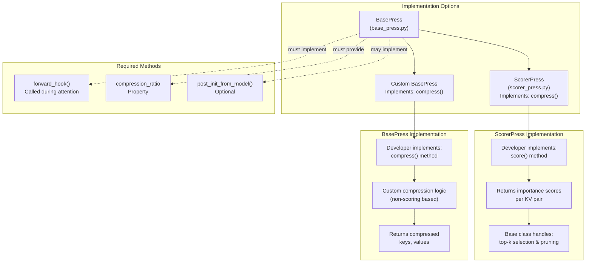
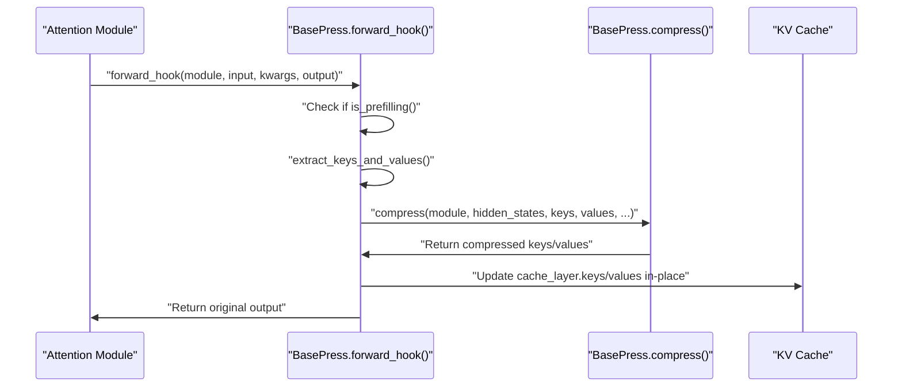

<!-- source: DeepWiki mcp.deepwiki.com · repo NVIDIA/kvpress · page 3.6 Custom Press Development · fetched 2026-10-26 -->

# Custom Press Development

<details>
<summary>Relevant source files</summary>

The following files were used as context for generating this wiki page:

- [AGENTS.md](AGENTS.md)
- [CONTRIBUTING.md](CONTRIBUTING.md)
- [kvpress/presses/base_press.py](kvpress/presses/base_press.py)
- [kvpress/presses/decoding_press.py](kvpress/presses/decoding_press.py)
- [kvpress/presses/prefill_decoding_press.py](kvpress/presses/prefill_decoding_press.py)
- [notebooks/new_press.ipynb](notebooks/new_press.ipynb)

</details>


This page provides a comprehensive guide for implementing custom KV cache compression methods (presses) in `kvpress`. It covers the press architecture, required methods, testing procedures, and integration patterns.

**Scope**: This document focuses on the technical details of creating new press implementations. For an overview of the press hierarchy and existing implementations, see [Core Architecture](#2) and [Press Implementations](#3). For details on using existing presses, see [Using KVPress](#4). For evaluation of custom presses, see [Evaluation Framework](#5).

---

## Press Architecture Overview

All presses in `kvpress` inherit from `BasePress` and must implement specific methods to participate in the compression pipeline. The architecture provides two primary patterns for implementing compression logic:

**Diagram: Press Implementation Patterns**



Sources: [kvpress/presses/base_press.py:44-162](), [kvpress/presses/scorer_press.py:17-102]()

---

## Implementing a ScorerPress

`ScorerPress` is the recommended base class for most compression methods. It abstracts the "score-and-prune" pattern where you compute importance scores for each KV pair, and the base class handles the pruning logic.

### Basic Structure

```python
from dataclasses import dataclass
import torch
from torch import nn
from kvpress.presses.scorer_press import ScorerPress

@dataclass
class MyCustomPress(ScorerPress):
    """
    Custom compression method description.
    """
    
    compression_ratio: float = 0.0
    
    def score(
        self,
        module: nn.Module,
        hidden_states: torch.Tensor,
        keys: torch.Tensor,
        values: torch.Tensor,
        attentions: torch.Tensor,
        kwargs: dict,
    ) -> torch.Tensor:
        """
        Compute importance scores for each KV pair.
        """
        # Your scoring logic here
        pass
```

Sources: [kvpress/presses/scorer_press.py:17-74](), [notebooks/new_press.ipynb:154-184]()

### Score Method Parameters

| Parameter | Type | Shape | Description |
|-----------|------|-------|-------------|
| `module` | `nn.Module` | - | The attention module being compressed |
| `hidden_states` | `torch.Tensor` | `(batch, seq_len, hidden_dim)` | Input hidden states to the attention layer |
| `keys` | `torch.Tensor` | `(batch, num_kv_heads, seq_len, head_dim)` | Key cache for this layer |
| `values` | `torch.Tensor` | `(batch, num_kv_heads, seq_len, head_dim)` | Value cache for this layer |
| `attentions` | `torch.Tensor` | `(batch, num_heads, q_len, k_len)` or `None` | Attention weights if available |
| `kwargs` | `dict` | - | Additional context (see below) |

**Important `kwargs` Contents**:
- `kwargs["hidden_states"]`: Full hidden states [kvpress/presses/base_press.py:139]()
- `kwargs["past_key_values"]`: The KV cache object [kvpress/presses/base_press.py:140]()
- `kwargs["cache_position"]`: Position indices indicating sequence location [kvpress/presses/base_press.py:145]()

Sources: [kvpress/presses/scorer_press.py:35-73](), [kvpress/presses/base_press.py:133-144]()

---

## Implementing a Custom BasePress

For compression methods that don't follow the score-and-prune pattern (e.g., channel-wise pruning or merging), inherit directly from `BasePress` and implement the `compress` method.

### Structure

```python
from dataclasses import dataclass
import torch
from torch import nn
from kvpress.presses.base_press import BasePress

@dataclass
class MyAlternativePress(BasePress):
    def compress(
        self,
        module: nn.Module,
        hidden_states: torch.Tensor,
        keys: torch.Tensor,
        values: torch.Tensor,
        attentions: torch.Tensor,
        kwargs: dict,
    ) -> tuple[torch.Tensor, torch.Tensor]:
        # Your custom compression logic
        return compressed_keys, compressed_values
```

Sources: [kvpress/presses/base_press.py:61-99]()

---

## Phase-Specific Implementation (DecodingPress)

If your press needs to operate during the generation/decoding phase, it should be wrapped in or inherit from `DecodingPress`. This class manages a `hidden_states_buffer` to accumulate context between compression steps [kvpress/presses/decoding_press.py:53]().

**Decoding Compression Flow**:
1. Accumulate `hidden_states` in a per-layer buffer [kvpress/presses/decoding_press.py:134]().
2. Track `layer_step_counts` [kvpress/presses/decoding_press.py:137]().
3. Apply compression every `compression_interval` steps [kvpress/presses/decoding_press.py:141]().
4. Delegate the actual scoring to a `base_press` [kvpress/presses/decoding_press.py:109]().

For hybrid strategies, use `PrefillDecodingPress` to specify different behaviors for the initial prefill and subsequent decoding [kvpress/presses/prefill_decoding_press.py:20-37]().

Sources: [kvpress/presses/decoding_press.py:23-111](), [kvpress/presses/prefill_decoding_press.py:20-81]()

---

## Forward Hook Integration

The `forward_hook` method is called automatically during attention computation. It is registered via the `BasePress.__call__` context manager [kvpress/presses/base_press.py:165-187]().

**Diagram: Natural Language to Code Entity Mapping**

| Natural Language Concept | Code Entity | File Location |
|--------------------------|-------------|---------------|
| Compression Activation | `BasePress.__call__` | [kvpress/presses/base_press.py:165]() |
| Phase Detection | `is_prefilling` | [kvpress/presses/base_press.py:37]() |
| Cache Extraction | `extract_keys_and_values` | [kvpress/presses/base_press.py:148]() |
| Core Logic Entry | `self.compress` | [kvpress/presses/base_press.py:150]() |
| Quantization Handling | `isinstance(cache, QuantizedCache)` | [kvpress/presses/base_press.py:152]() |

**Default Hook Flow**:



Sources: [kvpress/presses/base_press.py:101-162]()

---

## Development Checklist

To successfully integrate a new press into the `kvpress` ecosystem, follow these steps:

1.  **Class Definition**: Create the class in `kvpress/presses/` as a `@dataclass` [AGENTS.md:34]().
2.  **Export**: Add the new class to `kvpress/__init__.py` [AGENTS.md:35]().
3.  **Model Compatibility**: Use `post_init_from_model` to set parameters based on the model config if necessary [kvpress/presses/base_press.py:55-59]().
4.  **Testing**: Add the press to `tests/default_presses.py` to include it in the automated test matrix [AGENTS.md:36]().
5.  **Evaluation**: Add a pre-configured instance to the `PRESS_REGISTRY` in `evaluation/evaluate_registry.py` [AGENTS.md:37]().
6.  **Style**: Ensure the file has the required SPDX headers and pass `make style` [AGENTS.md:25-30]().

Sources: [AGENTS.md:23-44](), [kvpress/presses/base_press.py:55-59]()

---

