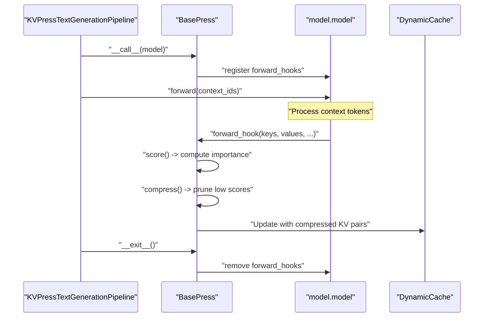

<!-- source: DeepWiki mcp.deepwiki.com · repo NVIDIA/kvpress · page 4 Using KVPress · fetched 2026-10-26 -->

# Using KVPress

<details>
<summary>Relevant source files</summary>

The following files were used as context for generating this wiki page:

- [README.md](README.md)
- [kvpress/pipeline.py](kvpress/pipeline.py)
- [notebooks/speed_and_memory.ipynb](notebooks/speed_and_memory.ipynb)
- [notebooks/wikipedia_demo.ipynb](notebooks/wikipedia_demo.ipynb)
- [tests/fixtures.py](tests/fixtures.py)
- [tests/integration/test_ruler.py](tests/integration/test_ruler.py)

</details>


This document provides practical guidance for integrating kvpress into text generation workflows. It covers the primary usage patterns, compression strategies, and integration with the HuggingFace transformers ecosystem.

For detailed information about specific press implementations, see [Press Implementations](#3). For evaluation and benchmarking, see [Evaluation Framework](#5). For developing custom presses, see [Custom Press Development](#3.6).

---

## Usage Patterns

kvpress provides three primary usage patterns for applying KV cache compression to language models:

| Pattern | Use Case | Interface | Flexibility |
|---------|----------|-----------|-------------|
| **KVPressTextGenerationPipeline** | Standard text generation with context/question separation | `pipeline("kv-press-text-generation", ...)` | High-level, handles tokenization and chat templates |
| **Context Manager** | Direct integration with `model.generate()` | `with press(model): ...` | Mid-level, direct control over generation |
| **Forward Hooks** | Custom inference workflows | `press.__call__(model)` | Low-level, maximum flexibility |

The pipeline approach is recommended for most use cases as it handles tokenization, chat templates, and multi-turn Q&A automatically. Context manager usage is appropriate when you need direct control over generation parameters. Forward hooks are for advanced custom workflows.

**Sources:** [README.md:37-55](), [kvpress/pipeline.py:25-38]()

---

## Pipeline-Based Usage

### KVPressTextGenerationPipeline Registration

When kvpress is imported, it automatically registers a custom transformers pipeline with the identifier `"kv-press-text-generation"`. This pipeline extends the standard text generation pipeline with KV cache compression capabilities.

Title: Pipeline Registration Flow
```mermaid
graph LR
    ["import kvpress"] --> ["PIPELINE_REGISTRY"]
    ["PIPELINE_REGISTRY"] -->|"registers 'kv-press-text-generation'"| ["KVPressTextGenerationPipeline"]
    ["transformers.pipeline()"] -->|"pipeline('kv-press-text-generation', ...)"| ["KVPressTextGenerationPipeline"]
    
    ["KVPressTextGenerationPipeline"] -->|"inherits from"| ["transformers.Pipeline"]
```

**Sources:** [kvpress/pipeline.py:11](), [kvpress/pipeline.py:25]()

### Basic Pipeline Usage

The simplest way to use kvpress is through the registered pipeline:

```python
from transformers import pipeline
from kvpress import ExpectedAttentionPress

model = "Qwen/Qwen3-8B"
pipe = pipeline("kv-press-text-generation", model=model, device_map="auto", dtype="auto")

context = "A very long text you want to compress once and for all"
question = "\nA question about the compressed context"

press = ExpectedAttentionPress(compression_ratio=0.5)
answer = pipe(context, question=question, press=press)["answer"]
```

The pipeline handles:
- Chat template application (if available)
- Tokenization and truncation
- Context compression during prefilling
- Question processing without compression
- Greedy decoding for answer generation

**Sources:** [README.md:37-55](), [kvpress/pipeline.py:105-170]()

### Pipeline Parameters

The pipeline accepts the following key parameters via `_sanitize_parameters()` [kvpress/pipeline.py:40-103]():

| Parameter | Type | Default | Description |
|-----------|------|---------|-------------|
| `question` | `str` | `None` | Single question about the context (exclusive with `questions`) |
| `questions` | `list[str]` | `None` | Multiple questions about the context (exclusive with `question`) |
| `answer_prefix` | `str` | `""` | Prefix prepended to generated answers |
| `press` | `BasePress` | `None` | Compression method to apply (no compression if `None`) |
| `max_new_tokens` | `int` | `50` | Maximum tokens to generate per answer |
| `max_context_length` | `int` | model max | Maximum context tokens (truncates if exceeded) |
| `enable_thinking` | `bool` | `False` | Enable thinking mode in chat template (if supported) |
| `cache` | `Cache` | `None` | Cache instance to use (defaults to `DynamicCache`) |

**Sources:** [kvpress/pipeline.py:40-103]()

---

## Compression Phases

### Prefilling Phase Compression

During the prefilling phase, the model processes the context tokens and builds the initial KV cache. This is when most compression occurs:

Title: Prefilling Compression Sequence


The `_forward()` method conditionally applies compression based on press type [kvpress/pipeline.py:214-224]():

```python
# From kvpress/pipeline.py:214-224
perform_prefill_compression = press is not None and not isinstance(press, DecodingPress)
with press(self.model) if perform_prefill_compression else contextlib.nullcontext():
    self.model.model(
        input_ids=context_ids,
        past_key_values=cache,
    )
```

Only standard presses and `PrefillDecodingPress` perform compression during prefilling. Pure `DecodingPress` instances skip this phase.

**Sources:** [kvpress/pipeline.py:214-224](), [README.md:37-55]()

### Decoding Phase Compression

Decoding compression is an experimental feature that compresses the KV cache periodically during token generation. This is enabled via the `DecodingPress` wrapper [README.md:57-97]():

```python
from kvpress import KnormPress, DecodingPress

decoding_press = DecodingPress(
    base_press=KnormPress(),
    compression_interval=10,     # Steps between compressions
    target_size=1024             # Target cache size after compression
)
```

Unlike prefilling compression which uses a `compression_ratio`, `DecodingPress` uses a `target_size` [README.md:60-67](). The compression ratio is computed dynamically to achieve the target cache size.

**Sources:** [README.md:57-97](), [kvpress/pipeline.py:226-229]()

### Combined Prefilling and Decoding

The `PrefillDecodingPress` wrapper combines separate strategies for each phase [kvpress/pipeline.py:19]():

```python
from kvpress import PrefillDecodingPress, KnormPress, DecodingPress

prefill_press = KnormPress(compression_ratio=0.5)
decoding_press = DecodingPress(
    base_press=KnormPress(),
    compression_interval=10,
    target_size=512
)

combined_press = PrefillDecodingPress(
    prefilling_press=prefill_press,
    decoding_press=decoding_press
)
```

This allows different compression strategies optimized for each phase's characteristics. For details, see [Combining Presses](#4.4).

**Sources:** [kvpress/pipeline.py:19](), [README.md:57-97]()

---

## Context and Question Separation

### Why Separate Context and Question

The pipeline enforces separation between context (compressed) and question (uncompressed) tokens to ensure fair evaluation and practical utility:

1. **Fair Evaluation**: Methods that score based on recent queries would artificially benefit if the question were compressed.
2. **General Utility**: The compressed context should work for any subsequent query, supporting document Q&A and chat use cases [README.md:55]().
3. **Multi-turn Q&A**: Same compressed context can be reused for multiple questions without recompression [notebooks/wikipedia_demo.ipynb:159-178]().

**Sources:** [README.md:37-55](), [kvpress/pipeline.py:105-170]()

### Tokenization and Template Application

The preprocessing step handles chat templates and tokenization:

Title: Tokenization Logic
```mermaid
graph TB
    ["context: str"] --> ["tokenizer.chat_template exists?"]
    ["question: str"] --> ["tokenizer.chat_template exists?"]
    
    ["tokenizer.chat_template exists?"] -->|Yes| ["Apply chat template with separator"]
    ["tokenizer.chat_template exists?"] -->|No| ["Add bos_token & simple separator"]
    
    ["Apply chat template with separator"] --> ["context_ids: Tensor"]
    ["Add bos_token & simple separator"] --> ["context_ids: Tensor"]
    
    ["context_ids: Tensor"] --> ["length > max_context_length?"]
    ["length > max_context_length?"] -->|Yes| ["Truncate context_ids"]
    ["length > max_context_length?"] -->|No| ["Return tokenized inputs"]
```

The method `preprocess` [kvpress/pipeline.py:105-170]() handles models with and without chat templates. For models with chat templates, it inserts a separator to split the context and question suffix.

**Sources:** [kvpress/pipeline.py:105-170]()

---

## Multi-turn Question Answering

### Cache Reuse for Multiple Questions

The pipeline supports asking multiple questions about the same compressed context without recompression. After generating each answer, the cache is reset to the post-context state:

Title: Multi-turn Cache Lifecycle
```mermaid
graph LR
    ["Compress context once"] --> ["Question 1"]
    ["Question 1"] --> ["Generate answer 1"]
    ["Generate answer 1"] --> ["Remove answer from cache"]
    
    ["Remove answer from cache"] --> ["Question 2"]
    ["Question 2"] --> ["Generate answer 2"]
    ["Generate answer 2"] --> ["Remove answer from cache"]
    
    ["Remove answer from cache"] --> ["Question 3"]
```

The implementation in `_remove_answer_from_cache()` [kvpress/pipeline.py:248-262]() truncates the cache back to its length after context compression:

```python
# From kvpress/pipeline.py:248-253
def _remove_answer_from_cache(self, cache: Cache, cache_seq_lengths: list[int]):
    for layer_idx, sequence_length in enumerate(cache_seq_lengths):
        cache.layers[layer_idx].keys = cache.layers[layer_idx].keys[:, :, :sequence_length]
        cache.layers[layer_idx].values = cache.layers[layer_idx].values[:, :, :sequence_length]
```

**Sources:** [kvpress/pipeline.py:230-246](), [kvpress/pipeline.py:248-262]()

---

## Context Manager Usage

### Direct Integration with model.generate()

For users who prefer direct control over generation, presses can be used as context managers with any transformer model:

```python
import torch
from transformers import AutoModelForCausalLM
from kvpress import KnormPress

device = "cuda:0"
model = AutoModelForCausalLM.from_pretrained("meta-llama/Llama-3.1-8B-Instruct").to(device)
press = KnormPress(compression_ratio=0.4)

inputs = tokenizer(text, return_tensors="pt").to(device)

with torch.no_grad(), press(model):
    outputs = model.generate(inputs["input_ids"], max_new_tokens=50)
```

The context manager registers forward hooks on model's attention layers. For details, see [Context Manager Usage](#4.2).

**Sources:** [README.md:124-152]()

---

## Cache Management

### Cache Types and Lifecycle

kvpress supports multiple cache implementations from transformers [kvpress/pipeline.py:10]():

| Cache Type | Description |
|------------|-------------|
| `DynamicCache` | Standard unquantized cache (Default) |
| `QuantizedCache` | Quantized cache storage for memory-constrained scenarios |

The pipeline handles both cache types transparently, including proper cleanup for quantized caches in `_remove_answer_from_cache()` [kvpress/pipeline.py:254-262](). For details, see [Cache Management](#4.3).

**Sources:** [kvpress/pipeline.py:10](), [kvpress/pipeline.py:254-262](), [tests/integration/test_ruler.py:46-53]()

---

## Model Compatibility and Performance

### Supported Models and Attention

kvpress is compatible with various models. Some presses require specific attention implementations:

| Press | Requirement | Reason |
|-------|-------------|--------|
| `ObservedAttentionPress` | `attn_implementation="eager"` | Needs explicit attention weights [notebooks/wikipedia_demo.ipynb:63]() |
| Most other presses | `attn_implementation="flash_attention_2"` | Optimized performance [notebooks/speed_and_memory.ipynb:113]() |

For details, see [Model Compatibility](#4.5) and [Performance Considerations](#4.6).

**Sources:** [notebooks/wikipedia_demo.ipynb:63](), [notebooks/speed_and_memory.ipynb:113](), [tests/fixtures.py:76-81]()

---

