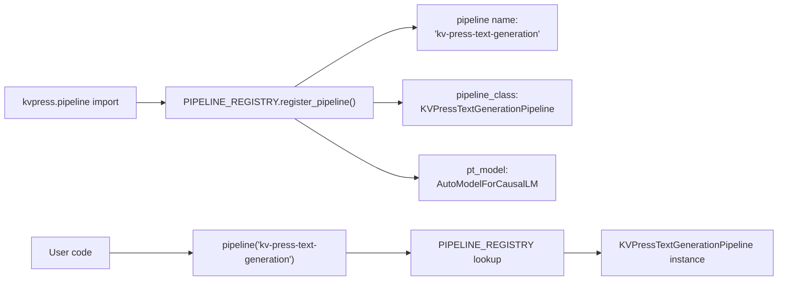
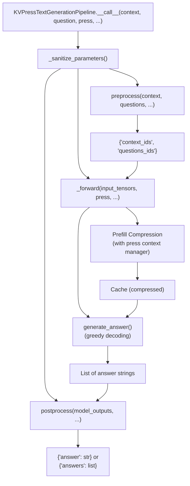
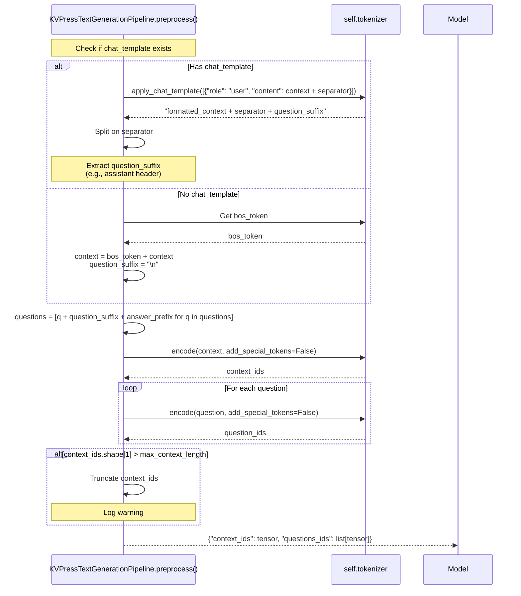
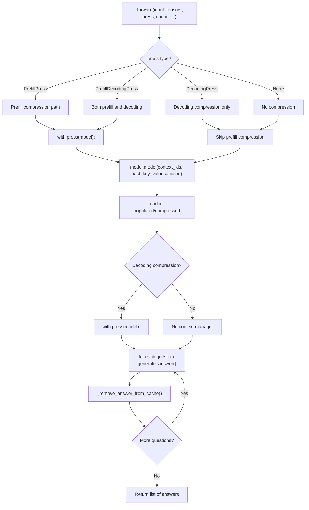
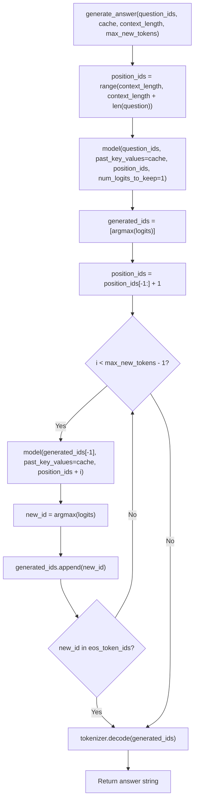
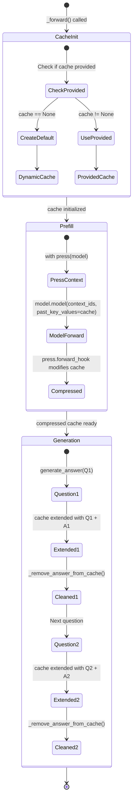

<!-- source: DeepWiki mcp.deepwiki.com · repo NVIDIA/kvpress · page 4.1 KVPressTextGenerationPipeline · fetched 2026-10-26 -->

# KVPressTextGenerationPipeline

<details>
<summary>Relevant source files</summary>

The following files were used as context for generating this wiki page:

- [README.md](README.md)
- [kvpress/pipeline.py](kvpress/pipeline.py)
- [tests/test_pipeline.py](tests/test_pipeline.py)
- [tests/test_press_call.py](tests/test_press_call.py)

</details>


The `KVPressTextGenerationPipeline` is a custom HuggingFace transformers pipeline that enables KV cache compression during text generation. It orchestrates the compression workflow by separating context pre-filling (where compression occurs) from answer generation, allowing evaluation of compression methods independent of the questions asked. For information about the underlying press implementations, see [Press Implementations](#3). For low-level cache integration details, see [Cache Management](#4.3).

## Overview

`KVPressTextGenerationPipeline` extends the transformers `Pipeline` class to provide a standardized interface for KV cache compression. It handles tokenization, chat template application, cache management, and generation while transparently applying compression via press objects.

The pipeline is automatically registered with transformers under the name `"kv-press-text-generation"` and can be instantiated using the standard `pipeline()` function.

**Key Features:**
- Automatic chat template handling for instruction-tuned models.
- Support for multiple questions on the same compressed context.
- Separation of context compression from answer generation.
- Compatible with both prefill and decoding compression methods.
- Integration with `DynamicCache` and `QuantizedCache`.

Sources: [kvpress/pipeline.py:25-38](), [kvpress/pipeline.py:313-317]()

## Pipeline Registration

The pipeline registers itself with the transformers ecosystem at module import time:

Title: Pipeline Registration Process


This registration allows users to instantiate the pipeline using standard transformers syntax:

```python
from transformers import pipeline
pipe = pipeline("kv-press-text-generation", model=model, device=device)
```

Sources: [kvpress/pipeline.py:313-317]()

## Pipeline Architecture

Title: KVPressTextGenerationPipeline Method Hierarchy and Data Flow


The pipeline follows the standard transformers pipeline pattern with three phases:
1. **preprocess**: Tokenization and chat template application.
2. **_forward**: Context compression and answer generation.  
3. **postprocess**: Format output based on single/multiple questions.

Sources: [kvpress/pipeline.py:40-103](), [kvpress/pipeline.py:105-188](), [kvpress/pipeline.py:190-236]()

## Core Parameters

The `_sanitize_parameters` method accepts and processes the following parameters:

| Parameter | Type | Default | Description |
|-----------|------|---------|-------------|
| `question` | `str \| None` | `None` | Single question about the context (exclusive with `questions`). |
| `questions` | `list[str] \| None` | `None` | Multiple questions about the context (exclusive with `question`). |
| `answer_prefix` | `str \| None` | `""` | Prefix prepended to generated answers. |
| `press` | `BasePress \| None` | `None` | Compression method to apply (any `BasePress` subclass). |
| `max_new_tokens` | `int` | `50` | Maximum tokens to generate per answer. |
| `max_context_length` | `int \| None` | `tokenizer.model_max_length` | Maximum context tokens (truncated if exceeded). |
| `enable_thinking` | `bool` | `False` | Whether to enable thinking in the chat template. |
| `cache` | `Cache \| None` | `None` | Cache object (`DynamicCache` or `QuantizedCache`). |

The pipeline enforces mutual exclusivity between `question` and `questions` parameters [kvpress/pipeline.py:92]().

Sources: [kvpress/pipeline.py:40-103]()

## Preprocessing and Chat Template Handling

Title: Preprocessing and Chat Template Logic


The preprocessing phase handles two scenarios:

**With Chat Template** [kvpress/pipeline.py:144-152]():
- Applies chat template with a unique separator string to extract the structural question suffix.
- Example for Llama 3.1: `question_suffix = "<|eot_id|><|start_header_id|>assistant<|end_header_id|>\n\n"`.

**Without Chat Template** [kvpress/pipeline.py:140-143]():
- Prepends BOS token to context.
- Uses a newline as question suffix.

Sources: [kvpress/pipeline.py:105-188]()

## Forward Pass and Compression

**Compression and Generation Flow**



The forward pass implements three compression modes:

1. **Prefill Compression Only** [kvpress/pipeline.py:206-212](): Applies press as context manager during context processing.
2. **Decoding Compression Only** [kvpress/pipeline.py:218-219](): Applies press during token generation.
3. **Combined Compression** [kvpress/pipeline.py:206-219](): Uses `PrefillDecodingPress` to apply different strategies in each phase.

The pipeline validates that `DecodingPress` is not used with multiple questions [kvpress/pipeline.py:193-196]().

Sources: [kvpress/pipeline.py:190-236]()

## Code Entity Reference

| Method | Purpose |
|--------|---------|
| `_sanitize_parameters` | Validates and splits parameters into preprocess/forward/postprocess kwargs [kvpress/pipeline.py:40-103](). |
| `preprocess` | Applies chat template, tokenizes context and questions [kvpress/pipeline.py:105-188](). |
| `_forward` | Executes compression and generation workflow [kvpress/pipeline.py:190-236](). |
| `generate_answer` | Greedy decoding loop for single question [kvpress/pipeline.py:253-305](). |
| `_remove_answer_from_cache` | Removes answer tokens from cache between questions [kvpress/pipeline.py:238-251](). |
| `postprocess` | Formats output as single answer or list [kvpress/pipeline.py:307-310](). |

Sources: [kvpress/pipeline.py:25-310]()

## Multi-Question Support

The pipeline supports asking multiple questions about the same compressed context without re-compressing:

1. **Cache State Preservation** [kvpress/pipeline.py:226-235](): Records cache sequence lengths before each question and restores them using `_remove_answer_from_cache()`.
2. **Position ID Adjustment** [kvpress/pipeline.py:223-224](): For `KeyRerotationPress`, `FinchPress`, `DMSPress`, and `RestoreKVPress`, `context_length` is updated to reflect compressed cache size for correct RoPE embeddings.
3. **Quantized Cache Handling** [kvpress/pipeline.py:244-251](): Trims both quantized and dequantized tensors in `QuantizedCache`.

Sources: [kvpress/pipeline.py:220-251]()

## Generation Method

The `generate_answer` method implements a greedy decoding loop:

Title: Greedy Decoding Implementation Details


**Implementation Details:**
- **Position IDs**: Calculated relative to `context_length` (compressed cache size) [kvpress/pipeline.py:275-277]().
- **Efficient Logits**: Uses `num_logits_to_keep=1` for the first forward pass [kvpress/pipeline.py:284]().
- **EOS Handling**: Retrieves EOS token IDs from `model.generation_config` [kvpress/pipeline.py:290-303]().

Sources: [kvpress/pipeline.py:253-305]()

## Cache Integration

The pipeline supports two cache types:

1. **DynamicCache** [kvpress/pipeline.py:202-203](): Default cache type for unquantized key-value tensors.
2. **QuantizedCache** [kvpress/pipeline.py:244-251](): Requires special handling to trim both quantized and dequantized representations.

Title: Cache Lifecycle in KVPressTextGenerationPipeline


Sources: [kvpress/pipeline.py:202-203](), [kvpress/pipeline.py:238-251]()

---

