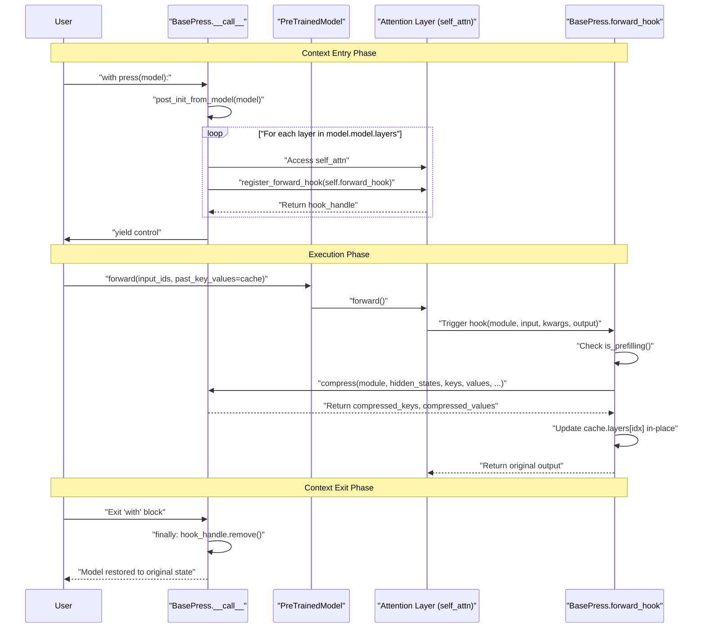
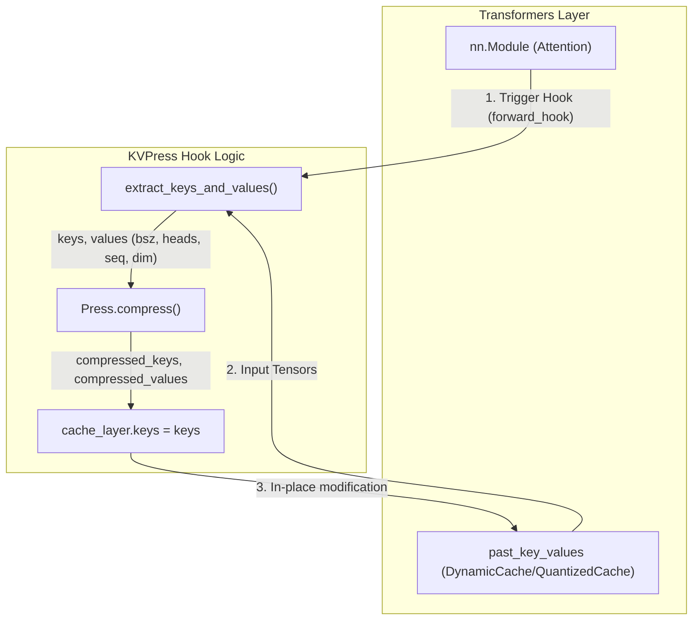

<!-- source: DeepWiki mcp.deepwiki.com · repo NVIDIA/kvpress · page 4.2 Context Manager Usage · fetched 2026-10-26 -->

# Context Manager Usage

<details>
<summary>Relevant source files</summary>

The following files were used as context for generating this wiki page:

- [README.md](README.md)
- [kvpress/presses/base_press.py](kvpress/presses/base_press.py)
- [kvpress/presses/decoding_press.py](kvpress/presses/decoding_press.py)
- [kvpress/presses/prefill_decoding_press.py](kvpress/presses/prefill_decoding_press.py)

</details>


## Purpose and Scope

This page documents how to use press instances as context managers with raw `transformers` models. This approach provides direct control over compression without the abstraction of `KVPressTextGenerationPipeline`. The context manager pattern enables compression by temporarily registering forward hooks on a model's attention layers. When the context exits, hooks are automatically removed, restoring normal model behavior.

---

## Basic Usage Pattern

Press instances implement the context manager protocol through the `__call__` method [kvpress/presses/base_press.py:164-180](), allowing them to be used with Python's `with` statement. The press compresses the KV cache in-place during the forward pass, reducing the sequence length dimension according to the specified `compression_ratio`.

```python
import torch
from transformers import AutoModelForCausalLM, DynamicCache
from kvpress import KnormPress

device = "cuda:0"
model = AutoModelForCausalLM.from_pretrained("meta-llama/Llama-3.1-8B-Instruct").to(device)
press = KnormPress(compression_ratio=0.4)

inputs = torch.randint(0, 1000, (1, 512)).to(device)
cache = DynamicCache()

# With compression applied via context manager
with torch.no_grad(), press(model):
    output = model(inputs, past_key_values=cache)
    # cache.layers[0].keys will now have ~307 tokens instead of 512
```

**Sources:** [kvpress/presses/base_press.py:164-180](), [kvpress/presses/knorm_press.py:11-13]()

---

## Hook Lifecycle

### Lifecycle Diagram

The following diagram illustrates the interaction between the `BasePress` context manager and the `PreTrainedModel` internal attention layers.

**Model-Hook Interaction Flow**


**Sources:** [kvpress/presses/base_press.py:101-162](), [kvpress/presses/base_press.py:164-207](), [kvpress/presses/base_press.py:37-40]()

### Lifecycle Phases

#### 1. Entry Phase (`__enter__`)
When entering the context, `kvpress` performs the following steps:
1. **Compatibility Check**: Validates the model against `SUPPORTED_MODELS` [kvpress/presses/base_press.py:187-188](). Supported models include Llama, Mistral, Phi3, Qwen2, Qwen3, and Gemma3 [kvpress/presses/base_press.py:27-34]().
2. **Initialization**: Calls `post_init_from_model(model)` to allow the press to adapt to specific model dimensions or configurations [kvpress/presses/base_press.py:193]().
3. **Hook Registration**: Iterates through attention layers and attaches `forward_hook`. For `Gemma3`, it specifically checks `is_sliding` to avoid interfering with sliding window attention [kvpress/presses/base_press.py:198-200]().

#### 2. Forward Pass Phase
The `forward_hook` intercepts the attention layer's output. By default, it ensures compression is only applied during the **pre-filling** phase by checking `is_prefilling(kwargs["cache_position"], q_len)` [kvpress/presses/base_press.py:145-146](). 

If pre-filling:
1. It extracts keys/values from the cache using `extract_keys_and_values` [kvpress/presses/base_press.py:148]().
2. It executes the specific press's `compress` logic [kvpress/presses/base_press.py:150]().
3. It updates the cache in-place. If using `QuantizedCache`, it handles re-quantization [kvpress/presses/base_press.py:152-157](). Otherwise, it updates the `keys` and `values` attributes of the `cache_layer` directly [kvpress/presses/base_press.py:159-160]().

#### 3. Exit Phase (`__exit__`)
The context manager uses a `finally` block to iterate through all stored hook handles and call `remove()` [kvpress/presses/base_press.py:204-206](). This ensures the model is cleaned up even if the forward pass crashes.

**Sources:** [kvpress/presses/base_press.py:101-162](), [kvpress/presses/base_press.py:164-207](), [kvpress/utils.py:17-30]()

---

## Specialized Context Behavior

### Decoding Compression
When using `DecodingPress`, the hook lifecycle changes. Instead of only operating during pre-filling, the `DecodingPress.forward_hook` detects when the model is in the decoding phase [kvpress/presses/decoding_press.py:128-131](). It accumulates hidden states in a `hidden_states_buffer` and applies compression periodically every `compression_interval` steps or when `q_len` exceeds `target_size` [kvpress/presses/decoding_press.py:134-141]().

### Prefill and Decoding Chaining
`PrefillDecodingPress` acts as a wrapper that delegates hook logic to different presses based on the phase. During the prefilling phase, it uses `prefilling_press.forward_hook`; during decoding, it switches to `decoding_press.forward_hook` [kvpress/presses/prefill_decoding_press.py:75-78]().

**Sources:** [kvpress/presses/decoding_press.py:113-157](), [kvpress/presses/prefill_decoding_press.py:67-81]()

---

## Technical Data Flow

The following diagram maps the flow of tensors from the `Attention` module through the `kvpress` hook system back into the `Transformers` cache.

**Tensor and Code Entity Mapping**


**Sources:** [kvpress/presses/base_press.py:101-162](), [kvpress/utils.py:17-30]()

### Key Functions and Classes

| Entity | Role | File Reference |
| :--- | :--- | :--- |
| `BasePress` | Abstract base class providing the `__call__` context manager and `forward_hook`. | [kvpress/presses/base_press.py:44]() |
| `is_prefilling` | Utility to determine if the current pass is the initial prefill based on `cache_position`. | [kvpress/presses/base_press.py:37]() |
| `extract_keys_and_values` | Utility to retrieve tensors from `DynamicCache` or `QuantizedCache`. | [kvpress/utils.py:17]() |
| `DecodingPress` | Specialized press for periodic compression during the generation phase. | [kvpress/presses/decoding_press.py:23]() |
| `PrefillDecodingPress` | Wrapper to switch strategies between prefilling and decoding phases. | [kvpress/presses/prefill_decoding_press.py:20]() |

**Sources:** [kvpress/presses/base_press.py:27-162](), [kvpress/presses/decoding_press.py:23-50](), [kvpress/presses/prefill_decoding_press.py:20-37]()

---

