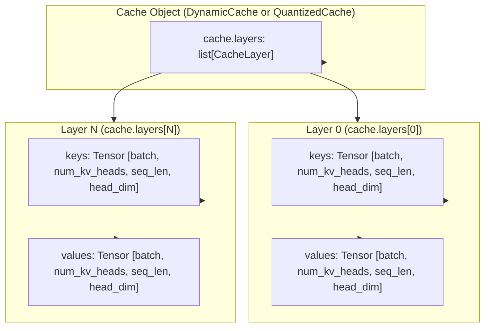
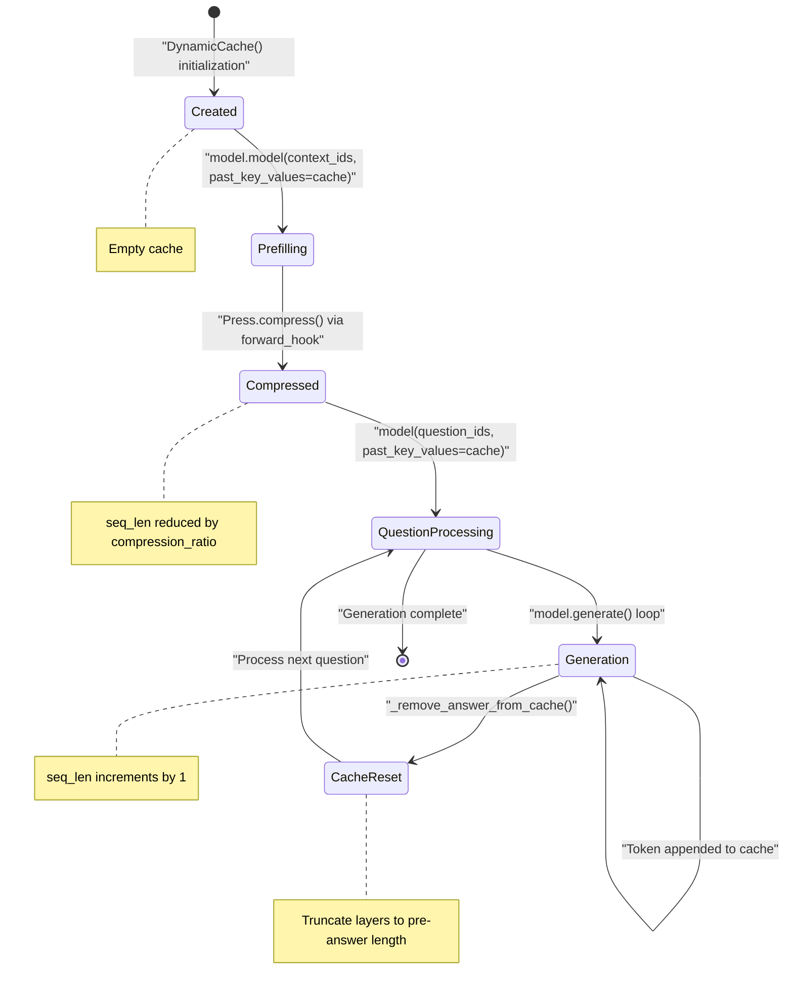
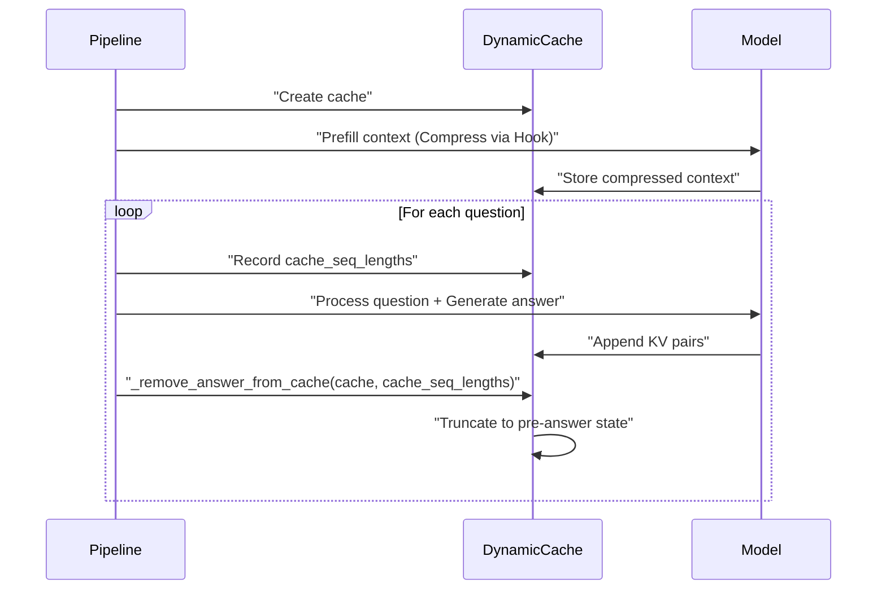
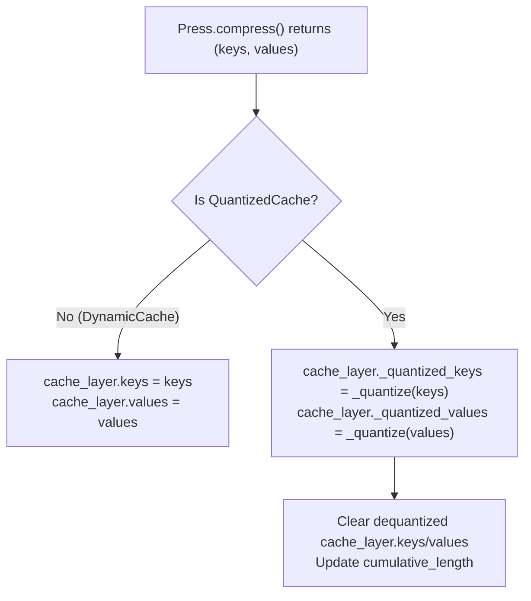

<!-- source: DeepWiki mcp.deepwiki.com · repo NVIDIA/kvpress · page 4.3 Cache Management · fetched 2026-10-26 -->

# Cache Management

<details>
<summary>Relevant source files</summary>

The following files were used as context for generating this wiki page:

- [README.md](README.md)
- [kvpress/presses/base_press.py](kvpress/presses/base_press.py)
- [kvpress/presses/decoding_press.py](kvpress/presses/decoding_press.py)
- [kvpress/presses/prefill_decoding_press.py](kvpress/presses/prefill_decoding_press.py)
- [notebooks/speed_and_memory.ipynb](notebooks/speed_and_memory.ipynb)
- [notebooks/wikipedia_demo.ipynb](notebooks/wikipedia_demo.ipynb)
- [tests/fixtures.py](tests/fixtures.py)
- [tests/integration/test_ruler.py](tests/integration/test_ruler.py)

</details>


This page documents KV cache management in kvpress, including cache types, cache lifecycle, and multi-turn question answering with cache reuse. For information about how presses modify cache contents during compression, see [2.2 Press Hierarchy and BasePress](). For pipeline-level cache usage patterns, see [4.1 KVPressTextGenerationPipeline]().

## Cache Types

KVPress supports two primary cache types from the HuggingFace Transformers library: `DynamicCache` and `QuantizedCache`. Both implement the `Cache` interface and store key-value pairs for each transformer layer.

### DynamicCache

`DynamicCache` stores uncompressed key and value tensors in full precision (typically float16 or bfloat16). This is the default cache type used when no cache is explicitly provided to the pipeline [kvpress/pipeline.py:210-211]().

### QuantizedCache

`QuantizedCache` applies quantization to key and value tensors to reduce memory usage. It stores quantized representations internally (`_quantized_keys` and `_quantized_values`) while maintaining dequantized working copies (`keys` and `values`) for computation.

When compression is applied to a `QuantizedCache`, both the quantized and dequantized representations must be updated to maintain consistency [kvpress/presses/base_press.py:152-157]().

```python
if isinstance(cache, QuantizedCache):
    cache_layer._quantized_keys = cache_layer._quantize(keys, axis=cache_layer.axis_key)
    cache_layer._quantized_values = cache_layer._quantize(values, axis=cache_layer.axis_value)
    cache_layer.keys = torch.zeros(0, dtype=keys.dtype, device=keys.device)
    cache_layer.values = torch.zeros(0, dtype=keys.dtype, device=keys.device)
    cache_layer.cumulative_length = keys.shape[2]
```

**Sources:** [kvpress/presses/base_press.py:152-157](), [kvpress/pipeline.py:254-261](), [kvpress/presses/decoding_press.py:154-159]()

## Cache Structure



**Cache Structure Overview**

The cache is organized as a list of per-layer cache objects. Each layer stores:
- **keys**: Key vectors with shape `[batch_size, num_key_value_heads, sequence_length, head_dim]`
- **values**: Value vectors with the same shape as keys

The sequence length dimension (`seq_len`) grows during generation and is pruned by presses during compression events [kvpress/presses/base_press.py:148-160]().

**Sources:** [kvpress/pipeline.py:248-262](), [kvpress/presses/base_press.py:148-160](), [kvpress/presses/decoding_press.py:142-162]()

## Cache Lifecycle



**Cache Lifecycle Through Generation Phases**

**Sources:** [kvpress/pipeline.py:209-246]()

### Cache Creation & Prefilling

The pipeline initializes the cache and populates it during the prefilling phase. If a press is active, it intercepts the forward pass via a hook to compress the context [kvpress/pipeline.py:210-223]().

```python
# Initialization
if cache is None:
    cache = DynamicCache()

# Prefilling and Compression
self.model.model(
    input_ids=context_ids,
    past_key_values=cache,
)
```

**Sources:** [kvpress/pipeline.py:210-223]()

### Multi-Turn Q&A with Cache Reuse

The `KVPressTextGenerationPipeline` supports multiple questions over the same compressed context. It manages the cache by recording sequence lengths before each generation and truncating after [kvpress/pipeline.py:231-246]().



**Multi-Turn Q&A Cache Flow**

**Sources:** [kvpress/pipeline.py:231-246]()

### Cache Truncation Logic

The pipeline uses `_remove_answer_from_cache` to ensure that answers from previous turns do not pollute the context for subsequent questions [kvpress/pipeline.py:248-261]().

```python
def _remove_answer_from_cache(self, cache: Cache, cache_seq_lengths: list[int]):
    for layer_idx, sequence_length in enumerate(cache_seq_lengths):
        cache.layers[layer_idx].keys = cache.layers[layer_idx].keys[:, :, :sequence_length]
        cache.layers[layer_idx].values = cache.layers[layer_idx].values[:, :, :sequence_length]
        
        if isinstance(cache, QuantizedCache):
            # Also truncate quantized buffers
            cache.layers[layer_idx]._quantized_keys = cache.layers[layer_idx]._quantized_keys[:, :, :sequence_length]
            cache.layers[layer_idx]._quantized_values = cache.layers[layer_idx]._quantized_values[:, :, :sequence_length]
```

**Sources:** [kvpress/pipeline.py:248-261]()

## Decoding Phase Cache Management

`DecodingPress` manages the cache during the autoregressive generation phase. Unlike prefill-only presses, it maintains an internal state to track when to apply compression [kvpress/presses/decoding_press.py:23-48]().

### Hidden State Buffer

`DecodingPress` accumulates hidden states in `self.hidden_states_buffer` (a `defaultdict(list)` indexed by `layer_idx`) to provide context for scoring during decoding [kvpress/presses/decoding_press.py:53-54]().

```python
# Accumulate hidden states
self.hidden_states_buffer[layer_idx].append(hidden_states.detach().clone())
self.layer_step_counts[layer_idx] += 1
```

**Sources:** [kvpress/presses/decoding_press.py:133-137]()

### Periodic Compression Trigger

Compression is triggered when the step count reaches `compression_interval` or the sequence length exceeds `target_size` [kvpress/presses/decoding_press.py:141-144]().

```python
if (self.layer_step_counts[layer_idx] >= self.compression_interval) or (q_len >= target_size):
    # Perform compression using base_press
    # ...
    # Reset state after compression
    self.layer_step_counts[layer_idx] = 0
    self.hidden_states_buffer[layer_idx] = []
```

**Sources:** [kvpress/presses/decoding_press.py:139-168]()

## Cache Update Mechanism during Compression

When `BasePress.compress` or `DecodingPress.compress` is called, the cache is updated in-place within the `forward_hook` [kvpress/presses/base_press.py:152-160]().



**Sources:** [kvpress/presses/base_press.py:152-162](), [kvpress/presses/decoding_press.py:152-162]()

### Implementation Detail: BlockPress Iterative Update

`BlockPress` performs iterative cache pruning. It segments the sequence into blocks and repeatedly calls `press.score` to select the best `n_kept` indices across the accumulated sequence [kvpress/presses/block_press.py:73-92]().

```python
for i in range(n_kept, k_len, block_size):
    # ... gather current_states ...
    scores = self.press.score(module, current_states, keys_subset, values_subset, ...)
    topk_indices = scores.topk(n_kept, dim=-1).indices
    kept_indices = current_indices.gather(-1, topk_indices)
```

**Sources:** [kvpress/presses/block_press.py:73-92]()

---

