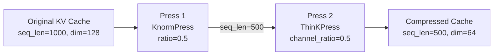
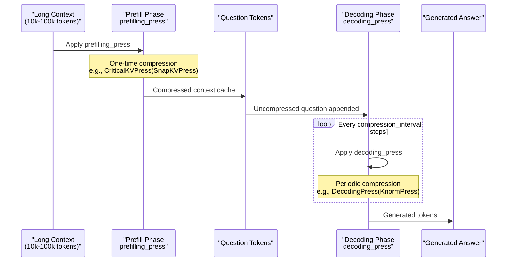
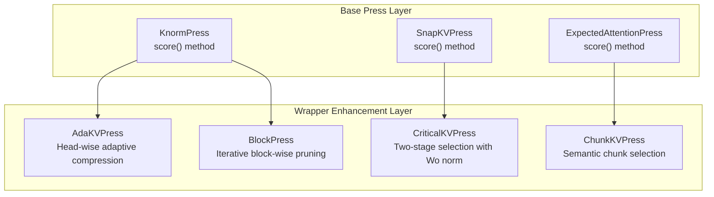

<!-- source: DeepWiki mcp.deepwiki.com · repo NVIDIA/kvpress · page 4.4 Combining Presses · fetched 2026-10-26 -->

# Combining Presses

<details>
<summary>Relevant source files</summary>

The following files were used as context for generating this wiki page:

- [evaluation/evaluate_registry.py](evaluation/evaluate_registry.py)
- [kvpress/presses/base_press.py](kvpress/presses/base_press.py)
- [kvpress/presses/composed_press.py](kvpress/presses/composed_press.py)
- [kvpress/presses/decoding_press.py](kvpress/presses/decoding_press.py)
- [kvpress/presses/observed_attention_press.py](kvpress/presses/observed_attention_press.py)
- [kvpress/presses/prefill_decoding_press.py](kvpress/presses/prefill_decoding_press.py)

</details>


This page explains how to combine multiple press implementations to achieve more sophisticated compression strategies. KVPress supports three primary composition patterns: **sequential chaining** via `ComposedPress`, **phase-specific strategies** via `PrefillDecodingPress`, and **wrapper-based enhancement** where decorator presses augment base press behavior.

For information about individual press implementations, see [Press Implementations](#3). For cache management and lifecycle details, see [Cache Management](#4.3).

---

## Sequential Composition with ComposedPress

`ComposedPress` applies multiple compression methods sequentially, where each press operates on the output of the previous one. This enables combining complementary approaches such as sequence-level pruning followed by dimension reduction.

### Basic Sequential Composition

**Diagram: Sequential Press Application Flow**


The `ComposedPress` class [kvpress/presses/composed_press.py:12-42]() chains presses by registering all their forward hooks in sequence. Each press receives the modified cache from the previous press.

**Sources:** [kvpress/presses/composed_press.py:12-42](), [kvpress/presses/composed_press.py:56-62]()

### Implementation Details

The `ComposedPress.forward_hook` method [kvpress/presses/composed_press.py:56-62]() iterates through all presses, applying each one's `forward_hook` in order:

```python
def forward_hook(self, module, input, kwargs, output):
    retained_fraction = 1.0
    for press in self.presses:
        output = press.forward_hook(module, input, kwargs, output)
        retained_fraction *= 1 - press.compression_ratio  # type: ignore
    self.compression_ratio = 1 - retained_fraction
    return output
```

The final compression ratio is computed as the product of retained fractions across all presses [kvpress/presses/composed_press.py:57-61]().

**Sources:** [kvpress/presses/composed_press.py:56-62]()

### Usage Example

```python
from kvpress import ComposedPress, SnapKVPress, ThinKPress

# Combine sequence compression with dimension compression
press = ComposedPress([
    SnapKVPress(compression_ratio=0.3),      # Keep 70% of tokens
    ThinKPress(key_channel_compression_ratio=0.2)  # Keep 80% of key dimensions
])
# Effective compression: (1-0.3) * (1-0.2) = 0.56 retained
```

**Sources:** [kvpress/presses/composed_press.py:22-26](), [evaluation/evaluate_registry.py:113]()

### Composition Constraints

**Diagram: ComposedPress Compatibility Matrix**
```mermaid
graph TB
    subgraph "Compatible Presses"
        ScorerGroup["ScorerPress Implementations<br/>KnormPress, SnapKVPress, etc."]
        AltGroup["Alternative Logic Presses<br/>ThinKPress, SimLayerKVPress"]
    end
    
    subgraph "Incompatible with ComposedPress"
        AdaKV["AdaKVPress<br/>Head-wise compression"]
        KVzip["KVzipPress<br/>Context reconstruction"]
    end
    
    ComposedPress["ComposedPress"] --> ScorerGroup
    ComposedPress --> AltGroup
    ComposedPress -.x|"Not Supported"| AdaKV
    ComposedPress -.x|"Not Supported"| KVzip
```

The `__post_init__` method [kvpress/presses/composed_press.py:46-50]() explicitly checks for incompatible presses like `AdaKVPress` and `KVzipPress`.

**Sources:** [kvpress/presses/composed_press.py:46-50]()

### Limitation: Attention-Dependent Presses

`ComposedPress` may fail when combining presses with different data dependencies [kvpress/presses/composed_press.py:30-34](). For example, combining `KnormPress` (which modifies keys/values) with `ObservedAttentionPress` (which requires original attention weights) will produce incorrect results because the second press receives modified cache but original attention weights.

**Sources:** [kvpress/presses/composed_press.py:30-34](), [kvpress/presses/observed_attention_press.py:14-49]()

---

## Phase-Specific Compression with PrefillDecodingPress

`PrefillDecodingPress` [kvpress/presses/prefill_decoding_press.py:20-37]() applies different compression strategies during the prefilling phase versus the decoding phase, allowing optimization for each phase's distinct characteristics.

### Prefill vs Decoding Compression

**Diagram: PrefillDecodingPress Execution Flow**


**Sources:** [kvpress/presses/prefill_decoding_press.py:57-60](), [kvpress/presses/prefill_decoding_press.py:75-78](), [kvpress/presses/decoding_press.py:113-155]()

### Implementation Details

`PrefillDecodingPress` determines the current phase by using the `is_prefilling` utility [kvpress/presses/base_press.py:37-40](), which compares `cache_position` with the query length (`q_len`). It delegates to the appropriate press accordingly [kvpress/presses/prefill_decoding_press.py:67-81]().

```python
def forward_hook(self, module: nn.Module, input: list[torch.Tensor], kwargs: dict, output: list):
    hidden_states = kwargs["hidden_states"]
    q_len = hidden_states.shape[1]

    # Determine if we're in prefilling or decoding phase
    if is_prefilling(kwargs["cache_position"], q_len) and self.prefilling_press is not None:
        return self.prefilling_press.forward_hook(module, input, kwargs, output)
    elif self.decoding_press is not None:
        return self.decoding_press.forward_hook(module, input, kwargs, output)
    return output
```

**Sources:** [kvpress/presses/prefill_decoding_press.py:67-81](), [kvpress/presses/base_press.py:37-40]()

### DecodingPress Parameters

The `DecodingPress` wrapper [kvpress/presses/decoding_press.py:23-49]() enables compression during token generation with configurable parameters. It maintains a running buffer of hidden states to provide context for scoring during the decoding phase [kvpress/presses/decoding_press.py:53]().

| Parameter | Type | Description |
|-----------|------|-------------|
| `base_press` | `ScorerPress \| AdaKVPress` | The underlying press used for scoring tokens |
| `compression_interval` | `int` | Number of decoding steps between compression applications (default: 512) |
| `target_size` | `int` | Target number of tokens to keep after compression (default: 2048) |
| `hidden_states_buffer_size` | `int` | Max hidden states to buffer for scoring context (default: 256) |

**Sources:** [kvpress/presses/decoding_press.py:23-49]()

---

## Wrapper Press Patterns

Wrapper presses enhance base presses with orthogonal functionality while preserving the core compression logic. These follow the decorator pattern.

### Wrapper Press Architecture

**Diagram: Wrapper Press Composition Patterns**


**Sources:** [evaluation/evaluate_registry.py:81-136]()

### AdaKVPress: Head-Wise Compression

`AdaKVPress` wraps any `ScorerPress` to enable head-wise adaptive compression ratios. It is frequently used in the evaluation registry to wrap other presses like `SnapKVPress` or `ExpectedAttentionPress` [evaluation/evaluate_registry.py:81-92]().

**Sources:** [evaluation/evaluate_registry.py:81-92](), [kvpress/presses/decoding_press.py:14]()

### CriticalKVPress: Two-Stage Selection

`CriticalKVPress` enhances existing scoring methods by rescaling scores using importance metrics derived from the model weights. In the registry, it is often combined with `ExpectedAttentionPress` or `SnapKVPress` [evaluation/evaluate_registry.py:84-87]().

**Sources:** [evaluation/evaluate_registry.py:84-87]()

### BlockPress: Iterative Pruning

`BlockPress` simulates block prompt processing by segmenting the input into non-overlapping blocks and compressing iteratively. A common configuration is `BlockPress(press=KeyDiffPress(), block_size=128)` [evaluation/evaluate_registry.py:82]().

**Sources:** [evaluation/evaluate_registry.py:82]()

### ChunkKVPress: Semantic Coherence

`ChunkKVPress` enhances a `ScorerPress` by applying chunk-wise token selection to preserve semantic coherence. For example, it can be used with `SnapKVPress` using a `chunk_length=20` [evaluation/evaluate_registry.py:83]().

**Sources:** [evaluation/evaluate_registry.py:83]()

---

## Best Practices and Recommendations

### Choosing Composition Strategies

| Scenario | Recommended Approach | Example |
|----------|---------------------|---------|
| Combine sequence + dimension compression | `ComposedPress` | `ComposedPress([SnapKVPress(), ThinKPress()])` |
| Different prefill vs decoding needs | `PrefillDecodingPress` | `PrefillDecodingPress(prefilling_press=SnapKVPress(), decoding_press=DecodingPress(KnormPress()))` |
| Head-wise adaptive compression | `AdaKVPress` wrapper | `AdaKVPress(SnapKVPress())` |
| Refine selection with output weights | `CriticalKVPress` wrapper | `CriticalKVPress(ExpectedAttentionPress())` |
| Semantic chunk preservation | `ChunkKVPress` wrapper | `ChunkKVPress(SnapKVPress(), chunk_length=20)` |

**Sources:** [evaluation/evaluate_registry.py:81-136](), [kvpress/presses/composed_press.py:22-26]()

### Avoiding Common Pitfalls

1. **Incompatible Types**: `ComposedPress` cannot contain `AdaKVPress` or `KVzipPress` [kvpress/presses/composed_press.py:48-50]().
2. **Phase Detection**: `PrefillDecodingPress` and `DecodingPress` rely on `is_prefilling` to detect the generation phase [kvpress/presses/prefill_decoding_press.py:57-60](). Ensure the model implementation provides `cache_position` correctly.
3. **Registry Usage**: When defining new combinations for evaluation, use the `PRESS_REGISTRY` in `evaluation/evaluate_registry.py` to ensure consistency across benchmarks [evaluation/evaluate_registry.py:80-137]().

**Sources:** [kvpress/presses/composed_press.py:48-50](), [kvpress/presses/base_press.py:37-40](), [evaluation/evaluate_registry.py:80-137]()

---

